# Day 68 – Introduction to Ansible (Inventory, Ad-Hoc Commands, Groups and Patterns)

> A beginner-friendly guide. You do **not** need to know Ansible before reading this. Follow the tasks in order, and take a screenshot after each task so you have proof of your output.

---

## Table of Contents

1. [What is Ansible? (Simple Idea)](#what-is-ansible-simple-idea)
2. [How the Setup Looks](#how-the-setup-looks)
3. [Important Words You Must Know](#important-words-you-must-know)
4. [Task 1: Launch 3 EC2 Servers](#task-1-launch-3-ec2-servers-managed-nodes)
5. [Task 2: SSH Into Each Server](#task-2-ssh-into-each-server)
6. [Task 3: Install Ansible on the Control Node](#task-3-install-ansible-on-the-control-node)
7. [Task 4: Create the Inventory File](#task-4-create-the-inventory-file)
8. [Task 5: Ad-Hoc Commands](#task-5-ad-hoc-commands)
9. [Task 6: Groups, Group of Groups, Patterns and ansible.cfg](#task-6-groups-group-of-groups-patterns-and-ansiblecfg)
10. [Common Errors and Fixes](#common-errors-and-fixes)
11. [Cleanup (Avoid AWS Bill)](#cleanup-avoid-aws-bill)
12. [Cheat Sheet](#cheat-sheet)

---

## What is Ansible? (Simple Idea)

- Ansible is a tool that lets you **control many servers from one place**.
- Imagine you have 50 servers and you want to install `git` on all of them.
  - Without Ansible: you log in to each server one by one and run the command 50 times.
  - With Ansible: you write **one command** on one machine, and Ansible does it on all 50 servers.
- Ansible is **agentless**.
  - This means you do **not** install anything special on the servers you manage.
  - Ansible simply connects over **SSH** (the same way you log in to a Linux server) and runs the work.
- Ansible is written in simple text files (YAML and INI), so it is easy to read.

**Real life example**

- Think of a teacher (Ansible) giving the same instruction to a whole class (many servers) at once, instead of telling each student separately.

---

## How the Setup Looks

```
                +----------------------+
                |    Control Node      |   <- Ansible is installed here
                |  (you work here)     |
                +----------+-----------+
                           |
                    SSH (port 22)
        +------------------+------------------+
        |                  |                  |
+-------v------+   +-------v------+   +-------v------+
| web-server   |   | app-server   |   | db-server    |
| (node1-web)  |   | (node2-app)  |   | (node3-db)   |
+--------------+   +--------------+   +--------------+
      Managed Nodes (the servers Ansible controls)
```

- **Control node**: the machine where Ansible is installed. You type all commands here.
- **Managed nodes**: the 3 servers that Ansible controls (web, app, db). Nothing is installed on them for Ansible.

---

## Important Words You Must Know

| Word | Simple meaning |
|------|----------------|
| **Control node** | The machine where you install Ansible and run commands |
| **Managed node** | A server that Ansible controls (also called a host) |
| **Inventory** | A file that lists your servers (like a contact list) |
| **Group** | A name for a set of servers, like `web` or `db` |
| **Module** | A ready-made tool in Ansible, like `ping`, `apt`, `copy`, `command` |
| **Ad-hoc command** | A one-line Ansible command for a quick job |
| **Pattern** | A rule to pick which servers to run on, like `web:app` or `all:!db` |
| **ansible.cfg** | A settings file for Ansible |
| **become** | Run the command as admin (sudo) |

---

## Task 1: Launch 3 EC2 Servers (Managed Nodes)

### What

- Create 3 Ubuntu EC2 instances on AWS. These are the servers Ansible will manage.
- Names:
  - `node1-web`
  - `node2-app`
  - `node3-db`

### Why

- Ansible needs real servers to work on. These 3 servers pretend to be a small real application setup: one for the website, one for the app, and one for the database.

### How (Step by Step)

1. Open the AWS Console and go to **EC2** > **Launch instance**.
2. Fill the form:
   - **Name**: `node1-web` (repeat later for `node2-app` and `node3-db`)
   - **AMI**: Ubuntu (latest LTS)
   - **Instance type**: a Free Tier eligible type (for example `t3.micro` or `t2.micro`)
   - **Key pair**: choose your existing key pair (`.pem` file). **Use the same key for all 3 servers.** This makes Ansible setup easy.
   - **Security group**: allow **SSH (port 22)**.
   - **Number of instances**: you can launch 3 at once, then rename them.
3. Click **Launch instance**.
4. Wait until all 3 show **Running** with **2/2 checks passed**.
5. Note down the **Public IP** (or private IP) of each server. You need them in Task 4.

### Output (Screenshots)

Launch form:

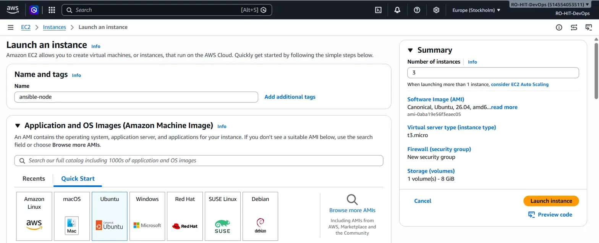

All instances running:

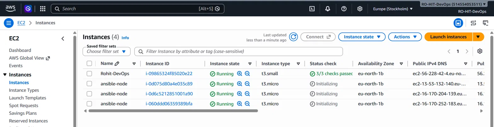

---

## Task 2: SSH Into Each Server

### What

- Log in to each of the 3 servers using SSH, just to check that you can reach them.

### Why

- Ansible uses SSH to talk to servers. If SSH does not work manually, Ansible will not work either.
- This is the **first thing to test** when something fails.

### How (Step by Step)

1. Keep your `.pem` key file safe. Fix its permission (SSH refuses keys that are too open):

```bash
chmod 400 your-key.pem
```

- `chmod 400` means: only I can read this file, nobody else can touch it.

2. SSH into each server:

```bash
ssh -i your-key.pem ubuntu@<NODE_IP>
```

- `-i your-key.pem`: use this key file to log in.
- `ubuntu`: the default username on Ubuntu servers.
- `<NODE_IP>`: the IP address of that server.

3. When it asks `Are you sure you want to continue connecting (yes/no)?`, type `yes`.
4. You should see a prompt like `ubuntu@ip-172-31-xx-xx:~$`. That means you are inside the server.
5. Type `exit` to come back. Repeat for all 3 servers.

### Output (Screenshots)

node1-web:

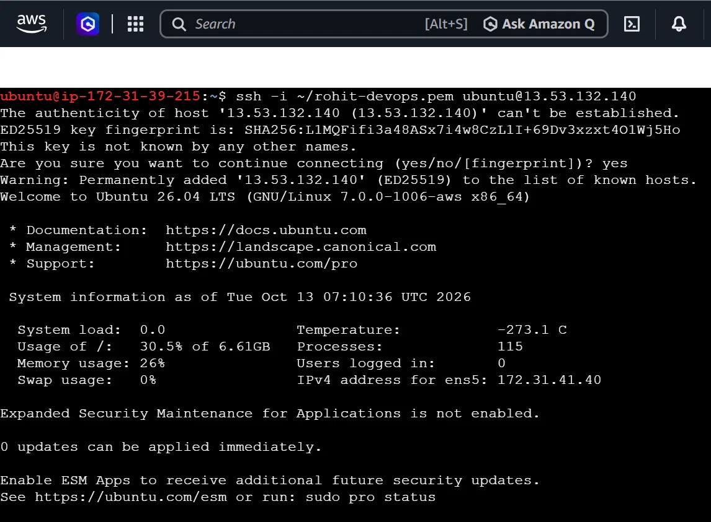

node2-app:

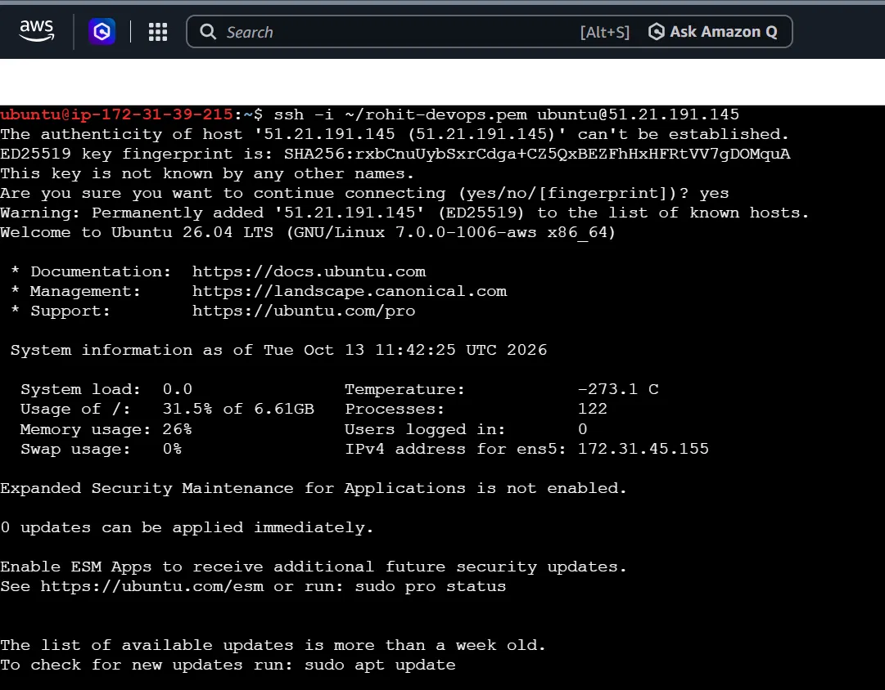

node3-db:

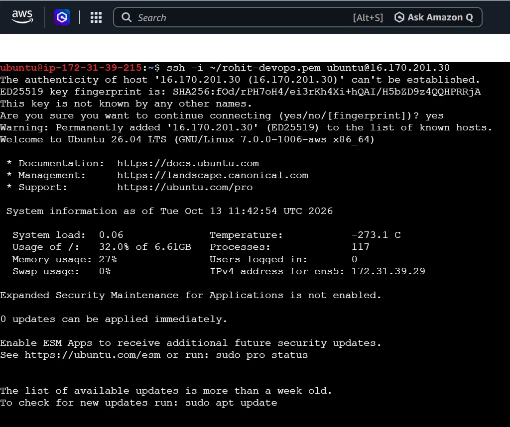

---

## Task 3: Install Ansible on the Control Node

### What

- Pick **one** machine as the control node and install Ansible on it.
- You install Ansible **only here**, not on the 3 managed nodes.

### Why

- The control node is your "remote control". All commands are typed here.

### How (Step by Step)

1. Log in to the control node.
2. Update the package list (this refreshes the list of available software):

```bash
sudo apt update
```

3. Install Ansible:

```bash
sudo apt install ansible -y
```

- `sudo`: run as admin.
- `-y`: automatically say "yes" to questions.

4. Check the install:

```bash
ansible --version
```

- You should see the Ansible version, the config file path, and the Python version.

### Output (Screenshots)

Update and install start:

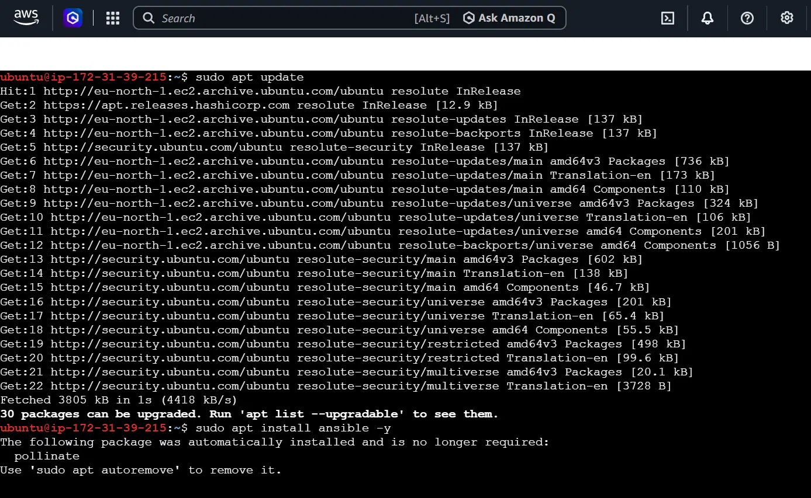

Install progress:

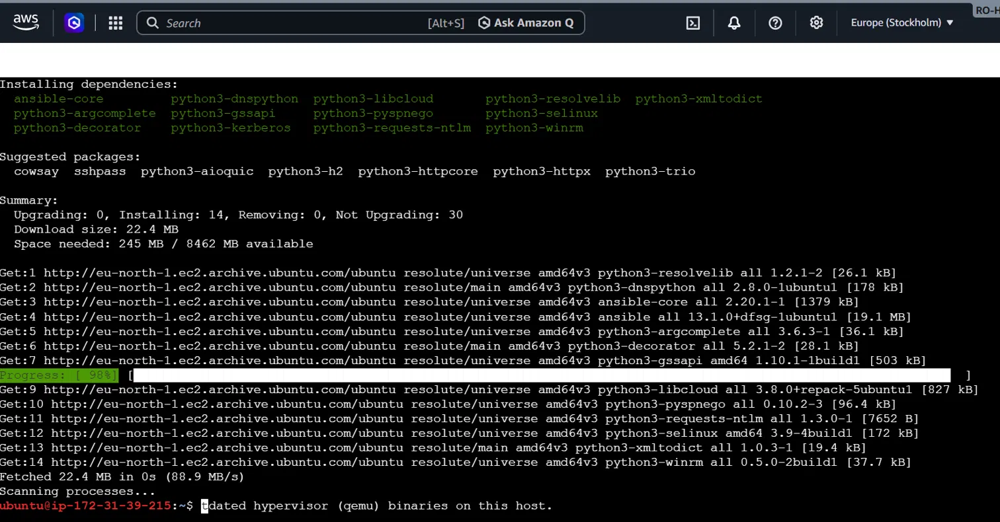

Version check:

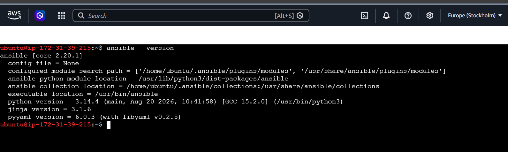

---

## Task 4: Create the Inventory File

### What

- An **inventory** is a text file that tells Ansible: "These are my servers, and this is how to connect to them."

### Why

- Ansible does not know your servers automatically. The inventory is its address book.

### How (Step by Step)

1. Make a practice folder and go inside:

```bash
mkdir ~/ansible-practice
cd ~/ansible-practice
```

2. Copy your `.pem` key to the control node (for example into `~/ansible-practice/` or `~/.ssh/`) and fix its permission:

```bash
chmod 400 ~/ansible-practice/your-key.pem
```

3. Create the inventory file:

```bash
nano inventory.ini
```

4. Paste this (replace the IPs and key path with your own):

```ini
[web]
web-server ansible_host=<WEB_IP> ansible_user=ubuntu ansible_ssh_private_key_file=~/ansible-practice/your-key.pem

[app]
app-server ansible_host=<APP_IP> ansible_user=ubuntu ansible_ssh_private_key_file=~/ansible-practice/your-key.pem

[db]
db-server ansible_host=<DB_IP> ansible_user=ubuntu ansible_ssh_private_key_file=~/ansible-practice/your-key.pem
```

5. Save in nano: `Ctrl+O`, `Enter`, then `Ctrl+X`.
6. Check the file:

```bash
cat inventory.ini
```

7. Test the connection with the `ping` module:

```bash
ansible all -i inventory.ini -m ping
```

### Line by line meaning

- `[web]`: the name of a group. Servers listed below it belong to the `web` group.
- `web-server`: a nickname for the server (you choose it).
- `ansible_host`: the real IP address to connect to.
- `ansible_user`: the username to log in with (`ubuntu`).
- `ansible_ssh_private_key_file`: the key file used to log in.
- `all`: a built-in name that means every server in the inventory.
- `-i inventory.ini`: use this inventory file.
- `-m ping`: use the `ping` module.

### What is the "ping" module?

- It is **not** a normal network ping.
- It checks: "Can I log in over SSH, and does Python work on the server?"
- Success looks like `"ping": "pong"`.

### Expected output

```
web-server | SUCCESS => {
    "changed": false,
    "ping": "pong"
}
```

### Output (Screenshots)

Inventory file:

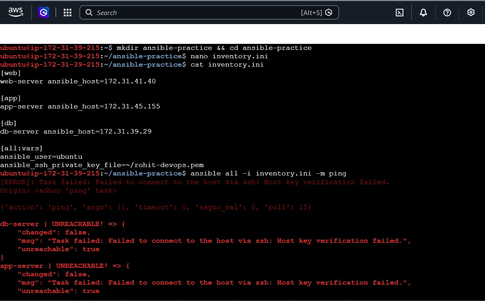

Ping all servers:

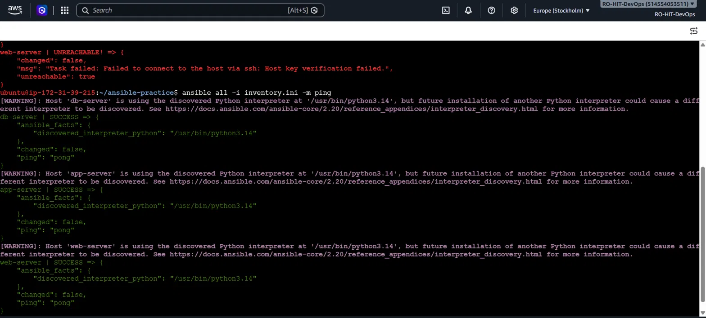

---

## Task 5: Ad-Hoc Commands

### What

- An **ad-hoc command** is a quick one-line command to do a small job on many servers at once.

### Why

- Great for quick checks (disk, memory, uptime) and small fixes, without writing a full playbook.

### General format

```bash
ansible <which servers> -i inventory.ini -m <module> -a "<arguments>"
```

- `<which servers>`: a server name, a group name, or `all`.
- `-m`: the module to use.
- `-a`: the arguments (extra information) for that module.
- `--become`: add this when the job needs admin (sudo) rights.

### 5.1 Check uptime on all servers

```bash
ansible all -i inventory.ini -m command -a "uptime"
```

- `command` module runs a normal Linux command on the servers.
- `uptime` shows how long the server has been running.

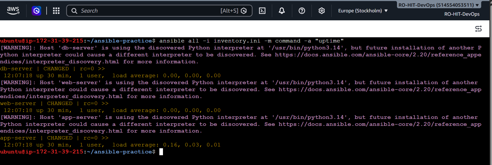

### 5.2 Check memory only on the web server

```bash
ansible web -i inventory.ini -m command -a "free -h"
```

- `web` means only the servers in the `web` group.
- `free -h` shows memory in a human readable form (MB/GB).

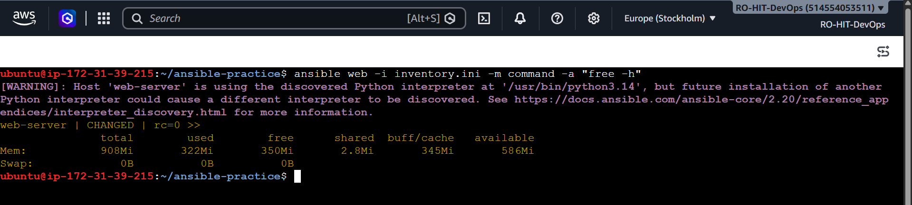

### 5.3 Check disk space on all servers

```bash
ansible all -i inventory.ini -m command -a "df -h"
```

- `df -h` shows disk usage in a readable form.

Screenshots (output was long, so it is split in parts):

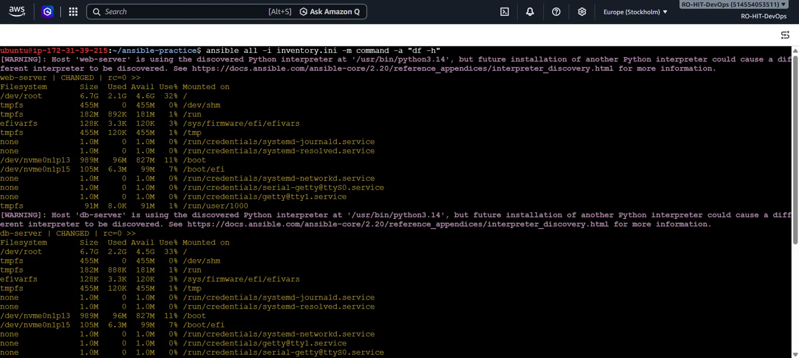

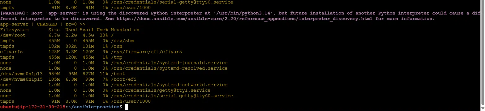

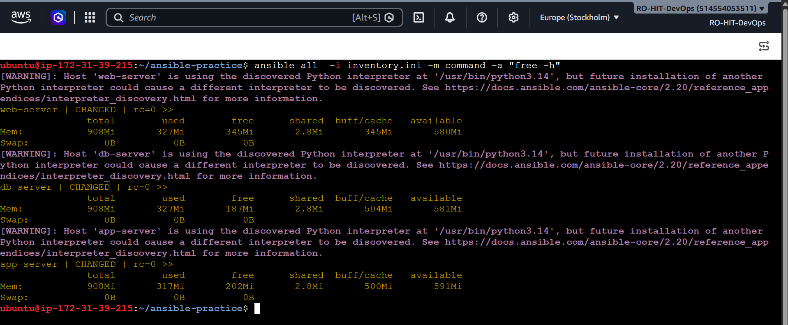

### 5.4 Install git on all servers

```bash
ansible all -i inventory.ini -m apt -a "name=git state=present update_cache=yes" --become
```

- `apt` module installs software on Ubuntu.
- `name=git`: which package.
- `state=present`: make sure it **is installed**. If it is already there, Ansible does nothing.
- `update_cache=yes`: refresh the package list first.
- `--become`: installing software needs sudo.

**Idempotent (important word)**

- Run it a second time and Ansible says `"changed": false`.
- Idempotent means: running the same task many times gives the same result and does not break anything.

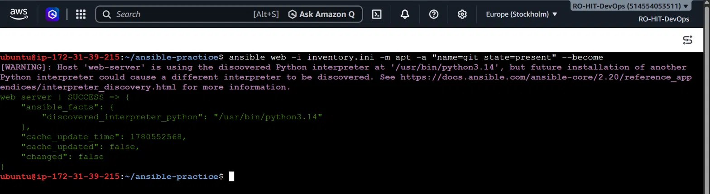

### 5.5 Copy a file to all servers

First make a small file on the control node:

```bash
echo "Hello from Ansible" > hello.txt
```

Now copy it to every server:

```bash
ansible all -i inventory.ini -m copy -a "src=hello.txt dest=/tmp/hello.txt"
```

- `copy` module sends a file from the control node to the servers.
- `src`: the file on the control node.
- `dest`: where to place it on each server.

Output was split in two screenshots:

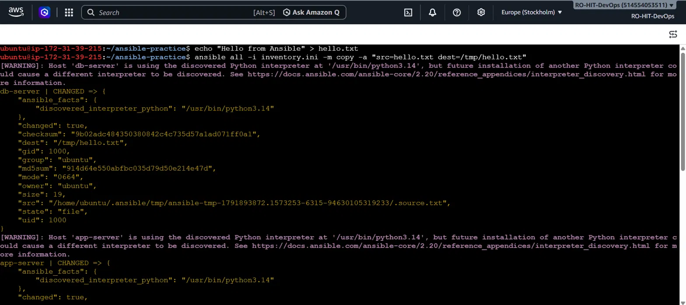

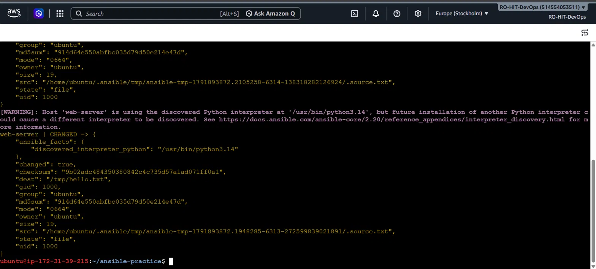

### 5.6 Verify the copied file

```bash
ansible all -i inventory.ini -m command -a "cat /tmp/hello.txt"
```

- You should see `Hello from Ansible` printed for every server. This proves the copy worked.

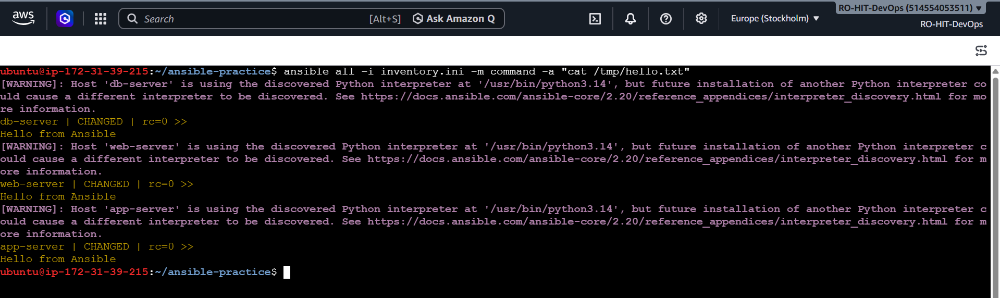

---

## Task 6: Groups, Group of Groups, Patterns and ansible.cfg

### Step 1: Group of groups

#### What

- You already have 3 groups: `web`, `app`, `db`.
- A **group of groups** combines groups into a bigger group.

#### Why

- Sometimes you want to work on "web and app together" again and again. Instead of typing both names every time, you make one new group name.

#### How

1. Open the inventory file:

```bash
nano inventory.ini
```

2. Go to the **end of the file**, leave one blank line, and add:

```ini
[application:children]
web
app

[all_servers:children]
application
db
```

3. Save: `Ctrl+O`, `Enter`, `Ctrl+X`.
4. Check:

```bash
cat inventory.ini
```

#### Line by line meaning

- `[application:children]`: create a group called `application`. Its members are **other groups**, not servers.
- `web` and `app`: these two groups are inside `application`.
- `[all_servers:children]`: create a group called `all_servers`.
- `application` and `db`: these are inside `all_servers`.

#### Why `:children` is needed

- Without `:children`, Ansible thinks `web` and `app` are **server names** and gives an error.
- `:children` tells Ansible: "these are groups."

#### Simple school example

- `web` = Class A, `app` = Class B, `db` = Class C.
- `application` = Class A + Class B = "Std 10 Science".
- `all_servers` = Std 10 Science + Class C = "whole school".

#### Tree

```
all_servers
├── application
│   ├── web  (web-server)
│   └── app  (app-server)
└── db       (db-server)
```

#### Output (Screenshot)

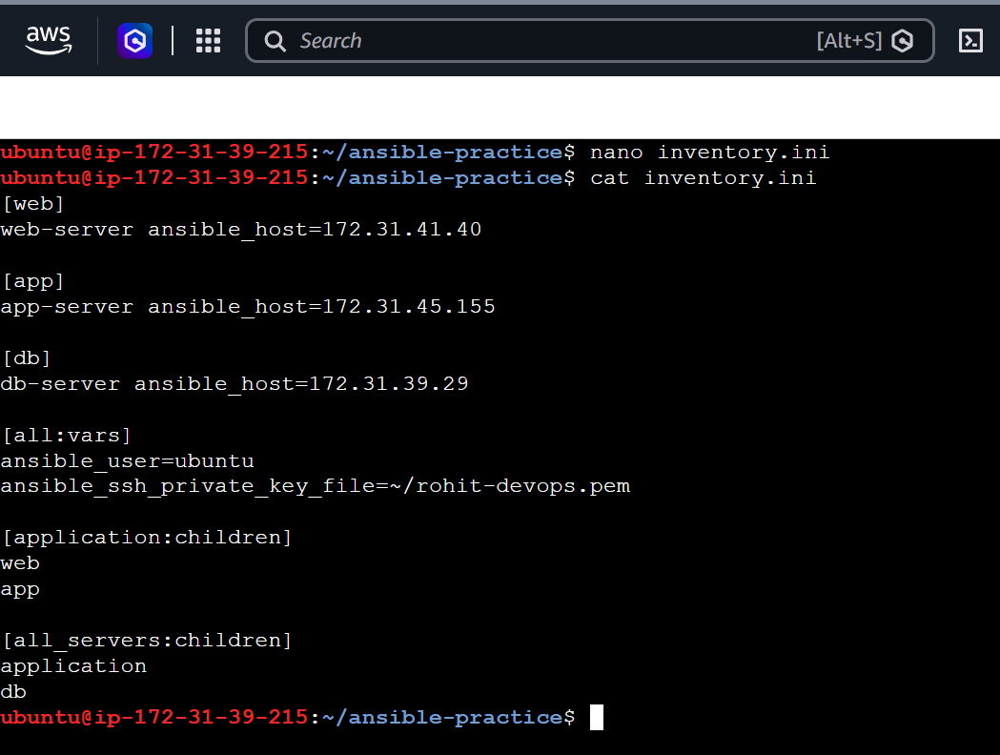

---

### Step 2: Ping the groups

#### What

- Test that the new groups pick the correct servers.

#### How

```bash
ansible application -i inventory.ini -m ping
ansible db -i inventory.ini -m ping
ansible all_servers -i inventory.ini -m ping
```

#### Expected result

| Command | Runs on | Why |
|---------|---------|-----|
| `application` | web-server, app-server | application = web + app |
| `db` | db-server | db has only one server |
| `all_servers` | all 3 servers | all_servers = application + db |

#### Output (Screenshots)

application and db:

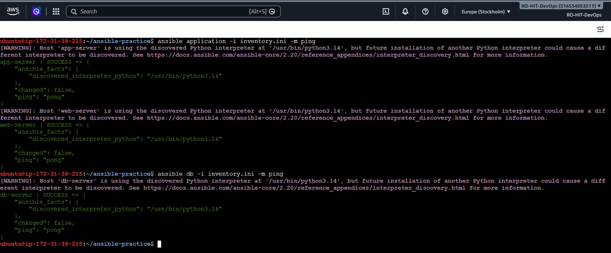

all_servers:

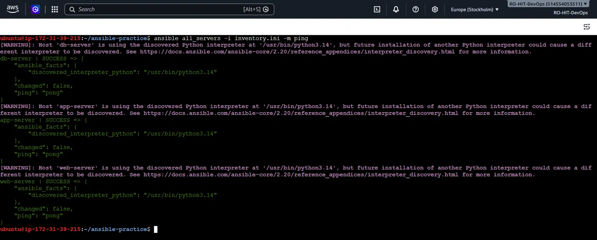

---

### Step 3: Patterns

#### What

- A **pattern** is a small rule that picks servers. You use it in place of the group name.

#### Why

- It gives you flexible control. You can say "all servers except the database" in one short expression.

#### How

OR pattern (web **or** app):

```bash
ansible 'web:app' -i inventory.ini -m ping
```

- `:` means **OR**. Runs on web-server and app-server.

NOT pattern (everyone except db):

```bash
ansible 'all:!db' -i inventory.ini -m ping
```

- `!` means **NOT / except**. Runs on all servers but removes `db`.
- Always keep the pattern inside **single quotes** `' '`. Otherwise the shell treats `!` in a special way and the command can fail.

#### Expected result

- Both commands: SUCCESS on **web-server** and **app-server** only. Not on db-server.

#### About the pink [WARNING]

- It says Ansible found Python 3.14 on the server.
- It is only a notice, **not an error**. The ping is still SUCCESS. We remove it in the next step.

#### Output (Screenshot)

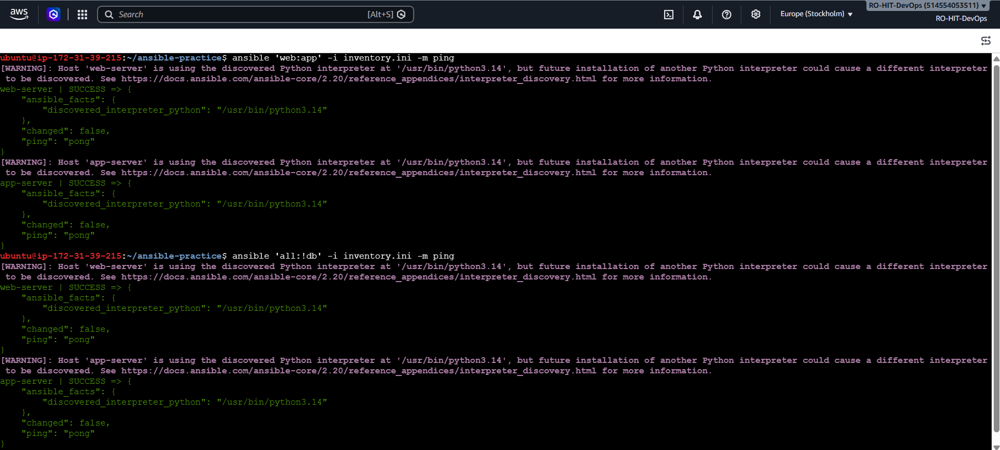

---

### Step 4: Create ansible.cfg

#### What

- `ansible.cfg` is Ansible's **settings file**.

#### Why

- Until now we typed `-i inventory.ini` in every command. With this file we say it once and never type it again.
- It also hides the pink Python warning.

#### How

1. In the `~/ansible-practice` folder:

```bash
nano ansible.cfg
```

2. Put exactly this (only **one** `[defaults]` section):

```ini
[defaults]
host_key_checking = False
inventory = inventory.ini
interpreter_python = auto_silent
```

3. Save: `Ctrl+O`, `Enter`, `Ctrl+X`.
4. Check:

```bash
cat ansible.cfg
```

#### Line by line meaning

- `[defaults]`: the main settings section.
- `host_key_checking = False`: do not ask "yes/no" when connecting to a new server for the first time.
- `inventory = inventory.ini`: always use this inventory file. No need for `-i`.
- `interpreter_python = auto_silent`: find Python automatically and do not show the warning.

#### Common mistake

- Do **not** write `[defaults]` twice in the same file. If you already had it, just add the new lines under the existing one.

#### Test (no `-i` needed now)

```bash
ansible all_servers -m ping
```

- All 3 servers show SUCCESS and there is no pink warning.

#### Important note

- Ansible reads `ansible.cfg` from the **current folder**. Always run your commands from `~/ansible-practice`.

#### Output (Screenshot)

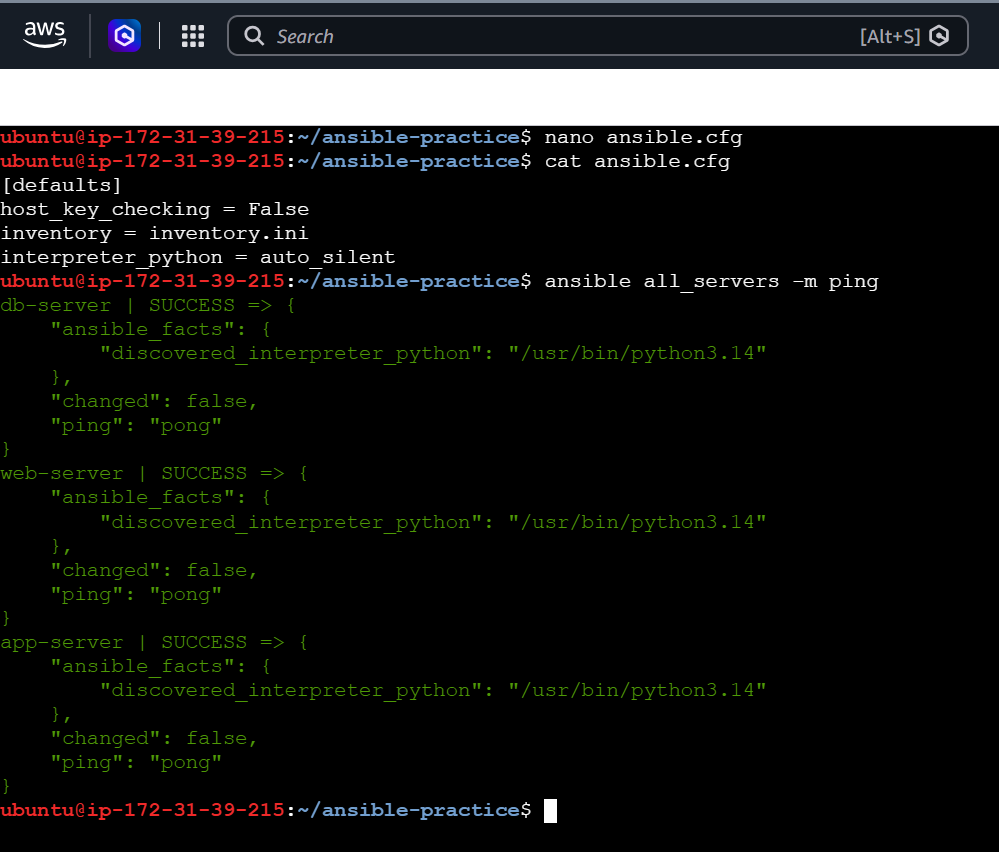

---

## Common Errors and Fixes

| Error | Meaning | Fix |
|-------|---------|-----|
| `Permission denied (publickey)` | Wrong key, wrong user, or key permission too open | Check the key path, user `ubuntu`, and run `chmod 400 key.pem` |
| `UNREACHABLE` / connection timed out | Server not reachable | Check the IP, that the server is running, and that port 22 is open in the security group |
| `Could not match supplied host pattern` | Group or server name not found | Check spelling in `inventory.ini` and that you are in the right folder |
| `Unable to parse inventory` | Mistake in the inventory file | Check `:children` and spelling; run `cat inventory.ini` |
| `No hosts matched` / `provided hosts list is empty` | Ansible cannot see the inventory | Run `pwd` and `ls`; `ansible.cfg` and `inventory.ini` must be in the current folder |
| `section 'defaults' already exists` | `[defaults]` written twice | Keep only one `[defaults]` section |
| `Missing sudo password` / permission error on `apt` | Admin rights needed | Add `--become` to the command |

---

## Cleanup (Avoid AWS Bill)

- EC2 instances keep costing money while they run.
- When you finish practicing, **terminate** all instances:
  - AWS Console > EC2 > Instances > select all > **Instance state** > **Terminate instance**.
- Also delete anything extra you created, like unused security groups or key pairs, if you do not need them.

---

## Cheat Sheet

| What you want | Command |
|---------------|---------|
| Check Ansible version | `ansible --version` |
| Ping all servers | `ansible all -m ping` |
| Run a Linux command | `ansible all -m command -a "uptime"` |
| Install a package | `ansible all -m apt -a "name=git state=present" --become` |
| Copy a file | `ansible all -m copy -a "src=hello.txt dest=/tmp/hello.txt"` |
| Only one group | `ansible web -m ping` |
| Two groups (OR) | `ansible 'web:app' -m ping` |
| Everyone except one group (NOT) | `ansible 'all:!db' -m ping` |
| Use a different inventory | `ansible all -i other.ini -m ping` |

---

## What I Learned

- Ansible controls many servers from one machine, using only SSH.
- The **inventory** lists servers and groups. `:children` makes a **group of groups**.
- **Ad-hoc commands** are quick one-liners (`-m module -a "arguments"`).
- **Patterns** like `web:app` and `all:!db` choose exactly which servers to run on.
- **ansible.cfg** saves typing and removes warnings.
- Ansible tasks are **idempotent**: running them again is safe.
