# Day 70: Variables, Facts, Conditionals and Loops (Ansible)

> **Goal of today:** Make our Ansible playbooks *smart*. Until now a playbook did the same thing on every server. Today we learn how to make it adapt to each server, each group and each environment.

This guide is written for **complete beginners**. You do not need any knowledge of Day 70. If you can open a terminal and have Ansible set up, you can follow every step. For each task you will see:

- **What** it is
- **Why** we need it
- **How** to do it (full code, line by line)
- **Output** (screenshot) so you can compare with your own result

---

## Table of Contents

1. [Before You Start](#before-you-start)
2. [Task 1: Variables in Playbooks](#task-1-variables-in-playbooks)
3. [Task 2: group_vars and host_vars](#task-2-group_vars-and-host_vars)
4. [Task 3: Ansible Facts](#task-3-ansible-facts)
5. [Task 4: Conditionals with `when`](#task-4-conditionals-with-when)
6. [Task 5: Loops](#task-5-loops)
7. [Task 6: Register, Debug and Combine Everything](#task-6-register-debug-and-combine-everything)
8. [Quick Cheat Sheet](#quick-cheat-sheet)
9. [Common Errors and Fixes](#common-errors-and-fixes)
10. [Key Takeaways](#key-takeaways)

---

## Before You Start

### What you need

- A **control node**: the machine where Ansible is installed and where you run commands.
- **Managed nodes**: the servers Ansible controls. In this guide we use 3 servers: `web-server`, `app-server` and `db-server`.
- Ansible can already connect to all 3 servers (test with `ansible all -m ping`).

### Our inventory file (`inventory.ini`)

An **inventory** is a list of your servers. Servers are put into **groups** using `[group-name]`.

```ini
[web]
web-server ansible_host=127.0.0.1 ansible_connection=local

[app]
app-server ansible_host=<APP_SERVER_PRIVATE_IP>

[db]
db-server ansible_host=<DB_SERVER_PRIVATE_IP>

[all:vars]
ansible_user=ubuntu
ansible_ssh_private_key_file=~/<your-key>.pem

[application:children]
web
app

[all_servers:children]
application
db
```

Replace the `<...>` values with your own. Group names (`web`, `app`, `db`) matter a lot today.

### Our `ansible.cfg` (optional but handy)

```ini
[defaults]
inventory = inventory.ini
host_key_checking = False
```

This tells Ansible to use `inventory.ini` automatically, so you do not need `-i inventory.ini` every time.

### Important: Ubuntu vs Amazon Linux

The original task uses the `yum` module. `yum` works only on Red Hat family systems (Amazon Linux, CentOS, RHEL).

Our servers run **Ubuntu**, which uses **`apt`**. So in this guide:

| Original task | What we use | Why |
|---|---|---|
| `yum:` | `apt:` | Ubuntu uses `apt` |
| group `wheel` | group `sudo` | Ubuntu has no `wheel` group. Its admin group is `sudo` |

If your servers are Amazon Linux, use the original `yum` and `wheel` instead.

### Project folder

All work is done inside one folder:

```bash
mkdir -p ~/ansible-practice
cd ~/ansible-practice
```

### How to create files in this guide

We use the `nano` editor:

```bash
nano filename.yml
```

Paste the code, then **save**: `Ctrl+O`, press `Enter`, then **exit**: `Ctrl+X`.

### Two golden rules of YAML

1. Use **2 spaces** for indentation. **Never use the Tab key.**
2. Spacing matters. Items on the same level must line up exactly.

---

## Task 1: Variables in Playbooks

### What is a variable?

A **variable** is a **named box** that stores a value. You put a value in the box once, then use the box's name anywhere in your playbook.

```yaml
app_name: terraweek-app
```

Here `app_name` is the box name and `terraweek-app` is the value inside.

### Why do we need variables?

Imagine the name `terraweek-app` appears in 20 places. If it changes, you must edit 20 places. With a variable you change it in **one place** and everything updates.

Variables also let one playbook behave differently for different environments (for example port 8080 in dev, port 80 in production).

### How do we use a variable?

Use double curly braces `{{ }}`:

```yaml
msg: "Deploying {{ app_name }} on port {{ app_port }}"
```

Ansible replaces `{{ app_name }}` with `terraweek-app` when it runs.

> **Rule:** If a value *starts* with `{{`, put the whole value in quotes. Example: `app_dir: "/opt/{{ app_name }}"`.

### Step 1: Create `variables-demo.yml`

```bash
nano variables-demo.yml
```

```yaml
---
- name: Variable demo
  hosts: all
  become: true

  vars:
    app_name: terraweek-app
    app_port: 8080
    app_dir: "/opt/{{ app_name }}"
    packages:
      - git
      - curl
      - wget

  tasks:
    - name: Print app details
      debug:
        msg: "Deploying {{ app_name }} on port {{ app_port }} to {{ app_dir }}"

    - name: Create application directory
      file:
        path: "{{ app_dir }}"
        state: directory
        mode: '0755'

    - name: Install required packages
      apt:
        name: "{{ packages }}"
        state: present
        update_cache: true
```

### Line by line explanation

| Line | Meaning |
|---|---|
| `---` | Start of a YAML file |
| `- name: Variable demo` | Name of the playbook (just a label) |
| `hosts: all` | Run on **every** server in the inventory |
| `become: true` | Use `sudo` (root power). Needed to install packages and create folders in `/opt` |
| `vars:` | The section where we define variables |
| `app_name`, `app_port` | Simple variables (one value each) |
| `app_dir: "/opt/{{ app_name }}"` | A variable built **from another variable**. Becomes `/opt/terraweek-app` |
| `packages:` | A **list** variable (many values) |
| `tasks:` | The list of jobs to do |
| `debug: msg:` | Prints a message on screen. Great for checking variables |
| `file:` module | Creates a directory (`state: directory`) with permission `0755` |
| `apt:` module | Installs packages. `update_cache: true` refreshes the package list first |

### Step 2: Run it

```bash
ansible-playbook variables-demo.yml
```

**What to check:** The message must say `Deploying terraweek-app on port 8080 to /opt/terraweek-app`. All tasks should be `ok` or `changed` with `failed=0`.

**The playbook file:**

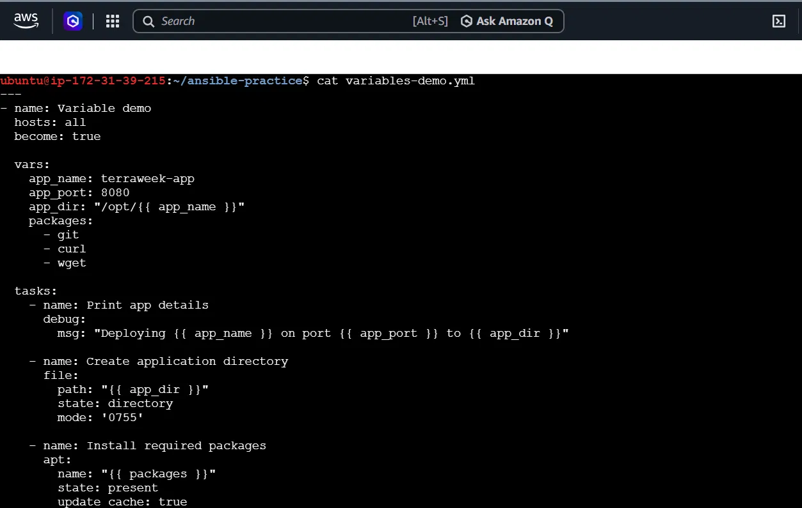

**Output of the normal run:**

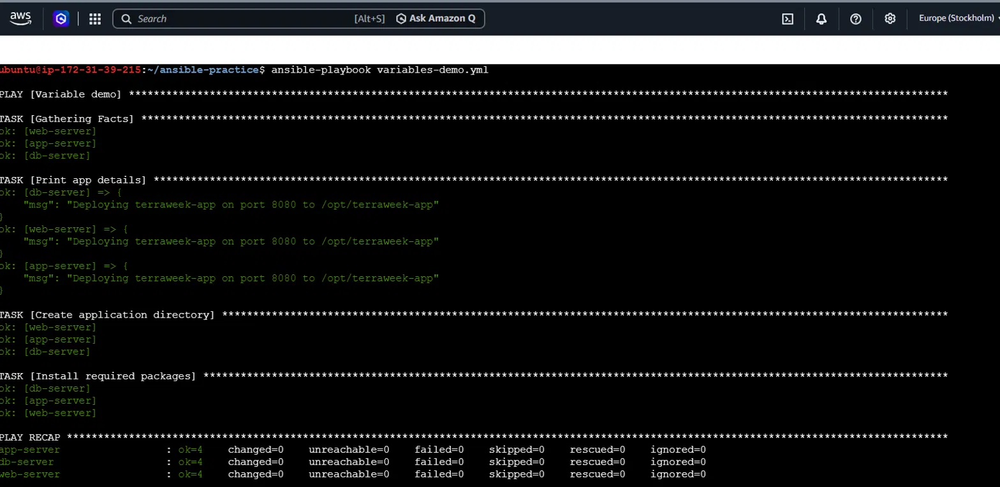

### Step 3: Override a variable from the command line

Use `-e` (extra variables):

```bash
ansible-playbook variables-demo.yml -e "app_name=my-custom-app app_port=9090"
```

**Output:**

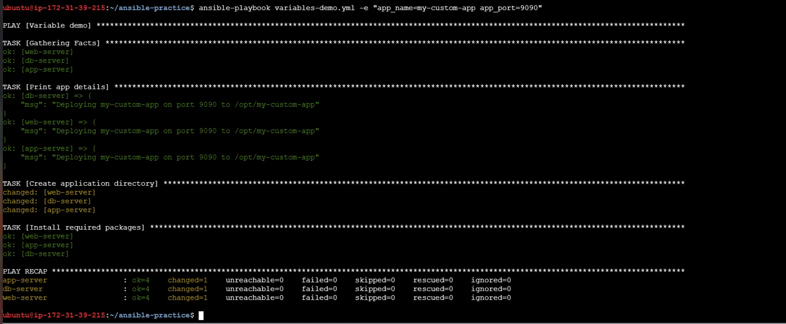

### Result and verification

- The message now says `Deploying my-custom-app on port 9090 to /opt/my-custom-app`.
- **Yes, the command line variable (`-e`) overrides the playbook variable.** `-e` always has the highest priority.
- `app_dir` also changed automatically because it is built from `app_name`.

### Bonus lesson: Idempotency

In the second run, "Create application directory" showed `changed` (a new folder `/opt/my-custom-app` was created), but "Install required packages" showed `ok` (packages were already installed). Ansible only changes what needs changing. This is called **idempotency**: running the same playbook many times is safe.

---

## Task 2: group_vars and host_vars

### What are they?

In Task 1 the variables were inside the playbook. That gets messy. Better practice is to keep variables in **separate files**.

- **`group_vars/`** holds variables for a **group** of servers.
- **`host_vars/`** holds variables for **one specific server**.

### Why do we need them?

- The playbook stays clean (only the work, no data).
- One playbook can give **different values to different servers**. For example the `web` group gets port 80 and the `db` group gets port 3306.
- One special server can get a special value without touching the others.

### How do they work?

Ansible finds these files **by name**. You do not import anything.

| File | Applies to |
|---|---|
| `group_vars/all.yml` | **Every** server |
| `group_vars/web.yml` | Only servers in the `[web]` group |
| `group_vars/db.yml` | Only servers in the `[db]` group |
| `host_vars/web-server.yml` | Only the server named `web-server` |

> **Important:** The file name must match the group or server name **exactly**. If it does not match, Ansible silently ignores the file.

### Step 1: Create the folder structure

```
ansible-practice/
  inventory.ini
  ansible.cfg
  group_vars/
    all.yml
    web.yml
    db.yml
  host_vars/
    web-server.yml
  playbooks/
    site.yml
```

```bash
cd ~/ansible-practice
mkdir -p group_vars host_vars playbooks
```

### Step 2: Create the variable files

**`group_vars/all.yml`** (applies to every host)

```bash
nano group_vars/all.yml
```

```yaml
---
ntp_server: pool.ntp.org
app_env: development
common_packages:
  - vim
  - htop
  - tree
```

**`group_vars/web.yml`** (only the web group)

```bash
nano group_vars/web.yml
```

```yaml
---
http_port: 80
max_connections: 1000
web_packages:
  - nginx
```

**`group_vars/db.yml`** (only the db group)

```bash
nano group_vars/db.yml
```

```yaml
---
db_port: 3306
db_packages:
  - mysql-server
```

**`host_vars/web-server.yml`** (only this one server)

```bash
nano host_vars/web-server.yml
```

```yaml
---
max_connections: 2000
custom_message: "This is the primary web server"
```

Notice that `max_connections` exists in **two** places: 1000 in `web.yml` and 2000 in `web-server.yml`. We will see which one wins.

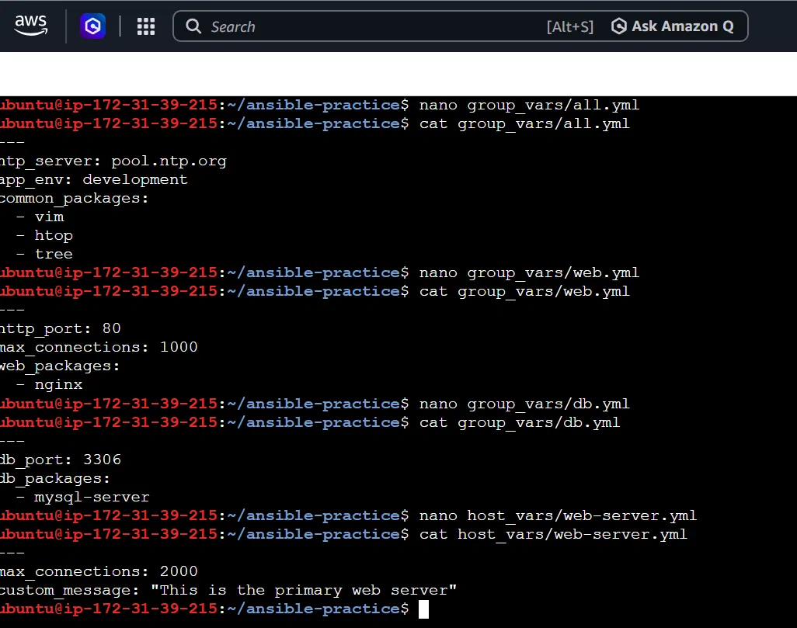

### Step 3: Create the playbook `playbooks/site.yml`

```bash
nano playbooks/site.yml
```

```yaml
---
- name: Apply common config
  hosts: all
  become: true
  tasks:
    - name: Install common packages
      apt:
        name: "{{ common_packages }}"
        state: present
        update_cache: true

    - name: Show environment
      debug:
        msg: "Environment: {{ app_env }}"

- name: Configure web servers
  hosts: web
  become: true
  tasks:
    - name: Show web config
      debug:
        msg: "HTTP port: {{ http_port }}, Max connections: {{ max_connections }}"

    - name: Show host-specific message
      debug:
        msg: "{{ custom_message }}"
```

### Explanation

- This file has **two plays** (two blocks that start with `- name:`).
- **Play 1** runs on `all` servers. It uses `common_packages` and `app_env` from `group_vars/all.yml`.
- **Play 2** runs only on the `web` group. It uses `http_port` (from `web.yml`), `max_connections` and `custom_message` (from `host_vars`).
- The playbook has **no `vars:` section**. All data comes from the files.

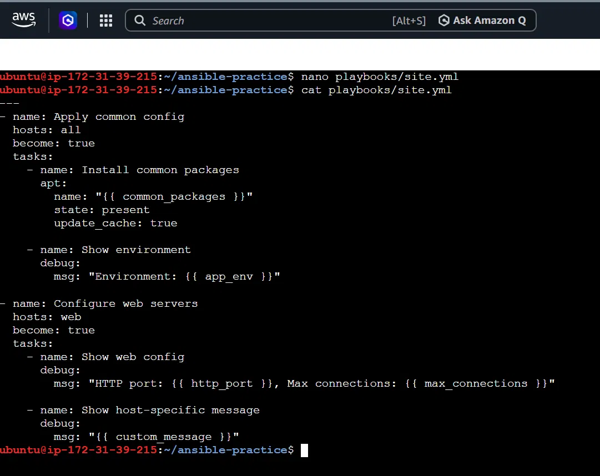

### Step 4: Run it

```bash
ansible-playbook playbooks/site.yml
```

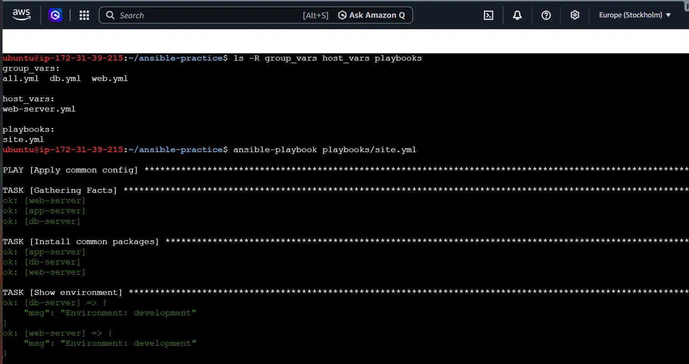

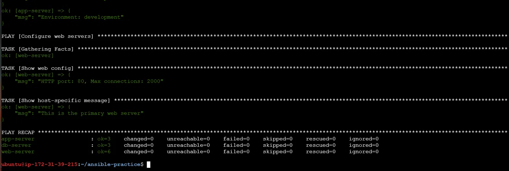

### What we observed

1. `Environment: development` appeared on **all 3 servers** (from `all.yml`).
2. The web play ran **only on `web-server`**, because `hosts: web`.
3. `Max connections` showed **2000**, not 1000. So **`host_vars` beat `group_vars`**.
4. `custom_message` appeared only for `web-server`.

### Variable precedence (who wins?)

When the same variable is defined in many places, the **higher** one wins. Simplified order from **lowest to highest**:

| Level | Source |
|---|---|
| 1 (lowest) | `group_vars/all` |
| 2 | `group_vars/<group name>` |
| 3 | `host_vars/<host name>` |
| 4 | Playbook `vars:` |
| 5 (highest) | `-e` extra variables on the command line |

So the rule is: **`-e` beats everything.**

> **Note:** The task hint says "host_vars > group_vars > playbook vars". The first part is correct (`host_vars` beats `group_vars`), but a playbook's own `vars:` actually has **higher** priority than `group_vars` and `host_vars`. The table above is the correct order.

---

## Task 3: Ansible Facts

### What are facts?

**Facts** are details about a server that Ansible **collects automatically**: operating system, IP address, RAM, CPU, disks, hostname and hundreds more.

Remember the first line "Gathering Facts" in every playbook run? That is Ansible collecting facts.

### Why do we need facts?

Servers are different. Facts let a playbook **look at the server and decide**:

- Ubuntu server? Use `apt`. Red Hat server? Use `yum`.
- Low on RAM? Use smaller settings.
- Need the server's own IP in a config file? Read it from facts.

No more guessing or hardcoding.

### How do we use facts?

Facts behave like variables. Most start with `ansible_`:

```yaml
{{ ansible_hostname }}
{{ ansible_distribution }}
{{ ansible_memtotal_mb }}
```

Outside a playbook you can look at facts using the `setup` module.

### Step 1: See all facts

```bash
ansible web-server -m setup
```

This prints a very long list. That is normal.

| Part | Meaning |
|---|---|
| `ansible` | Run a single quick command (an *ad-hoc* command), not a playbook |
| `web-server` | Run on this server |
| `-m setup` | Use the `setup` module (collects facts) |

### Step 2: Filter specific facts

```bash
ansible web-server -m setup -a "filter=ansible_os_family"
ansible web-server -m setup -a "filter=ansible_distribution*"
ansible web-server -m setup -a "filter=ansible_memtotal_mb"
ansible web-server -m setup -a "filter=ansible_default_ipv4"
```

`-a "filter=..."` shows only the fact you ask for. The `*` means "everything that starts with this".

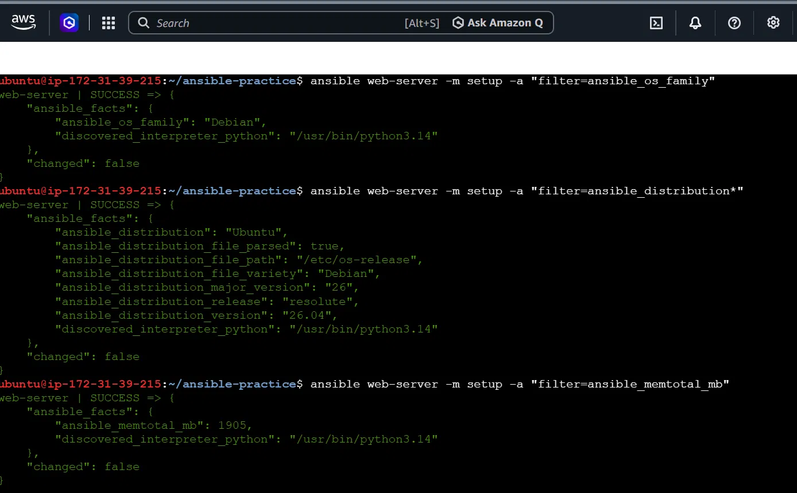

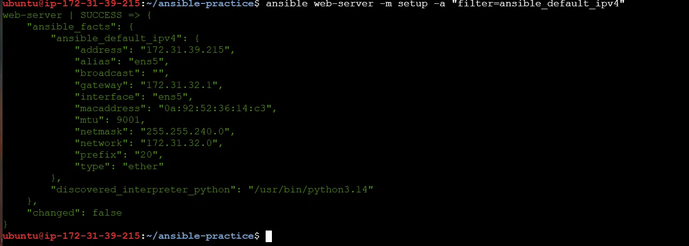

### What the output means

| Fact | Our value | Meaning |
|---|---|---|
| `ansible_os_family` | `Debian` | Ubuntu belongs to the Debian family, so `apt` works |
| `ansible_distribution` | `Ubuntu` | OS name |
| `ansible_distribution_version` | `26.04` | OS version |
| `ansible_memtotal_mb` | `1905` | Total RAM in MB |
| `ansible_default_ipv4.address` | `172.31.39.215` | The server's private IP |

`ansible_default_ipv4` is a **dictionary** (a box with many labelled values inside: address, gateway, interface...). To get one value, use a **dot**: `{{ ansible_default_ipv4.address }}`.

### Step 3: Use facts in a playbook

```bash
nano facts-demo.yml
```

```yaml
---
- name: Facts demo
  hosts: all
  tasks:
    - name: Show OS info
      debug:
        msg: >
          Hostname: {{ ansible_hostname }},
          OS: {{ ansible_distribution }} {{ ansible_distribution_version }},
          RAM: {{ ansible_memtotal_mb }}MB,
          IP: {{ ansible_default_ipv4.address }}

    - name: Show all network interfaces
      debug:
        var: ansible_interfaces
```

### Explanation

| Part | Meaning |
|---|---|
| `msg: >` | The `>` joins the following lines into one long line. Handy for long messages |
| `debug: var:` | Prints a variable directly. Write only its name, **no `{{ }}`** |
| `ansible_interfaces` | A list of all network interfaces on the server |

### Step 4: Run it

```bash
ansible-playbook facts-demo.yml
```

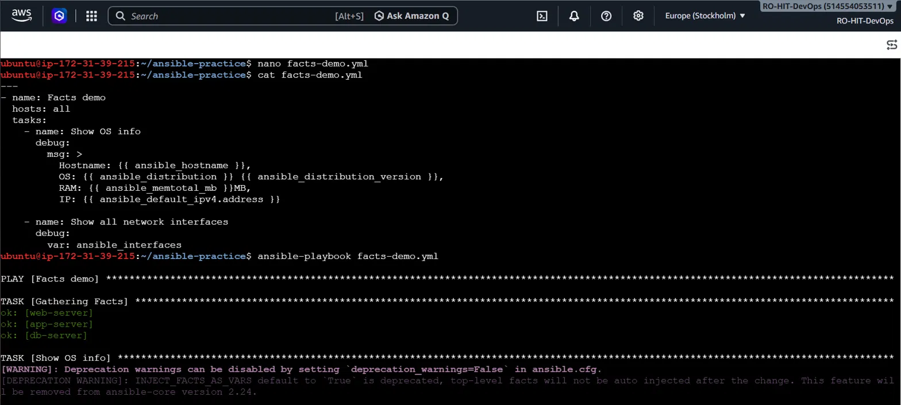

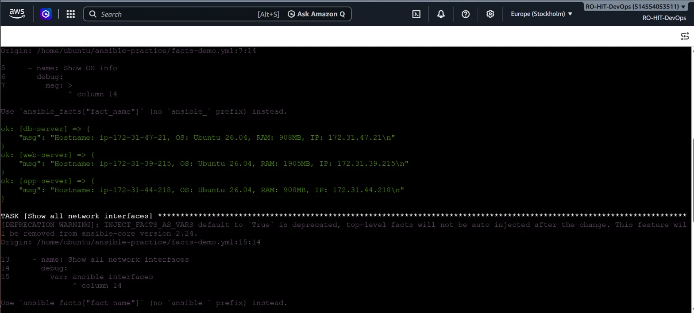

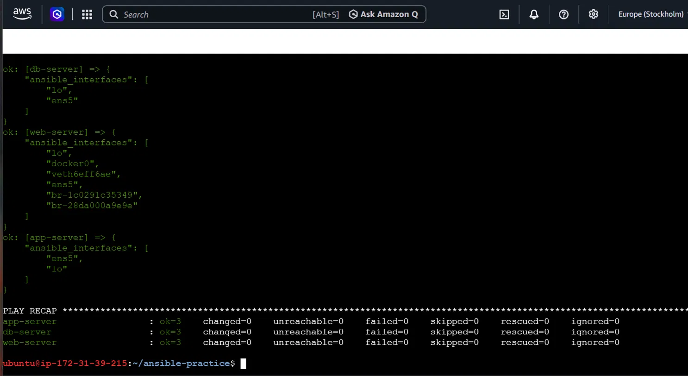

### What we observed

One playbook, three servers, and **each server printed its own data**:

| Server | Hostname | RAM | IP |
|---|---|---|---|
| web-server | ip-172-31-39-215 | 1905MB | 172.31.39.215 |
| app-server | ip-172-31-44-218 | 908MB | 172.31.44.218 |
| db-server | ip-172-31-47-21 | 908MB | 172.31.47.21 |

`web-server` also showed `docker0` and `br-...` interfaces because Docker is running on it.

> **About the purple DEPRECATION WARNING:** This is **not an error**. Ansible is telling us that in a future version the new style `ansible_facts["hostname"]` will be preferred over `ansible_hostname`. The playbook still works fine (`failed=0`).

### Five facts used in real playbooks

| Fact | Why it is useful |
|---|---|
| `ansible_os_family` | Choose the right package manager (`apt` for Debian, `yum`/`dnf` for RedHat), so one playbook works on many OS types |
| `ansible_distribution_version` | Run different steps for different OS versions |
| `ansible_memtotal_mb` | Tune settings by RAM, for example a bigger database buffer on a bigger server |
| `ansible_default_ipv4.address` | Put the server's own IP into config files automatically instead of typing it |
| `ansible_hostname` | Add the server name to logs, monitoring and config files so you know which server is which |

Bonus facts: `ansible_processor_vcpus` (CPU count, for setting worker processes) and `ansible_interfaces` (network checks).

---

## Task 4: Conditionals with `when`

### What is `when`?

`when` tells a task: **"Run only if this condition is true."** If the condition is false, the task is **skipped**.

### Why do we need it?

Our servers have different jobs. Nginx should be installed only on web servers, MySQL only on database servers. Without `when`, every task would run on every server. With `when`, **one playbook, and each server gets only the tasks meant for it**.

### How do we use it?

Add a `when:` line under the task:

```yaml
- name: Install Nginx (only on web servers)
  apt:
    name: nginx
    state: present
  when: "'web' in group_names"
```

- `group_names` is a built-in variable: the list of groups the current server belongs to.
- `'web' in group_names` means "is `web` in that list?"
- You can compare values too: `ansible_memtotal_mb < 1024`, `ansible_distribution == "Ubuntu"`.

> **Rules:**
> - **Do not use `{{ }}`** inside `when`. Write the variable name directly.
> - Use `==` (two equals signs) to compare. One `=` is wrong.

### Step 1: Start small (two tasks)

```bash
nano conditional-demo.yml
```

```yaml
---
- name: Conditional tasks demo
  hosts: all
  become: true

  tasks:
    - name: Install Nginx (only on web servers)
      apt:
        name: nginx
        state: present
        update_cache: true
      when: "'web' in group_names"

    - name: Install MySQL (only on db servers)
      apt:
        name: mysql-server
        state: present
        update_cache: true
      when: "'db' in group_names"
```

```bash
ansible-playbook conditional-demo.yml
```

> **Be patient:** installing `mysql-server` on a small server can take 1 to 3 minutes. Do not press `Ctrl+C`. Wait for the PLAY RECAP.

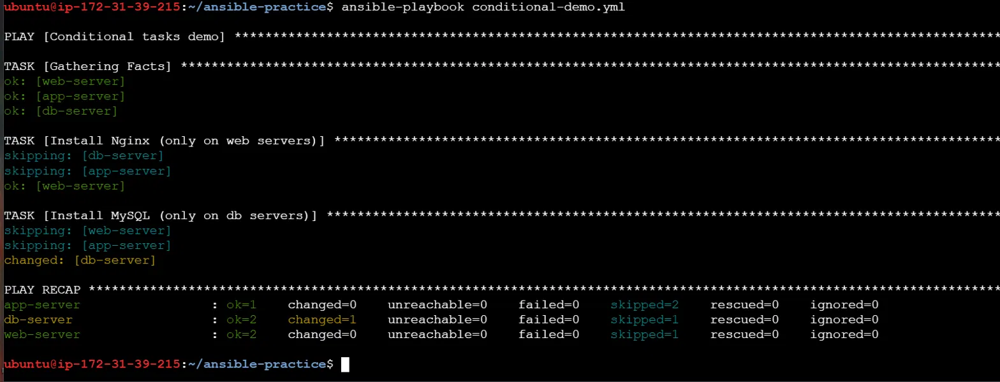

**What we see:**

- Nginx: `skipping` on `app-server` and `db-server`. Only `web-server` ran.
- MySQL: `skipping` on `web-server` and `app-server`. Only `db-server` ran (`changed`).

That is exactly what we wanted.

### Step 2: The full playbook (8 tasks)

Delete the old file and create the full one:

```bash
rm conditional-demo.yml
nano conditional-demo.yml
```

```yaml
---
- name: Conditional tasks demo
  hosts: all
  become: true

  tasks:
    - name: Install Nginx (only on web servers)
      apt:
        name: nginx
        state: present
        update_cache: true
      when: "'web' in group_names"

    - name: Install MySQL (only on db servers)
      apt:
        name: mysql-server
        state: present
        update_cache: true
      when: "'db' in group_names"

    - name: Show warning on low memory hosts
      debug:
        msg: "WARNING: This host has less than 1GB RAM"
      when: ansible_memtotal_mb < 1024

    - name: Run only on Amazon Linux
      debug:
        msg: "This is an Amazon Linux machine"
      when: ansible_distribution == "Amazon"

    - name: Run only on Ubuntu
      debug:
        msg: "This is an Ubuntu machine"
      when: ansible_distribution == "Ubuntu"

    - name: Run only in production
      debug:
        msg: "Production settings applied"
      when: app_env == "production"

    - name: Multiple conditions (AND)
      debug:
        msg: "Web server with enough memory"
      when:
        - "'web' in group_names"
        - ansible_memtotal_mb >= 512

    - name: OR condition
      debug:
        msg: "Either web or app server"
      when: "'web' in group_names or 'app' in group_names"
```

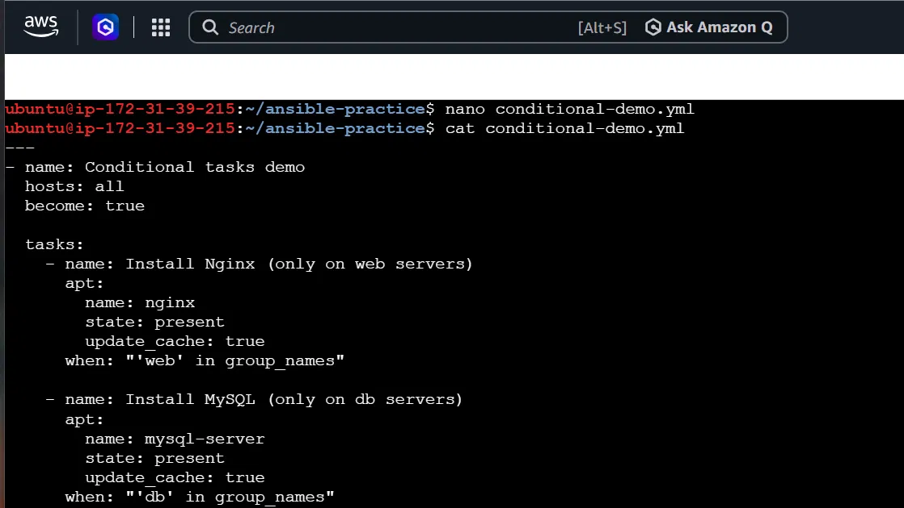

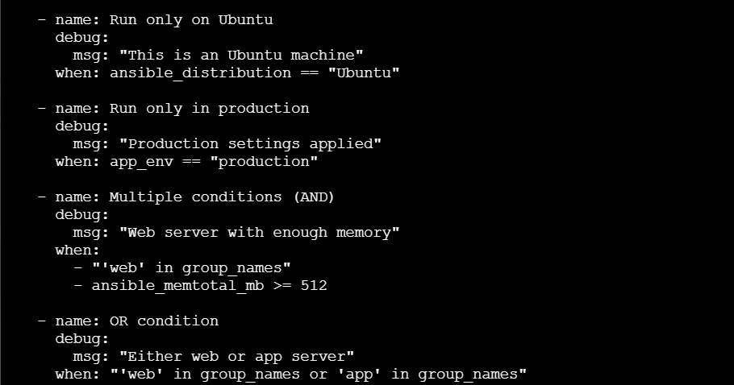

### Types of conditions explained

| Task | Condition | How it works |
|---|---|---|
| Low memory | `ansible_memtotal_mb < 1024` | Compares a **fact** (number) |
| Amazon Linux | `ansible_distribution == "Amazon"` | Compares text. Text goes in quotes |
| Production | `app_env == "production"` | Compares a **variable** from `group_vars/all.yml` |
| AND | A list of two lines under `when:` | **Both** conditions must be true |
| OR | `... or ...` on one line | **At least one** must be true |

### Run it

```bash
ansible-playbook conditional-demo.yml
```

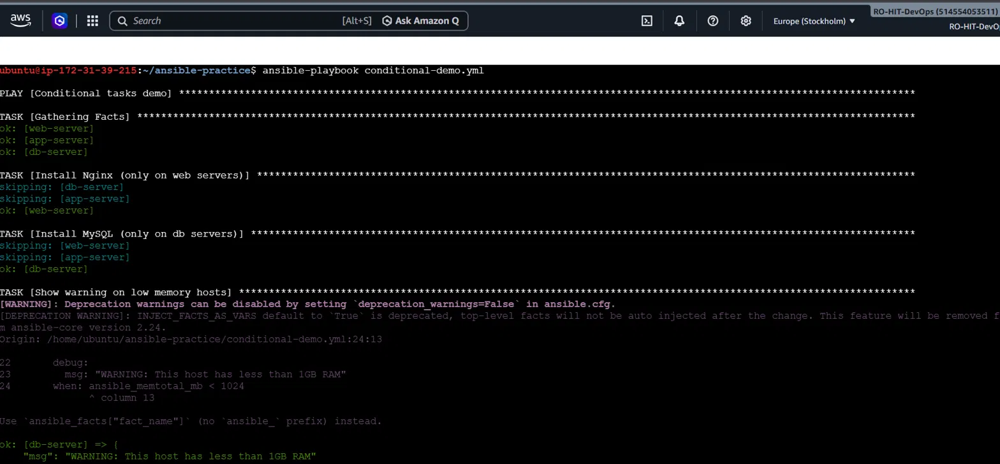

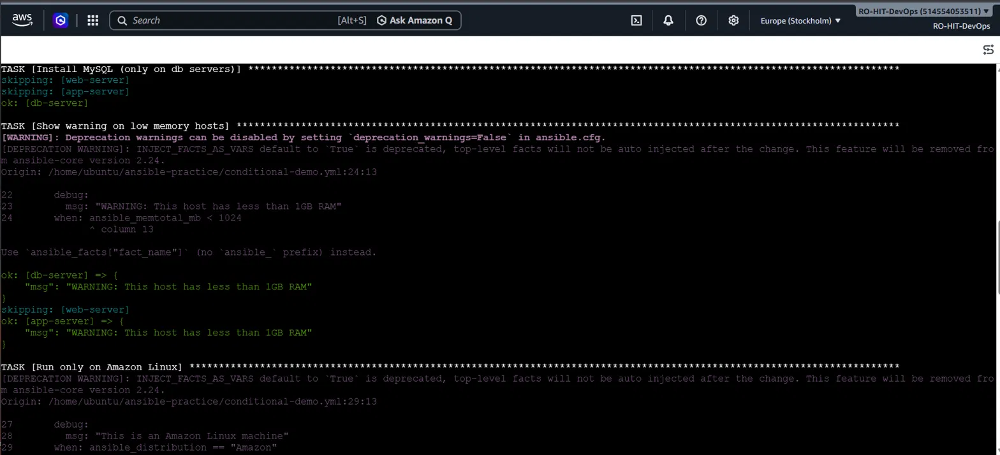

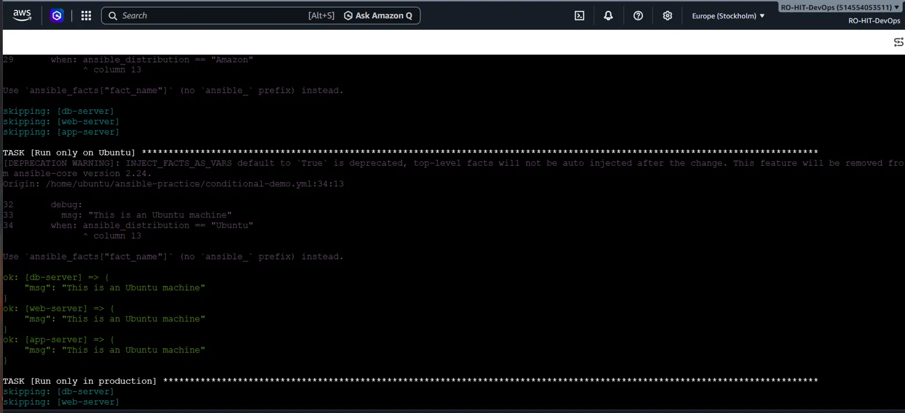

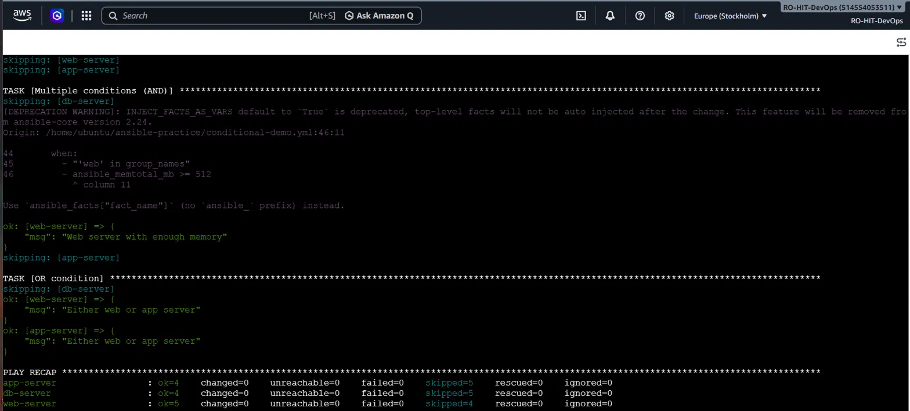

### What we observed

| Task | web-server (1905MB) | app-server (908MB) | db-server (908MB) |
|---|---|---|---|
| Low memory warning | skipped | **ran** | **ran** |
| Amazon Linux | skipped | skipped | skipped |
| Ubuntu | **ran** | **ran** | **ran** |
| Production | skipped | skipped | skipped |
| AND (web and RAM >= 512) | **ran** | skipped | skipped |
| OR (web or app) | **ran** | **ran** | skipped |

### Verification

**Yes, tasks correctly skip on hosts that do not match the condition.**

- The "Production" task was skipped everywhere because `app_env` is `development`. To trigger it, run `ansible-playbook conditional-demo.yml -e "app_env=production"`.
- "Amazon Linux" was skipped everywhere because all our servers are Ubuntu.

---

## Task 5: Loops

### What is a loop?

A **loop** runs **one task many times**, once for each item in a list.

### Why do we need loops?

To create 3 users you would otherwise write 3 separate tasks. To create 4 folders, 4 tasks. With a loop you write **one task** and give it a list.

### How do we use it?

Add `loop:` and use `{{ item }}` for the current value:

```yaml
- name: Create multiple directories
  file:
    path: "{{ item }}"
    state: directory
  loop:
    - /opt/app/logs
    - /opt/app/config
```

- `loop:` is the list to go through.
- `item` is the current value (first `/opt/app/logs`, then `/opt/app/config`).
- If each item has several fields (like a user with a name and a group), use a dot: `{{ item.name }}`, `{{ item.groups }}`.

### Step 1: Start with the user loop

```bash
nano loops-demo.yml
```

```yaml
---
- name: Loops demo
  hosts: all
  become: true

  vars:
    users:
      - name: deploy
        groups: sudo
      - name: monitor
        groups: sudo
      - name: appuser
        groups: users

    directories:
      - /opt/app/logs
      - /opt/app/config
      - /opt/app/data
      - /opt/app/tmp

  tasks:
    - name: Create multiple users
      user:
        name: "{{ item.name }}"
        groups: "{{ item.groups }}"
        state: present
      loop: "{{ users }}"
```

```bash
ansible-playbook loops-demo.yml
```

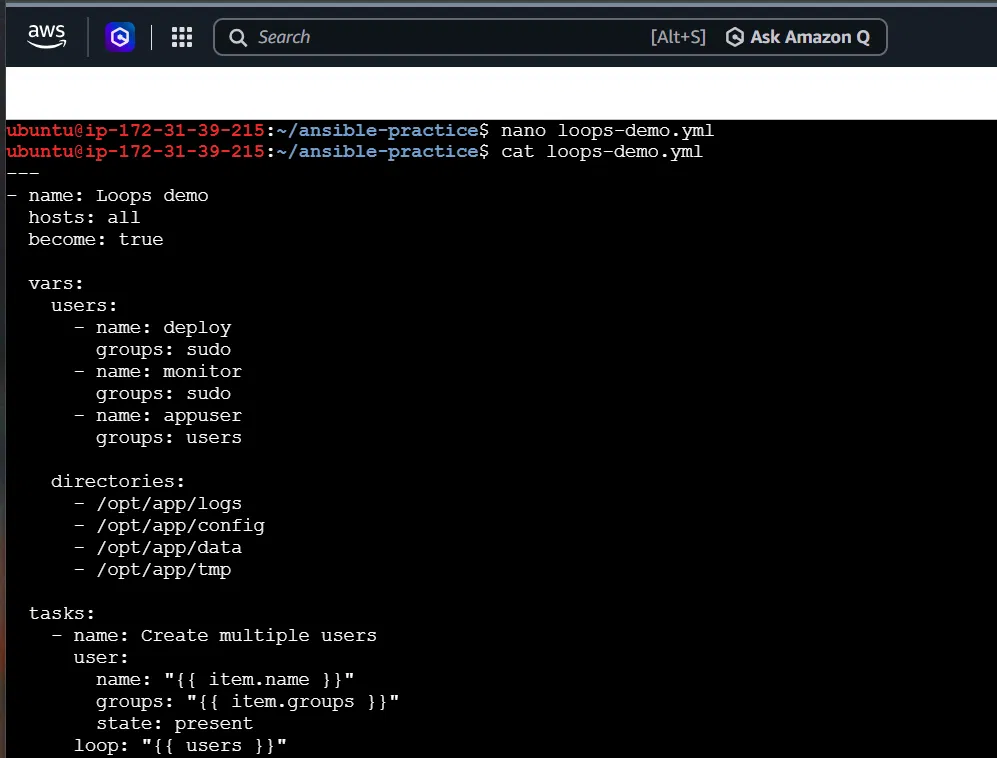

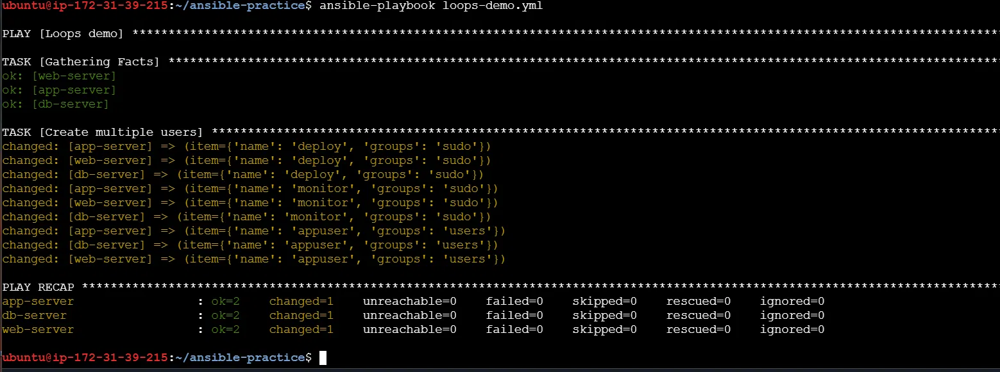

**What we see:** Each user is shown as a separate line, with `item={'name': 'deploy', 'groups': 'sudo'}`. That is 3 servers x 3 users = 9 `changed` lines.

> `users` is a **list of dictionaries**: each item has two fields (`name` and `groups`).
> In the recap you see `changed=1`, not 3. Ansible counts **tasks**, not loop rounds.

### Step 2: The full playbook (4 tasks)

```bash
rm loops-demo.yml
nano loops-demo.yml
```

```yaml
---
- name: Loops demo
  hosts: all
  become: true

  vars:
    users:
      - name: deploy
        groups: sudo
      - name: monitor
        groups: sudo
      - name: appuser
        groups: users

    directories:
      - /opt/app/logs
      - /opt/app/config
      - /opt/app/data
      - /opt/app/tmp

  tasks:
    - name: Create multiple users
      user:
        name: "{{ item.name }}"
        groups: "{{ item.groups }}"
        state: present
      loop: "{{ users }}"

    - name: Create multiple directories
      file:
        path: "{{ item }}"
        state: directory
        mode: '0755'
      loop: "{{ directories }}"

    - name: Install multiple packages
      apt:
        name: "{{ item }}"
        state: present
        update_cache: true
      loop:
        - git
        - curl
        - unzip
        - jq

    - name: Print each user created
      debug:
        msg: "Created user {{ item.name }} in group {{ item.groups }}"
      loop: "{{ users }}"
```

```bash
ansible-playbook loops-demo.yml
```

### The four loops explained

| Task | Loop type | Notes |
|---|---|---|
| Create users | Loop over `users` (list of dictionaries) | Uses `item.name` and `item.groups` |
| Create directories | Loop over `directories` (simple list) | Uses `item` directly |
| Install packages | List written **right under** `loop:` | No separate variable needed |
| Print users | Loop over the same `users` list again | Shows a variable can be reused |

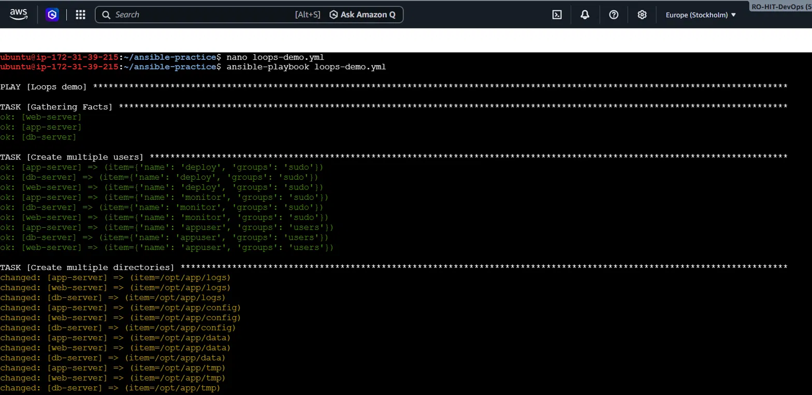

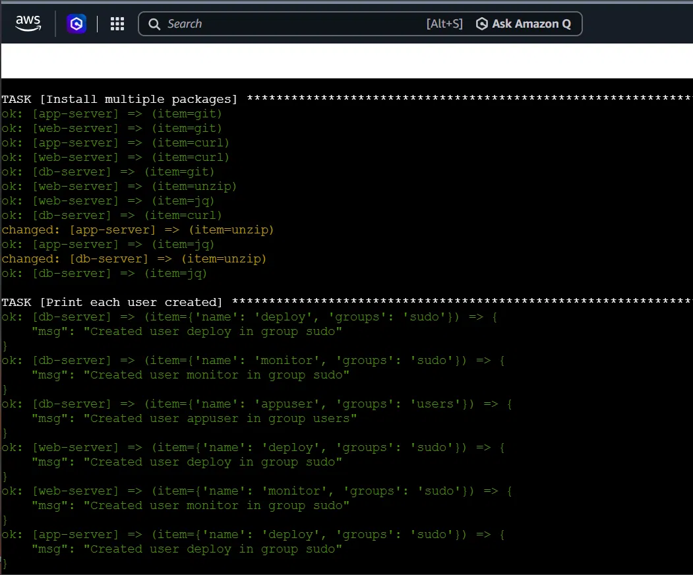

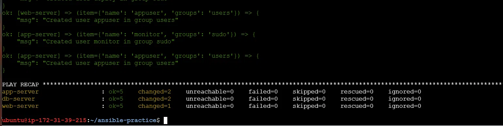

### What we observed

- **Create users:** `ok` (not `changed`) because the users already existed from the first run. That is idempotency again.
- **Create directories:** `changed`, 4 folders on each of 3 servers.
- **Install packages:** mostly `ok`. Only `unzip` was `changed` on `app-server` and `db-server`, because the other packages were already installed.
- **Print users:** one separate message per user per server.
- `failed=0` everywhere.

### `loop` vs `with_items`

| | `with_items` | `loop` |
|---|---|---|
| Age | **Old** style (before Ansible 2.5) | **Modern** style |
| Status | Legacy | **Recommended** |
| Design | Many different `with_*` keywords (`with_dict`, `with_fileglob`...) | One keyword for everything, combined with filters (for example `loop: "{{ mydict \| dict2items }}"`) |
| List flattening | Automatically flattens nested lists | Does **not** flatten unless you ask |

For simple lists they give the same result. **Use `loop` in all new playbooks.**

---

## Task 6: Register, Debug and Combine Everything

### What is `register`?

`register` **saves the output of a task into a variable**, so later tasks can use it.

### Why do we need it?

Facts do not have everything. For example, "how full is the disk right now?" is not a fact. We have to run a command (`df -h`) to find out. `register` captures the command's output so we can use it.

### How do we use it?

```yaml
- name: Check disk space
  command: df -h /
  register: disk_result
```

Now `disk_result` holds the result. Useful parts:

| Field | Meaning |
|---|---|
| `disk_result.stdout` | The whole output as one block of text |
| `disk_result.stdout_lines` | The output as a **list of lines** (counting starts at 0) |
| `disk_result.rc` | Return code. `0` means success |
| `disk_result.changed` | Did the task change anything? |

`df -h /` prints 2 lines: line `[0]` is the heading and line `[1]` is the real data. So we use `stdout_lines[1]`.

### `command` vs `shell`

- **`command`** runs one simple command. Special characters like the pipe `|` do **not** work.
- **`shell`** runs the command inside a shell, so `|` works. We use it for `systemctl ... | head -20`.

### Step 1: Test `register` first

```bash
nano server-report.yml
```

```yaml
---
- name: Server Health Report
  hosts: all

  tasks:
    - name: Check disk space
      command: df -h /
      register: disk_result

    - name: Check memory
      command: free -m
      register: memory_result

    - name: Check running services
      shell: systemctl list-units --type=service --state=running | head -20
      register: services_result

    - name: Show raw disk output
      debug:
        var: disk_result.stdout_lines
```

```bash
ansible-playbook server-report.yml
```

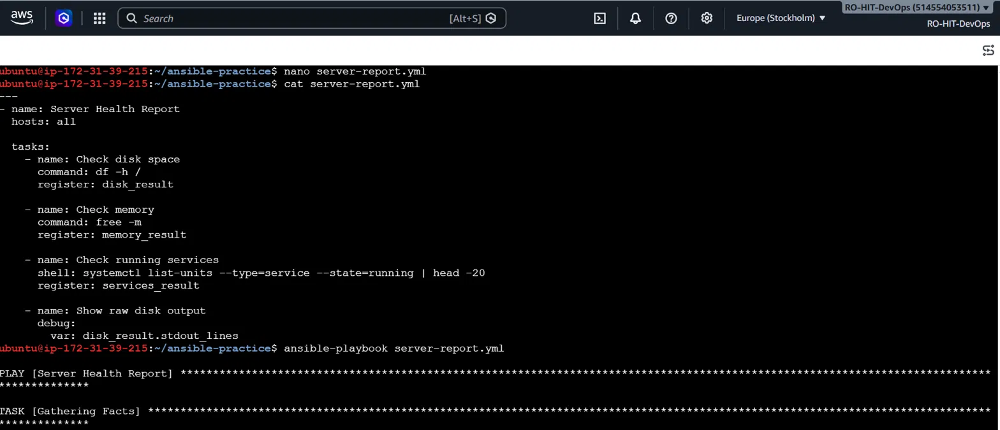

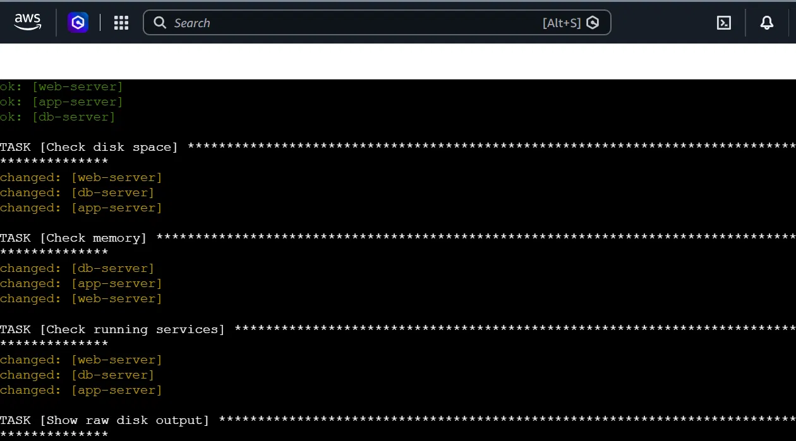

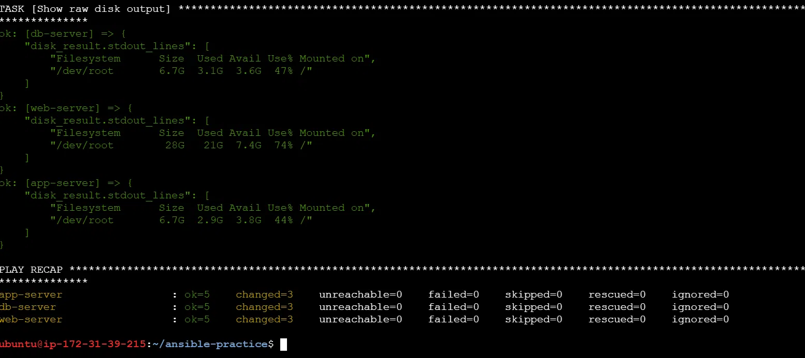

**What we see:**

| Server | Size | Used | Free | Use% |
|---|---|---|---|---|
| web-server | 28G | 21G | 7.4G | 74% |
| app-server | 6.7G | 2.9G | 3.8G | 44% |
| db-server | 6.7G | 3.1G | 3.6G | 47% |

The first three tasks show `changed` even though they only read information. That is normal: `command` and `shell` always report `changed`.

### Step 2: The final playbook

This version builds a report, raises an alert if the disk is almost full, and saves the report into a file on each server.

> **A fix we made:** The original task used `when: "'9[0-9]%' in disk_result.stdout"`. That does not work, because Ansible searches for that exact text, not as a pattern. Our version picks the `Use%` column, removes the `%` sign, turns it into a number and checks `>= 90`.

```bash
rm server-report.yml
nano server-report.yml
```

```yaml
---
- name: Server Health Report
  hosts: all

  tasks:
    - name: Check disk space
      command: df -h /
      register: disk_result

    - name: Check memory
      command: free -m
      register: memory_result

    - name: Check running services
      shell: systemctl list-units --type=service --state=running | head -20
      register: services_result

    - name: Generate report
      debug:
        msg:
          - "========== {{ inventory_hostname }} =========="
          - "OS: {{ ansible_distribution }} {{ ansible_distribution_version }}"
          - "IP: {{ ansible_default_ipv4.address }}"
          - "RAM: {{ ansible_memtotal_mb }}MB"
          - "Disk: {{ disk_result.stdout_lines[1] }}"
          - "Running services (first 20): {{ services_result.stdout_lines | length }}"

    - name: Flag if disk is critically low
      debug:
        msg: "ALERT: Check disk space on {{ inventory_hostname }}"
      when: (disk_result.stdout_lines[1].split()[4] | replace('%', '') | int) >= 90

    - name: Save report to file
      copy:
        content: |
          Server: {{ inventory_hostname }}
          OS: {{ ansible_distribution }} {{ ansible_distribution_version }}
          IP: {{ ansible_default_ipv4.address }}
          RAM: {{ ansible_memtotal_mb }}MB
          Disk: {{ disk_result.stdout }}
          Checked at: {{ ansible_date_time.iso8601 }}
        dest: "/tmp/server-report-{{ inventory_hostname }}.txt"
      become: true
```

### Explanation of the new parts

| Part | Meaning |
|---|---|
| `inventory_hostname` | The server's name from the inventory (`web-server`, etc.) |
| `msg:` with a list | Prints many lines in one message |
| `stdout_lines \| length` | Counts the number of lines |
| `stdout_lines[1].split()[4]` | Splits the data line into words and takes the 5th word, which is the `Use%` column (for example `74%`) |
| `replace('%', '') \| int` | Removes `%` and converts the text `74` into the number 74 |
| `>= 90` | Compares as numbers. If true, the alert shows |
| `content: \|` | The `\|` keeps line breaks exactly as written in the file |
| `dest:` | Where to save the file. The server name is part of the file name, so each server has its own file |
| `ansible_date_time.iso8601` | A fact: the current date and time |
| `become: true` on one task | Uses `sudo` only for this task |

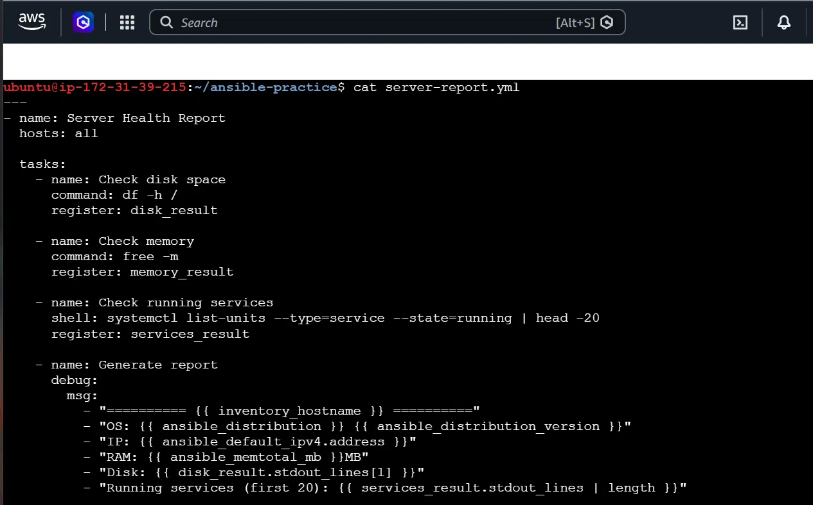

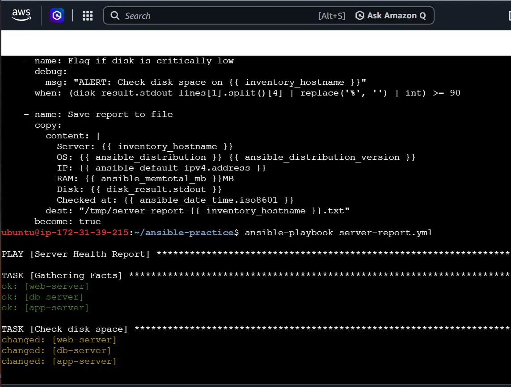

### Run it

```bash
ansible-playbook server-report.yml
```

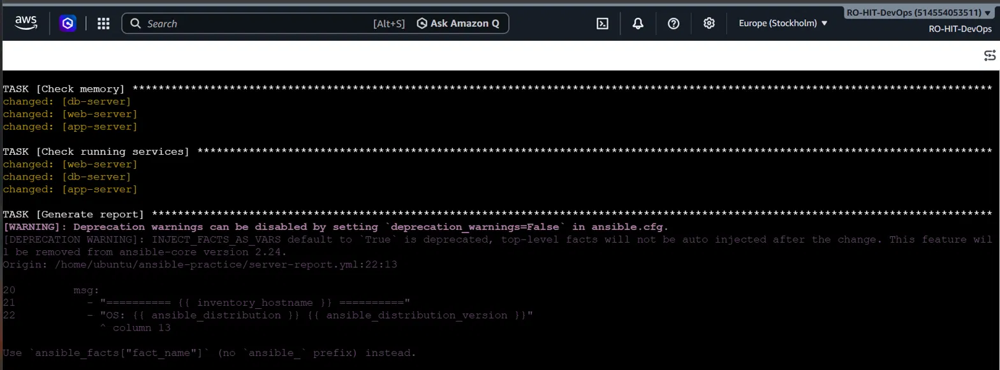

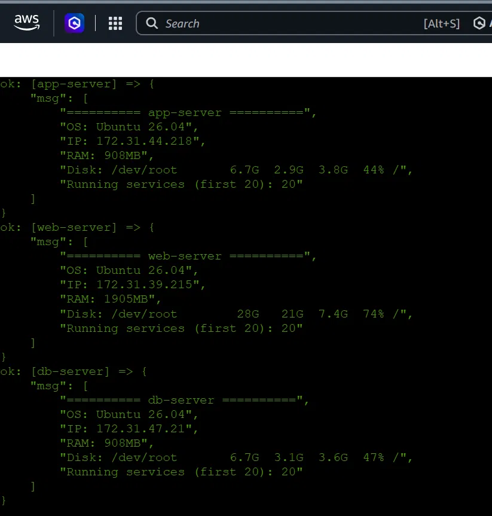

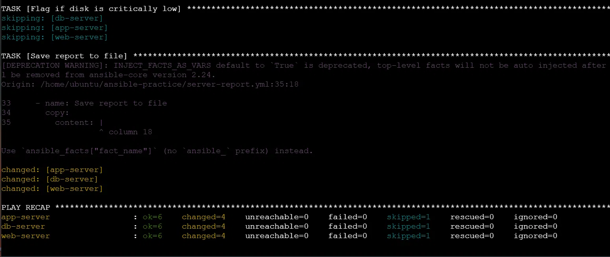

### What we observed

- "Generate report" printed a separate block for each server with its own OS, IP, RAM, disk and service count.
- "Flag if disk is critically low" was **skipped** on all servers, because their disks are 74%, 44% and 47% (all below 90%). The condition works.
- "Save report to file" was `changed` on all 3 servers (the file was created).
- Recap: `ok=6`, `changed=4`, `skipped=1`, `failed=0`.

### Verify the report files

Read the file on each server:

```bash
cat /tmp/server-report-web-server.txt
ansible app-server -m command -a "cat /tmp/server-report-app-server.txt"
ansible db-server -m command -a "cat /tmp/server-report-db-server.txt"
```

The first command works because `web-server` is the local machine. The other two use an ad-hoc Ansible command to read the file on the remote servers.

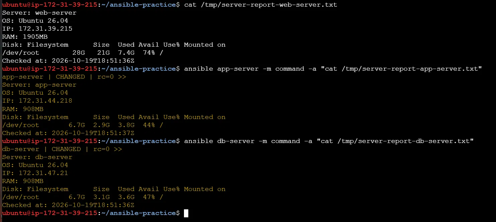

**Yes, the files contain accurate information.** The IP, RAM, disk usage and OS match what we saw earlier for each server. Each file also has a `Checked at` time in UTC.

---

## Quick Cheat Sheet

| Topic | Example | Remember |
|---|---|---|
| Define a variable | `vars:` then `app_port: 8080` | Put it in the playbook or in `group_vars`/`host_vars` |
| Use a variable | `"{{ app_port }}"` | Quote the value if it starts with `{{` |
| Override from CLI | `-e "app_port=9090"` | Highest priority |
| Group variables | `group_vars/<group>.yml` | File name = group name |
| Host variables | `host_vars/<host>.yml` | File name = host name |
| See facts | `ansible <host> -m setup` | Add `-a "filter=..."` to narrow it |
| Use a fact | `{{ ansible_hostname }}` | Dictionary values use a dot |
| Condition | `when: ansible_distribution == "Ubuntu"` | No `{{ }}`, use `==` |
| AND | Two lines under `when:` | Both must be true |
| OR | `when: a or b` | One is enough |
| Loop | `loop: "{{ list }}"` with `{{ item }}` | Prefer `loop` over `with_items` |
| Save output | `register: result` | Use `result.stdout`, `result.stdout_lines` |

---

## Common Errors and Fixes

| Problem | Cause | Fix |
|---|---|---|
| `Could not detect which major revision of dnf is in use` | Used `yum` on Ubuntu | Use `apt` instead of `yum` |
| `Group wheel does not exist` | `wheel` group does not exist on Ubuntu | Use the `sudo` group |
| Variable file is ignored | File name does not match the group or host name | Use the exact name (`web.yml`, `web-server.yml`) |
| YAML syntax error | Used the Tab key, or wrong spacing | Use 2 spaces only |
| Install task looks stuck | Big package on a small server | Wait 1 to 3 minutes. Do not press `Ctrl+C` |
| `Could not get lock` after `Ctrl+C` | An install was interrupted | Run `ansible all -b -m shell -a "dpkg --configure -a"` and try again |
| Purple `DEPRECATION WARNING` | Ansible prefers `ansible_facts["name"]` in the future | Safe to ignore for now. It is not an error |

---

## Key Takeaways

- **Variables** remove repeated values. Change once, update everywhere.
- **`group_vars` and `host_vars`** keep data out of playbooks and let different servers get different values.
- **Facts** let a playbook discover details about each server by itself.
- **`when`** makes a task run only where it should.
- **`loop`** replaces many copy-pasted tasks with one.
- **`register`** captures a command's output so later tasks can use it.
- **Precedence:** `group_vars` < `host_vars` < playbook `vars` < `-e`.
- **Idempotency:** Ansible only changes what needs changing, so you can run a playbook many times safely.

Together these make one playbook that adapts to every host, every group and every environment. That is the real power of Ansible.

---

## Files in this folder

```
day-70/
├── day-70-variables-loops.md
├── inventory.ini
├── ansible.cfg
├── variables-demo.yml
├── facts-demo.yml
├── conditional-demo.yml
├── loops-demo.yml
├── server-report.yml
├── group_vars/
│   ├── all.yml
│   ├── web.yml
│   └── db.yml
├── host_vars/
│   └── web-server.yml
├── playbooks/
│   └── site.yml
└── Screenshots/
    └── (all task screenshots)
```
