# Day 71 -- Roles, Galaxy, Templates and Vault

> A beginner-friendly, step-by-step guide. You can follow this file from top to bottom and practice every task yourself, even if you have never used these Ansible features before.

---

## Table of Contents

1. [What you will learn today](#1-what-you-will-learn-today)
2. [Lab setup (what you need before starting)](#2-lab-setup-what-you-need-before-starting)
3. [Final folder structure](#3-final-folder-structure)
4. [Task 1: Jinja2 Templates](#task-1-jinja2-templates)
5. [Task 2: Understand the Role Structure](#task-2-understand-the-role-structure)
6. [Task 3: Build a Custom Webserver Role](#task-3-build-a-custom-webserver-role)
7. [Task 4: Ansible Galaxy (Community Roles)](#task-4-ansible-galaxy--use-community-roles)
8. [Task 5: Ansible Vault (Encrypt Secrets)](#task-5-ansible-vault--encrypt-secrets)
9. [Task 6: Combine Roles, Templates and Vault](#task-6-combine-roles-templates-and-vault)
10. [Common errors and fixes](#common-errors-and-fixes)
11. [Key takeaways](#key-takeaways)

---

## 1. What you will learn today

Your playbooks keep getting bigger. Tasks, variables, handlers and files all sit in one YAML file. In real projects you manage many servers (web, app, database), so you need a way to **organize, reuse, share and secure** your automation.

| Topic | One-line meaning | Why it matters |
|---|---|---|
| **Jinja2 Templates** | A "fill in the blanks" config file | One file works for many servers |
| **Roles** | A standard folder structure for automation | Keeps code clean and reusable |
| **Ansible Galaxy** | A marketplace of ready-made roles | Do not rebuild what already exists |
| **Ansible Vault** | A locker for passwords and API keys | Never store secrets in plain text |

**Expected output of the day**
- A custom role built from scratch (`webserver`)
- A Jinja2 template that renders dynamic config files
- A role installed from Ansible Galaxy (`geerlingguy.docker`)
- Secrets encrypted with Ansible Vault
- This markdown file

---

## 2. Lab setup (what you need before starting)

### Servers used

| Inventory group | Server name | Purpose |
|---|---|---|
| `web` | `web-server` | Runs Nginx (this is the control node itself) |
| `app` | `app-server` | Gets Docker installed |
| `db` | `db-server` | Gets a database config file with secrets |

Check your groups with:

```bash
cd ~/ansible-practice
ansible-inventory --graph
```

Output:

```
@all:
  |--@ungrouped:
  |--@all_servers:
  |  |--@application:
  |  |  |--@web:
  |  |  |  |--web-server
  |  |  |--@app:
  |  |  |  |--app-server
  |  |--@db:
  |  |  |--db-server
```

### Working folder

Everything is done inside `~/ansible-practice`.

### ansible.cfg (starting version)

```ini
[defaults]
host_key_checking = False
inventory = inventory.ini
interpreter_python = auto_silent
```

(In Task 5 we add one more line to this file.)

### Important notes for this lab

- My servers run **Ubuntu**, so I used the **`apt`** module. The original task used `yum`, which only works on Red Hat / Amazon Linux. If your servers use Red Hat or Amazon Linux, use `yum` or `dnf` instead.
- The task says "SSH into the server and check". I ran the check commands through Ansible (`ansible <group> -m command -a "..."`), which gives the same result.
- The `[DEPRECATION WARNING]` messages in screenshots are only notices about newer Ansible versions. They are **not errors** and can be ignored.

---

## 3. Final folder structure

This is how `~/ansible-practice` looks after all tasks:

```
ansible-practice/
├── ansible.cfg
├── inventory.ini
├── .vault_pass                  # vault password file (NEVER commit this)
├── .gitignore                   # contains .vault_pass
├── requirements.yml             # Galaxy roles list (Task 4)
├── template-demo.yml            # Task 1 playbook
├── site.yml                     # Task 3, later extended in Task 6
├── docker-setup.yml             # Task 4 playbook
├── db-setup.yml                 # Task 5 playbook
├── templates/
│   ├── nginx-vhost.conf.j2      # Task 1 template
│   └── db-config.j2             # Task 6 template
├── group_vars/
│   └── db/
│       ├── vault.yml            # encrypted secrets (Task 5)
│       └── secrets.yml          # encrypted secrets (Task 5)
└── roles/
    └── webserver/               # custom role (Task 2 and 3)
        ├── defaults/main.yml
        ├── files/
        ├── handlers/main.yml
        ├── meta/main.yml
        ├── tasks/main.yml
        ├── templates/
        │   ├── index.html.j2
        │   ├── nginx.conf.j2
        │   └── vhost.conf.j2
        ├── tests/
        ├── vars/main.yml
        └── README.md
```

Galaxy roles are installed outside this folder, in `/home/ubuntu/.ansible/roles/`.

---

# Task 1: Jinja2 Templates

## What is a template?

- A template is a file with **blanks** written as `{{ something }}`.
- Those blanks are called **variables**.
- When Ansible copies the file to a server, it **replaces every `{{ ... }}` with the real value**.
- Template files use the `.j2` extension (short for Jinja2).

**Tiny example**
- Template: `Hello {{ name }}`
- Variable: `name = Rahul`
- File on the server: `Hello Rahul`

## Why use templates?

- Imagine 10 servers, each needing an Nginx config with its own hostname.
- Without templates you would write 10 files by hand.
- With a template you write **one file**, and Ansible fills in the hostname for every server.

## The three kinds of values used today

| Written in template | Meaning | Where the value comes from |
|---|---|---|
| `{{ http_port \| default(80) }}` | Port number. `default(80)` means "use 80 if no value is given" | Playbook `vars:` |
| `{{ ansible_hostname }}` | Server hostname | Ansible finds it itself (called a **fact**) |
| `{{ app_name }}` | Application name | Playbook `vars:` |

## Step 1: Create the template file

```bash
cd ~/ansible-practice
mkdir templates
nano templates/nginx-vhost.conf.j2
```

Paste this content:

```nginx
# Managed by Ansible -- do not edit manually
server {
    listen {{ http_port | default(80) }};
    server_name {{ ansible_hostname }};

    root /var/www/{{ app_name }};
    index index.html;

    location / {
        try_files $uri $uri/ =404;
    }

    access_log /var/log/nginx/{{ app_name }}_access.log;
    error_log /var/log/nginx/{{ app_name }}_error.log;
}
```

Save in nano: `Ctrl + O`, `Enter`, then `Ctrl + X`.

> Make sure the file is **inside the `templates/` folder**. If you created it outside, move it: `mv nginx-vhost.conf.j2 templates/`

Check it:

```bash
cat templates/nginx-vhost.conf.j2
ls templates/
```

You should still see `{{ }}` here. They are replaced only when the playbook runs.

## Step 2: Create the playbook `template-demo.yml`

```bash
nano template-demo.yml
```

```yaml
---
- name: Deploy Nginx with template
  hosts: web
  become: true
  vars:
    app_name: terraweek-app
    http_port: 80

  tasks:
    - name: Install Nginx
      apt:
        name: nginx
        state: present
        update_cache: true

    - name: Create web root
      file:
        path: "/var/www/{{ app_name }}"
        state: directory
        mode: '0755'

    - name: Deploy vhost config from template
      template:
        src: templates/nginx-vhost.conf.j2
        dest: "/etc/nginx/conf.d/{{ app_name }}.conf"
        owner: root
        mode: '0644'
      notify: Restart Nginx

    - name: Deploy index page
      copy:
        content: "<h1>{{ app_name }}</h1><p>Host: {{ ansible_hostname }} | IP: {{ ansible_default_ipv4.address }}</p>"
        dest: "/var/www/{{ app_name }}/index.html"

  handlers:
    - name: Restart Nginx
      service:
        name: nginx
        state: restarted
```

### How this playbook works (line by line idea)

| Part | What it does |
|---|---|
| `hosts: web` | Run on the `web` group |
| `become: true` | Use sudo (admin rights) |
| `vars:` | Defines `app_name` and `http_port`, used by the template |
| `apt` task | Installs Nginx |
| `file` task | Creates the folder `/var/www/terraweek-app` |
| `template` task | Takes the `.j2` file, fills in the variables and saves it to `/etc/nginx/conf.d/terraweek-app.conf` |
| `notify` + `handlers` | Restarts Nginx **only if the config file changed** |
| `copy` task | Creates a small `index.html` page |

> **What is a handler?** A task that runs only when another task says `notify`. It avoids restarting Nginx when nothing changed.

## Step 3: Run the playbook with `--diff`

```bash
ansible-playbook template-demo.yml --diff
```

`--diff` shows **what changed**. For the template task you will see the final text with real values, lines starting with `+`.

Important part of the output:

```
+server {
+    listen 80;
+    server_name ip-172-31-39-215;
+
+    root /var/www/terraweek-app;
+    index index.html;
...
```

PLAY RECAP: `ok=6  changed=4  failed=0`

### Screenshots (Task 1)

**Template file**
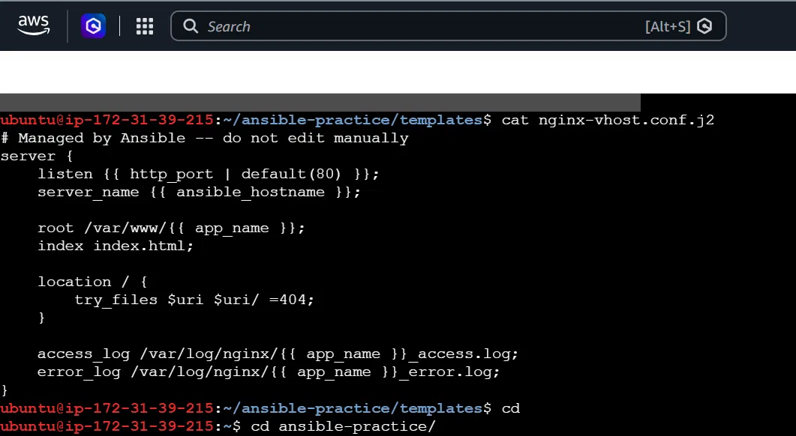

**Playbook (first part)**
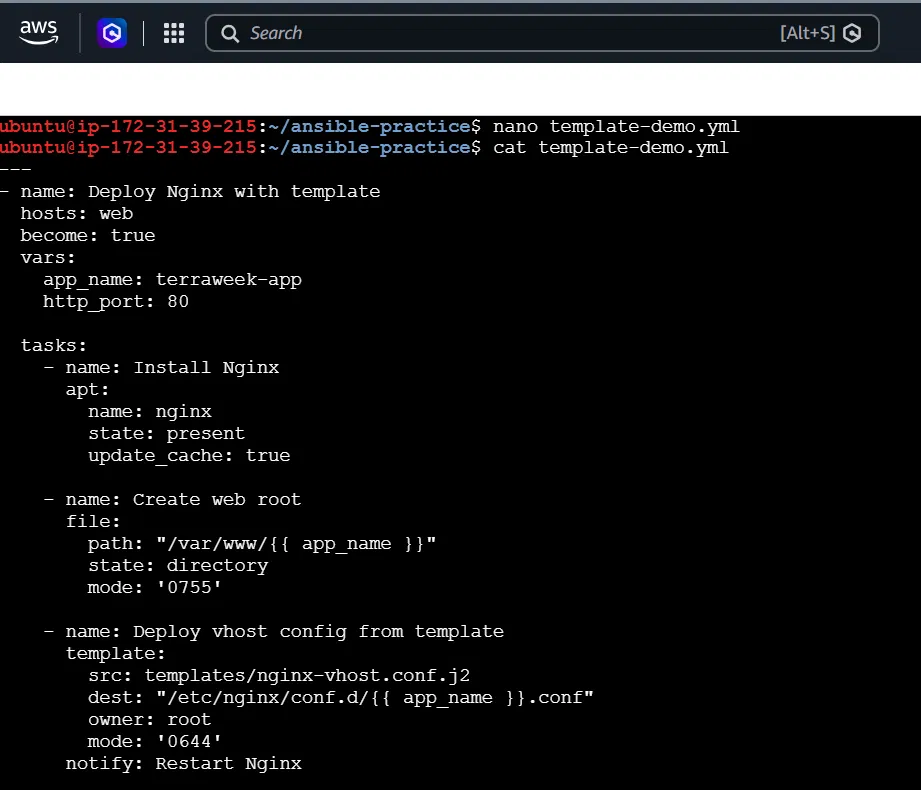

**Playbook (second part)**
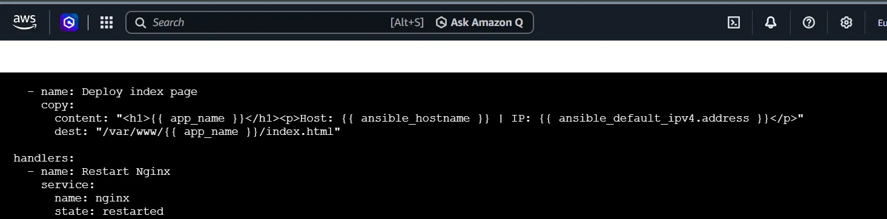

**Playbook run with --diff (start)**
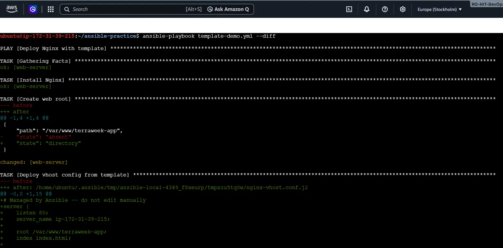

**Playbook run with --diff (end)**
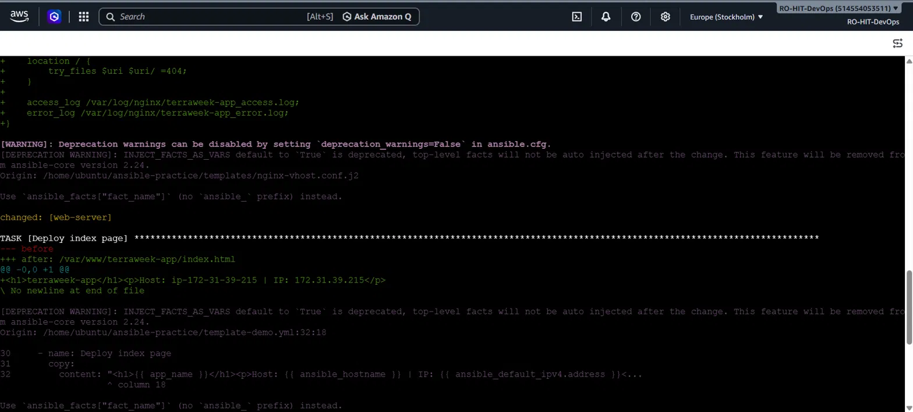

## Step 4: Verify the generated config

```bash
cat /etc/nginx/conf.d/terraweek-app.conf
```

Output:

```nginx
# Managed by Ansible -- do not edit manually
server {
    listen 80;
    server_name ip-172-31-39-215;

    root /var/www/terraweek-app;
    index index.html;

    location / {
        try_files $uri $uri/ =404;
    }

    access_log /var/log/nginx/terraweek-app_access.log;
    error_log /var/log/nginx/terraweek-app_error.log;
}
```

**Question: Are the variables replaced with actual values?**
**Yes.** `{{ http_port }}` became `80`, `{{ ansible_hostname }}` became `ip-172-31-39-215`, and `{{ app_name }}` became `terraweek-app`. No `{{ }}` is left.

**Final result (recap + rendered config)**
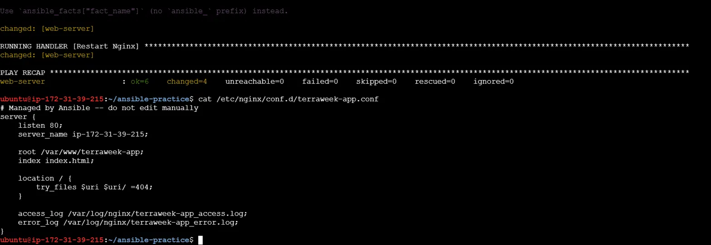

---

# Task 2: Understand the Role Structure

## What is a role?

- A role is a **neat box (folder)** that holds one piece of automation, for example "set up a web server".
- Instead of one huge playbook, each kind of content goes into its own folder.
- A role has a **fixed folder structure**. Ansible looks in those folders by itself.

## Why use roles?

- **Organized:** tasks in one place, templates in another.
- **Reusable:** write once, use in many playbooks.
- **Shareable:** easy to give to teammates or publish on Galaxy.
- **Standard:** everyone uses the same structure, so anyone can read it.

## The role folders

| Folder / file | Purpose |
|---|---|
| `tasks/main.yml` | The main list of tasks (the most important file) |
| `handlers/main.yml` | Handlers, such as "restart nginx" |
| `templates/` | Jinja2 `.j2` files |
| `files/` | Static files that are copied as they are |
| `vars/main.yml` | Role variables, **high priority** |
| `defaults/main.yml` | Role variables, **low priority** (easy to override) |
| `meta/main.yml` | Role information and dependencies |

You only need the folders you actually use. Every `main.yml` is loaded automatically.

## Step 1: Generate the skeleton

```bash
cd ~/ansible-practice
ansible-galaxy init roles/webserver
ls -R roles/webserver
```

Expected message: `- Role roles/webserver was created successfully`

The command creates all the folders with empty `main.yml` files. `files/` and `templates/` stay empty. A `tests/` folder is also created (we do not use it).

## Step 2: Read the README

```bash
cat roles/webserver/README.md
```

It is a template README with these headings: Role Name, Requirements, Role Variables, Dependencies, Example Playbook, License, Author Information. Think of it as the **instruction manual of a role**.

## Step 3: Look at `defaults` and `vars`

```bash
cat roles/webserver/defaults/main.yml
cat roles/webserver/vars/main.yml
```

Both files only contain a comment for now, because we have not added anything yet.

## Documentation question: difference between `vars/main.yml` and `defaults/main.yml`

| | `defaults/main.yml` | `vars/main.yml` |
|---|---|---|
| Priority | **Lowest** | **High** |
| Can it be overridden? | Easily (playbook, inventory, command line) | Hard to override |
| What it means | "Suggested value, change it if you want" | "Fixed value, please do not change" |
| Use it for | Port, app name, limits | Values the role depends on |

**Example**
- `defaults/main.yml` has `http_port: 80`. A playbook sets `http_port: 8080`. Result: **8080** is used.
- `vars/main.yml` has `http_port: 80`. A playbook sets `http_port: 8080`. Result: **80** stays, because `vars` wins.

**Rule of thumb:** put values that users may change in `defaults`, and fixed values in `vars`.

### Screenshots (Task 2)

**Role skeleton created**
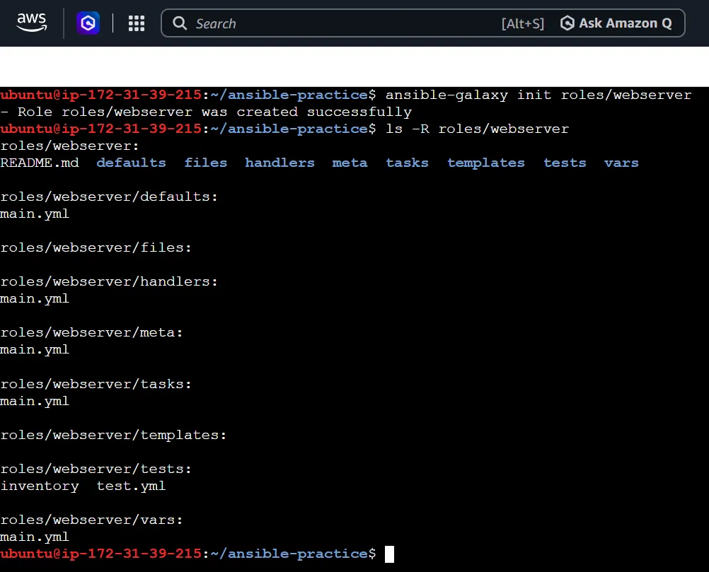

**README (part 1)**
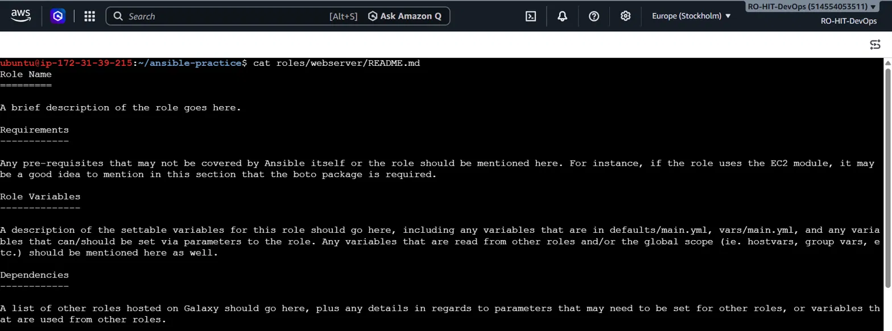

**README (part 2)**
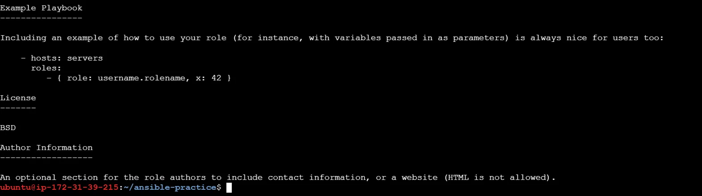

**defaults and vars files**
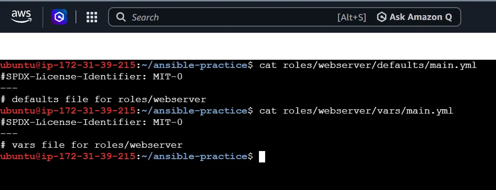

---

# Task 3: Build a Custom Webserver Role

## What we are building

A complete `webserver` role that:
1. Installs Nginx
2. Deploys the main Nginx config
3. Deploys a virtual host config
4. Creates the web root folder
5. Deploys an index page
6. Starts and enables Nginx

Then we call the role from a small playbook `site.yml`.

## Step 1: `defaults/main.yml`

```bash
nano roles/webserver/defaults/main.yml
```

Delete everything and paste:

```yaml
---
http_port: 80
app_name: myapp
max_connections: 512
```

- `http_port`: the port Nginx listens on
- `app_name`: the application name (used in folder and file names)
- `max_connections`: how many connections Nginx can handle at once

## Step 2: `tasks/main.yml`

```bash
nano roles/webserver/tasks/main.yml
```

```yaml
---
- name: Install Nginx
  apt:
    name: nginx
    state: present
    update_cache: true

- name: Deploy Nginx config
  template:
    src: nginx.conf.j2
    dest: /etc/nginx/nginx.conf
    owner: root
    mode: '0644'
  notify: Restart Nginx

- name: Deploy vhost config
  template:
    src: vhost.conf.j2
    dest: "/etc/nginx/conf.d/{{ app_name }}.conf"
    owner: root
    mode: '0644'
  notify: Restart Nginx

- name: Create web root
  file:
    path: "/var/www/{{ app_name }}"
    state: directory
    mode: '0755'

- name: Deploy index page
  template:
    src: index.html.j2
    dest: "/var/www/{{ app_name }}/index.html"
    mode: '0644'

- name: Start and enable Nginx
  service:
    name: nginx
    state: started
    enabled: true
```

**Things to notice**
- `src: nginx.conf.j2` has **no `templates/` prefix**. Inside a role, Ansible automatically looks in the role's own `templates/` folder.
- `enabled: true` means Nginx also starts again after a server reboot.
- `notify: Restart Nginx` must match the handler name **exactly**.

## Step 3: `handlers/main.yml`

```bash
nano roles/webserver/handlers/main.yml
```

```yaml
---
- name: Restart Nginx
  service:
    name: nginx
    state: restarted
```

## Step 4: `templates/index.html.j2`

```bash
nano roles/webserver/templates/index.html.j2
```

```html
<h1>{{ app_name }}</h1>
<p>Server: {{ ansible_hostname }}</p>
<p>IP: {{ ansible_default_ipv4.address }}</p>
<p>Environment: {{ app_env | default('development') }}</p>
<p>Managed by Ansible</p>
```

`app_env` is not defined anywhere, so `default('development')` is used.

## Step 5: `templates/vhost.conf.j2`

Same idea as Task 1:

```bash
nano roles/webserver/templates/vhost.conf.j2
```

```nginx
# Managed by Ansible -- do not edit manually
server {
    listen {{ http_port | default(80) }};
    server_name {{ ansible_hostname }};

    root /var/www/{{ app_name }};
    index index.html;

    location / {
        try_files $uri $uri/ =404;
    }

    access_log /var/log/nginx/{{ app_name }}_access.log;
    error_log /var/log/nginx/{{ app_name }}_error.log;
}
```

## Step 6: `templates/nginx.conf.j2`

This is the main Nginx config. It uses the `max_connections` variable.

```bash
nano roles/webserver/templates/nginx.conf.j2
```

```nginx
# Managed by Ansible -- do not edit manually
user www-data;
worker_processes auto;
pid /run/nginx.pid;
include /etc/nginx/modules-enabled/*.conf;

events {
    worker_connections {{ max_connections }};
}

http {
    include /etc/nginx/mime.types;
    default_type application/octet-stream;

    sendfile on;
    keepalive_timeout 65;

    access_log /var/log/nginx/access.log;
    error_log /var/log/nginx/error.log;

    include /etc/nginx/conf.d/*.conf;
}
```

This is a simple, working Nginx config for Ubuntu. It loads every file from `/etc/nginx/conf.d/`, which is where the vhost config goes.

Check that all three templates exist:

```bash
ls roles/webserver/templates/
```

Expected: `index.html.j2  nginx.conf.j2  vhost.conf.j2`

## Step 7: Remove the old Task 1 config (to avoid a conflict)

Task 1 created `/etc/nginx/conf.d/terraweek-app.conf`. The role now creates `terraweek.conf`. Both use port 80 and the same server name, so Nginx could show the old page. Remove the old one:

```bash
sudo rm /etc/nginx/conf.d/terraweek-app.conf
```

## Step 8: Create `site.yml` (calls the role)

`site.yml` goes in `~/ansible-practice`, **outside** the `roles` folder.

```bash
nano site.yml
```

```yaml
---
- name: Configure web servers
  hosts: web
  become: true
  roles:
    - role: webserver
      vars:
        app_name: terraweek
        http_port: 80
```

**Variable priority in action:** the role's `defaults` has `app_name: myapp`, but the playbook passes `app_name: terraweek`. The playbook value **wins**, so `terraweek` is used.

## Step 9: Run it

```bash
ansible-playbook site.yml
```

Task names now show the role name, for example `webserver : Install Nginx`.
PLAY RECAP: `ok=8  changed=5  failed=0`

## Step 10: Verify with curl

```bash
curl http://localhost
```

Output:

```html
<h1>terraweek</h1>
<p>Server: ip-172-31-39-215</p>
<p>IP: 172.31.39.215</p>
<p>Environment: development</p>
<p>Managed by Ansible</p>
```

**Question: Does the custom page load?** **Yes.**
- `terraweek` proves the playbook value overrode the default `myapp`.
- Server and IP were found by Ansible (facts).
- `development` came from the `default('development')` filter.

### Screenshots (Task 3)

**defaults and tasks (part 1)**
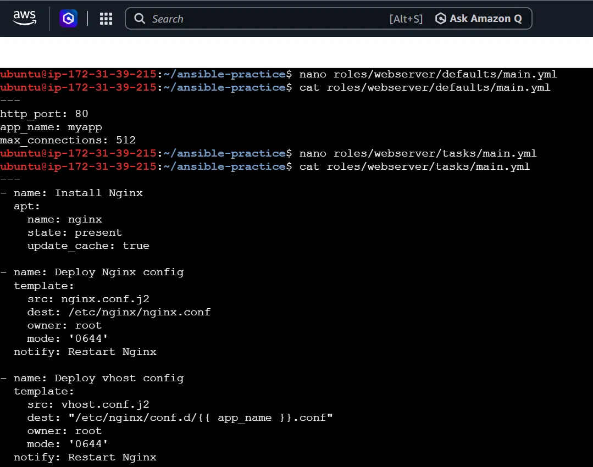

**tasks (part 2), handlers and index template**
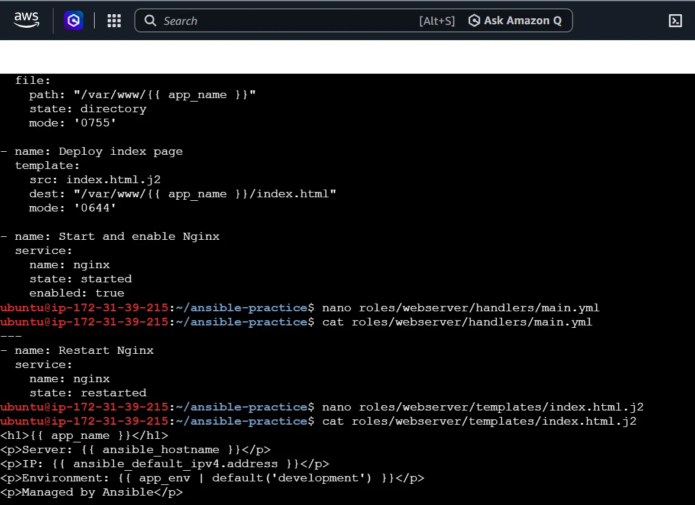

**vhost and nginx templates (part 1)**
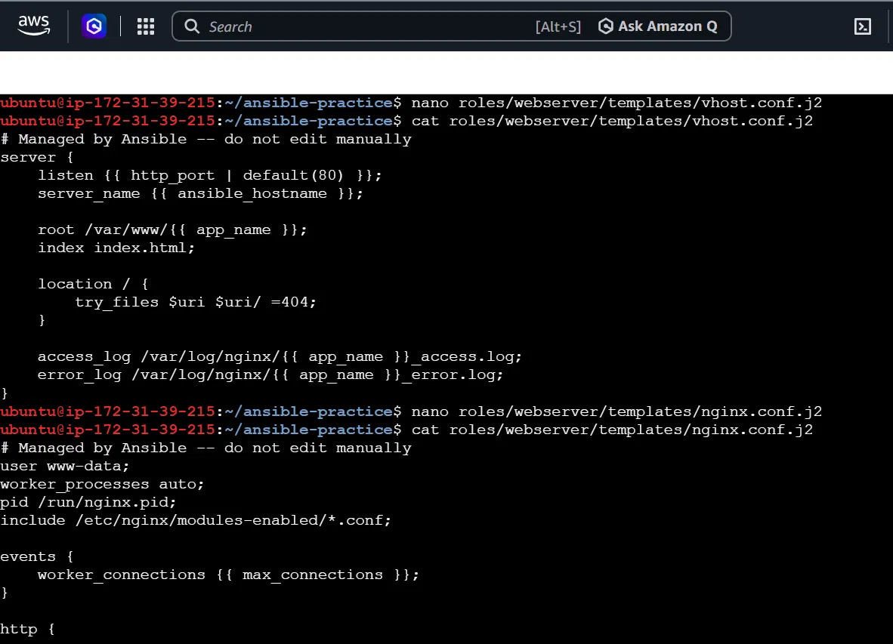

**nginx template (part 2) and site.yml**
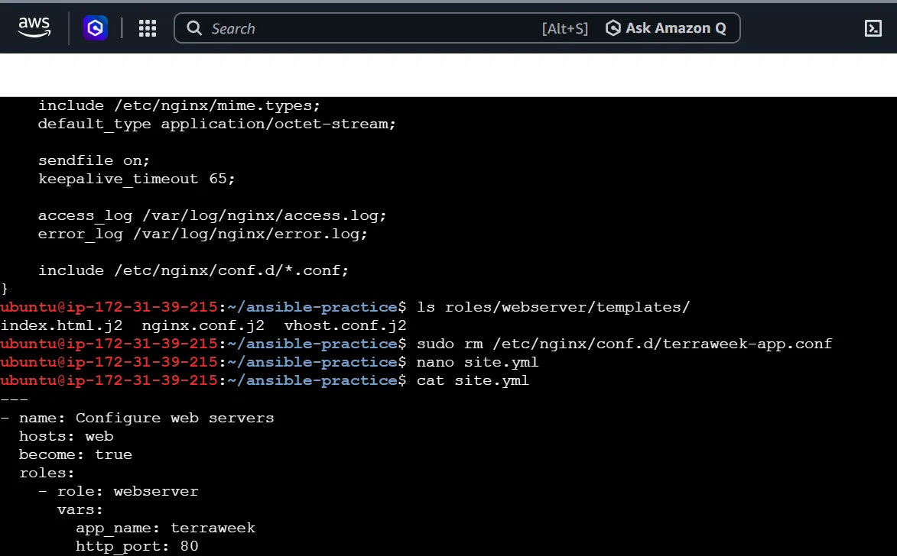

**Running site.yml**
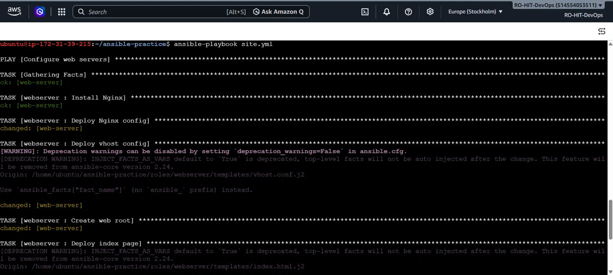

**Recap and curl output (final result)**
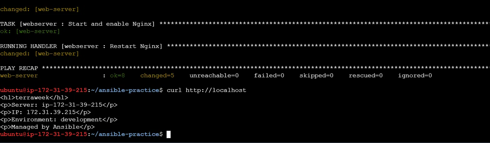

---

# Task 4: Ansible Galaxy -- Use Community Roles

## What is Galaxy?

- Ansible Galaxy is an **online marketplace of ready-made roles**, like a Play Store for Ansible.
- Role names look like `username.rolename`. Example: `geerlingguy.docker` is the **docker** role written by **geerlingguy**.

## Why use it?

- In Task 3 you built a role yourself, which took time.
- For common jobs (Docker, MySQL, NTP) someone has already built and tested a role.
- With one command you download it, and with a few lines you use it.

## Step 1: Search for roles

```bash
ansible-galaxy search nginx --platforms EL
ansible-galaxy search mysql
```

- `--platforms EL` limits the result to Enterprise Linux (Red Hat family).
- The output is a long list with `Name` and `Description`. Hundreds of roles are normal (824 for nginx, 691 for mysql in my run).
- Tip: pipe to `head -20` to see only the first lines.

**Screenshots: search results**

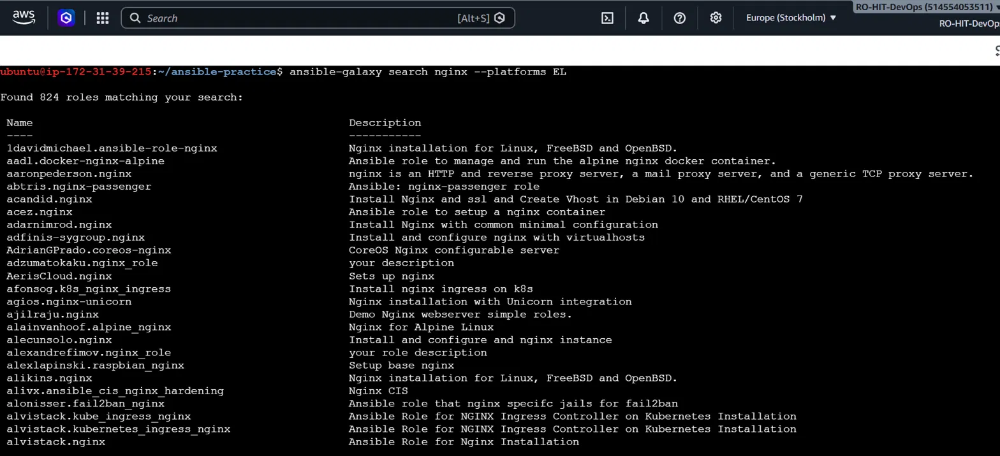

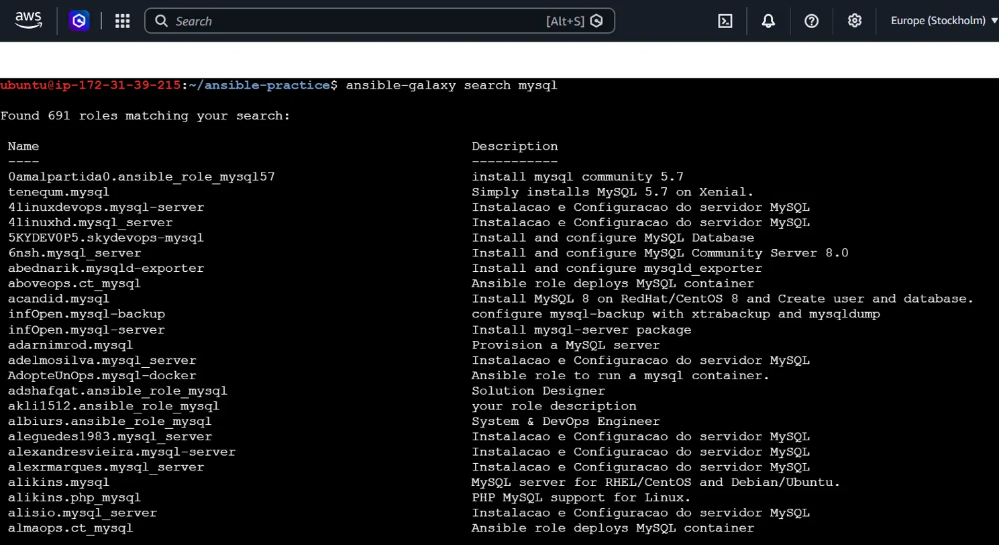

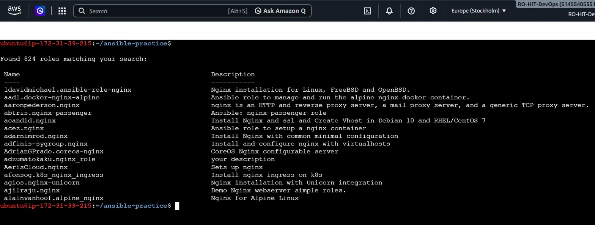

## Step 2: Install a role

```bash
ansible-galaxy install geerlingguy.docker
```

Expected last line: `- geerlingguy.docker (8.0.0) was installed successfully`

## Step 3: Check where it was installed

```bash
ansible-galaxy list
```

Output:

```
# /home/ubuntu/.ansible/roles
- geerlingguy.docker, 8.0.0
```

So the role lives in `/home/ubuntu/.ansible/roles/geerlingguy.docker`. (The two `[WARNING]` lines about `/usr/share/ansible/roles` and `/etc/ansible/roles` only mean those folders do not exist. Ignore them.)

Before using it, confirm the `app` group exists:

```bash
ansible-inventory --graph
```

**Screenshot: install, list and inventory**

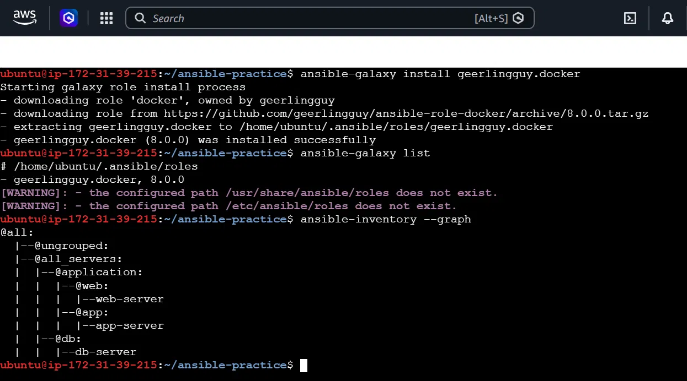

## Step 4: Use the role in a playbook

Create `docker-setup.yml`:

```bash
nano docker-setup.yml
```

```yaml
---
- name: Install Docker using Galaxy role
  hosts: app
  become: true
  roles:
    - geerlingguy.docker
```

No tasks were written. The whole Docker installation logic is inside the role.

Test the connection first, then run:

```bash
ansible app -m ping
ansible-playbook docker-setup.yml
```

Result: `ok=14  changed=4  failed=0  skipped=13`
- `skipped=13` is normal: the role skips tasks meant for other operating systems.

**Screenshots: playbook and run**

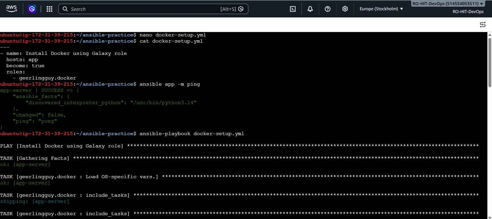

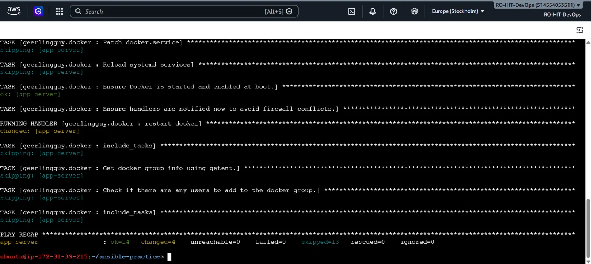

## Step 5: Verify Docker on the app server

Docker was installed on `app-server`, so run the checks through Ansible:

```bash
ansible app -m command -a "docker --version"
ansible app -m command -a "systemctl is-active docker"
ansible app -b -m command -a "docker run --rm hello-world"
```

- `docker --version` prints the version (for me: `29.9.1`).
- `systemctl is-active docker` prints `active`.
- `hello-world` prints `Hello from Docker!`, proof that Docker works. (`-b` = use sudo.)

**Screenshot: Docker verification**

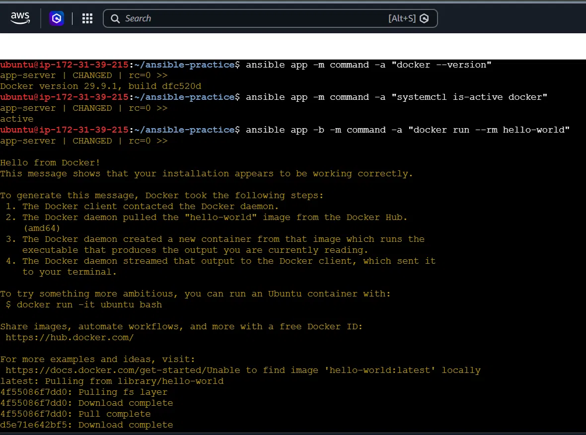

## Step 6: Use a `requirements.yml` file

When a project needs many roles, list them in one file.

```bash
nano requirements.yml
```

```yaml
---
roles:
  - name: geerlingguy.docker
    version: "7.4.1"
  - name: geerlingguy.ntp
```

- `version: "7.4.1"` locks that exact version.
- `geerlingguy.ntp` has no version, so the latest is used. (NTP keeps server time correct.)

Install everything at once:

```bash
ansible-galaxy install -r requirements.yml
```

What happened in my run:
- `geerlingguy.docker` was already installed as 8.0.0, so Ansible warned and skipped it.
- `geerlingguy.ntp` was installed (4.0.1).

To force the exact version from the file:

```bash
ansible-galaxy install -r requirements.yml --force
```

Now Docker role changed from **8.0.0 to 7.4.1**, which proves the version lock works. Check with `ansible-galaxy list`.

**Screenshot: requirements.yml, install and list**

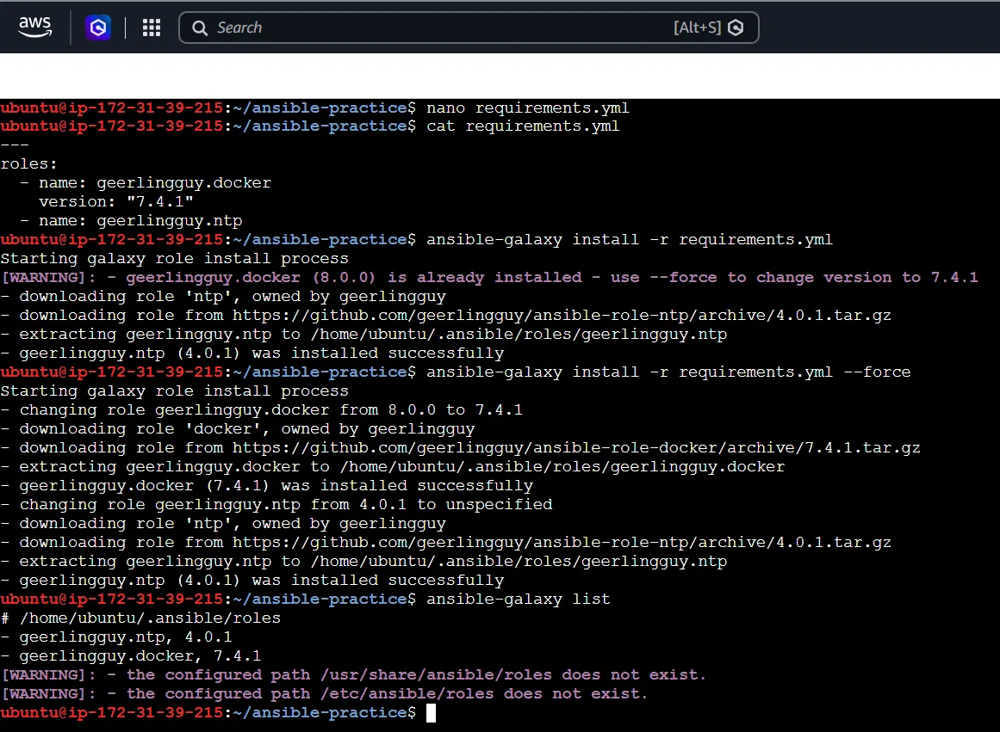

## Documentation question: why use `requirements.yml` instead of installing roles manually?

- **One command** installs all roles at once.
- **Version locking:** everyone gets the same version, so a new release cannot break your setup.
- **Store it in Git:** the whole team uses the same roles.
- **Easy on a new machine:** run one command and you are ready.
- **Works as documentation:** anyone can see which roles the project needs.
- **Repeatable:** the result is the same every time.

---

# Task 5: Ansible Vault -- Encrypt Secrets

## What is Vault?

- Ansible Vault is a **locker** for secrets such as passwords, API keys and tokens.
- It **encrypts** text, so only someone with the vault password can read it.
- Before: `vault_db_password: SuperSecretP@ssw0rd` (anyone can read)
- After: `$ANSIBLE_VAULT;1.1;AES256 66386439...` (unreadable)

## Why use it?

- If you put a password in a playbook and push it to GitHub, **the whole world can read it**.
- Attackers scan GitHub for leaked passwords.
- With Vault, only the encrypted text goes to GitHub.

## Vault commands at a glance

| Command | What it does |
|---|---|
| `ansible-vault create <file>` | Create a **new** encrypted file |
| `ansible-vault edit <file>` | Decrypt, edit, and encrypt again |
| `ansible-vault view <file>` | Show content without editing |
| `ansible-vault encrypt <file>` | Encrypt a file that **already exists** |

## Why the folder is `group_vars/db/`

Ansible automatically loads files from `group_vars/<group name>/` for the servers in that group. Our inventory has a `db` group, so everything in `group_vars/db/` is available to `db-server`.

## Step 1: Create an encrypted file

```bash
cd ~/ansible-practice
mkdir -p group_vars/db
EDITOR=nano ansible-vault create group_vars/db/vault.yml
```

- `EDITOR=nano` tells Ansible to open nano (the default may be vim).
- You are asked for a **New Vault password** and a confirmation. Typing shows nothing on screen, which is normal. **Remember this password.** If you lose it, the file can never be opened again.
- In nano, add:

```yaml
vault_db_password: SuperSecretP@ssw0rd
vault_db_root_password: R00tP@ssw0rd123
vault_api_key: sk-abc123xyz789
```

Save and exit, then check:

```bash
cat group_vars/db/vault.yml
```

You only see `$ANSIBLE_VAULT;1.1;AES256` and encrypted numbers. The secrets are fully hidden.

> **Do not run** `nano ansible-vault create ...`. That opens plain files and your secrets would **not** be encrypted. Always use `ansible-vault create`.

## Step 2: Edit an encrypted file

```bash
EDITOR=nano ansible-vault edit group_vars/db/vault.yml
```

Enter the vault password. The content appears as plain text in nano. I added one line:

```yaml
vault_app_secret: MyEditedSecret123
```

After saving, the file is encrypted again.

**Screenshot: create and edit**

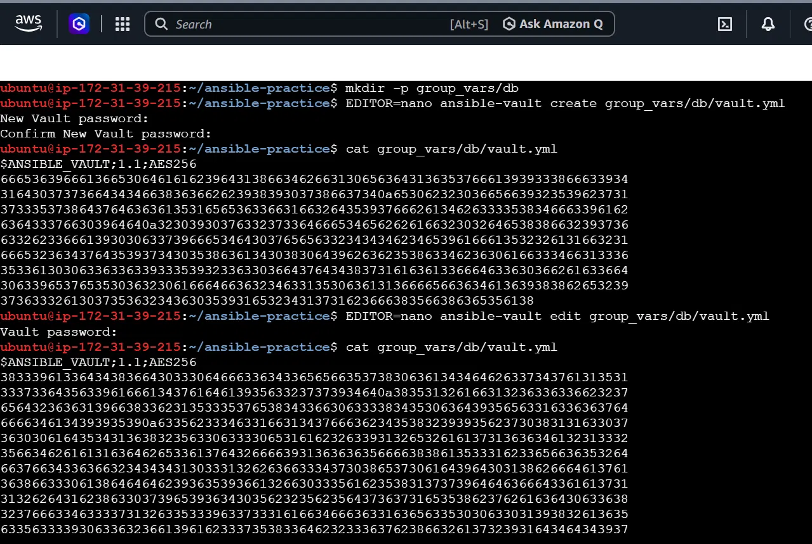

## Step 3: View without editing

```bash
ansible-vault view group_vars/db/vault.yml
```

Shows the 4 lines in plain text but does not change the file.

## Step 4: Encrypt an existing file

First create a normal (plain) file:

```bash
nano group_vars/db/secrets.yml
```

```yaml
vault_smtp_password: MailP@ss456
vault_backup_key: backup-key-789
```

`cat` shows plain text, so it is not safe yet. Encrypt it:

```bash
ansible-vault encrypt group_vars/db/secrets.yml
cat group_vars/db/secrets.yml
```

Now it shows `$ANSIBLE_VAULT;1.1;AES256`. Use the **same vault password** as `vault.yml`, because Ansible loads every file in `group_vars/db/` together.

**Screenshot: view and encrypt existing file**

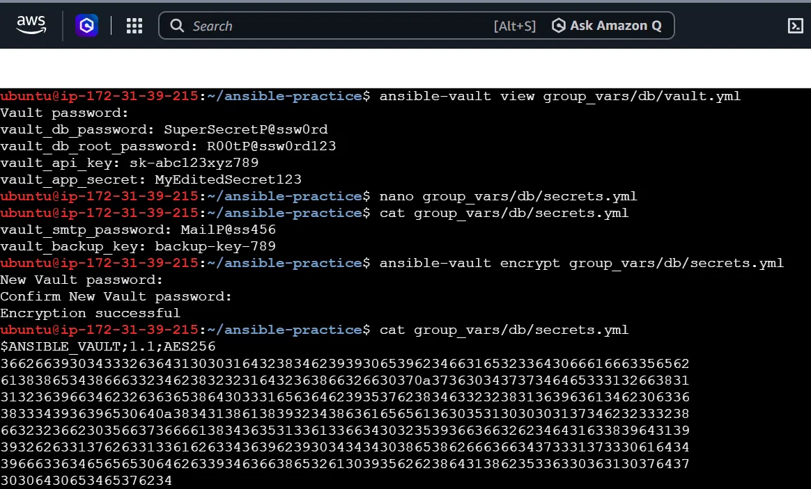

## Step 5: Use vault variables in a playbook

First test the connection. Because `group_vars/db/` is encrypted, every command on the `db` group needs the vault password:

```bash
ansible db -m ping --ask-vault-pass
```

Create `db-setup.yml`:

```bash
nano db-setup.yml
```

```yaml
---
- name: Configure database
  hosts: db
  become: true

  tasks:
    - name: Show DB password (never do this in production)
      debug:
        msg: "DB password is set: {{ vault_db_password | length > 0 }}"
```

- It does **not** print the real password. `length > 0` only checks that a password exists and prints `True` or `False`.
- You do not need to name the vault file in the playbook. Ansible loads it from `group_vars/db/` on its own.

Run it:

```bash
ansible-playbook db-setup.yml --ask-vault-pass
```

Ansible asks `Vault password:`. Output:

```
"msg": "DB password is set: True"
```

PLAY RECAP: `ok=2  failed=0`. The real password is never shown on screen.

**Screenshot: ping and db-setup.yml**

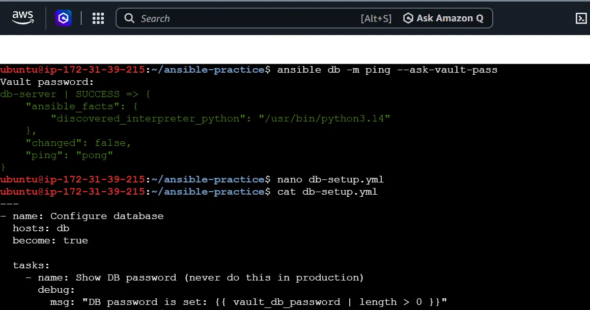

## Step 6: Use a password file (better for automation)

Typing a password every time is not possible in a pipeline. Store it in a file instead.

```bash
echo "<your-vault-password>" > .vault_pass
chmod 600 .vault_pass
echo ".vault_pass" >> .gitignore

ansible-playbook db-setup.yml --vault-password-file .vault_pass
```

Replace `<your-vault-password>` with the password you used for the vault files.

| Command | Why |
|---|---|
| `echo "..." > .vault_pass` | Saves the password in a hidden file |
| `chmod 600 .vault_pass` | Only you can read or write it |
| `echo ".vault_pass" >> .gitignore` | Tells Git to **never upload** this file |
| `--vault-password-file .vault_pass` | Ansible reads the password from the file, no prompt |

**Rules for `.vault_pass`**
- It must contain **only the vault password**, on **one line**. Do not put the secrets inside it.
- It must be the **same password** that encrypted the files.
- Check it has one line: `wc -l .vault_pass` should print `1`.

**Screenshot: run with `--ask-vault-pass` and creating `.vault_pass`**

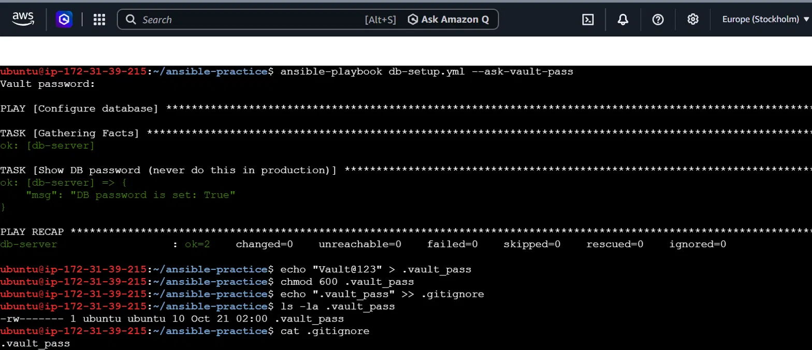

### Set the password file in `ansible.cfg` (optional shortcut)

Add one line under `[defaults]`:

```ini
[defaults]
host_key_checking = False
inventory = inventory.ini
interpreter_python = auto_silent
vault_password_file = .vault_pass
```

Now this works with **no flag at all**:

```bash
ansible-playbook db-setup.yml
```

This only applies when you run commands from `~/ansible-practice` (where `ansible.cfg` lives). Make sure `.vault_pass` is correct first, otherwise every command on the `db` group will fail.

**Screenshot: playbook running with the password coming from `ansible.cfg`**

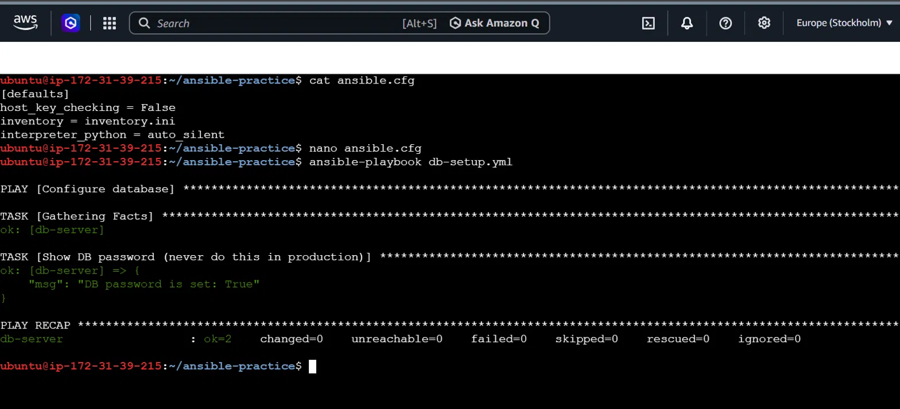

## Documentation question: why is `--vault-password-file` better than `--ask-vault-pass` for automated pipelines?

- **No human is present in a pipeline.** `--ask-vault-pass` waits for someone to type, so a CI/CD job would hang.
- **Fully automatic.** Ansible reads the password from the file by itself.
- **Repeatable and less error-prone.** No manual typing mistakes.
- **Works with secret stores.** A pipeline can write the password from a secret (for example GitHub Secrets) into a file just for the run.
- **Keep the file safe.** Use `chmod 600` and `.gitignore` so the password never reaches Git.

---

# Task 6: Combine Roles, Templates and Vault

## What we are doing

One `site.yml` with **three plays**, one for each server group:

| Play | Hosts | What it uses |
|---|---|---|
| 1 | `web` | Our custom `webserver` role (Task 3) |
| 2 | `app` | Galaxy role `geerlingguy.docker` (Task 4) |
| 3 | `db` | A template that uses vault secrets (Tasks 1 and 5) |

One command configures all three servers.

## Step 1: Create the database template

```bash
nano templates/db-config.j2
```

```
# Database Configuration -- Managed by Ansible
DB_HOST={{ ansible_default_ipv4.address }}
DB_PORT={{ db_port | default(3306) }}
DB_PASSWORD={{ vault_db_password }}
DB_ROOT_PASSWORD={{ vault_db_root_password }}
```

- `ansible_default_ipv4.address`: the db server's own IP (a fact)
- `db_port | default(3306)`: uses 3306 because we do not set `db_port`
- `vault_db_password` and `vault_db_root_password`: come from the encrypted `vault.yml`

The template contains **no real passwords**, only variable names.

**Screenshot: template**

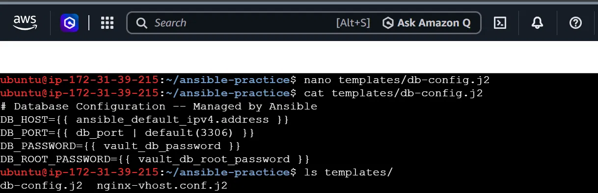

## Step 2: Write the full `site.yml`

Clear the old file and write the new one:

```bash
: > site.yml
nano site.yml
```

```yaml
---
- name: Configure web servers
  hosts: web
  become: true
  roles:
    - role: webserver
      vars:
        app_name: terraweek
        http_port: 80

- name: Configure app servers with Docker
  hosts: app
  become: true
  roles:
    - geerlingguy.docker

- name: Configure database servers
  hosts: db
  become: true
  tasks:
    - name: Create DB config with secrets
      template:
        src: templates/db-config.j2
        dest: /etc/db-config.env
        owner: root
        mode: '0600'
```

- `mode: '0600'` means only the owner (root) can read and write the file. This matters because the file holds secrets in plain text.
- Here `src: templates/db-config.j2` includes `templates/` because this is a normal playbook, not a role.

**Screenshot: site.yml**

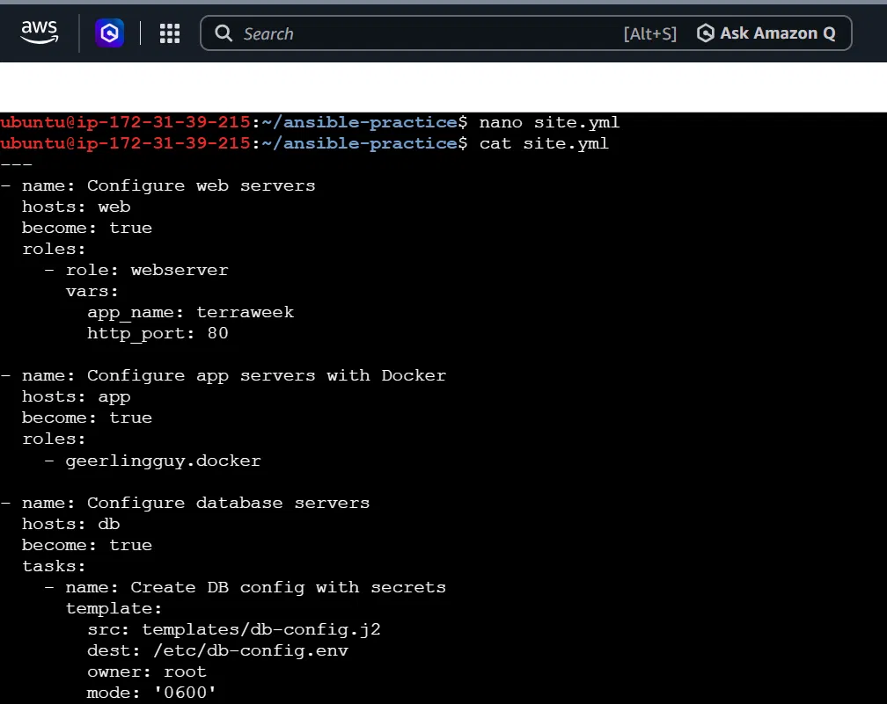

## Step 3: Run it

```bash
ansible-playbook site.yml
```

No vault prompt appears because `ansible.cfg` points to `.vault_pass`.

PLAY RECAP:

| Server | ok | changed | failed |
|---|---|---|---|
| app-server | 13 | 2 | 0 |
| db-server | 2 | 1 | 0 |
| web-server | 7 | 0 | 0 |

- `web-server`: nothing changed, the role was already applied in Task 3.
- `app-server`: the Docker role ran again.
- `db-server`: the new config file was created (`changed=1`).

**Screenshot: web play**

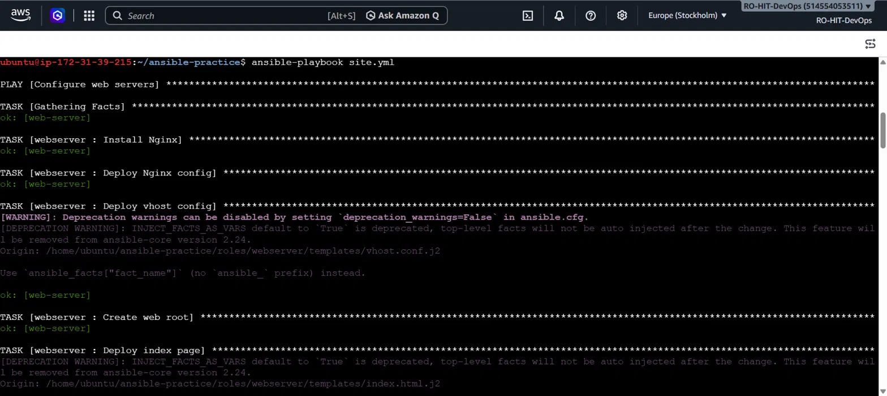

## Step 4: Verify on the database server

The task says "SSH into the db server". Running the same checks through Ansible gives the same result:

```bash
ansible db -b -m command -a "cat /etc/db-config.env"
ansible db -b -m command -a "ls -l /etc/db-config.env"
```

- `-b` means use sudo. It is needed because only root can read the file.

Result of the first command:

```
# Database Configuration -- Managed by Ansible
DB_HOST=172.31.47.21
DB_PORT=3306
DB_PASSWORD=<real value from vault>
DB_ROOT_PASSWORD=<real value from vault>
```

Result of the second command:

```
-rw------- 1 root root 146 Oct 22 01:22 /etc/db-config.env
```

**Question: Are the secrets rendered correctly?** **Yes.** The vault values were decrypted and filled in. No `{{ }}` is left. `DB_HOST` is the db server's own IP.

**Question: Is the file permission 600?** **Yes.** `-rw-------` means only root can read and write.

**Screenshot: recap, rendered file and permissions**

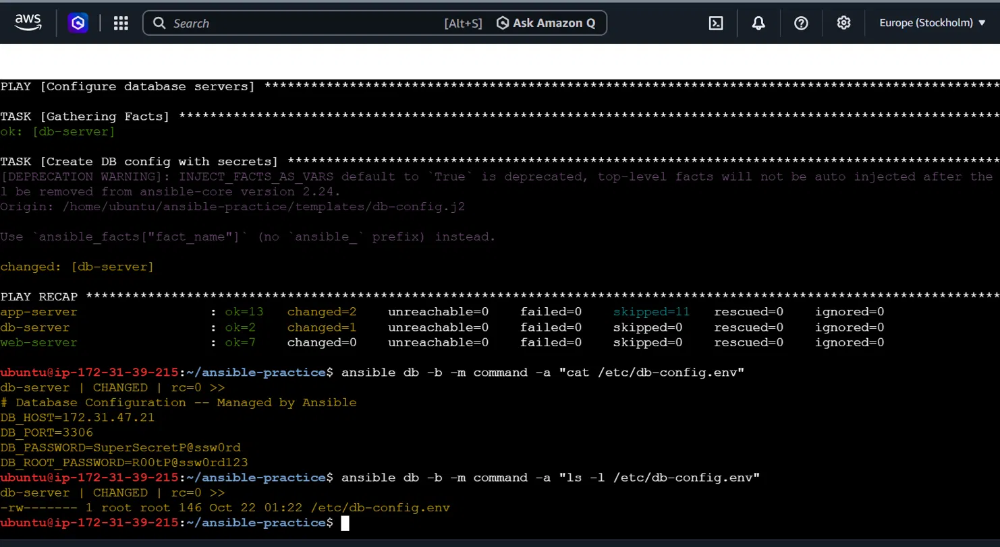

---

## Common errors and fixes

| Error message | Why it happens | Fix |
|---|---|---|
| `yum` module fails on Ubuntu | `yum` is for Red Hat / Amazon Linux | Use `apt` on Ubuntu |
| Curl shows the old page after Task 3 | Old config from Task 1 is still active | `sudo rm /etc/nginx/conf.d/terraweek-app.conf` |
| `Attempting to decrypt but no vault secrets found` (even on `ansible db -m ping`) | `group_vars/db/` is encrypted and no password was given | Add `--ask-vault-pass` or `--vault-password-file .vault_pass` |
| `Decryption failed (no vault secrets were found that could decrypt)` | Wrong vault password, or `.vault_pass` has the wrong content, or `vault.yml` and `secrets.yml` have **different** passwords | Make sure `.vault_pass` holds only the correct password on one line, and re-create the files with one password |
| `geerlingguy.docker ... is already installed - use --force` | Role is installed in another version | Add `--force` |
| `no hosts matched` | Wrong inventory or group name | Run `ansible-inventory --graph` |
| `[DEPRECATION WARNING] INJECT_FACTS_AS_VARS` | Notice from newer Ansible | Ignore, it is not an error |

---

## Key takeaways

- **Templates (`.j2`)** create config files from variables and facts, so one file works for many servers.
- **Roles** keep tasks, handlers, templates and variables in a standard structure that can be reused.
- **`defaults`** are easy to override and **`vars`** are not. Playbook values beat `defaults`.
- **Galaxy** gives ready-made roles, and **`requirements.yml`** installs them with fixed versions.
- **Vault** keeps secrets encrypted. Use a password file for automation, and never commit it to Git.
- All of these were combined in one `site.yml` that configures web, app and database servers with a single command.
