# Day 72 - Ansible Project: Deploy a Web Stack on AWS EC2 (Docker + Nginx + Vault)

> **Goal of today:** Put everything from Day 68 to Day 71 into ONE real project.
> We configure a fresh Ubuntu EC2 server **only with Ansible**. No manual setup on the server.
> At the end, a browser opens `http://<server-public-ip>` and shows the app running behind Nginx, inside a Docker container.

This file is written so that **anyone**, even someone who never did Day 72, can read it top to bottom and repeat the whole project.

Screenshots are at the end of every task under **Output**. They live in the `Screenshots/` folder next to this file.

---

## Table of Contents

1. [What we are building](#what-we-are-building)
2. [Prerequisites](#prerequisites)
3. [Final project structure](#final-project-structure)
4. [Task 1 - Project setup](#task-1---project-setup)
5. [Task 2 - Common role (base server setup)](#task-2---common-role-base-server-setup)
6. [Task 3 - Docker role](#task-3---docker-role)
7. [Task 4 - Nginx role (reverse proxy)](#task-4---nginx-role-reverse-proxy)
8. [Task 5 - Ansible Vault (secrets)](#task-5---ansible-vault-secrets)
9. [Task 6 - Full site.yml, tags, dry run](#task-6---full-siteyml-tags-dry-run)
10. [Task 7 - Change the app to Apache httpd and re-run (idempotency)](#task-7---change-the-app-to-apache-httpd-and-re-run-idempotency)
11. [Concepts: which day taught what](#concepts-which-day-taught-what)
12. [Final result](#final-result)
13. [Production improvements](#production-improvements)
14. [Cleanup](#cleanup)
15. [Common errors and fixes](#common-errors-and-fixes)

---

## What we are building

```
 You (browser)
      |
      |  http://<EC2-public-IP>   (port 80)
      v
 +---------------------- EC2 Ubuntu server ("web-server") ----------------------+
 |                                                                               |
 |   Nginx (installed by Ansible)                                                |
 |      |   reverse proxy: forwards port 80  ->  127.0.0.1:8080                  |
 |      v                                                                        |
 |   Docker container "apache-app" (started by Ansible)                          |
 |      image: httpd   (Apache web server)                                       |
 |                                                                               |
 +-------------------------------------------------------------------------------+

 Ansible runs from the same machine (control node) and configures the "web-server" host.
```

Three things are done by three **roles**:

| Role     | Job                                                                 |
|----------|---------------------------------------------------------------------|
| `common` | Update apt, install basic packages, create a deploy user, folders   |
| `docker` | Install Docker, log in to Docker Hub (using Vault), run the container |
| `nginx`  | Install Nginx, deploy config from templates, reverse-proxy to the container |

One file, `site.yml`, calls all three roles in order (three **plays**).

---

## Prerequisites

- An AWS EC2 Ubuntu instance (we used region Europe/Stockholm). Security Group must allow:
  - port **22** (SSH)
  - port **80** (HTTP)
- Ansible installed on the control machine:
  ```bash
  sudo apt update
  sudo apt install -y ansible
  ansible --version
  ```
- A Docker Hub account and a **Personal Access Token** (used instead of your password).
- Basic idea of YAML (indentation = 2 spaces, never tabs).

---

## Final project structure

```
ansible-project/
├── ansible.cfg                  # Ansible settings for this project
├── inventory.ini                # List of servers
├── site.yml                     # Main playbook (3 plays)
├── .vault_pass                  # Vault password file (NEVER push to GitHub)
├── group_vars/
│   ├── all.yml                  # Normal variables
│   └── vault.yml                # Encrypted secrets (safe to push, it is encrypted)
└── roles/
    ├── common/
    │   └── tasks/main.yml
    ├── docker/
    │   ├── defaults/main.yml
    │   ├── handlers/main.yml
    │   └── tasks/main.yml
    └── nginx/
        ├── handlers/main.yml
        ├── tasks/main.yml
        └── templates/
            ├── nginx.conf.j2
            └── app-proxy.conf.j2
```

Add this `.gitignore` so secrets never reach GitHub:

```
.vault_pass
*.retry
```

---

## Task 1 - Project setup

### What
Create the project folder, the inventory, `ansible.cfg`, and test that Ansible can reach the server.

### Why
Ansible needs to know **which servers** to manage (inventory) and **how** to connect (config). A simple `ping` proves the connection works before we write any real code.

### Steps

**1. Create the folders**

```bash
mkdir -p ~/ansible-project && cd ~/ansible-project
mkdir -p group_vars
ansible-galaxy init roles/common
ansible-galaxy init roles/docker
ansible-galaxy init roles/nginx
```

`ansible-galaxy init` creates the standard role folder layout (`tasks`, `handlers`, `defaults`, `templates`, ...).

**2. Create `inventory.ini`**

```ini
[web]
web-server ansible_host=<EC2-PUBLIC-IP> ansible_user=ubuntu ansible_ssh_private_key_file=~/.ssh/<your-key>.pem
```

- `[web]` is a **group**. Group name is used later in the playbook (`hosts: web`).
- `web-server` is the **host alias** (just a name we choose; it shows in the output).
- `ansible_host` is the real IP. `ansible_user` is the SSH user (`ubuntu` on Ubuntu AMIs).

> If you run Ansible on the same EC2 server, you can use `ansible_connection=local` instead of SSH.

**3. Create `ansible.cfg`**

```ini
[defaults]
inventory = inventory.ini
host_key_checking = False
roles_path = roles
retry_files_enabled = False

[privilege_escalation]
become = True
become_method = sudo
```

- `inventory = inventory.ini` means we do not need `-i` every time.
- `host_key_checking = False` skips the "are you sure you want to connect" question.
- `become = True` runs tasks with sudo (needed for apt, service, etc.).

**4. Test the connection (ad-hoc command)**

```bash
ansible web -m ping
```

Expected:

```
web-server | SUCCESS => {
    "changed": false,
    "ping": "pong"
}
```

`pong` means: SSH works, Python exists on the server, Ansible can run modules.

### Output

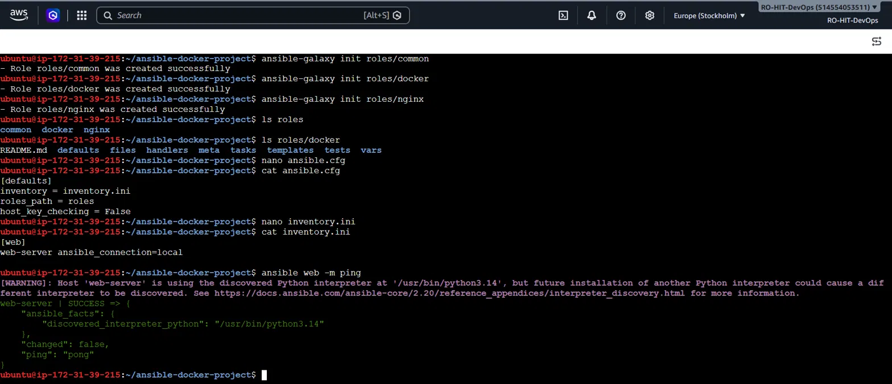

---

## Task 2 - Common role (base server setup)

### What
Write the `common` role. It prepares every server the same way: update apt cache, install a list of packages, create a user, create a folder.

### Why
Every server needs the same basics (curl, git, vim, etc.). Putting this in a role means we write it once and reuse it for 1 server or 100 servers.

### Steps

**1. Create the variables - `group_vars/all.yml`**

```yaml
---
# Applies to every host
app_env: production
deploy_user: deploy
app_dir: /opt/app

common_packages:
  - curl
  - git
  - vim
  - htop
  - unzip
  - acl
```

**Variables explained**
- `group_vars/all.yml` is loaded automatically for **all** hosts. Ansible reads this folder by name, no import needed.
- `common_packages` is a **list**. We give the whole list to the `apt` module and Ansible installs each package. We did not write a `loop:` ourselves. The `apt` module accepts a list directly.
- `acl` is included because Ansible needs it when it becomes a non-root user (see the error section / Task 5).

**2. Write the role tasks - `roles/common/tasks/main.yml`**

```yaml
---
- name: Update apt cache
  ansible.builtin.apt:
    update_cache: yes
    cache_valid_time: 3600

- name: Install common packages
  ansible.builtin.apt:
    name: "{{ common_packages }}"
    state: present

- name: Create deploy user
  ansible.builtin.user:
    name: "{{ deploy_user }}"
    shell: /bin/bash
    groups: sudo
    append: yes
    state: present

- name: Create application directory
  ansible.builtin.file:
    path: "{{ app_dir }}"
    state: directory
    owner: "{{ deploy_user }}"
    group: "{{ deploy_user }}"
    mode: "0755"
```

**Logic explained**
| Task | Module | What it does |
|------|--------|--------------|
| Update apt cache | `apt` | Same as `apt update`. `cache_valid_time` avoids repeating it within 1 hour. |
| Install common packages | `apt` | Installs every package in the `common_packages` list. `state: present` = install if missing. |
| Create deploy user | `user` | Creates a Linux user. Safe to re-run: if the user exists, nothing changes. |
| Create application directory | `file` | Creates `/opt/app` with the right owner and permissions. |

**3. Create the first `site.yml` (only common for now)**

```yaml
---
- name: Common setup
  hosts: web
  roles:
    - common
```

**4. Check the syntax (does not run anything)**

```bash
ansible-playbook site.yml --syntax-check
```

Expected: `playbook: site.yml`

**5. Run it**

```bash
ansible-playbook site.yml
```

**6. Verify on the server (ad-hoc commands)**

```bash
ansible web -a "git --version"
ansible web -a "id deploy"
ansible web -a "ls -ld /opt/app"
```

### Output

**Variables file**

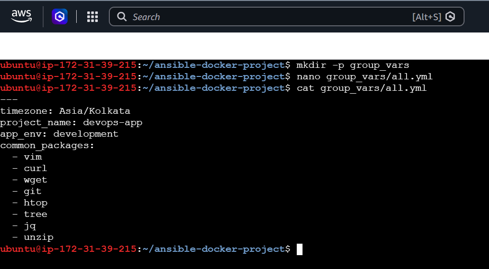

**Common role tasks**

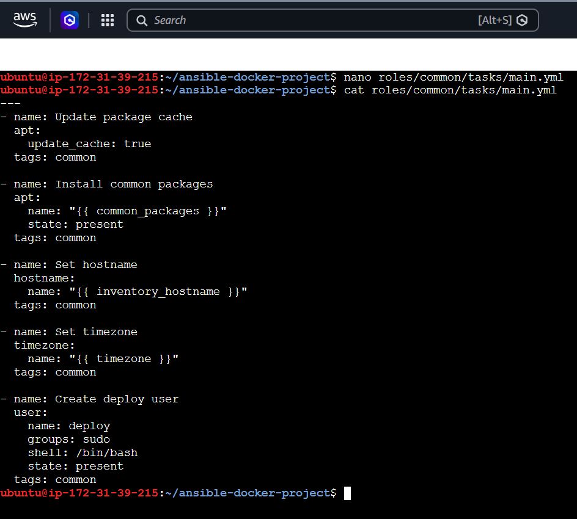

**Syntax check**

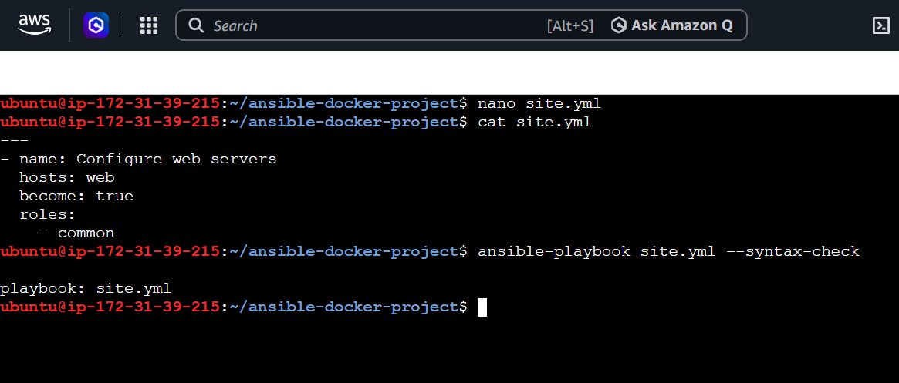

**Common role run**

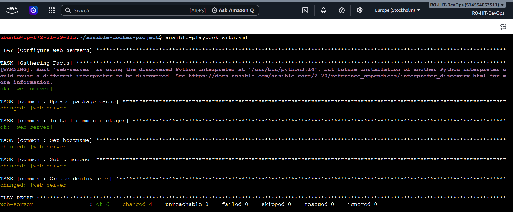

**Verify**

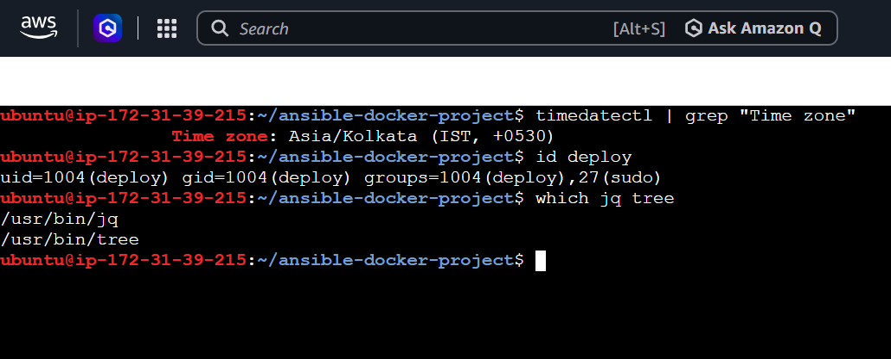

---

## Task 3 - Docker role

### What
Install Docker on the server with Ansible and run a container from the `community.docker` collection.

### Why
Docker is how we package and run the app. Instead of typing `docker run ...` by hand, Ansible does it, so the result is repeatable.

### Steps

**1. Install the Docker collection (Ansible Galaxy)**

```bash
ansible-galaxy collection install community.docker
ansible-galaxy collection list | grep docker
```

A **collection** is a bundle of extra modules. `docker_container` and `docker_login` come from it.

**2. Role defaults - `roles/docker/defaults/main.yml`**

```yaml
---
# Lowest priority variables. Anyone can override them in group_vars or with -e
docker_packages:
  - docker.io
  - docker-compose-v2
  - python3-docker

app_container_name: apache-app
app_image: httpd
app_image_tag: latest
app_host_port: 8080
app_container_port: 80
```

**Why defaults?** `defaults/main.yml` has the **lowest priority**. This makes the role reusable: you can change a value from `group_vars/all.yml` or from the command line without touching the role.

- `python3-docker` is required on the server so Ansible's Docker modules can talk to Docker.
- The container publishes **host port 8080** to **container port 80**. Nginx will use 8080 later, so port 80 stays free for Nginx.

**3. Role tasks - `roles/docker/tasks/main.yml`**

```yaml
---
- name: Install Docker packages
  ansible.builtin.apt:
    name: "{{ docker_packages }}"
    state: present
    update_cache: yes
  notify: Restart Docker

- name: Start and enable Docker service
  ansible.builtin.service:
    name: docker
    state: started
    enabled: yes

- name: Add deploy user to docker group
  ansible.builtin.user:
    name: "{{ deploy_user }}"
    groups: docker
    append: yes

- name: Log in to Docker Hub
  community.docker.docker_login:
    username: "{{ vault_docker_username }}"
    password: "{{ vault_docker_token }}"
  when: vault_docker_username is defined
  no_log: true

- name: Pull application image
  community.docker.docker_image:
    name: "{{ app_image }}"
    tag: "{{ app_image_tag }}"
    source: pull

- name: Run application container
  community.docker.docker_container:
    name: "{{ app_container_name }}"
    image: "{{ app_image }}:{{ app_image_tag }}"
    state: started
    restart_policy: unless-stopped
    ports:
      - "{{ app_host_port }}:{{ app_container_port }}"
```

**Logic explained**
- `notify: Restart Docker` -> only fires the handler if this task **changed** something.
- `when: vault_docker_username is defined` is a **conditional**. The login task runs only if the vault variable exists. This keeps the role working before Vault is set up (Task 5).
- `no_log: true` hides the username/token from the output, so secrets never print on screen.
- `restart_policy: unless-stopped` means the container comes back after a server reboot.
- `ports: "8080:80"` format is `host_port:container_port`.

**4. Handlers - `roles/docker/handlers/main.yml`**

```yaml
---
- name: Restart Docker
  ansible.builtin.service:
    name: docker
    state: restarted
```

A **handler** is a task that runs only when notified, and only **once at the end** of the play, even if notified many times.

**5. Wire it into `site.yml`**

```yaml
---
- name: Common setup
  hosts: web
  roles:
    - common

- name: Docker setup
  hosts: web
  roles:
    - docker
```

```bash
ansible-playbook site.yml --syntax-check
```

**6. Run and verify**

```bash
ansible-playbook site.yml
ansible web -a "docker --version"
ansible web -a "docker ps"
curl http://<EC2-PUBLIC-IP>:8080
```

> To test port 8080 from your browser, temporarily allow port 8080 in the Security Group. After Task 4 you will not need it, because Nginx serves on port 80.

### Output

**Collection + defaults**

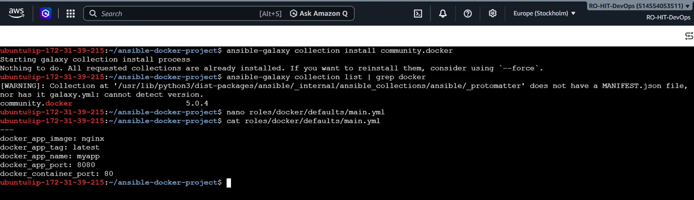

**Docker role tasks (4 parts)**

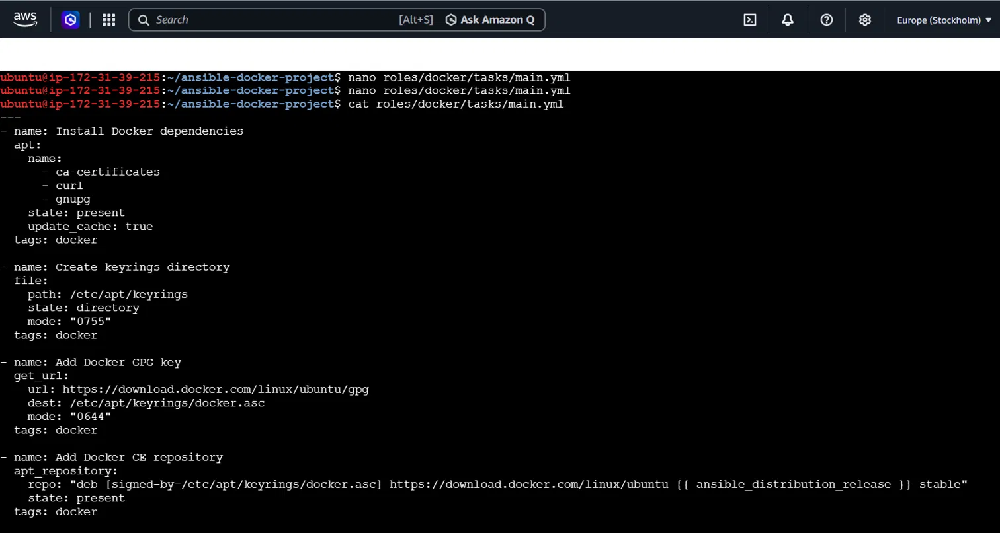

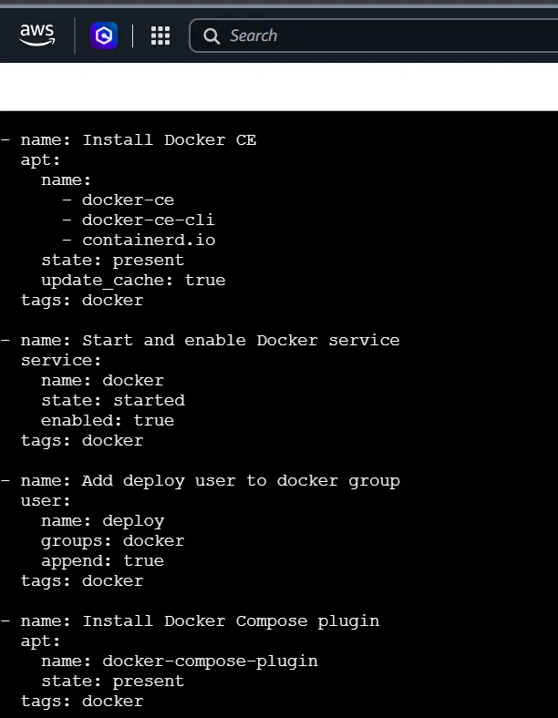

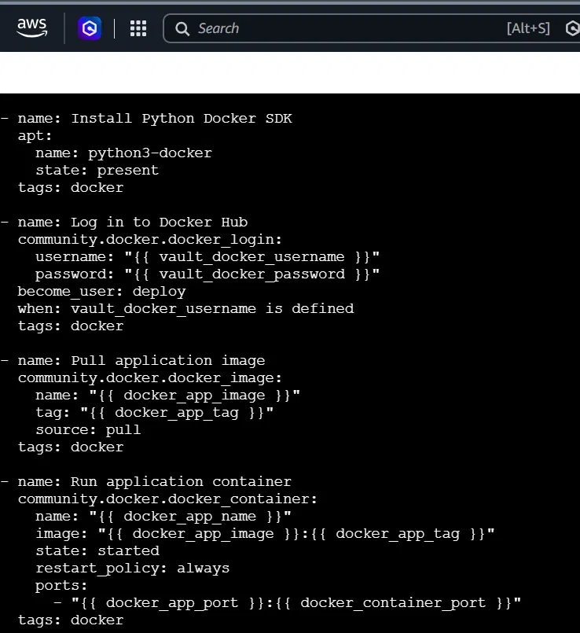

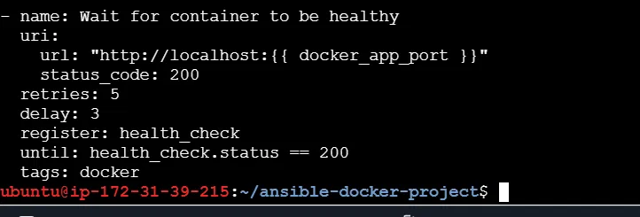

**Handlers + site.yml syntax check**

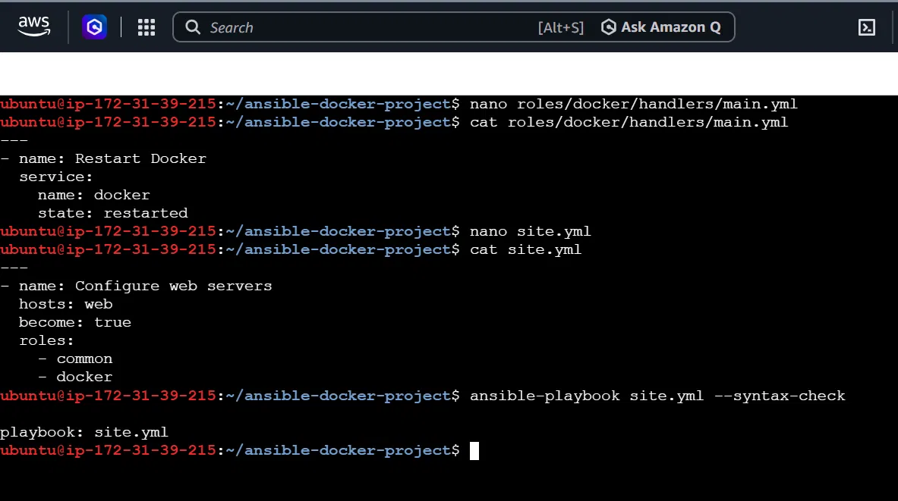

**Playbook run (2 parts)**

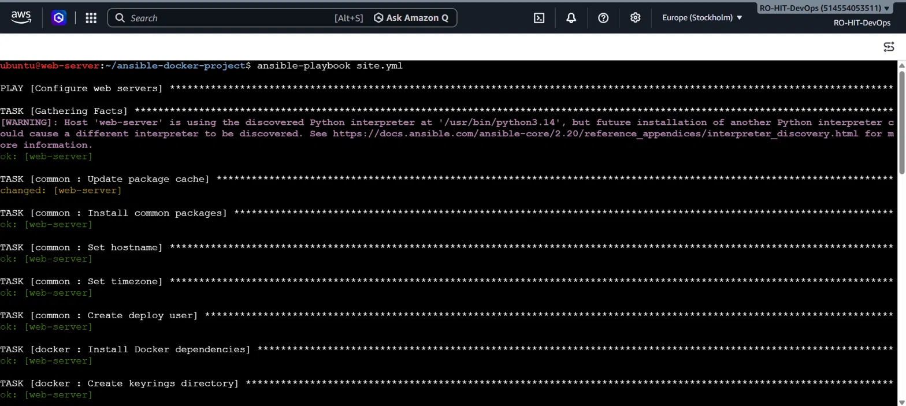

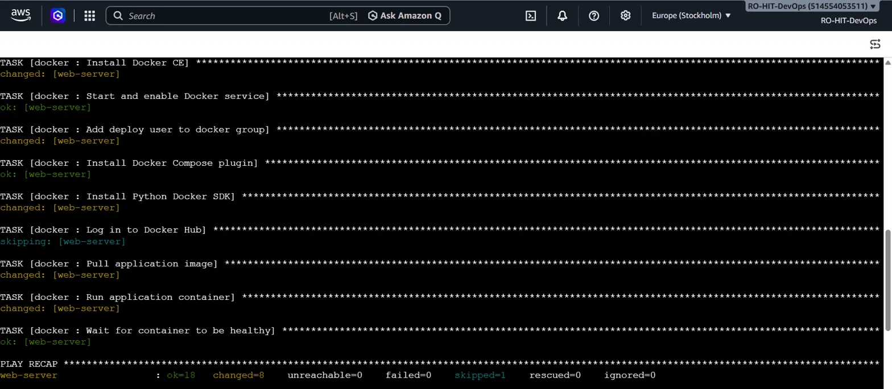

**Verify**

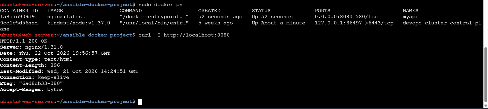

---

## Task 4 - Nginx role (reverse proxy)

### What
Install Nginx and configure it with **Jinja2 templates** so that visitors on port 80 are forwarded to the Docker container on port 8080.

### Why
In real projects you do not expose the app port directly. Nginx sits in front (port 80), handles web traffic, and passes requests to the app. This is called a **reverse proxy**.

### Steps

**1. Check that port 80 is free**

```bash
ansible web -a "ss -tlnp"
```

If something already listens on port 80 (for example Apache), Nginx will fail to start. Stop that service first, or choose a different port.

**2. Add Nginx variables - append to `group_vars/all.yml`**

```yaml
nginx_listen_port: 80
nginx_server_name: "_"
nginx_worker_connections: 1024
```

**3. Template: reverse proxy site - `roles/nginx/templates/app-proxy.conf.j2`**

```nginx
# Managed by Ansible - do not edit by hand
server {
    listen {{ nginx_listen_port }};
    server_name {{ nginx_server_name }};

    location / {
        proxy_pass http://127.0.0.1:{{ app_host_port }};
        proxy_set_header Host $host;
        proxy_set_header X-Real-IP $remote_addr;
        proxy_set_header X-Forwarded-For $proxy_add_x_forwarded_for;
    }
}
```

**4. Template: main Nginx config - `roles/nginx/templates/nginx.conf.j2`**

```nginx
# Managed by Ansible - environment: {{ app_env }}
user www-data;
worker_processes auto;
pid /run/nginx.pid;

events {
    worker_connections {{ nginx_worker_connections }};
}

http {
    include /etc/nginx/mime.types;
    default_type application/octet-stream;

    access_log /var/log/nginx/access.log;
    error_log  /var/log/nginx/error.log;


    server_tokens off;


    include /etc/nginx/conf.d/*.conf;
}
```

**Templates explained**
- A `.j2` file is a Jinja2 template. `{{ variable }}` is replaced by the variable's value when Ansible copies the file.
- ` ... ` is a **conditional inside a template**. In production we hide the Nginx version (`server_tokens off`).
- `app_host_port` comes from the docker role defaults, so Nginx always points to the right container port.

**5. Handlers - `roles/nginx/handlers/main.yml`**

```yaml
---
- name: Reload Nginx
  ansible.builtin.service:
    name: nginx
    state: reloaded
```

**6. Tasks - `roles/nginx/tasks/main.yml`**

```yaml
---
- name: Install Nginx
  ansible.builtin.apt:
    name: nginx
    state: present

- name: Remove default Nginx site config
  ansible.builtin.file:
    path: /etc/nginx/sites-enabled/default
    state: absent
  notify: Reload Nginx

- name: Deploy main Nginx config
  ansible.builtin.template:
    src: nginx.conf.j2
    dest: /etc/nginx/nginx.conf
    owner: root
    group: root
    mode: "0644"
  notify: Reload Nginx

- name: Deploy reverse proxy config
  ansible.builtin.template:
    src: app-proxy.conf.j2
    dest: /etc/nginx/conf.d/app-proxy.conf
    owner: root
    group: root
    mode: "0644"
  notify: Reload Nginx

- name: Test Nginx configuration
  ansible.builtin.command: nginx -t
  changed_when: false

- name: Start and enable Nginx
  ansible.builtin.service:
    name: nginx
    state: started
    enabled: yes
```

**Logic explained**
| Task | Why |
|------|-----|
| Remove default site | The default Nginx welcome page would conflict with our config. |
| Deploy templates | `template` module renders `.j2` files with our variables and copies them to the server. |
| Test configuration | `nginx -t` checks for syntax errors **before** Nginx loads the config. `changed_when: false` because a test never changes anything. |
| Start and enable | Starts Nginx now and on every reboot. |
| `notify: Reload Nginx` | Reload only happens if a file actually changed. |

**7. Add the role to `site.yml`**

```yaml
---
- name: Common setup
  hosts: web
  roles:
    - common

- name: Docker setup
  hosts: web
  roles:
    - docker

- name: Nginx setup
  hosts: web
  roles:
    - nginx
```

**8. Run and verify**

```bash
ansible-playbook site.yml
ansible web -a "nginx -t"
ansible web -a "systemctl status nginx --no-pager"
curl http://<EC2-PUBLIC-IP>
```

**9. Open in the browser:** `http://<EC2-PUBLIC-IP>` (port 80). The app page loads through Nginx.

### Output

**Port check + defaults**

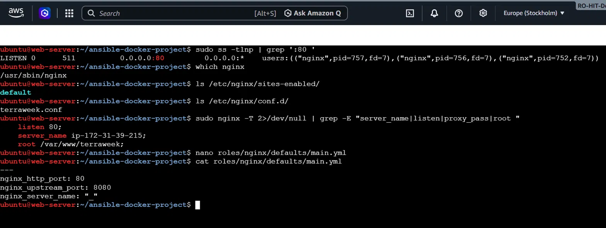

**Reverse proxy template**

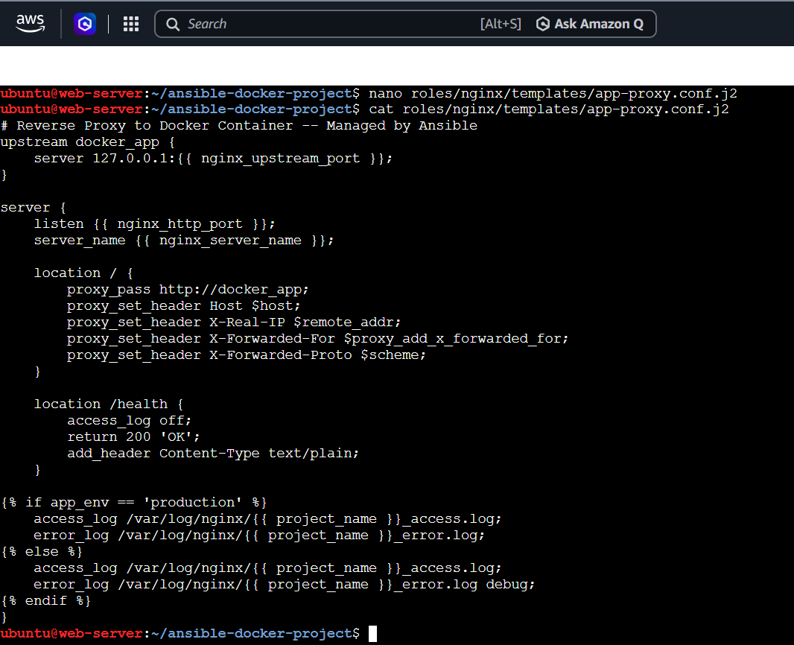

**Main Nginx template**

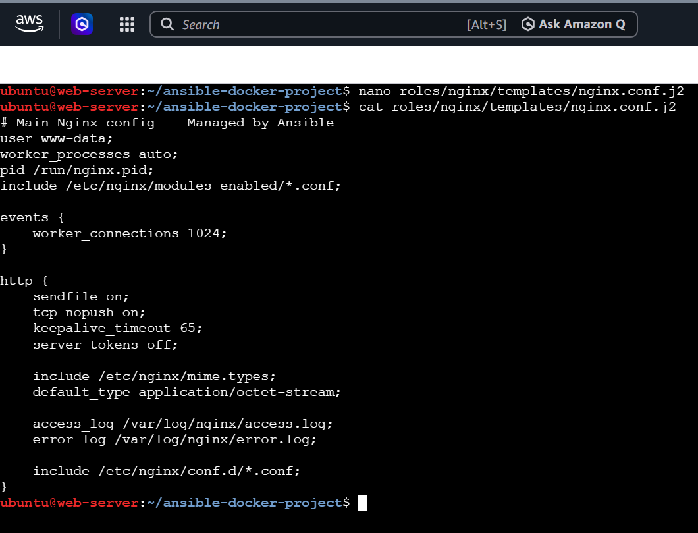

**Handlers**

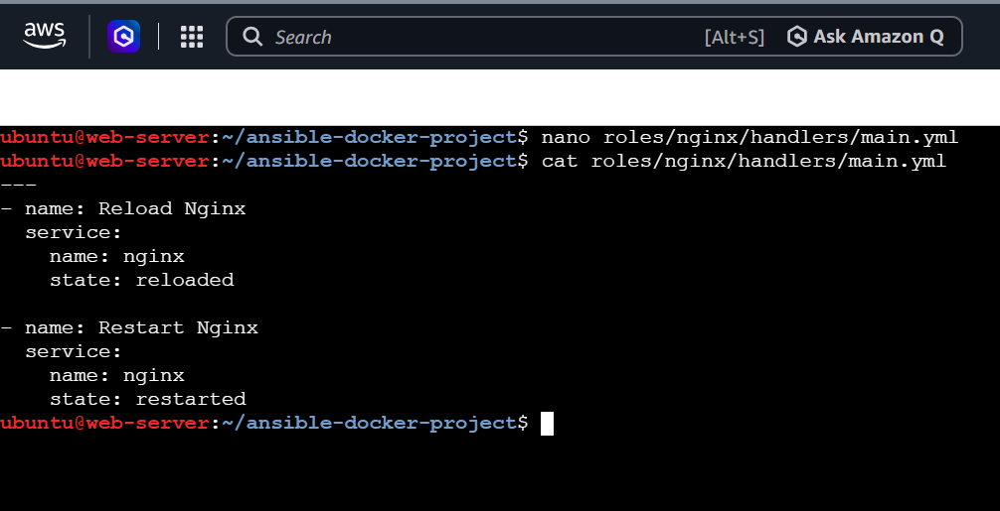

**Nginx tasks (2 parts)**

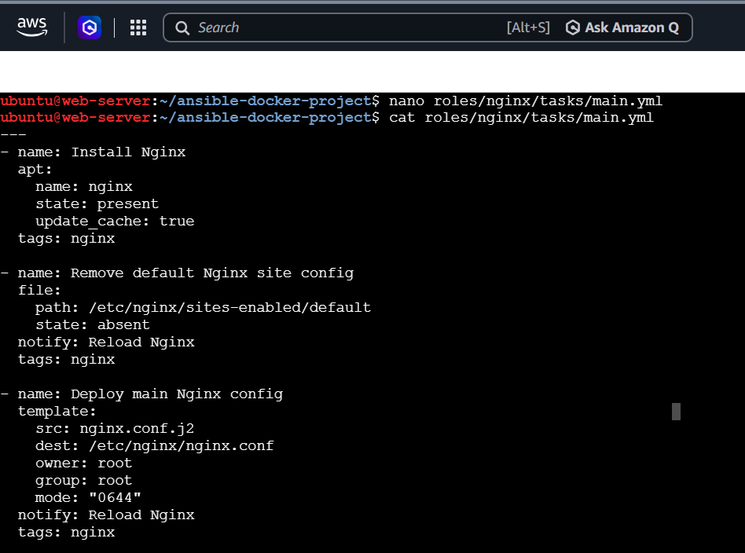

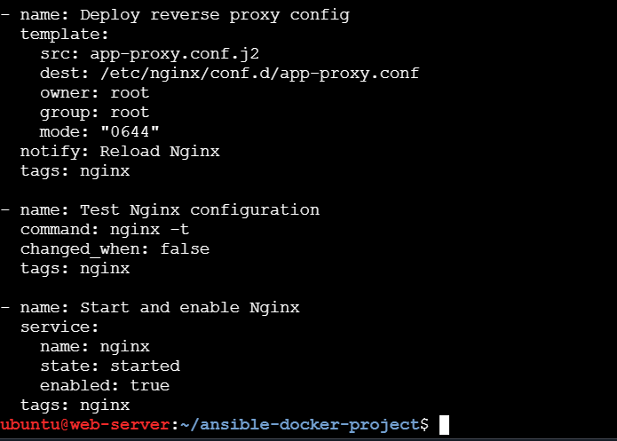

**site.yml with Nginx role + run (2 parts)**

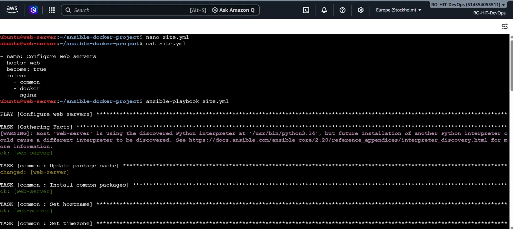

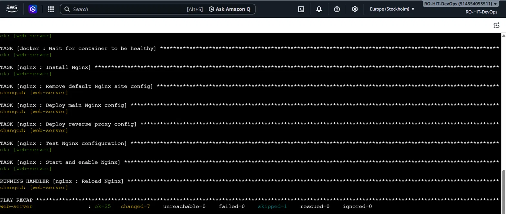

**Verify**

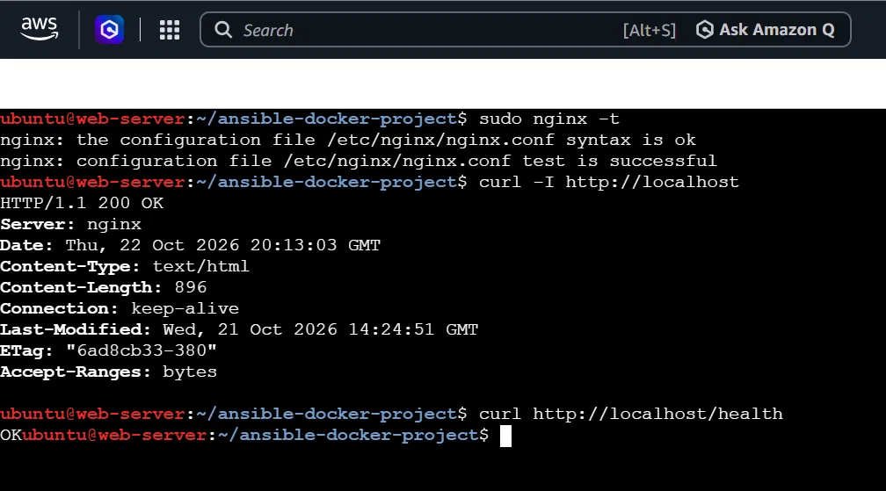

**Browser on port 80**

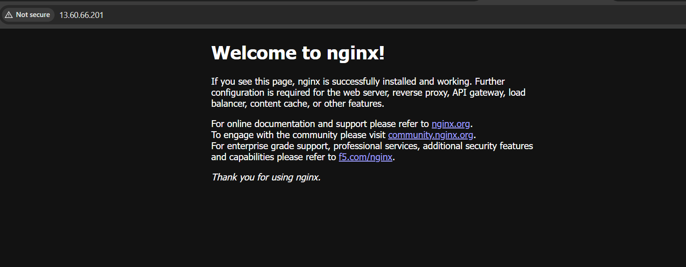

---

## Task 5 - Ansible Vault (secrets)

### What
Store the Docker Hub username and token in an **encrypted file** using Ansible Vault, and let the playbook decrypt it automatically.

### Why
Never write passwords or tokens in plain text, and never push them to GitHub. Vault encrypts the file with AES. The encrypted file is safe to keep in Git. Only the vault password must stay secret.

### Steps

**1. Create the vault password file**

```bash
echo "YourStrongVaultPassword" > .vault_pass
chmod 600 .vault_pass
echo ".vault_pass" >> .gitignore
```

**2. Tell Ansible to use it - add to `ansible.cfg` under `[defaults]`**

```ini
vault_password_file = .vault_pass
```

Now Ansible decrypts vault files automatically, so you do not need `--ask-vault-pass`.

**3. Create the encrypted file**

```bash
ansible-vault create group_vars/vault.yml
```

An editor opens. Type:

```yaml
---
vault_docker_username: your-dockerhub-username
vault_docker_token: your-dockerhub-access-token
```

Save and exit. The file on disk is now encrypted.

**4. Check it**

```bash
cat group_vars/vault.yml          # shows $ANSIBLE_VAULT;1.1;AES256 ... (unreadable)
ansible-vault view group_vars/vault.yml   # shows the real content
```

Other useful vault commands:

```bash
ansible-vault edit group_vars/vault.yml      # edit safely
ansible-vault encrypt somefile.yml           # encrypt an existing file
ansible-vault decrypt somefile.yml           # decrypt (careful!)
ansible-vault rekey group_vars/vault.yml     # change the vault password
```

**5. Load the vault file in the Docker play - update `site.yml`**

```yaml
- name: Docker setup
  hosts: web
  vars_files:
    - group_vars/vault.yml
  roles:
    - docker
```

`vars_files` loads the encrypted variables so the `docker_login` task can use `vault_docker_username` and `vault_docker_token`.

> Naming rule: all secret variables start with `vault_`. It tells every reader "this value comes from the encrypted file".

**6. Fix: `acl` package error**

When Ansible runs a task as a non-root user with `become`, it may fail with:

```
Failed to set permissions on the temporary files Ansible needs to create when becoming an unprivileged user
```

**Fix:** install the `acl` package on the server. We added `acl` to `common_packages` in `group_vars/all.yml` (Task 2). Re-run the common role:

```bash
ansible-playbook site.yml --tags common
```

**7. Run the playbook with Vault**

```bash
ansible-playbook site.yml
```

The task `Log in to Docker Hub` now runs and shows `changed` or `ok`. The token is hidden because of `no_log: true`.

### Output

**Vault setup and config**

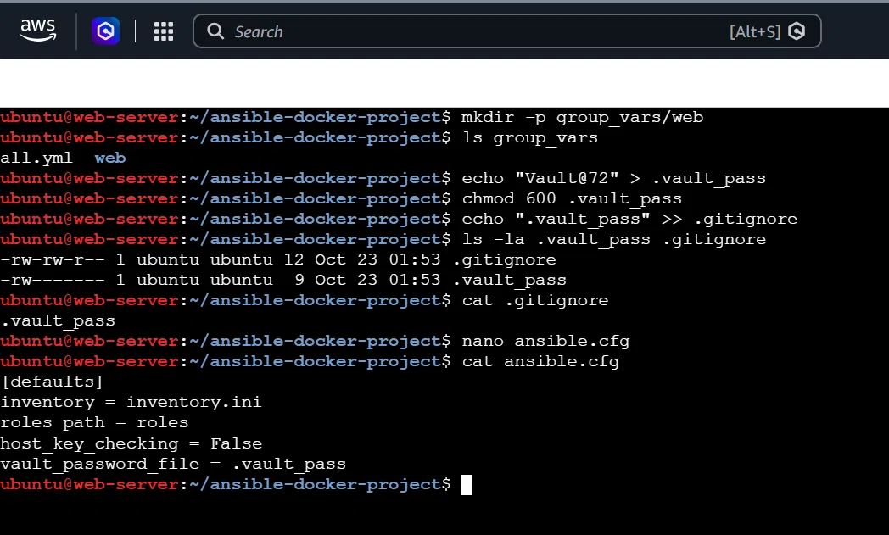

**Vault created and checked**

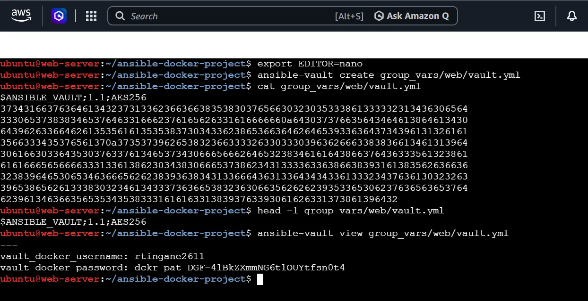

**Fix for acl package**

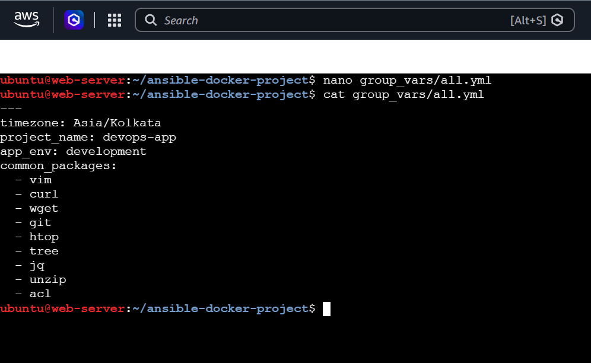

**Playbook run with Vault (2 parts)**

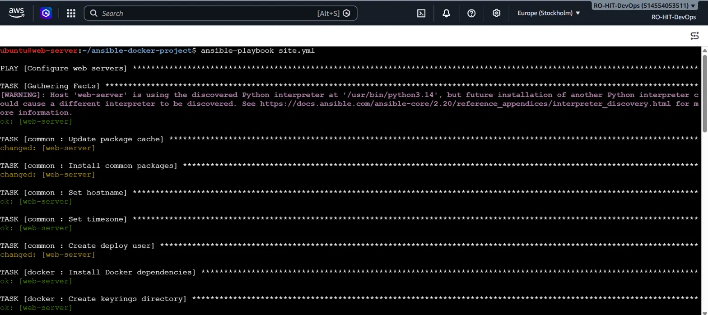

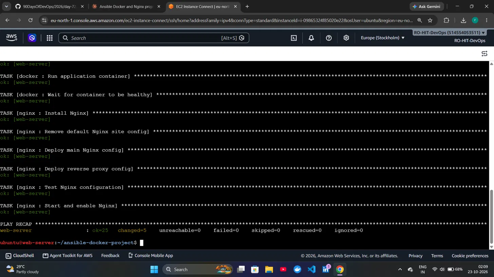

---

## Task 6 - Full site.yml, tags, dry run

### What
Finalize `site.yml` with three plays, add **tags**, then use `--check --diff`, `--tags`, `--skip-tags` and `-e`.

### Why
In real life you do not want to run everything every time. Tags let you run only one part (for example, only Nginx). Dry run shows what **would** change without changing anything.

### Steps

**1. Final `site.yml` with tags**

```yaml
---
- name: Common setup
  hosts: web
  roles:
    - role: common
      tags: [common]

- name: Docker setup
  hosts: web
  vars_files:
    - group_vars/vault.yml
  roles:
    - role: docker
      tags: [docker]

- name: Nginx setup
  hosts: web
  roles:
    - role: nginx
      tags: [nginx]
```

**2. Syntax check**

```bash
ansible-playbook site.yml --syntax-check
```

**3. Dry run: see what WOULD change**

```bash
ansible-playbook site.yml --check --diff
```

- `--check` = do not change anything, just predict.
- `--diff` = show the exact lines that would change in files.

**4. Full deploy**

```bash
ansible-playbook site.yml
```

**5. Run only some parts with tags**

```bash
# only the Docker role
ansible-playbook site.yml --tags docker

# only the Nginx role
ansible-playbook site.yml --tags nginx

# everything EXCEPT the common role
ansible-playbook site.yml --skip-tags common

# list all tags without running
ansible-playbook site.yml --list-tags
```

**6. Override a variable from the command line (extra vars)**

```bash
ansible-playbook site.yml --tags nginx -e "nginx_listen_port=80 app_env=production"
```

`-e` has the **highest priority** of all variable sources.

**7. Verify everything**

```bash
ansible web -a "docker ps"
ansible web -a "systemctl is-active nginx"
curl -I http://<EC2-PUBLIC-IP>
```

### Output

**site.yml with three plays + syntax check**

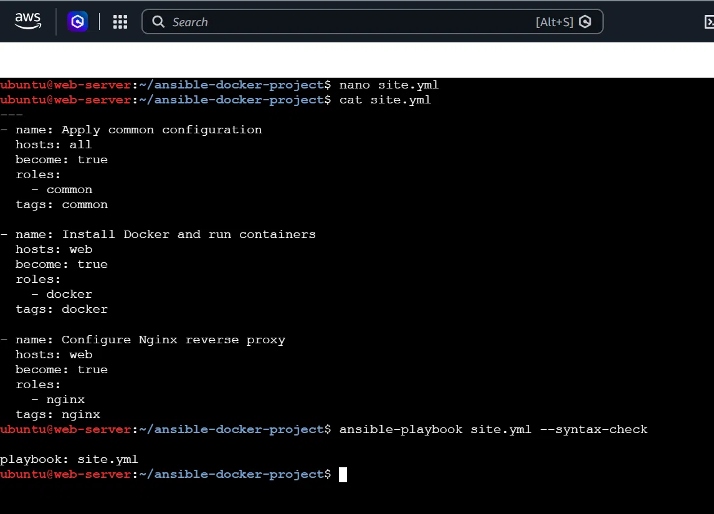

**Dry run (2 parts)**

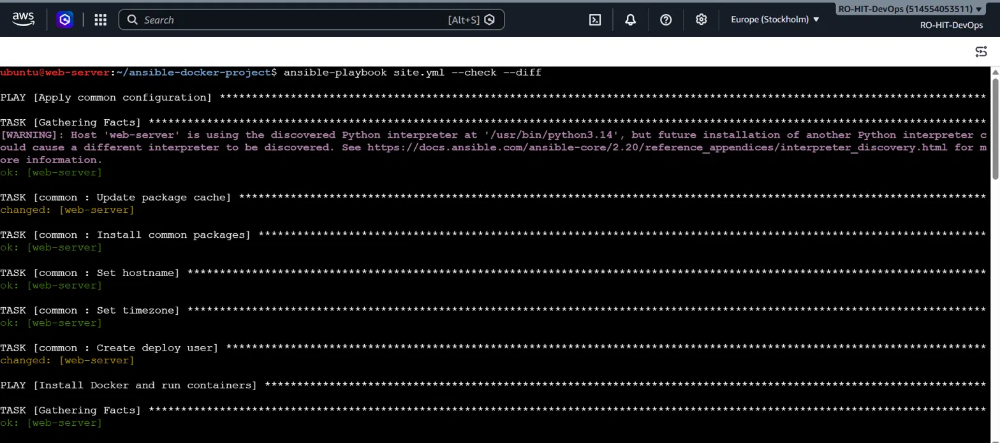

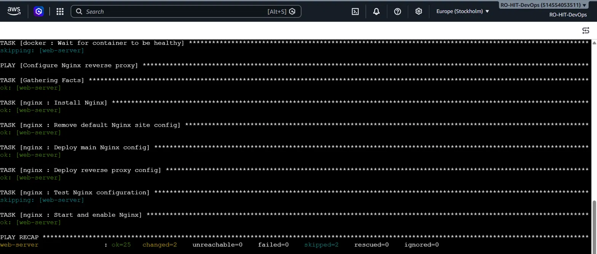

**Full deploy (2 parts)**

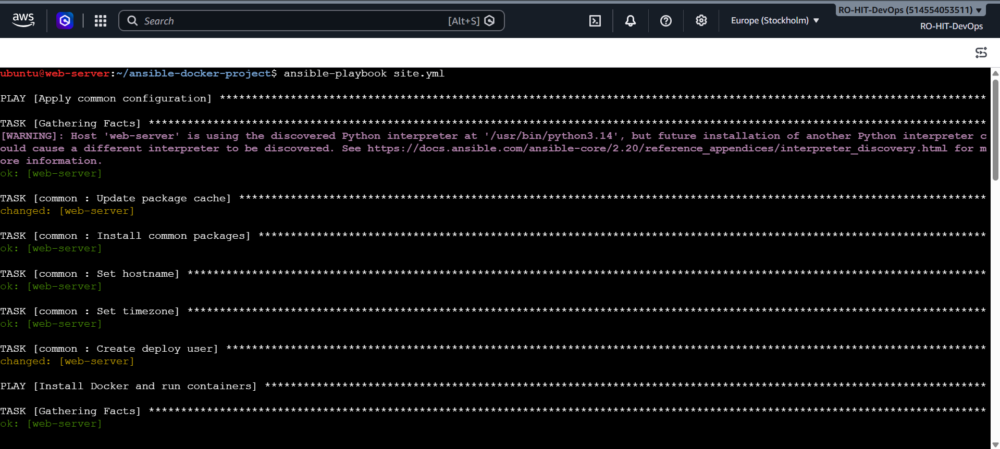

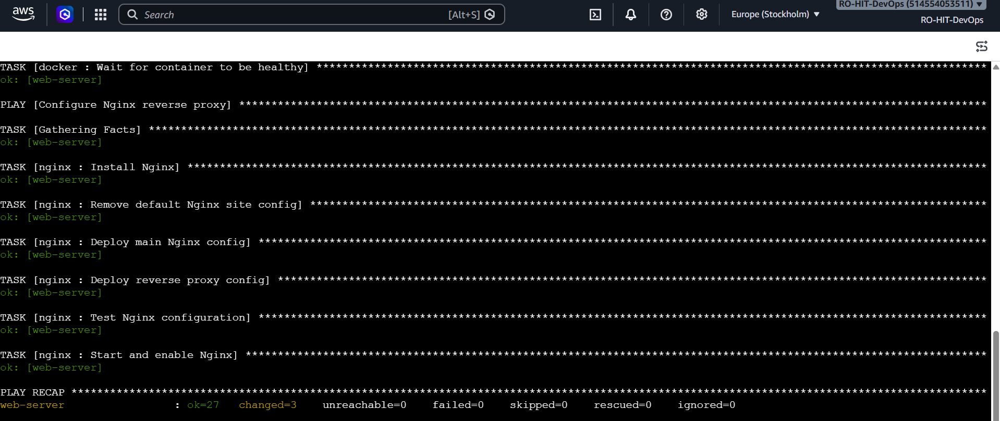

**`--skip-tags common` (2 parts)**

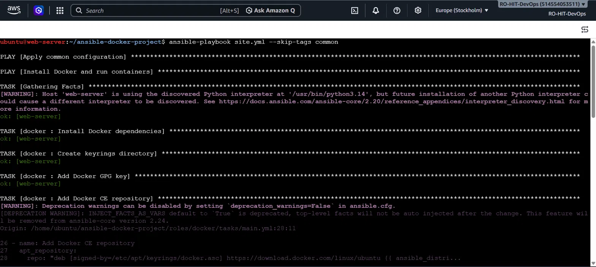

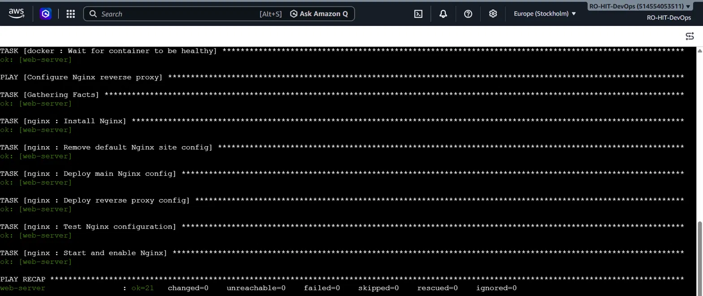

**`--tags docker` (2 parts)**

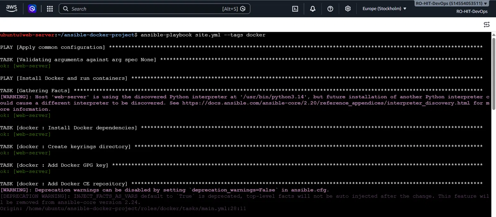

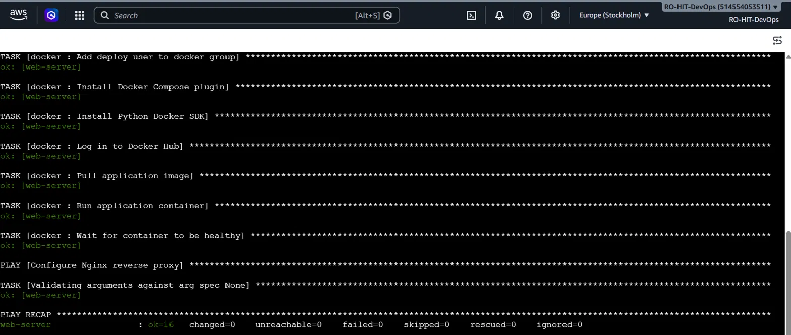

**`--tags nginx` (2 parts)**

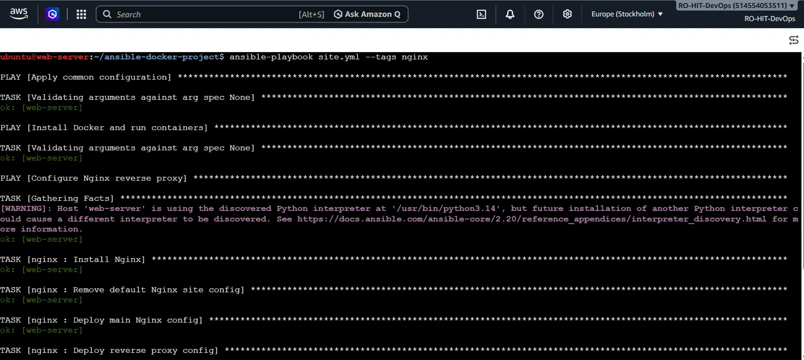

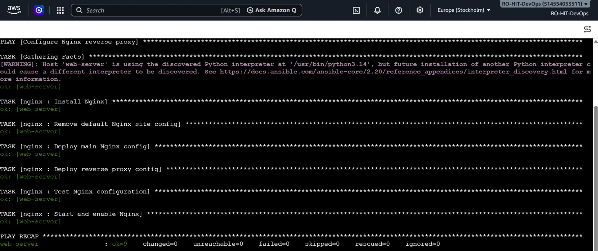

**Verify all**

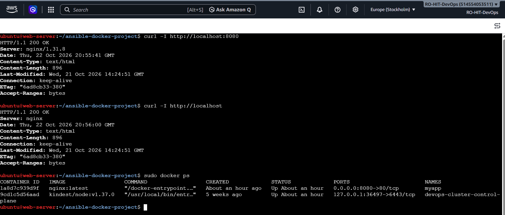

---

## Task 7 - Change the app to Apache httpd and re-run (idempotency)

### What
Remove the old container, deploy the **Apache `httpd`** image as the app, check the "It works!" page in the browser, then run the whole playbook again to prove it is **idempotent**.

### Why
Real projects change often. You should be able to change **one variable** (the image), re-run the playbook, and have Ansible fix only what is different. Running again with no changes should change almost nothing. That is **idempotency**.

### Steps

**1. Remove the old container (clean start)**

```bash
ansible web -a "docker rm -f apache-app"
ansible web -a "docker ps -a"
```

Or as an ad-hoc module call:

```bash
ansible web -m community.docker.docker_container -a "name=apache-app state=absent"
```

**2. Change the variables - add to `group_vars/all.yml`**

```yaml
app_container_name: apache-app
app_image: httpd
app_image_tag: "2.4"
app_host_port: 8080
app_container_port: 80
```

Values in `group_vars/all.yml` **override** the role `defaults`. We did not edit the role. This is why defaults are useful.

**3. Deploy**

```bash
ansible-playbook site.yml --tags docker
```

Ansible pulls `httpd:2.4` and starts the container `apache-app`.

**4. Open in the browser:** `http://<EC2-PUBLIC-IP>`

You should see Apache's default page: **"It works!"**. The request path is:
`browser -> Nginx (port 80) -> container (port 8080 -> 80)`.

**5. Full re-run (idempotency test)**

```bash
ansible-playbook site.yml
```

Look at the **PLAY RECAP**. Our final run was:

```
web-server : ok=27  changed=3  unreachable=0  failed=0  skipped=0  rescued=0  ignored=0
```

- Total tasks counted = ok + changed + skipped + failed = 27 + 3 + 0 + 0 = **30**.
- First full deploy had `changed=5`. This run has `changed=3`. Fewer changes on a repeat run = the playbook is idempotent.
- `Gathering Facts` is counted in tasks. With 3 plays it runs 3 times.
- Tasks like `docker_login` and `command: nginx -t` may still report `ok` or `changed`, depending on how the module reports; that is normal.

### Output

**Remove the old container**

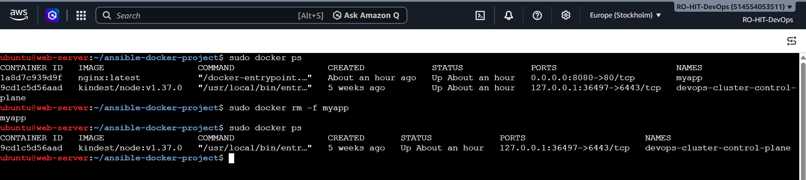

**httpd deploy (2 parts)**

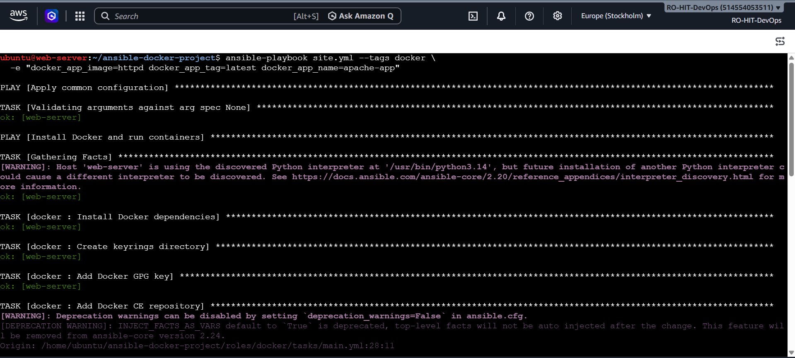

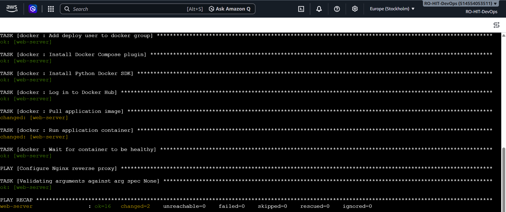

**Browser: "It works!"**

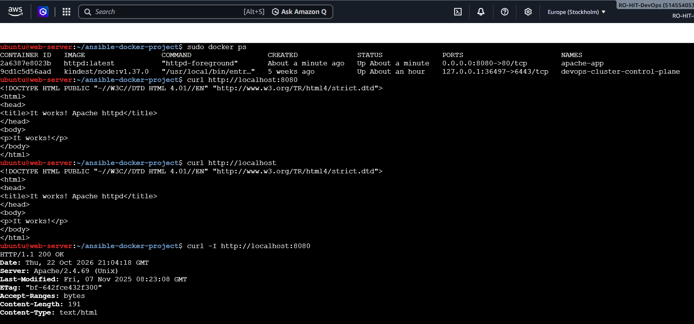

**group_vars for httpd**

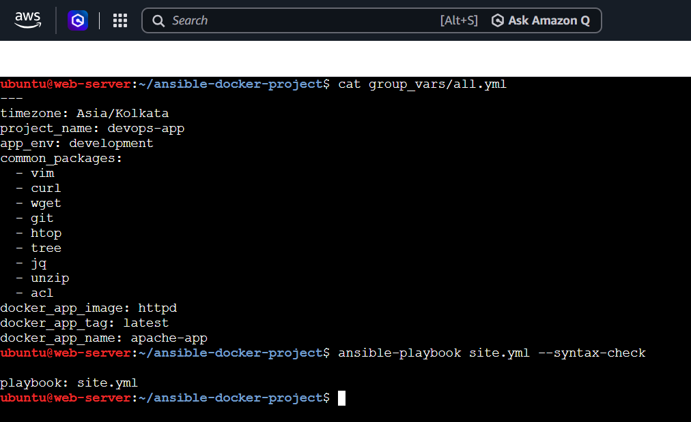

**Full re-run (2 parts)**

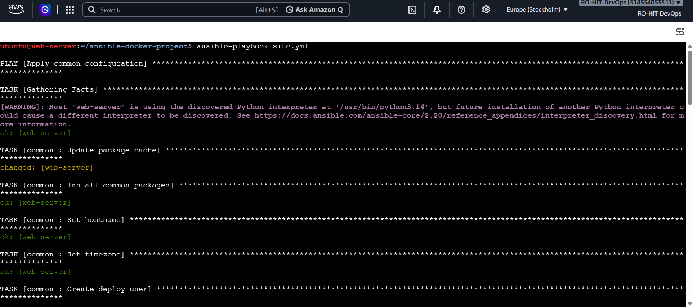

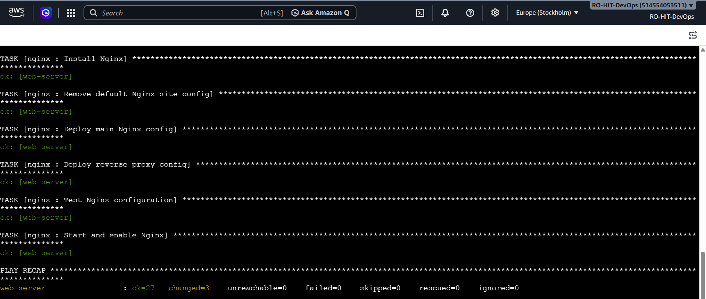

---

## Concepts: which day taught what

| Day | Concepts | Where we used them today |
|-----|----------|--------------------------|
| **Day 68** | Inventory (`[web]` group in `inventory.ini`), ad-hoc commands (`ansible web -m ping`), `ansible.cfg` | Task 1, plus all verify commands |
| **Day 69** | Playbook (`site.yml`), modules (`apt`, `service`, `user`, `file`, `template`, `docker_container`), handlers (`Reload Nginx`, `Restart Docker`) | All tasks |
| **Day 70** | Variables (`group_vars/all.yml`, defaults), facts, conditionals (`when: vault_docker_username is defined`, ``), lists of packages (`common_packages`) | Task 2, 3, 4 |
| **Day 71** | Roles (`common`, `docker`, `nginx`), Jinja2 templates (`.j2`), Galaxy (`ansible-galaxy init`, `community.docker`), Vault (`vault.yml`) | Task 2 to 5 |
| **Day 72** | Everything in one project, tags, `--check --diff`, `-e` extra vars, idempotency | Task 6, 7 |

> Note on loops: we did **not** write a `loop:` in this project. The `apt` module accepts a list (`common_packages`) and installs each item by itself.

---

## Final result

| Item | Result |
|------|--------|
| Roles created | 3 (`common`, `docker`, `nginx`) |
| Plays in `site.yml` | 3 |
| Total tasks in the last run | **30** (`ok=27`, `changed=3`, `skipped=0`, `failed=0`) |
| First full deploy | `ok=25`, `changed=5` |
| Secrets | Stored in Ansible Vault (`group_vars/vault.yml`) |
| App | Apache `httpd` container behind Nginx on port 80 |
| Idempotency | Proven: repeat run changed fewer tasks |

### What I learned (short summary)

- A **role** keeps tasks, handlers, templates, and defaults in one reusable place.
- **Handlers** only run when something really changed, so services are not restarted for no reason.
- **Templates** let one file work for many environments using variables and `if` conditions.
- **Vault** keeps secrets encrypted so the project can go to GitHub safely.
- **Tags** and `--check --diff` make deployments safer and faster.
- **Idempotent** means: run it 10 times, and the server ends up in the same correct state.

---

## Production improvements

What I would add before using this in a real company:

1. **SSL with Certbot** - right now we use HTTP (port 80) and the browser says "Not secure". Certbot gives a free certificate for HTTPS (port 443).
2. **Monitoring** - Prometheus + Grafana to know if the server or container is healthy and to get alerts when a container stops.
3. **Log rotation** - logs keep growing and fill the disk. Rotation compresses and deletes old logs.
4. **Multi-container Docker Compose** - run app + database + cache together from one `docker-compose.yml`. Docker Compose is installed here but not used yet.
5. **Fixed image versions** - use `httpd:2.4` instead of `latest`, so updates never surprise us.
6. **Firewall (ufw)** - allow only ports 22, 80 and 443.
7. **Vault password from CI/CD** - instead of a `.vault_pass` file, pass it from the CI/CD secret store.

---

## Cleanup

When the project is finished:

1. **Delete the Docker Hub token** (Docker Hub -> Account Settings -> Personal access tokens -> select the token -> Delete). Temporary tokens should not live longer than needed.
   - After deleting, the `Log in to Docker Hub` task will fail if you run it again. That is expected.
2. **Check your screenshots before pushing to GitHub.** Make sure no real token, password or public secret is visible. Crop or blur if needed.
3. **Never push** `.vault_pass`.
4. **Decide about the EC2 server:** keep it and clean only the project (container, Nginx config), or terminate it to stop AWS charges. Push your work to GitHub first, because files and screenshots on the server are lost after termination.

Cleanup commands (project only, keep the server):

```bash
ansible web -m community.docker.docker_container -a "name=apache-app state=absent"
ansible web -m ansible.builtin.apt -a "name=nginx state=absent purge=yes" --become
```

---

## Common errors and fixes

| Error | Cause | Fix |
|-------|-------|-----|
| `UNREACHABLE! Permission denied (publickey)` | Wrong key or user in inventory | Check `ansible_user` and `ansible_ssh_private_key_file`; `chmod 400 key.pem` |
| `Failed to set permissions on the temporary files ... unprivileged user` | `acl` package missing | Install `acl` (it is in `common_packages`) |
| `Decryption failed` / `Attempting to decrypt but no vault secrets found` | Wrong or missing vault password | Check `.vault_pass` and `vault_password_file` in `ansible.cfg` |
| `'vault_docker_username' is undefined` | Vault file not loaded | Add `vars_files: - group_vars/vault.yml` to the play |
| `Failed to import the required Python library (docker)` | `python3-docker` missing on server | Add `python3-docker` to `docker_packages` |
| `nginx: [emerg] bind() to 0.0.0.0:80 failed` | Port 80 already in use | Find it with `ss -tlnp`, stop that service |
| Browser cannot open the site | Security Group blocks port 80 | Allow inbound HTTP (80) in the EC2 Security Group |
| YAML error `mapping values are not allowed here` | Wrong indentation or tab used | Use 2 spaces; run `--syntax-check` |

---

### Quick command cheat sheet

```bash
ansible web -m ping                                  # test connection
ansible-playbook site.yml --syntax-check             # check YAML
ansible-playbook site.yml --check --diff             # dry run
ansible-playbook site.yml                            # full deploy
ansible-playbook site.yml --tags nginx               # only one role
ansible-playbook site.yml --skip-tags common         # skip one role
ansible-playbook site.yml -e "app_env=production"    # override variable
ansible-playbook site.yml --list-tags                # show tags
ansible-vault create|edit|view group_vars/vault.yml  # work with secrets
```
