# Day 73 - Introduction to Observability and Prometheus

> A beginner-friendly, step-by-step guide. You do not need to know anything about observability or Prometheus before reading this. Follow the steps in order and you will get the same results shown in the screenshots.

---

## Table of Contents

1. [What you will build](#what-you-will-build)
2. [Prerequisites](#prerequisites)
3. [Task 1: Understand Observability](#task-1-understand-observability)
4. [Task 2: Set Up Prometheus with Docker](#task-2-set-up-prometheus-with-docker)
5. [Task 3: Understand Prometheus Concepts](#task-3-understand-prometheus-concepts)
6. [Task 4: Learn PromQL Basics](#task-4-learn-promql-basics)
7. [Task 5: Add a Sample Application as a Scrape Target](#task-5-add-a-sample-application-as-a-scrape-target)
8. [Task 6: Explore Data Retention and Storage](#task-6-explore-data-retention-and-storage)
9. [Troubleshooting (real errors I hit)](#troubleshooting-real-errors-i-hit)
10. [Final folder structure](#final-folder-structure)
11. [Cheat sheet](#cheat-sheet)
12. [Key takeaways](#key-takeaways)

---

## What you will build

By the end of today you will have:

- A clear idea of what **observability** is and how it differs from **monitoring**
- **Prometheus** running inside a Docker container
- A working `prometheus.yml` config file with two scrape targets
- Prometheus scraping its own metrics and answering **PromQL** queries
- A sample app added as a second target (and you will see why it shows `DOWN`)
- A basic understanding of how Prometheus stores data and how long it keeps it

---

## Prerequisites

- A Linux server (I used an AWS EC2 Ubuntu server named `web-server`)
- Docker and Docker Compose installed

Check Docker:

```bash
docker --version
```

Example output:

```
Docker version 29.9.2, build a82e528
```

**Important for cloud servers (AWS):** Prometheus listens on port `9090`. To open it in your browser, you must allow port `9090` in the server's **Security Group**:

1. AWS Console -> EC2 -> select your instance -> **Security** tab
2. Click the Security Group -> **Edit inbound rules**
3. Add rule: Type `Custom TCP`, Port `9090`, Source `My IP`

Use `My IP`, not `0.0.0.0/0`. Otherwise the whole internet can open your Prometheus.

Then open `http://<SERVER_PUBLIC_IP>:9090` in your browser. (If you run Docker on your own laptop, use `http://localhost:9090`.)

---

## Task 1: Understand Observability

### 1.1 Monitoring vs Observability

Imagine your app is running in production and one day it becomes slow. You need two things:

1. To **know** that something is wrong
2. To **find out why**

| | Monitoring | Observability |
|---|---|---|
| Tells you | **What** is wrong | **Why** it is wrong |
| How | Alerts and fixed thresholds | Explore, query and connect data |
| Example | "CPU is 90%!" | "Why is CPU 90%? Which request or service caused it?" |

**Doctor example:**
- **Monitoring** = a thermometer. It says "you have a fever of 102 degrees". It does not say why.
- **Observability** = blood test + X-ray + medical history. It helps you find the cause.

**Why does a DevOps engineer need this?** You can build infrastructure with Terraform, configure servers with Ansible and run apps in Docker. But when something breaks at 3 AM, you need data to find the problem fast.

### 1.2 The three pillars of observability

Observability uses three kinds of data. They are called **pillars**.

| Pillar | What it is | Real-life example | Tools | Question it answers |
|---|---|---|---|---|
| **Metrics** | Numbers measured over time (CPU usage, request count, error rate) | Car speedometer | Prometheus, Datadog, CloudWatch | **What** is broken? |
| **Logs** | Timestamped text records of events (app output, error messages) | A diary of the app | Loki, ELK Stack, Fluentd | **Why** did it break? |
| **Traces** | The journey of one request across many services | Courier parcel tracking | OpenTelemetry, Jaeger, Zipkin | **Where** did it break? |

### 1.3 Why do we need all three? (Flipkart example)

The "Pay" button stops working at 2 AM.

| Step | Pillar | What you see | What you learn |
|---|---|---|---|
| 1 | Metrics | Error rate on `/api/pay` jumped to 40% | **What** is wrong: payments are failing |
| 2 | Traces | Request path: Cart -> Order -> **Payment (12 sec)** | **Where** it is wrong: the Payment service is slow |
| 3 | Logs | Payment service log: `Database connection timeout` with an exact timestamp | **Why** it is wrong: it cannot reach the database |

Metrics show the problem, traces show the place, logs show the reason. One pillar alone gives only part of the answer:

- Only metrics: you know there are errors but not the cause.
- Only logs: millions of lines, and you do not know where to start.
- Only traces: you know the place but not how many users are affected or the reason.

### 1.4 The architecture we will build over the next 5 days

```
[Your App] --> metrics --> [Prometheus] --> [Grafana Dashboards]
[Your App] --> logs    --> [Promtail]   --> [Loki] --> [Grafana]
[Your App] --> traces  --> [OTEL Collector] --> [Grafana/Debug]
[Host]     --> metrics --> [Node Exporter] --> [Prometheus]
[Docker]   --> metrics --> [cAdvisor] --> [Prometheus]
```

What each tool does:

| Tool | Job | Simple example |
|---|---|---|
| **Prometheus** | Collects and stores metrics | A milkman who visits every house and collects milk |
| **Grafana** | Draws dashboards and graphs | A TV screen showing all numbers |
| **Promtail** | Picks up logs and sends them to Loki | A postman |
| **Loki** | Stores logs and lets you search them | A records warehouse |
| **OTEL Collector** | Collects traces and forwards them | A courier collection centre |
| **Node Exporter** | Gives server CPU, RAM and disk numbers | Health report of the server |
| **cAdvisor** | Gives Docker container numbers | Health report of each container |

**Today's focus:** only **Prometheus** (the metrics part). The other tools come in the next days.

---

## Task 2: Set Up Prometheus with Docker

### How Prometheus works (read this first)

Prometheus uses a **pull model**. Prometheus itself goes to each target and **asks for its metrics**. This is called **scraping**. Think of a milkman visiting each house every morning.

To make this work you need two files:

1. `prometheus.yml` - tells Prometheus **who to scrape and how often**
2. `docker-compose.yml` - tells Docker **how to run the Prometheus container**

### Step 2.1: Create the project folder

All of this week's work will live in one folder.

```bash
mkdir observability-stack && cd observability-stack
pwd
```

- `mkdir observability-stack` creates the folder
- `&&` means "if the first command worked, run the next one"
- `cd observability-stack` goes into the folder
- `pwd` prints where you are. Expected: `/home/ubuntu/observability-stack`

### Step 2.2: Create `prometheus.yml`

```bash
nano prometheus.yml
```

Paste this:

```yaml
global:
  scrape_interval: 15s
  evaluation_interval: 15s

scrape_configs:
  - job_name: "prometheus"
    static_configs:
      - targets: ["localhost:9090"]
```

Save in nano: `Ctrl + O`, `Enter`, then `Ctrl + X`. Check it:

```bash
cat prometheus.yml
```

**Line by line:**

| Line | Meaning |
|---|---|
| `global:` | Settings that apply to all jobs |
| `scrape_interval: 15s` | Collect metrics every 15 seconds |
| `evaluation_interval: 15s` | Check alert rules every 15 seconds (we use this in later days) |
| `scrape_configs:` | The list of things to scrape |
| `- job_name: "prometheus"` | A name for this group of targets. It becomes the label `job="prometheus"` |
| `static_configs:` | A fixed (hard-coded) list of targets |
| `targets: ["localhost:9090"]` | The address to scrape. Prometheus exposes its own metrics on port 9090 |

So this config tells Prometheus: **"scrape yourself every 15 seconds."**

**YAML rule:** indentation must use **spaces, not tabs**. Wrong spaces cause errors.

### Step 2.3: Create `docker-compose.yml`

```bash
nano docker-compose.yml
```

Paste this:

```yaml
services:
  prometheus:
    image: prom/prometheus:latest
    container_name: prometheus
    ports:
      - "9090:9090"
    volumes:
      - ./prometheus.yml:/etc/prometheus/prometheus.yml
      - prometheus_data:/prometheus
    command:
      - '--config.file=/etc/prometheus/prometheus.yml'
    restart: unless-stopped

volumes:
  prometheus_data:
```

**What is Docker Compose?** A "recipe" file. Instead of typing a long `docker run ...` command, you describe your containers in one file and start them with one command.

**Line by line:**

| Line | Meaning |
|---|---|
| `services:` | The list of containers to run |
| `prometheus:` | The name of this service |
| `image: prom/prometheus:latest` | Which ready-made software to use (from Docker Hub) |
| `container_name: prometheus` | The name given to the running container |
| `ports: "9090:9090"` | Format is `server port : container port`. Opening port 9090 on the server reaches Prometheus inside the container |
| `./prometheus.yml:/etc/prometheus/prometheus.yml` | Copies/links your config file into the container (a **bind mount**) |
| `prometheus_data:/prometheus` | Stores Prometheus data in a Docker **volume** so it is not lost |
| `command: --config.file=...` | Tells Prometheus which config file to use |
| `restart: unless-stopped` | Container starts again after a server reboot, unless you stopped it yourself |
| `volumes: prometheus_data:` (at the bottom) | **Declares** the volume. Rule: *use it above, declare it below* |

**Two kinds of `volumes`:**
- Inside a service: *where to connect* (mapping)
- At the bottom, outside services: *create the storage* (declaration)

### Step 2.4: Start Prometheus

```bash
docker compose up -d
docker ps
```

- `up` creates and starts the containers from the file
- `-d` means **detached** (runs in the background, your terminal stays free)

The first time, Docker downloads the image, so it takes a minute.

Expected: `Image ... Pulled`, `Network ... Created`, `Volume ... Created`, `Container prometheus Started`. In `docker ps` the status should be `Up` and ports `0.0.0.0:9090->9090/tcp`.

**Output (screenshots):**

Config files created:

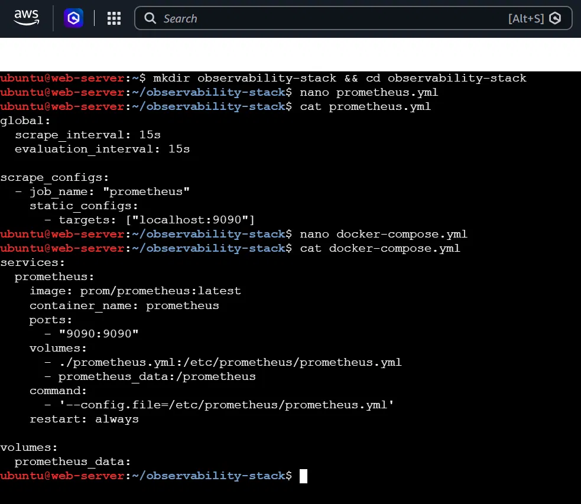

`docker compose up -d` and `docker ps`:

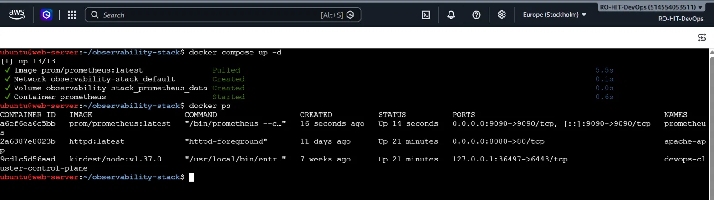

### Step 2.5: Open the UI and verify the target

Open `http://<SERVER_PUBLIC_IP>:9090`, then go to **Status -> Targets**.

You should see one target, `prometheus`, with state **UP** (green).

| What you see | Meaning |
|---|---|
| `http://localhost:9090/metrics` | The page Prometheus reads metrics from |
| `instance="localhost:9090"` | Address of the target (a label) |
| `job="prometheus"` | The `job_name` from `prometheus.yml` |
| `Last scrape: 3.6s ago` | When it was last scraped |
| `4ms` | How long the scrape took |
| `UP` | The target is healthy. `DOWN` means something is wrong |

**Output:**

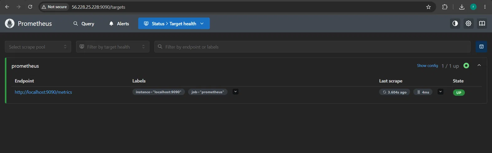

### Step 2.6: First PromQL queries (warm-up)

**PromQL** is Prometheus's query language. Open the **Query** tab, type a query and click **Execute**.

**Query 1: all HTTP requests Prometheus has received**

```
prometheus_http_requests_total
```

This returns many rows (65 for me). Each row is one **time series**: the same metric with a different `handler` label. The metric ends with `_total`, so it is a **counter**.

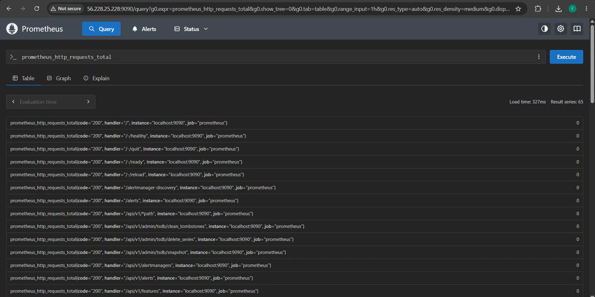

**Query 2: filter by label**

```
prometheus_http_requests_total{handler="/metrics"}
```

Now only 1 row. The value (29 for me) is how many times `/metrics` was requested. Prometheus requests its own `/metrics` page every 15 seconds, so the number keeps growing.

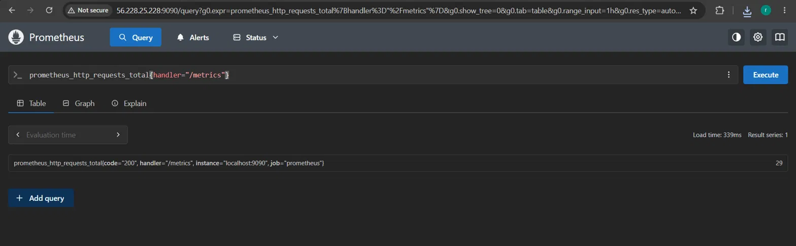

**Query 3: rate**

```
rate(prometheus_http_requests_total{handler="/metrics"}[1m])
```

Result: about `0.0666`. That is `1 / 15`: one scrape every 15 seconds. It matches `scrape_interval: 15s`.

- The counter = the car's **odometer** (total so far)
- `rate()` = the car's **speedometer** (how fast it grows right now)

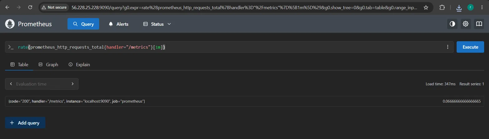

**Query 4: Graph tab.** Run the same `rate(...)` query and click **Graph**. The line starts low (Prometheus had just started, so the 1-minute window was not full) and then stays steady near 0.066. Times are shown in **UTC** (IST = UTC + 5:30).

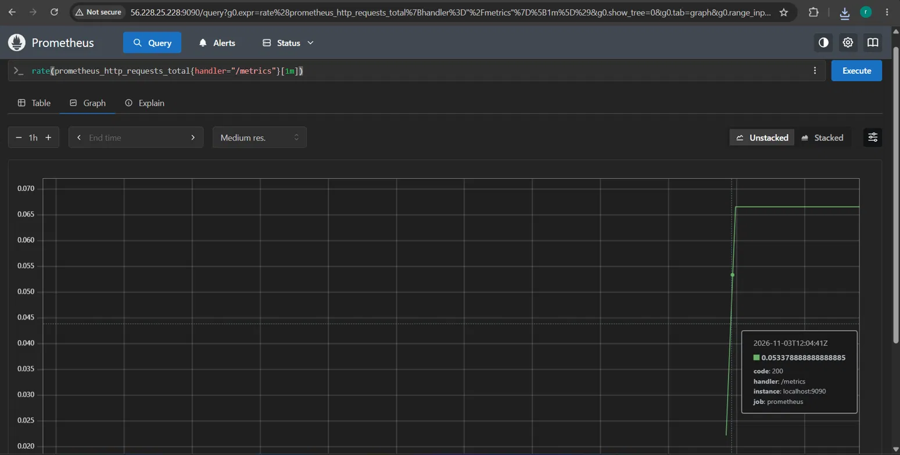

---

## Task 3: Understand Prometheus Concepts

### 3.1 Scrape targets

A **scrape target** is an endpoint (an address) that Prometheus pulls metrics from at regular intervals. In our config the target is `localhost:9090`.

### 3.2 The four metric types

| Type | Behavior | Real-world example | Prometheus example |
|---|---|---|---|
| **Counter** | Only goes **up** (resets only on restart) | Car odometer | `prometheus_http_requests_total` |
| **Gauge** | Goes **up and down** | Petrol tank meter | `process_resident_memory_bytes` |
| **Histogram** | Puts values into **buckets** (e.g. how many requests took under 100ms, under 500ms, under 1s) | Marks distribution of a class | Uses the `le` label |
| **Summary** | Like a histogram, but the **app itself** calculates percentiles | "95% of requests finished within X seconds" | Uses the `quantile` label |

### 3.3 Labels

Labels are key-value pairs that add dimensions to a metric. Example:

```
http_requests_total{method="GET", status="200"}
```

Labels let you filter and group. In our case, `handler="/metrics"` and `code="200"` are labels.

### 3.4 Time series

A **time series** is one unique combination of **metric name + labels**. Change any label value and you get a new time series. That is why `prometheus_http_requests_total` returned 65 rows: 65 different label combinations.

### 3.5 Queries to run

**Query 1: how many time series does Prometheus hold?**

```
count({__name__=~".+"})
```

- `count(...)` counts rows
- `__name__` is a special label that holds every metric's name
- `=~` means "matches this regex" (a single `=` means exact match)
- `".+"` is a regex meaning "one or more characters", i.e. any name

My result: **912** time series. (A later check in TSDB Status showed 994 because more series were created over time.)

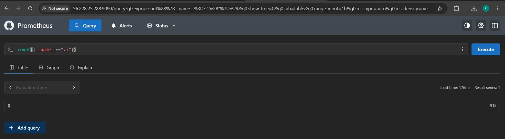

**Query 2: how much memory is Prometheus using?**

```
process_resident_memory_bytes
```

Result in the screenshot: `90382336` bytes, which is about **86 MB** (`90382336 / 1024 / 1024`). It changes over time because this is a gauge.

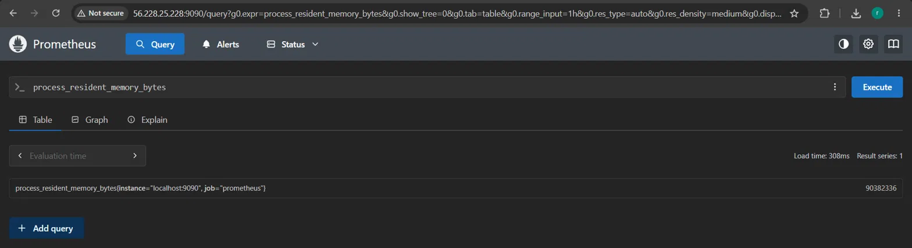

**Query 3 and 4: HTTP requests, then break down by handler**

```
prometheus_http_requests_total
prometheus_http_requests_total{handler="/api/v1/query"}
```

The second query returned 1 series with a value of 11. That is how many times I ran a query from the UI (the UI uses this API).

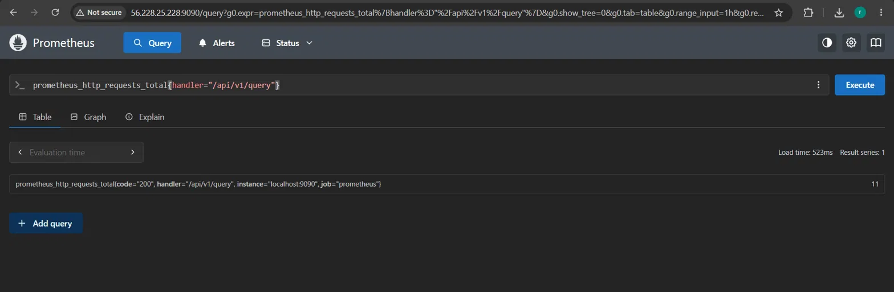

### 3.6 Counter vs Gauge (documented answer)

- A **counter** only goes **up**. It tells you "how many so far". It only drops back to 0 if the process restarts.
  - Real-world example: a car **odometer**, or the total number of requests served. In Prometheus: `prometheus_http_requests_total`.
- A **gauge** goes **up and down**. It tells you "what is the value right now".
  - Real-world example: the **fuel meter** in a car, or the number of active connections. In Prometheus: `process_resident_memory_bytes`.

Rule of thumb: a counter name usually ends in `_total`. For counters you almost always use `rate()`, for gauges you read the value directly.

---

## Task 4: Learn PromQL Basics

Run each query in the **Query** tab (Table view).

### 4.1 Instant vector - the current value

```
up
```

An **instant vector** is the latest single value of each series. `up` is a built-in metric: `1` = target is up, `0` = target is down. My result: `up{instance="localhost:9090", job="prometheus"}` = `1`.

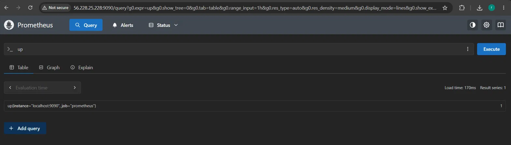

### 4.2 Range vector - values over a time window

```
prometheus_http_requests_total[5m]
```

A **range vector** gives all values from the last 5 minutes. Each row shows many `value @ timestamp` pairs (about 20, since we scrape every 15s). Functions like `rate()` need a range vector. Range vectors cannot be drawn on the Graph tab, so use the Table tab.

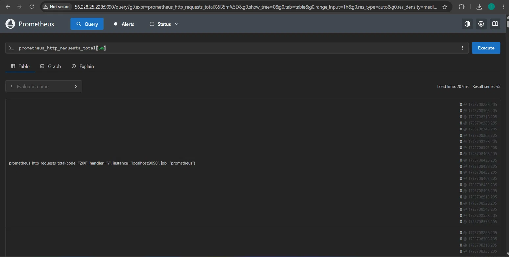

### 4.3 rate - per-second speed of a counter

```
rate(prometheus_http_requests_total[5m])
```

This is the most commonly used function. Counters only go up, so the raw number is not very useful. `rate()` turns it into "requests per second over the last 5 minutes". Many rows show `0` because nobody called those handlers.

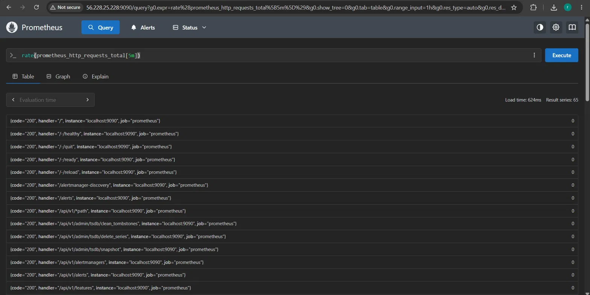

### 4.4 Aggregation - sum

```
sum(rate(prometheus_http_requests_total[5m]))
```

`sum()` adds up all the series into one number. My result was about `0.126`, meaning Prometheus served around 0.126 requests per second in total.

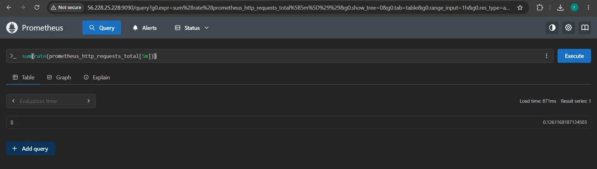

### 4.5 Filter by label

```
prometheus_http_requests_total{code="200"}
prometheus_http_requests_total{code!="200"}
```

- `=` means equal. `!=` means **not** equal.
- `code="200"` returned 64 series (successful requests).
- `code!="200"` returned 2 series: code `302` on handler `/` (a redirect) and code `400` on handler `/api/v1/query` (a bad request, from a query I typed wrongly). Both have the value `1`.

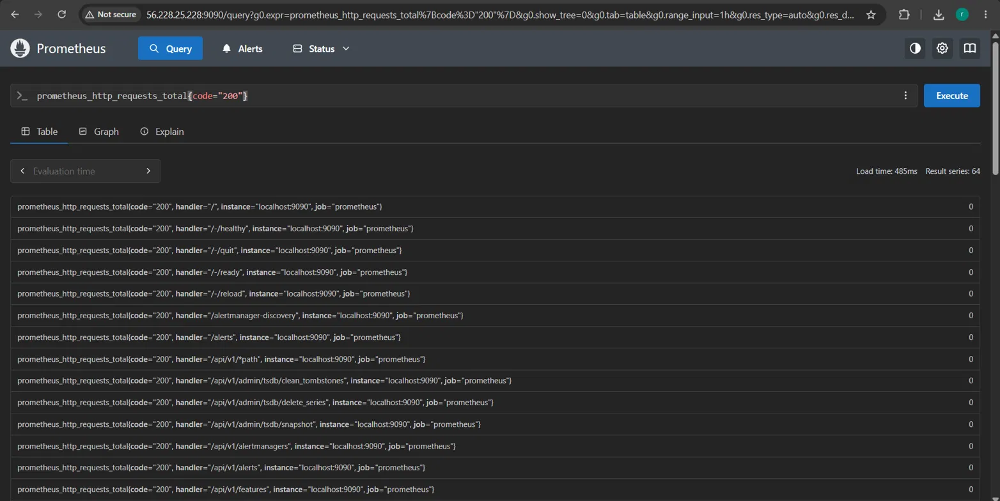

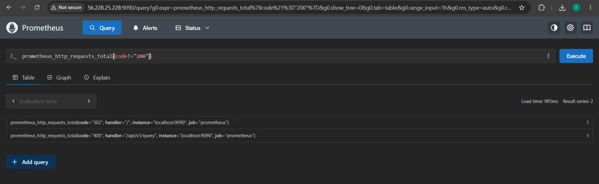

### 4.6 Arithmetic

```
process_resident_memory_bytes / 1024 / 1024
```

This converts bytes to megabytes. Result: about `90.07` MB.

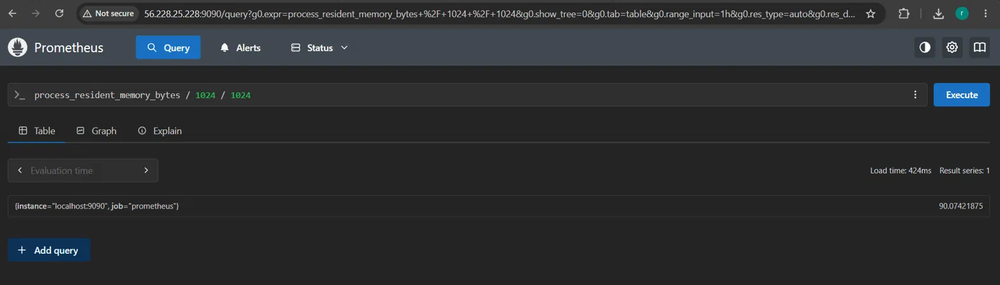

### 4.7 topk - the top results

```
topk(5, prometheus_http_requests_total)
```

Shows the 5 series with the highest values. My result:

| Handler | Count |
|---|---|
| `/metrics` | 89 |
| `/api/v1/notifications/live` | 26 |
| `/api/v1/query` | 20 |
| `/api/v1/metadata` | 4 |
| `/assets/*filepath` | 3 |

As expected, `/metrics` is the highest because Prometheus scrapes itself every 15 seconds.

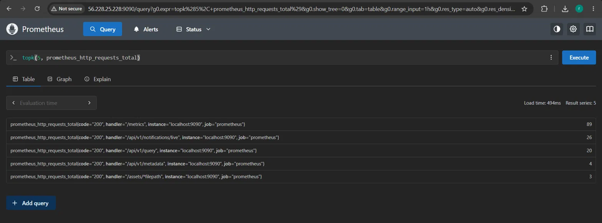

### 4.8 Exercise: per-second rate of non-200 requests over 5 minutes

Pattern: `rate( metric_name{label_filter}[time_window] )`

```
rate(prometheus_http_requests_total{code!="200"}[5m])
```

- `prometheus_http_requests_total{code!="200"}` selects only the non-200 series
- `[5m]` makes it a range vector of 5 minutes
- `rate(...)` converts it into requests per second

Because only 2 non-200 requests happened in total, the rate is a very small number (close to 0).

To get one single number for all non-200 requests, wrap it in `sum()`:

```
sum(rate(prometheus_http_requests_total{code!="200"}[5m]))
```

---

## Task 5: Add a Sample Application as a Scrape Target

Prometheus needs something to monitor. We add a sample app called `notes-app`.

### Step 5.1: Update `docker-compose.yml`

```bash
nano docker-compose.yml
```

Replace the content with:

```yaml
services:
  prometheus:
    image: prom/prometheus:latest
    container_name: prometheus
    ports:
      - "9090:9090"
    volumes:
      - ./prometheus.yml:/etc/prometheus/prometheus.yml
      - prometheus_data:/prometheus
    command:
      - '--config.file=/etc/prometheus/prometheus.yml'
    restart: unless-stopped

  notes-app:
    image: trainwithshubham/notes-app:latest
    container_name: notes-app
    ports:
      - "8000:8000"
    restart: unless-stopped

volumes:
  prometheus_data:
```

The new part is the `notes-app` service. Keep `notes-app:` at the same indentation as `prometheus:`.

| Line | Meaning |
|---|---|
| `notes-app:` | Service name. Inside the Docker network this name works as an address (`notes-app:8000`) |
| `image: trainwithshubham/notes-app:latest` | A ready-made sample app |
| `ports: "8000:8000"` | Opens port 8000 so you can reach the app |

### Step 5.2: Update `prometheus.yml`

```bash
nano prometheus.yml
```

```yaml
global:
  scrape_interval: 15s
  evaluation_interval: 15s

scrape_configs:
  - job_name: "prometheus"
    static_configs:
      - targets: ["localhost:9090"]

  - job_name: "notes-app"
    static_configs:
      - targets: ["notes-app:8000"]
```

**Why `notes-app:8000` and not `localhost:8000`?** Inside the Prometheus container, `localhost` means Prometheus itself. `notes-app` is a different container. Docker Compose puts both containers on the same network, so the **service name** works as the address.

**Output (both files):**

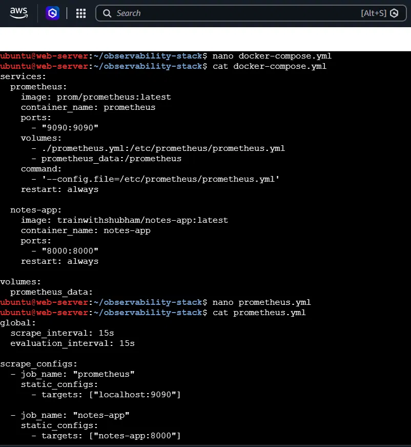

### Step 5.3: Restart the stack

```bash
docker compose up -d
docker compose restart prometheus
docker ps
```

- `up -d` downloads and starts the new `notes-app` container
- `restart prometheus` makes Prometheus re-read `prometheus.yml`
- `docker ps` should now show `prometheus` and `notes-app` both `Up`

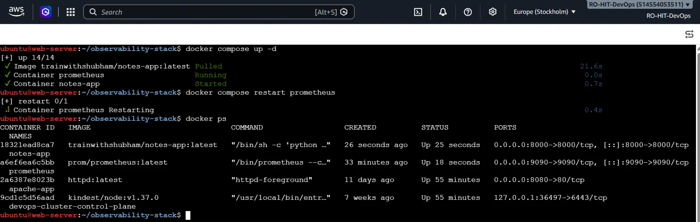

### Step 5.4: Check Status -> Targets

Open `http://<SERVER_PUBLIC_IP>:9090/targets`. You now see **two targets**:

| Job | State |
|---|---|
| `prometheus` | **UP** |
| `notes-app` | **DOWN** with error `server returned HTTP status 404 Not Found` |

**Why is `notes-app` DOWN? Is it a mistake? No, it is expected.**

- The network works: Prometheus reached `notes-app:8000` (otherwise the error would be "connection refused").
- The app is running (we test this below with `curl`, it returns `200`).
- But Prometheus asks for `http://notes-app:8000/metrics`, and this app has **no `/metrics` page**, so it answers 404.

`notes-app` is a React web app. It does not expose Prometheus metrics. **Not every application exposes Prometheus metrics natively.** In the coming days we will use **Node Exporter, cAdvisor and the OTEL Collector** as exporters for systems that do not have built-in Prometheus support.

How to read common scrape errors:

| Error | Usual meaning |
|---|---|
| `404 Not Found` | App is running, but has no `/metrics` endpoint |
| `connection refused` | App is stopped, or wrong port/address |
| `timeout` | Network or firewall problem |

This is also a small example of observability: the target state tells you **what** is wrong (DOWN), and the error message tells you **why** (404).

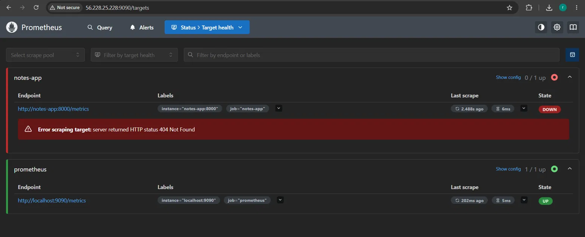

### Step 5.5: Generate traffic with curl

```bash
curl http://localhost:8000
curl http://localhost:8000
curl http://localhost:8000
curl -s -o /dev/null -w "%{http_code}\n" http://localhost:8000
```

- The first three print the app's HTML homepage (title "Notessss APPPPP"). That proves the app is alive.
- The last command hides the page and prints only the HTTP status code. `-s` = silent, `-o /dev/null` = throw away the body, `-w "%{http_code}"` = print the status. We get `200`.

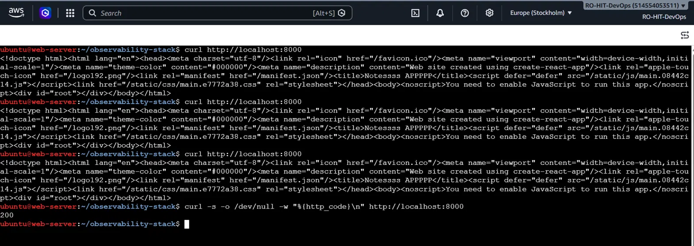

---

## Task 6: Explore Data Retention and Storage

Prometheus stores data in its own local **time-series database (TSDB)**.

### Step 6.1: Check disk usage

```bash
docker exec prometheus du -sh /prometheus
```

| Part | Meaning |
|---|---|
| `docker exec prometheus` | Run a command **inside** the running `prometheus` container |
| `du` | Disk usage |
| `-s` | Summary (one total) |
| `-h` | Human readable (MB, GB) |
| `/prometheus` | The folder where Prometheus stores its data |

My output:

```
1.1M    /prometheus
```

Only 1.1 MB, because Prometheus had been running for about an hour with two targets, and TSDB compresses data very well.

### Step 6.2: Set retention

**Retention** = how long Prometheus keeps data. The default is **15 days**. Edit the `command:` section of the `prometheus` service:

```yaml
    command:
      - '--config.file=/etc/prometheus/prometheus.yml'
      - '--storage.tsdb.retention.time=30d'
      - '--storage.tsdb.retention.size=1GB'
```

| Flag | Meaning |
|---|---|
| `retention.time=30d` | Delete data older than 30 days |
| `retention.size=1GB` | If data grows beyond 1 GB, delete the oldest data |

Whichever limit is reached first applies. Apply the change:

```bash
docker compose up -d
docker inspect prometheus --format '{{.Config.Cmd}}'
```

The `inspect` output must show both retention flags. That proves Prometheus started with the new settings:

```
[--config.file=/etc/prometheus/prometheus.yml --storage.tsdb.retention.time=30d --storage.tsdb.retention.size=1GB]
```

Your data is not lost when the container is recreated, because the data lives in the `prometheus_data` volume.

Config file:

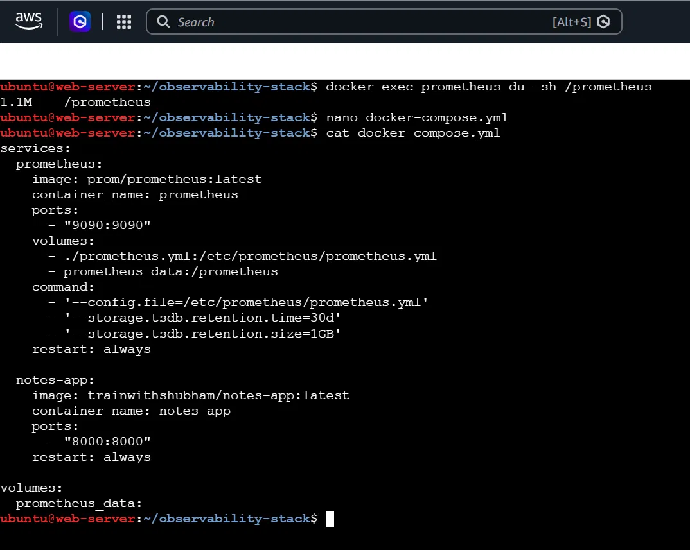

Applied and verified:

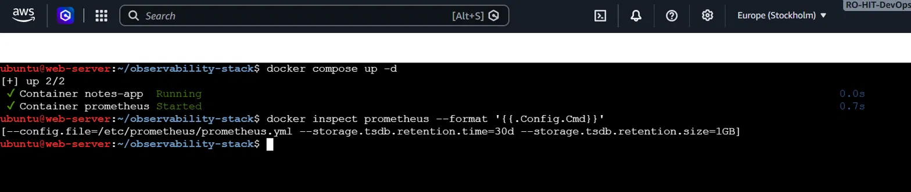

### Step 6.3: TSDB Status in the UI

Go to **Status -> TSDB Status**. It shows a report of the database.

| Item | My value | Meaning |
|---|---|---|
| Number of Series | 994 | Time series currently in memory |
| Number of Chunks | 1790 | Small blocks of stored samples |
| Number of Label Pairs | 541 | Different `label=value` pairs |
| Current Min / Max Time | 12:03:53Z to 12:53:23Z | About 50 minutes of data (UTC) |

Top label names:

| Label | Count | Note |
|---|---|---|
| `__name__` | 329 | 329 different metric names |
| `le` | 88 | Used by **histograms** (bucket limits) |
| `handler` | 64 | The 64 HTTP handlers we saw |
| `quantile` | 9 | Used by **summaries** |
| `code` | 5 | HTTP status codes |

This page helps you find which metrics create the most series when Prometheus gets slow or uses a lot of disk.

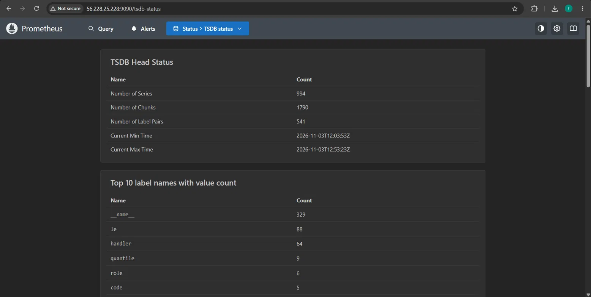

### Step 6.4: Documented answers

**Q1. What happens when retention is exceeded?**

When the data becomes older than `retention.time`, or the total size goes above `retention.size`, Prometheus automatically deletes the **oldest** data. New data keeps coming in. This keeps the disk from filling up. The side effect is that very old history is no longer available for queries.

**Q2. Why is a volume mount important for Prometheus data?**

A container's own filesystem is temporary. If the container is deleted or recreated (for example when you change `docker-compose.yml` and run `docker compose up -d`), everything inside it is lost. A volume (`prometheus_data:/prometheus`) stores the data **outside** the container, so metrics history survives restarts, upgrades and recreation. Without it you would lose all your history every time the container is replaced. We saw this today: Prometheus was recreated several times and the data stayed.

---

## Troubleshooting (real errors I hit)

### Error: `authentication required - incorrect username or password` when pulling an image

```
Error response from daemon: authentication required - incorrect username or password
```

`prom/prometheus` is a public image and needs no login. The error appears when old or wrong Docker Hub credentials are saved on the server. Fix:

```bash
docker logout
docker compose up -d
```

### Cannot open `http://<IP>:9090` in the browser

The Security Group is probably blocking port 9090. Add an inbound rule for TCP port 9090 from your IP (see Prerequisites).

### Prometheus does not pick up my config change

`prometheus.yml` is read at startup, so restart it:

```bash
docker compose restart prometheus
```

### YAML errors

Use spaces, not tabs, and keep indentation consistent. Check the file with `cat prometheus.yml`.

---

## Final folder structure

```
observability-stack/
|-- docker-compose.yml
`-- prometheus.yml
```

Useful commands for this stack:

```bash
docker compose up -d          # start / apply changes
docker compose down           # stop and remove containers (volume stays)
docker compose restart prometheus
docker compose logs prometheus
docker ps
```

---

## Cheat sheet

### PromQL

| Query | What it does |
|---|---|
| `up` | 1 if the target is up, 0 if down |
| `metric_name` | Current value (instant vector) |
| `metric_name[5m]` | Last 5 minutes of values (range vector) |
| `rate(metric[5m])` | Per-second rate of a counter |
| `sum(rate(metric[5m]))` | Add all series into one number |
| `metric{label="x"}` | Filter: label equals x |
| `metric{label!="x"}` | Filter: label not equal to x |
| `metric{label=~"a.*"}` | Filter: label matches regex |
| `metric / 1024 / 1024` | Arithmetic (bytes to MB) |
| `topk(5, metric)` | Top 5 series by value |
| `count({__name__=~".+"})` | Count all time series |

### Metric types

| Type | Goes | Example |
|---|---|---|
| Counter | Up only | Total requests |
| Gauge | Up and down | Memory, active connections |
| Histogram | Buckets (`le` label) | Request duration distribution |
| Summary | Client-side percentiles (`quantile` label) | 95th percentile latency |

---

## Key takeaways

1. **Monitoring** tells you *what* is wrong. **Observability** helps you find out *why*.
2. The three pillars are **metrics** (what), **traces** (where) and **logs** (why).
3. Prometheus **pulls** (scrapes) metrics from targets on a schedule.
4. `prometheus.yml` says *what to scrape*. `docker-compose.yml` says *how to run it*.
5. A time series is a metric name plus a unique set of labels.
6. Use `rate()` on counters. Read gauges directly.
7. A target can be `DOWN` even when the app works. The error text tells you why (404 = no `/metrics` page).
8. Retention controls how long data is kept. A volume keeps data safe when containers are recreated.
9. Tomorrow's tools (Node Exporter, cAdvisor, OTEL Collector) exist because many systems do not expose Prometheus metrics by themselves.
