# Day 74: Exporters + Grafana (Full Observability Stack)

> **Goal of the day:** Build a small monitoring system with **Prometheus + Node Exporter + cAdvisor + Grafana**, all running with Docker Compose. At the end you will see your server and your containers on live dashboards.

If you have never done this before, do not worry. This guide explains **what** each thing is, **why** we do it, **which command** we use, and **what the command means**. Follow the tasks in order and compare your result with the screenshot under each task.

---

## Table of Contents

1. [What you will build](#1-what-you-will-build)
2. [Basic concepts (read this first)](#2-basic-concepts-read-this-first)
3. [Prerequisites](#3-prerequisites)
4. [Project folder structure](#4-project-folder-structure)
5. [Task 1: Add Node Exporter (server metrics)](#task-1-add-node-exporter-server-metrics)
6. [Task 2: Add cAdvisor (container metrics)](#task-2-add-cadvisor-container-metrics)
7. [Task 3: Add Grafana and connect Prometheus](#task-3-add-grafana-and-connect-prometheus)
8. [Task 4: Build your own dashboard (5 panels)](#task-4-build-your-own-dashboard-5-panels)
9. [Task 5: Auto-provision the datasource with YAML](#task-5-auto-provision-the-datasource-with-yaml)
10. [Task 6: Import community dashboards](#task-6-import-community-dashboards)
11. [Troubleshooting](#troubleshooting)
12. [Command cheat sheet](#command-cheat-sheet)
13. [Key learnings](#key-learnings)

---

## 1. What you will build

```
                    +----------------------+
                    |       GRAFANA        |  <- You open this in the browser (port 3000)
                    |  (graphs/dashboards) |
                    +----------+-----------+
                               |  asks: "give me CPU data"
                               v
                    +----------------------+
                    |      PROMETHEUS      |  <- Stores the data (port 9090)
                    |  (database + query)  |
                    +-----+----------+-----+
          pulls every 15s |          | pulls every 15s
                          v          v
              +----------------+  +----------------+
              |  NODE EXPORTER |  |    cADVISOR    |
              | server metrics |  |container metrics|
              |   (port 9100)  |  |   (port 8080)  |
              +----------------+  +----------------+
                  CPU, RAM,           CPU, RAM, network
                  disk, network       of each container
                  of the SERVER
```

Services in the final `docker-compose.yml`:

| Service | Job in one line | Port |
|---|---|---|
| `prometheus` | Collects and stores metrics | 9090 |
| `node-exporter` | Gives server (host) metrics | 9100 |
| `cadvisor` | Gives per-container metrics | 8080 |
| `grafana` | Draws dashboards | 3000 |
| `notes-app` | Sample app from Day 73 (we monitor it) | 8000 |

---

## 2. Basic concepts (read this first)

- **Metric**
  - A number that is measured again and again over time.
  - Example: "CPU is 5% busy right now", "RAM used is 800 MB".

- **Monitoring vs Observability**
  - Monitoring = watching numbers to know if something is broken.
  - Observability = having enough data (metrics, logs, traces) to understand **why** it broke.

- **Prometheus**
  - A time-series database. It saves numbers with a timestamp.
  - It works on a **pull** model: Prometheus goes to each target and collects the data. Targets do not push.

- **Exporter**
  - Prometheus cannot read your Linux server or Docker directly.
  - An exporter is a small helper program. It reads the data and shows it on a web page at `/metrics` in a format Prometheus understands.
  - Think of it as a **translator**.

- **Node Exporter**
  - Exporter for the **machine** (CPU, memory, disk, network).

- **cAdvisor** (Container Advisor)
  - Exporter for **containers** (CPU, memory, network used by each container).

- **Target**
  - Anything Prometheus collects data from (for example `node-exporter:9100`).

- **Job**
  - A group of targets with one name, written in `prometheus.yml` (for example `node-exporter`).

- **Scrape**
  - One round of "Prometheus visits a target and copies its metrics". We scrape every 15 seconds.

- **PromQL**
  - The query language of Prometheus. Example: `node_memory_MemTotal_bytes`.

- **Counter vs Gauge**
  - Counter = number that only goes up (total CPU seconds used). We use `rate()` on it to get "per second".
  - Gauge = number that goes up and down (memory available right now).

- **Grafana**
  - A tool that makes graphs and dashboards. It has no data of its own. It asks a **datasource** (Prometheus) for data.

- **Datasource**
  - The place Grafana reads data from. Here: Prometheus.

- **Provisioning**
  - Setting up Grafana from config files at startup, instead of clicking in the UI.

---

## 3. Prerequisites

- A Linux server (we used an AWS EC2 Ubuntu instance).
- Docker and Docker Compose installed. Check with:

```bash
docker --version
docker compose version
```

- `prometheus` and `notes-app` from earlier days already in your `docker-compose.yml`.
- On AWS, open these ports in the **Security Group** so you can use them from your browser: `9090`, `9100`, `8080`, `3000`.
  - **Warning:** open them only for your own IP while learning. Do not leave them open to the whole internet.

---

## 4. Project folder structure

We work inside one folder, here called `observability-stack`:

```
observability-stack/
├── docker-compose.yml          <- all services are defined here
├── prometheus.yml              <- tells Prometheus what to scrape
└── grafana/
    └── provisioning/
        ├── datasources/
        │   └── datasources.yml <- Task 5
        └── dashboards/         <- empty for now
```

Go to your project folder before starting:

```bash
cd ~/observability-stack
```

---

# Task 1: Add Node Exporter (server metrics)

### What and why

- We want to know how healthy the **server** is: CPU, RAM, disk, network.
- Prometheus cannot read these itself, so we run **Node Exporter** next to it.
- Then we tell Prometheus: "also collect data from Node Exporter".

### Step 1: Add the `node-exporter` service to `docker-compose.yml`

```yaml
  node-exporter:
    image: prom/node-exporter:latest
    container_name: node-exporter
    ports:
      - "9100:9100"
    command:
      - '--path.procfs=/host/proc'
      - '--path.sysfs=/host/sys'
      - '--path.rootfs=/rootfs'
    volumes:
      - /proc:/host/proc:ro
      - /sys:/host/sys:ro
      - /:/rootfs:ro
    restart: unless-stopped
```

**Line by line:**

- `image: prom/node-exporter:latest` = the official Node Exporter image.
- `container_name` = a fixed name, so other containers can reach it as `node-exporter`.
- `ports: "9100:9100"` = `host-port:container-port`. Port 9100 is the Node Exporter default.
- `volumes ... :ro` = we share the server's `/proc`, `/sys` and `/` folders with the container as **read-only** (`ro`). Inside a container you only see the container. These mounts let Node Exporter see the **real server**.
- `command` = tells Node Exporter where to find those shared folders.
- `restart: unless-stopped` = start again automatically after a reboot or crash (unless you stopped it yourself).

📸 **Output: the service added in `docker-compose.yml`**

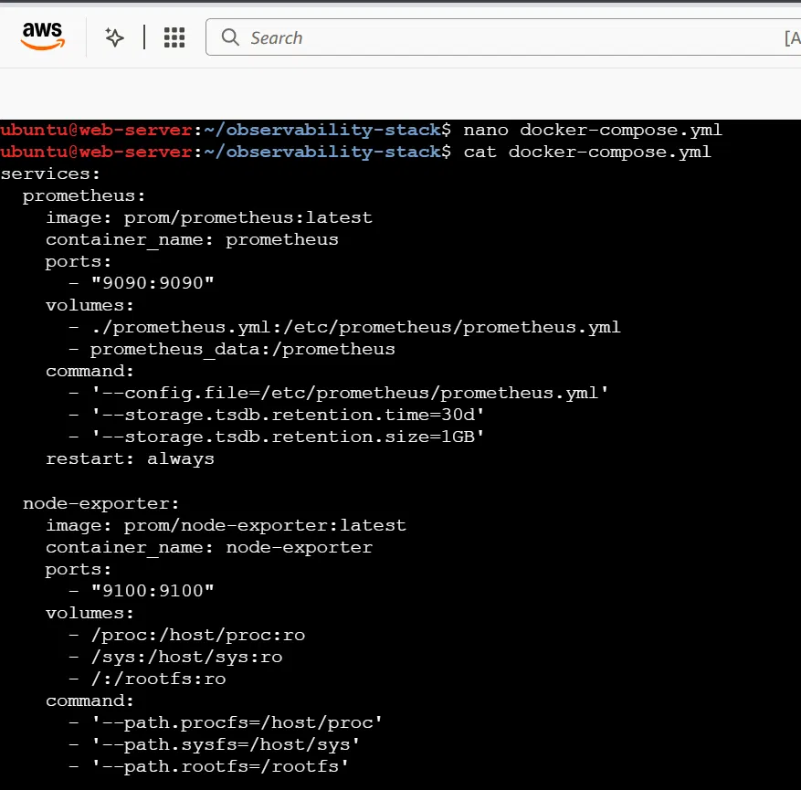

### Step 2: Check the compose file is valid

```bash
docker compose config
```

- **Meaning:** reads your `docker-compose.yml`, checks the syntax, and prints the final full version.
- If there is a YAML mistake (wrong spaces), it shows an error here, **before** you start anything.
- Tip: `docker compose config -q` prints nothing if everything is OK.

📸 **Output: config check (start, ports, end of the output)**

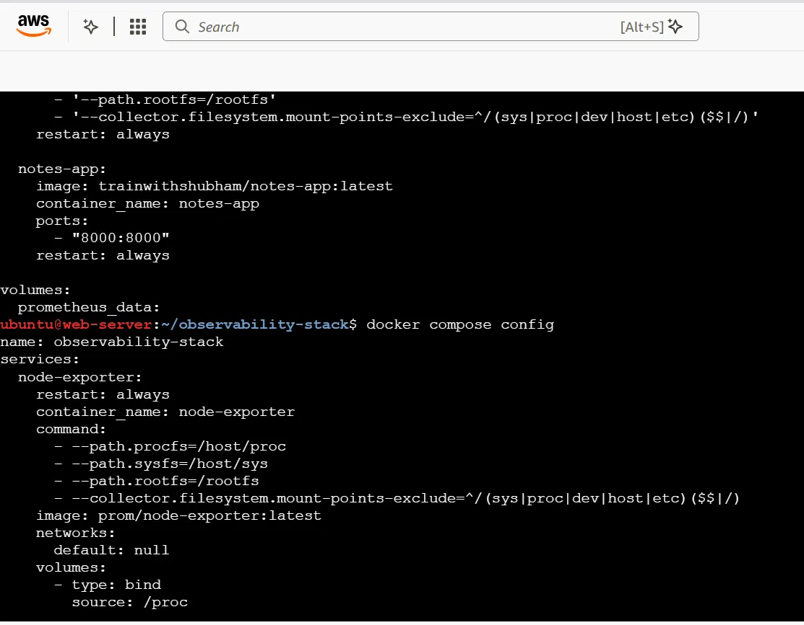

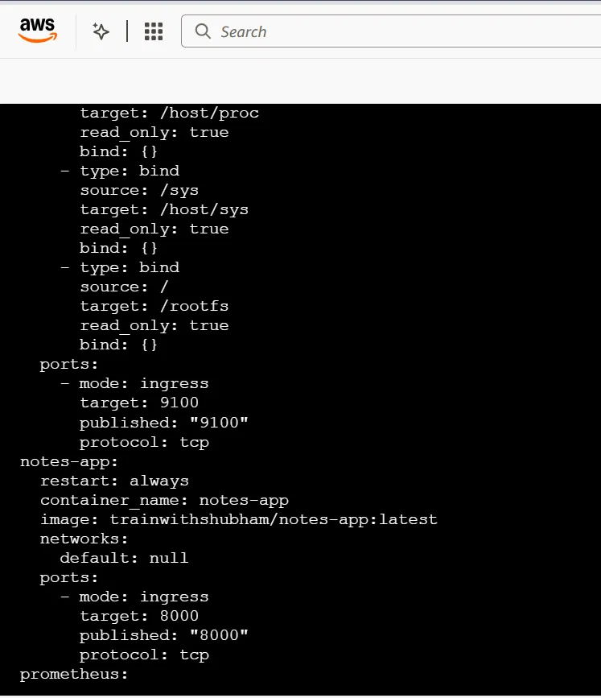

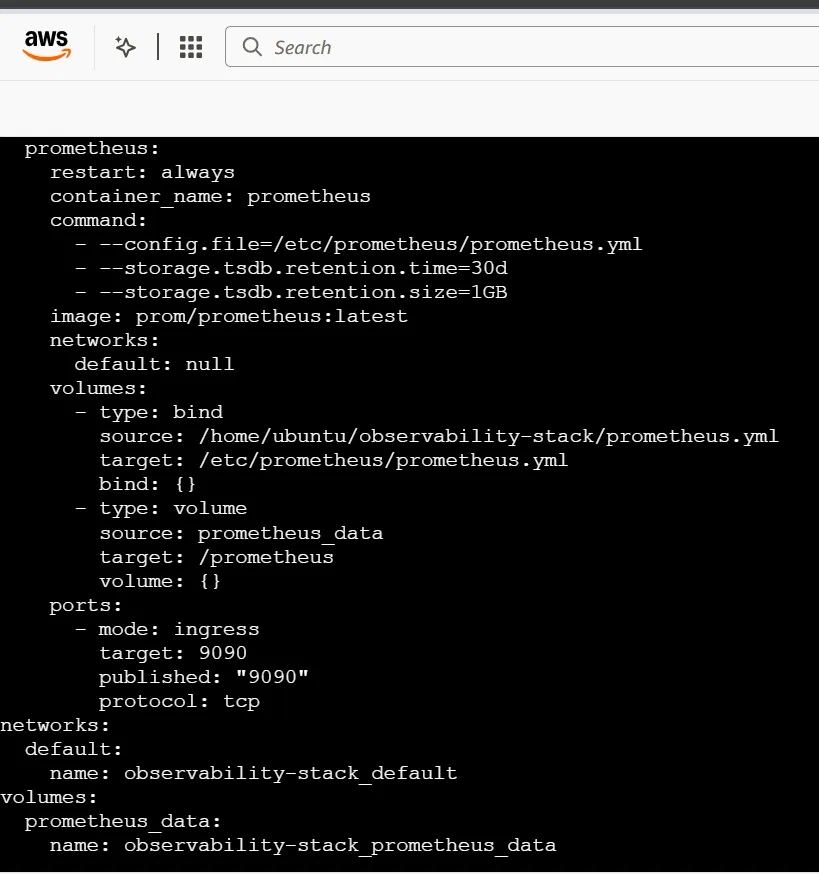

### Step 3: Tell Prometheus to scrape Node Exporter

Open `prometheus.yml`:

```bash
nano prometheus.yml
```

Add a new job under `scrape_configs`:

```yaml
global:
  scrape_interval: 15s

scrape_configs:
  - job_name: 'prometheus'
    static_configs:
      - targets: ['localhost:9090']

  - job_name: 'node-exporter'
    static_configs:
      - targets: ['node-exporter:9100']
```

**Line by line:**

- `scrape_interval: 15s` = collect data every 15 seconds.
- `job_name: 'node-exporter'` = the label for this group of targets.
- `targets: ['node-exporter:9100']` = address of the exporter.
  - We write `node-exporter` (the service name), **not** `localhost`.
  - Docker Compose puts all services on one network, and the service name works like a hostname.

Save in nano: `Ctrl + O`, `Enter`, then `Ctrl + X`.

📸 **Output: `prometheus.yml` with the node-exporter job**

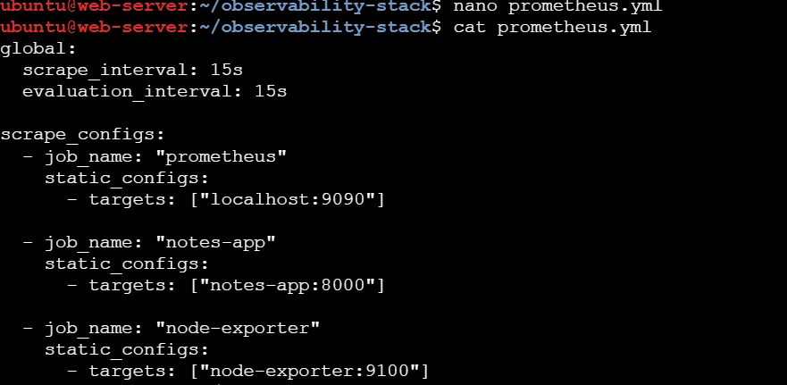

### Step 4: Start everything

```bash
docker compose up -d
```

- `up` = create and start the services.
- `-d` = detached, run in the background so the terminal is free.

Check:

```bash
docker compose ps
```

- Shows all services and their status. You want to see `Up`.

If Prometheus does not pick up the new job, restart it:

```bash
docker compose restart prometheus
```

📸 **Output: containers are running**

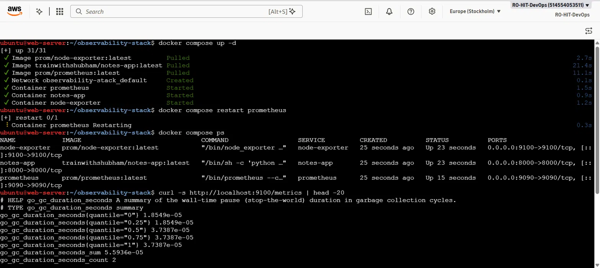

### Step 5: See the raw metrics

```bash
curl http://localhost:9100/metrics | head -n 20
```

- `curl` = fetch a URL from the terminal.
- `/metrics` = the page where an exporter shows its data.
- `| head -n 20` = show only the first 20 lines (the full page has thousands).
- You will see lines like `node_cpu_seconds_total{cpu="0",mode="idle"} 12345.6`. This is the format Prometheus reads.

📸 **Output: Node Exporter metrics**

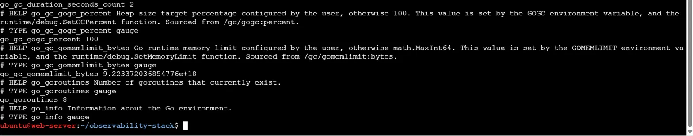

### Step 6: Confirm Prometheus sees the target

- Open `http://<server-ip>:9090/targets` in your browser.
- The `node-exporter` target must show **UP** (green).
  - `UP` = Prometheus can reach it and collect data.
  - `DOWN` = something is wrong (wrong name/port, or container not running).

📸 **Output: target is UP**

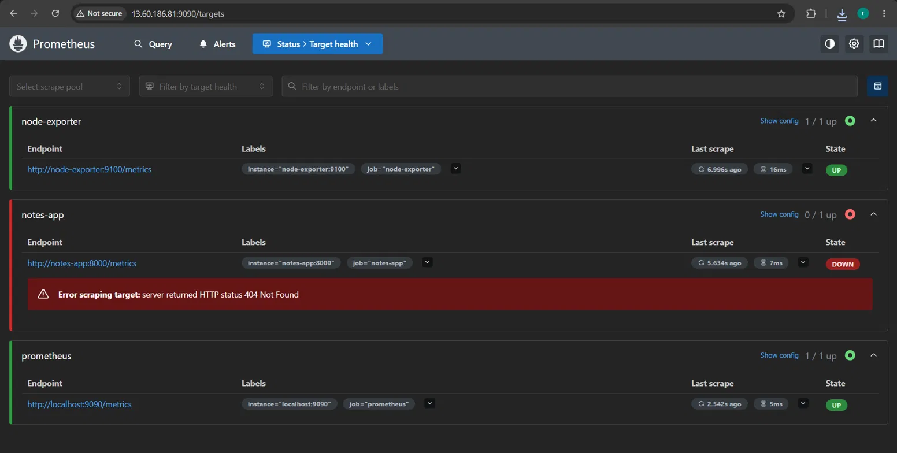

### Step 7: Run PromQL queries (Prometheus UI > Graph)

Open `http://<server-ip>:9090/graph`, type the query, click **Execute**.

**Query 1: CPU idle time**

```promql
node_cpu_seconds_total{mode="idle"}
```

- Total seconds each CPU core has spent **idle** (doing nothing).
- `mode="idle"` filters only the idle mode.
- It is a counter: it only goes up. To turn it into a useful CPU% we use `rate()` (see Task 4).

📸 **Output**

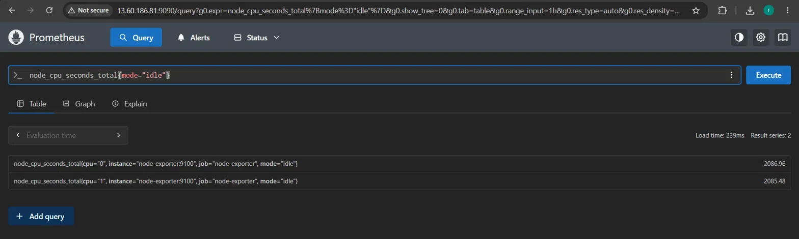

**Query 2: Total memory**

```promql
node_memory_MemTotal_bytes
```

- Total RAM of the server in bytes. It never changes (gauge).

📸 **Output**

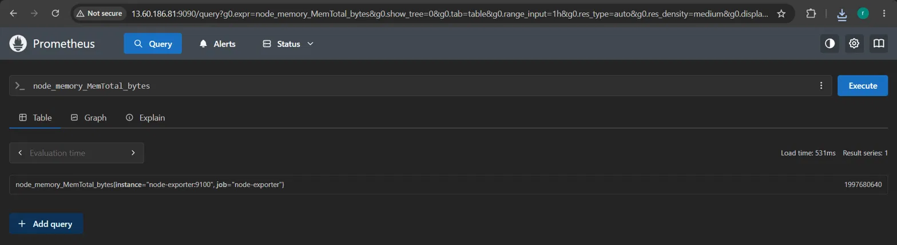

**Query 3: Available memory**

```promql
node_memory_MemAvailable_bytes
```

- RAM that can still be used by programs right now, in bytes.

📸 **Output**

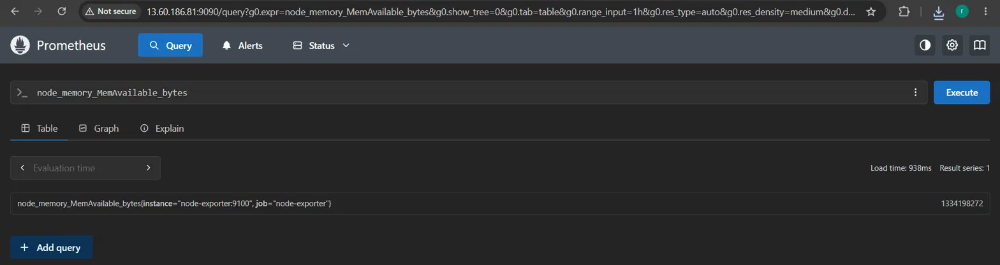

**Query 4: Disk usage percent**

```promql
(1 - (node_filesystem_avail_bytes{mountpoint="/"} / node_filesystem_size_bytes{mountpoint="/"})) * 100
```

- `avail / size` = fraction of disk that is free.
- `1 - that` = fraction that is used.
- `* 100` = turn it into percent.
- `mountpoint="/"` = look only at the main disk.

📸 **Output**

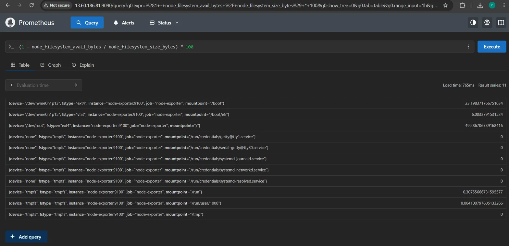

**Query 5: Network receive rate**

```promql
rate(node_network_receive_bytes_total[5m])
```

- `node_network_receive_bytes_total` = total bytes received (counter).
- `rate(...[5m])` = how many bytes **per second** were received, averaged over the last 5 minutes.

📸 **Output**

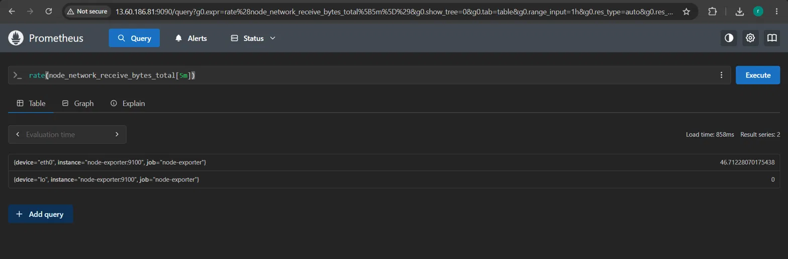

✅ **Task 1 done:** Node Exporter is running, Prometheus scrapes it, and you can query server metrics.

---

# Task 2: Add cAdvisor (container metrics)

### What and why

- Node Exporter tells us about the **server**. But we also want to know **which container** is using how much CPU/RAM.
- **cAdvisor** (by Google) reads this from Docker and exposes it for Prometheus.

### Step 1: Add the `cadvisor` service to `docker-compose.yml`

```yaml
  cadvisor:
    image: gcr.io/cadvisor/cadvisor:latest
    container_name: cadvisor
    ports:
      - "8080:8080"
    volumes:
      - /:/rootfs:ro
      - /var/run:/var/run:ro
      - /sys:/sys:ro
      - /var/lib/docker/:/var/lib/docker:ro
      - /dev/disk/:/dev/disk:ro
    privileged: true
    devices:
      - /dev/kmsg
    restart: unless-stopped
```

**Why these mounts?**

- cAdvisor must look inside Docker's own folders to measure containers:
  - `/var/lib/docker` = where Docker stores container data.
  - `/var/run` = contains the Docker socket (how to talk to Docker).
  - `/sys` and `/rootfs` = CPU/memory counters (cgroups) of the host.
  - All are `:ro` (read-only), so cAdvisor cannot change anything.
- `privileged: true` = gives extra permission to read kernel data.

📸 **Output: compose file with cAdvisor (top part)**

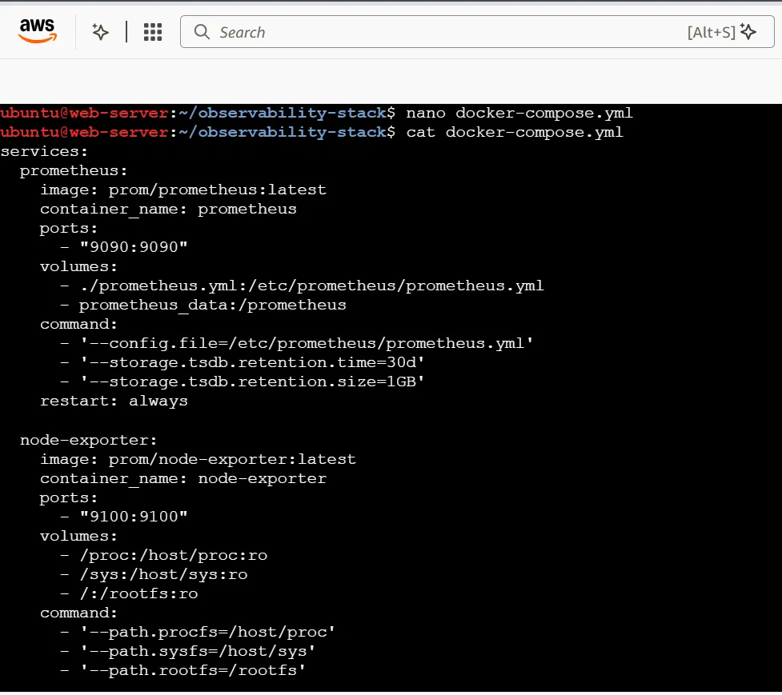

### Step 2: Validate the YAML

```bash
docker compose config
```

- Same as before. Make sure there is no error.

📸 **Output: YAML is OK**

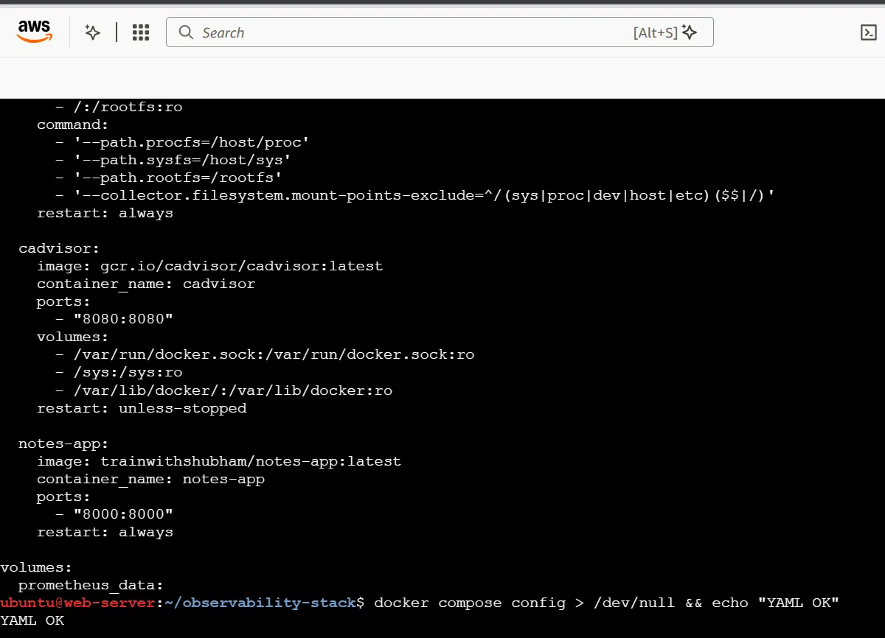

### Step 3: Add a cAdvisor job in `prometheus.yml`

```yaml
  - job_name: 'cadvisor'
    static_configs:
      - targets: ['cadvisor:8080']
```

- Put it under `scrape_configs`, same spacing as the other jobs.
- Target is `cadvisor:8080` (service name + container port).

📸 **Output**

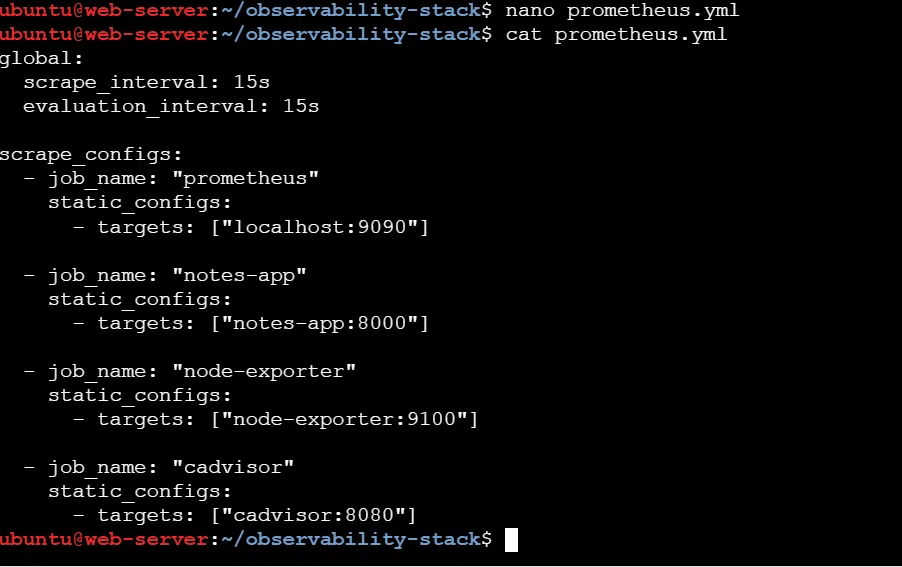

### Step 4: Start and restart

```bash
docker compose up -d
docker compose restart prometheus
```

- `up -d` creates the new `cadvisor` container.
- `restart prometheus` makes Prometheus read the new `prometheus.yml`.

### Step 5: Open the cAdvisor UI

- Browser: `http://<server-ip>:8080`
- cAdvisor has its own simple web page with live graphs.

📸 **Output: cAdvisor home page**

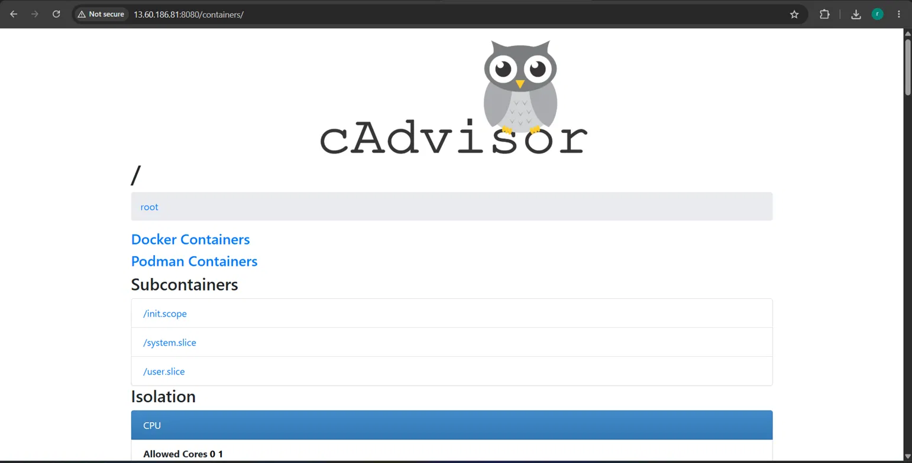

### Step 6: Confirm the target is UP

- Open `http://<server-ip>:9090/targets`. The `cadvisor` target must be **UP**.

📸 **Output**

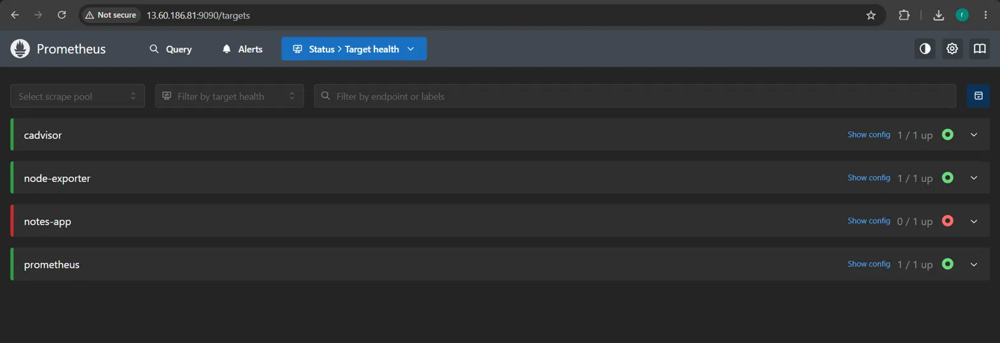

### Step 7: See Docker containers in cAdvisor

- In the cAdvisor UI, click **Docker Containers** (`/docker/`).
- You should see your containers: `prometheus`, `node-exporter`, `grafana`, `notes-app`, `cadvisor`.

📸 **Output**

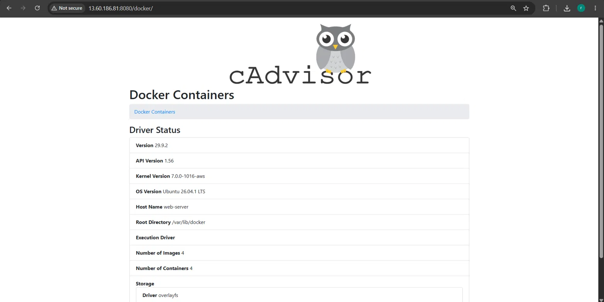

### Step 8: Query container metrics (and a problem we hit)

First try:

```promql
container_cpu_usage_seconds_total{name="notes-app"}
```

- `container_cpu_usage_seconds_total` = total CPU seconds used by a container (counter).
- `{name="notes-app"}` = filter by container name.

**What we saw:** the result was **empty**.

📸 **Output: empty result**

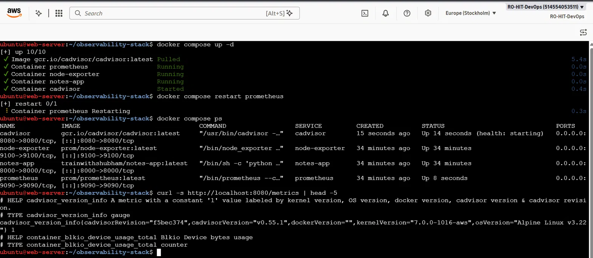

**How we debugged it (the right way to think):**

1. Check cAdvisor really gives data:

```bash
curl -s http://localhost:8080/metrics | grep container_cpu_usage_seconds_total | head
```

- `grep` keeps only lines that contain the text.
- This showed data exists. So the problem is not "no data".

📸 **Output**

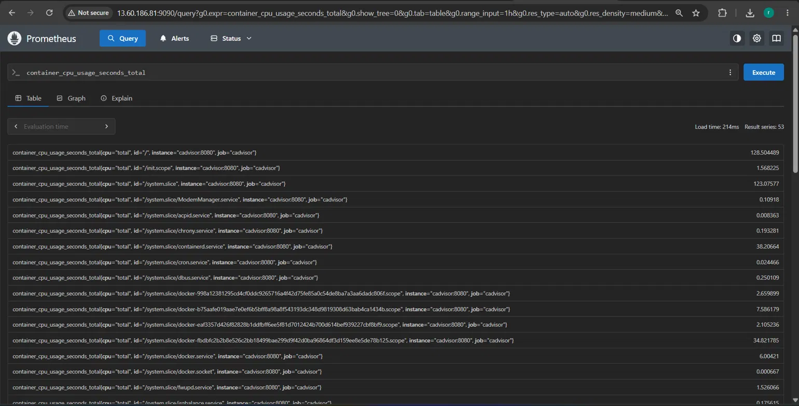

2. Look at the query without the `name` filter. The lines had **no `name` label**, so filtering by name found nothing.

📸 **Output: metrics without a `name` label**

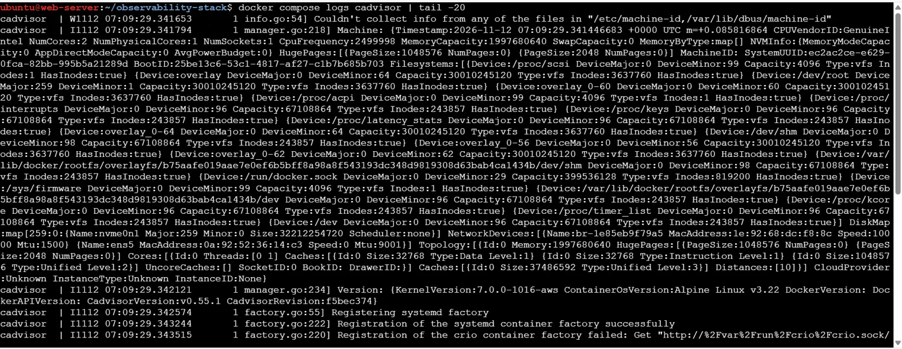

3. Check cAdvisor logs for errors:

```bash
docker compose logs cadvisor --tail 50
```

- `logs` = show output of the container.
- `--tail 50` = only the last 50 lines.

📸 **Output: cAdvisor logs**

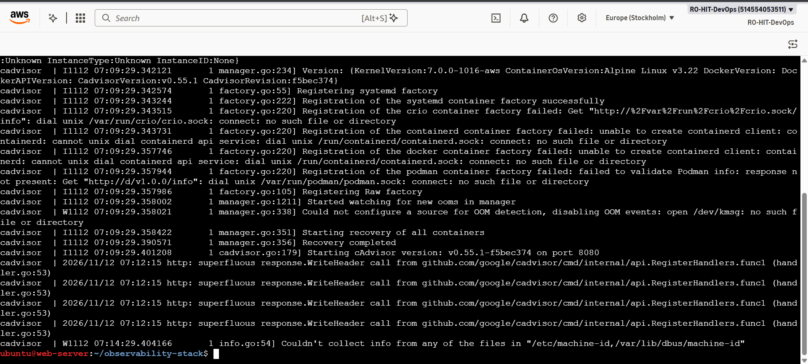

**Lesson:** when a query is empty, do not guess. Go step by step:
exporter has data? → Prometheus has the target UP? → does the label you filter on really exist?

> If the `name` label is missing in your setup, make sure the cAdvisor volumes above are mounted correctly (especially `/var/lib/docker` and `/var/run`), recreate it with `docker compose up -d --force-recreate cadvisor`, and look at one raw line to see which labels exist. Then build your filter from labels that really exist.

### Step 9: Useful container queries

**Container CPU usage (percent)**

```promql
rate(container_cpu_usage_seconds_total{name!=""}[5m]) * 100
```

- `rate(...[5m])` = CPU seconds used per second, over 5 minutes.
- `* 100` = percent of one CPU core.
- `name!=""` = ignore entries that have no container name.

📸 **Output**

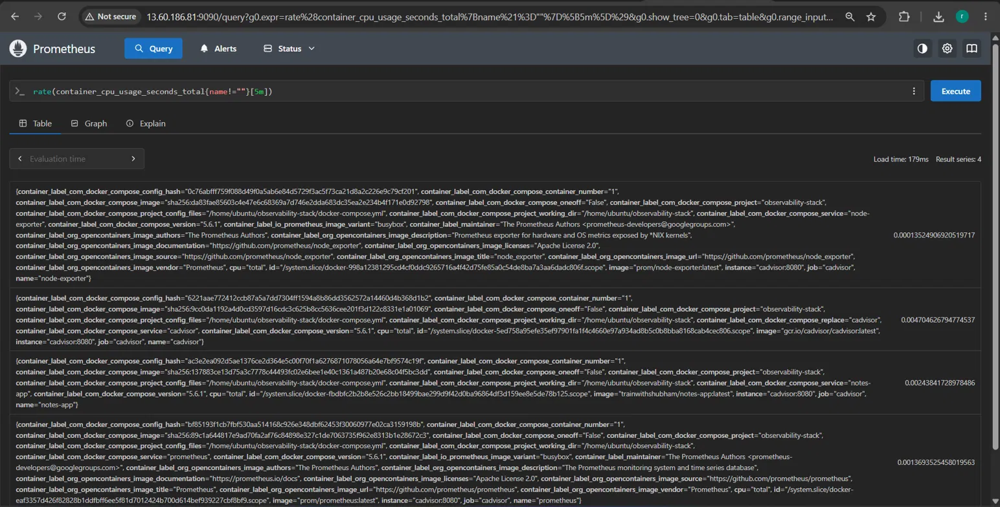

**Container memory usage**

```promql
container_memory_usage_bytes{name!=""}
```

- Memory used by each container, in bytes.

📸 **Output**

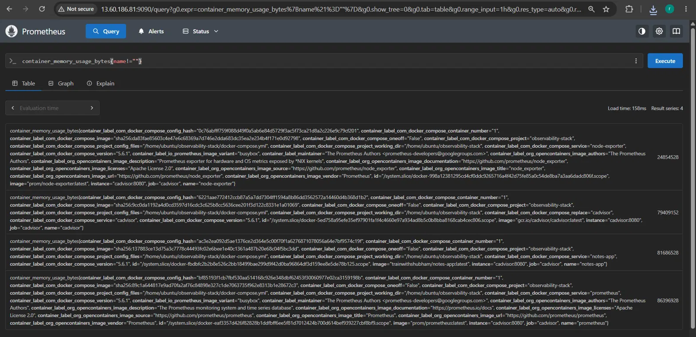

**Top 3 memory-hungry containers**

```promql
topk(3, container_memory_usage_bytes{name!=""})
```

- `topk(3, ...)` = keep only the 3 biggest values.
- Great for finding "which container is eating my RAM?".

📸 **Output**

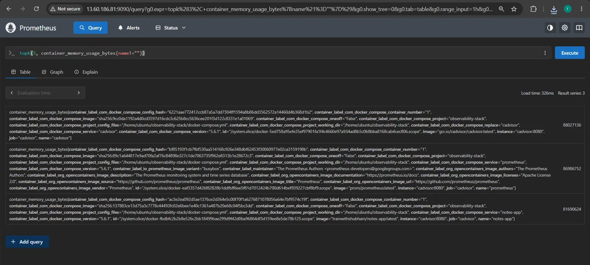

**Container network (we again saw the missing `name` label)**

```promql
rate(container_network_receive_bytes_total[5m])
```

📸 **Output**

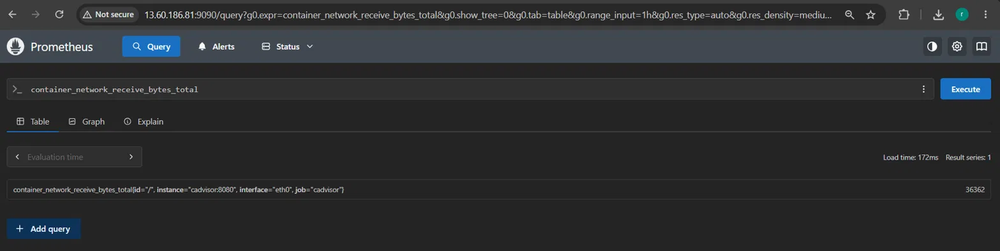

✅ **Task 2 done:** cAdvisor is running, Prometheus scrapes it, and you can see per-container CPU and memory.

---

# Task 3: Add Grafana and connect Prometheus

### What and why

- PromQL graphs in Prometheus are basic. **Grafana** gives beautiful dashboards.
- Grafana needs to know where the data is. So we add Prometheus as a **datasource**.

### Step 1: Add the `grafana` service to `docker-compose.yml`

```yaml
  grafana:
    image: grafana/grafana-enterprise:latest
    container_name: grafana
    ports:
      - "3000:3000"
    volumes:
      - grafana_data:/var/lib/grafana
    environment:
      - GF_SECURITY_ADMIN_USER=admin
      - GF_SECURITY_ADMIN_PASSWORD=admin123
    restart: unless-stopped
```

And at the **bottom** of the file (outside services), declare the volume:

```yaml
volumes:
  grafana_data:
```

**Line by line:**

- `grafana/grafana-enterprise` = the official Grafana image.
- `ports: "3000:3000"` = Grafana UI is on port 3000.
- `grafana_data:/var/lib/grafana` = a **named volume**. Grafana saves dashboards and settings here, so you do not lose them when the container is recreated.
- `GF_SECURITY_ADMIN_USER / PASSWORD` = login for Grafana.
  - `GF_` + setting name = how Grafana reads settings from environment variables.
  - **Warning:** `admin123` is only for learning. Use a strong password (or secrets) in real projects.

📸 **Output: compose YAML is valid**

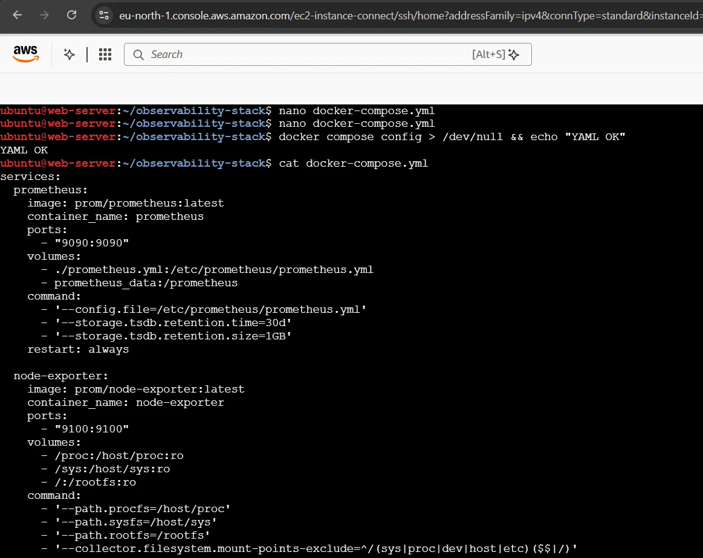

📸 **Output: Grafana service and volume in the file**

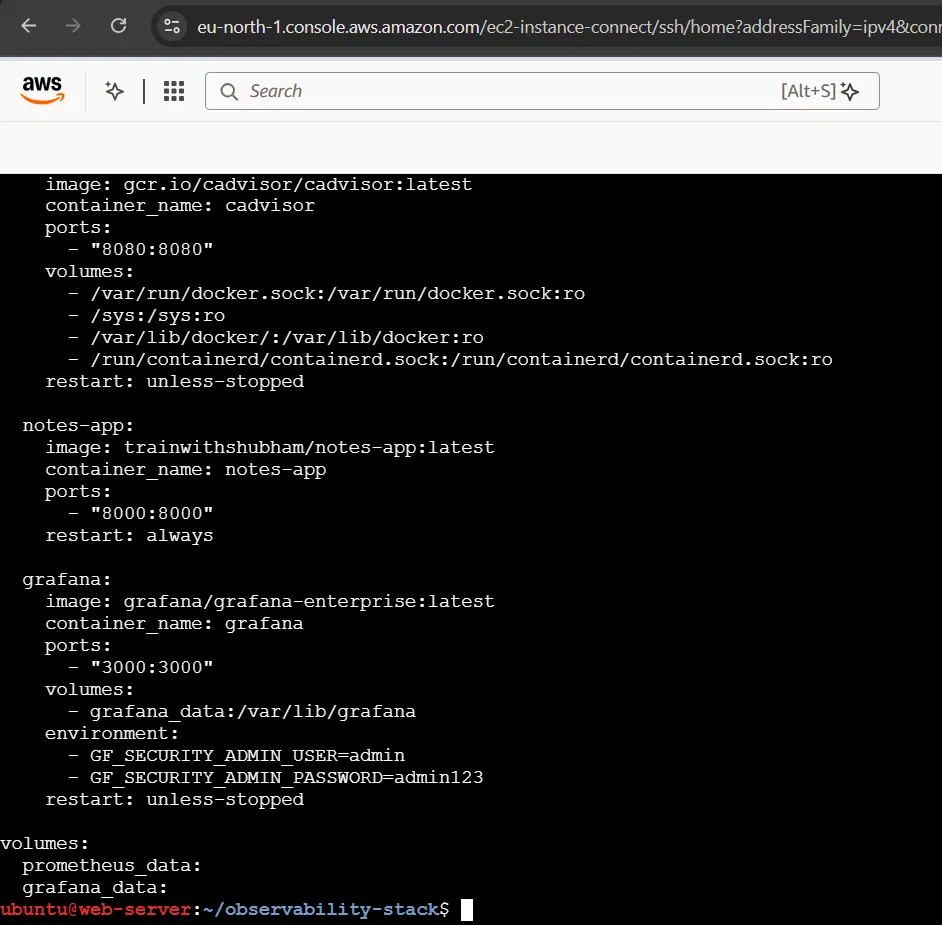

### Step 2: Start Grafana

```bash
docker compose up -d grafana
```

- Starts only the `grafana` service.

### Step 3: Check Grafana is alive

```bash
curl -s -o /dev/null -w "%{http_code}\n" http://localhost:3000/login
```

- `-s` = silent (no progress bar).
- `-o /dev/null` = throw away the page content.
- `-w "%{http_code}\n"` = print only the HTTP status code.
- **200** = Grafana is up and responding.

📸 **Output**

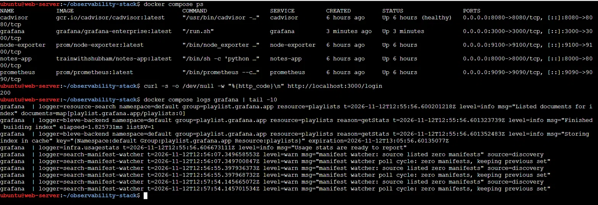

### Step 4: Log in

- Browser: `http://<server-ip>:3000`
- Username: `admin`, Password: `admin123`

📸 **Output: login page**

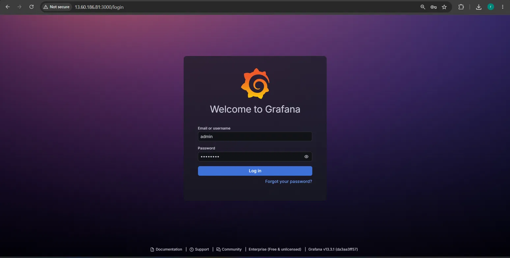

### Step 5: Add Prometheus as a datasource (manual way)

1. Left menu → **Connections** → **Add new connection**.
2. Search **Prometheus** and click it.
3. Click **Add new data source**.

📸 **Output**

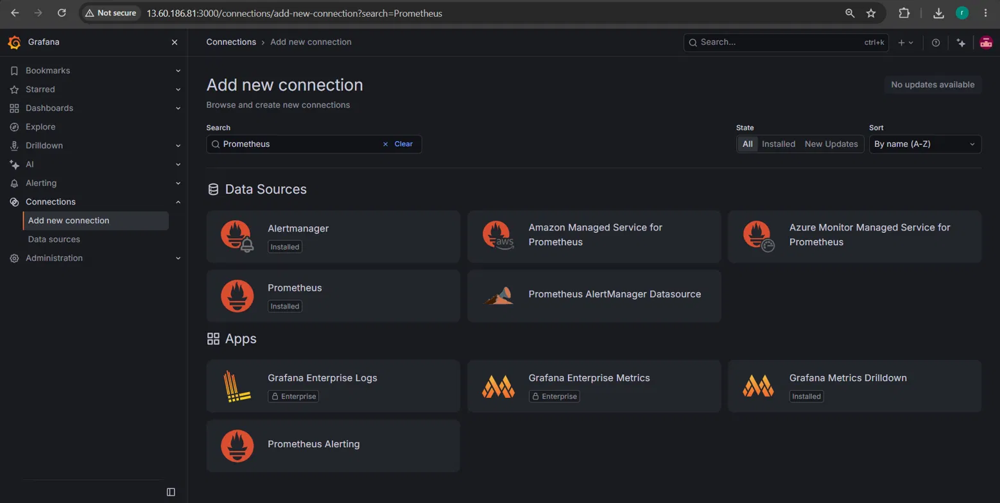

4. In **Prometheus server URL** type:

```
http://prometheus:9090
```

- **Important:** use `prometheus` (service name), **not** `localhost`.
  - Grafana runs in its own container. For it, `localhost` means "the Grafana container itself", where Prometheus is not running.

📸 **Output**

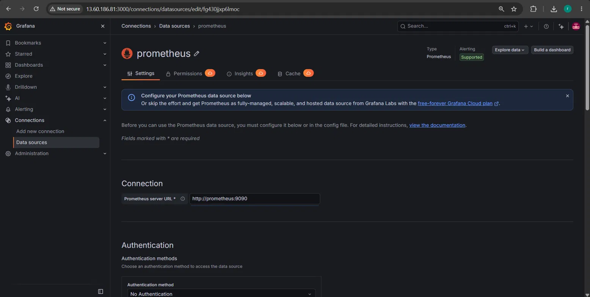

5. Scroll down and click **Save & test**.
   - Green message "Successfully queried the Prometheus API" = connection works.

📸 **Output**

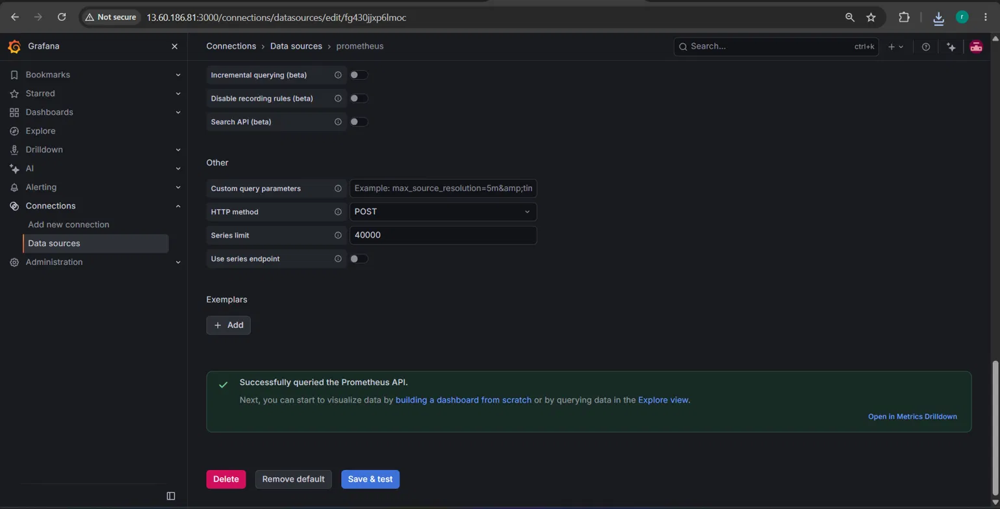

✅ **Task 3 done:** Grafana is running and connected to Prometheus.

---

# Task 4: Build your own dashboard (5 panels)

### What and why

- A **dashboard** = one page with many **panels**. Each panel shows one query as a graph, gauge, or number.
- We build 5 panels: 2 for the server, 2 for containers, 1 for disk.

### How to create any panel

1. **Dashboards** → **New** → **New dashboard** → **Add visualization**.
2. Choose datasource **Prometheus**.
3. Under the query box, switch to **Code** mode and paste the PromQL.
4. On the right, choose the **Visualization** type (Gauge, Time series, Bar chart, Stat).
5. Set the **Title**, click **Run queries** to check, then go **Back to dashboard**.
6. Add the next panel with **Add** → **Visualization**.

### Panel 1: CPU Usage % (Gauge)

```promql
100 - (avg(rate(node_cpu_seconds_total{mode="idle"}[5m])) * 100)
```

**Logic (step by step):**

- `rate(...idle...[5m])` = fraction of time each core was idle, per second.
- `avg(...)` = average of all cores.
- `* 100` = percent idle.
- `100 - ...` = percent **busy**. (Busy = 100 − idle.)

Settings: Visualization = **Gauge**, Unit = **Percent (0-100)**.

📸 **Output**

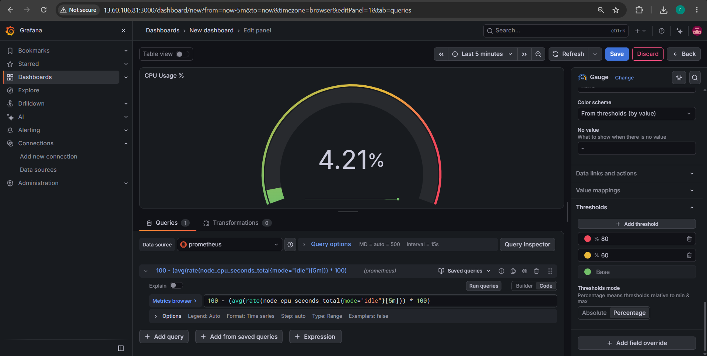

### Panel 2: Memory Usage % (Gauge)

```promql
(1 - (node_memory_MemAvailable_bytes / node_memory_MemTotal_bytes)) * 100
```

**Logic:**

- `available / total` = fraction of RAM still free.
- `1 - that` = fraction used.
- `* 100` = percent.

Settings: Visualization = **Gauge**, Unit = **Percent (0-100)**.

### Panel 3: Container CPU Usage (Time series)

```promql
rate(container_cpu_usage_seconds_total{name!=""}[5m]) * 100
```

- One line per container. Shows who uses the CPU over time.
- Visualization = **Time series**.

📸 **Output**

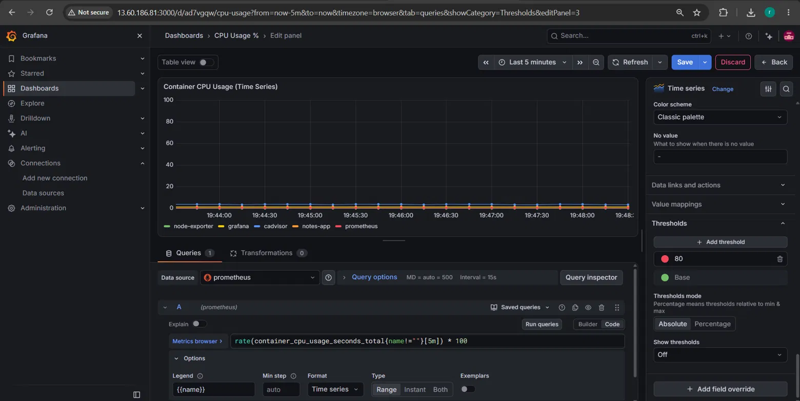

### Panel 4: Container Memory in MB (Bar chart)

```promql
container_memory_usage_bytes{name!=""} / 1024 / 1024
```

- `/ 1024 / 1024` = bytes → MB.
- Visualization = **Bar chart**, one bar per container.

📸 **Output**

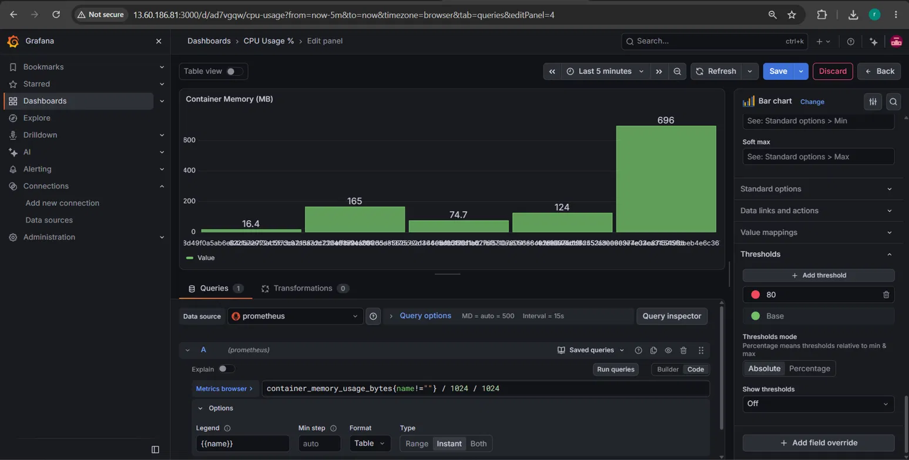

### Panel 5: Disk Usage % (Stat)

```promql
(1 - (node_filesystem_avail_bytes{mountpoint="/"} / node_filesystem_size_bytes{mountpoint="/"})) * 100
```

- Visualization = **Stat** (one big number), Unit = **Percent (0-100)**.
- Optional: set thresholds (for example, red above 80%) so the panel changes colour when the disk is almost full.

📸 **Output**

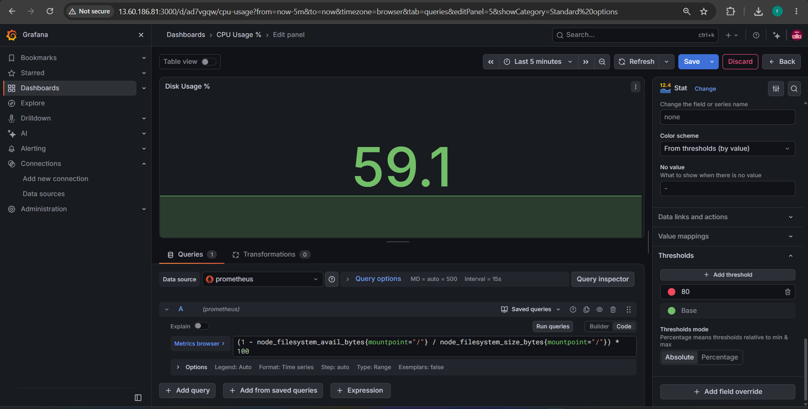

### Save the dashboard

1. Arrange the panels by dragging them and set time range **Last 1 hour**.
2. Click **Save dashboard** (top right).
3. Title: `DevOps Observability Overview`, then **Save**.

✅ **Task 4 done:** you have a custom dashboard with 5 panels.

---

# Task 5: Auto-provision the datasource with YAML

### What and why

- In Task 3 we added the datasource by clicking. In real companies nobody does this by hand.
- If the server is rebuilt, you would have to click everything again. With **provisioning**, Grafana reads a YAML file at startup and sets everything up **by itself**.

### Step 1: Create the folders

```bash
mkdir -p grafana/provisioning/datasources
mkdir -p grafana/provisioning/dashboards
```

- `mkdir` = make a folder. `-p` = also create parent folders, and no error if they exist.
- Grafana looks in a fixed place: `/etc/grafana/provisioning`. Inside it, folder names must be exact:
  - `datasources/` for datasource files.
  - `dashboards/` for dashboard files (empty for now; used later).

### Step 2: Create the datasource file

```bash
nano grafana/provisioning/datasources/datasources.yml
```

```yaml
apiVersion: 1

datasources:
  - name: Prometheus
    type: prometheus
    access: proxy
    url: http://prometheus:9090
    isDefault: true
    editable: false
```

**Line by line:**

- `apiVersion: 1` = version of the provisioning format. Always 1.
- `name: Prometheus` = name shown in Grafana.
- `type: prometheus` = kind of datasource.
- `access: proxy` = Grafana's **server** talks to Prometheus (not your browser). This is why `prometheus:9090` works.
- `url` = where Prometheus is.
- `isDefault: true` = new panels use this datasource automatically.
- `editable: false` = nobody can change it from the UI. Only the file can change it.

> Use **spaces**, never Tab, in YAML.

### Step 3: Mount the folder into the Grafana container

In `docker-compose.yml`, add one line under Grafana `volumes`:

```yaml
  grafana:
    image: grafana/grafana-enterprise:latest
    container_name: grafana
    ports:
      - "3000:3000"
    volumes:
      - grafana_data:/var/lib/grafana
      - ./grafana/provisioning:/etc/grafana/provisioning
    environment:
      - GF_SECURITY_ADMIN_USER=admin
      - GF_SECURITY_ADMIN_PASSWORD=admin123
    restart: unless-stopped
```

- `./grafana/provisioning:/etc/grafana/provisioning` = `host-folder:container-folder`.
- It makes your local folder visible inside the container at the place where Grafana looks.

Quick check that the line exists:

```bash
grep -n -A 12 "grafana:" docker-compose.yml
```

- `grep` = search text. `-n` = show line numbers. `-A 12` = also show 12 lines **after** the match.

### Step 4: Restart Grafana

```bash
docker compose up -d grafana
docker ps | grep grafana
```

- Compose sees that the volumes changed, so it **recreates** the Grafana container.
- `docker ps` = list running containers; `| grep grafana` = show only Grafana.

📸 **Output: folders, YAML file, compose volume line, restart**

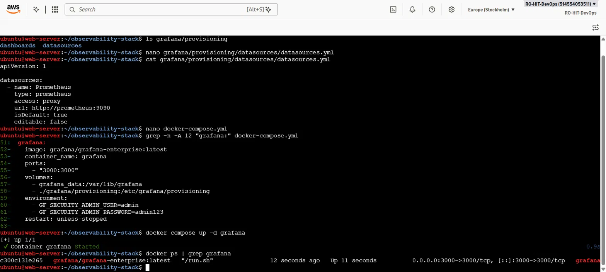

### Step 5: Verify in Grafana

- Go to **Connections** → **Data sources**.
- You will see two entries if you also added one manually in Task 3:
  - `Prometheus` (capital P) with the **default** badge = created from the YAML file.
  - `prometheus` (small p) = the one created by hand earlier.
- Both work. Do not delete the old one if your dashboard panels still use it.

📸 **Output**

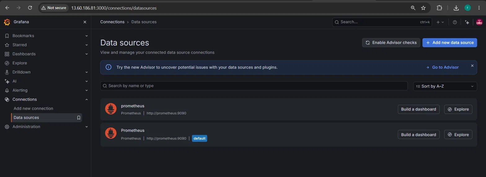

- Click the `Prometheus` (default) one. You will see the blue message **"Provisioned data source: this data source was added by config and cannot be modified using the UI"**. The fields are greyed out because of `editable: false`.

📸 **Output**

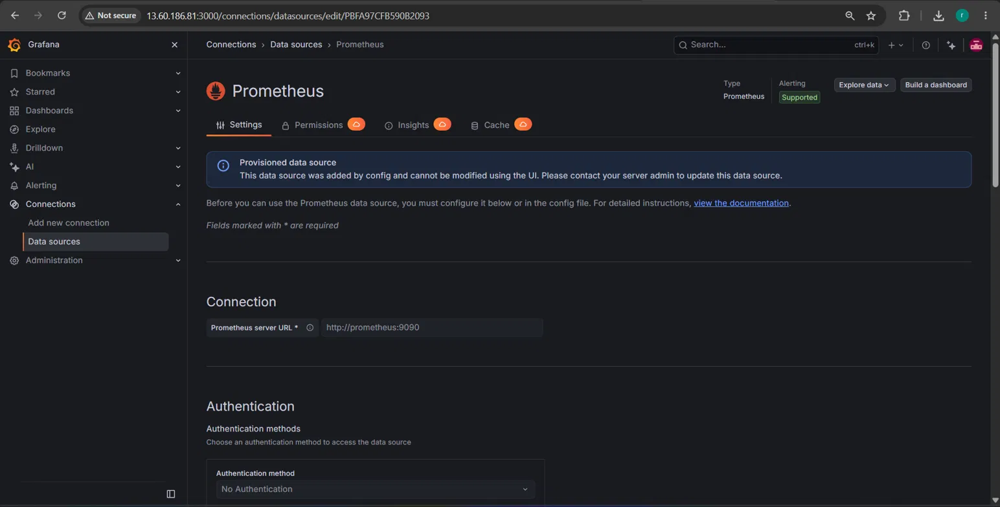

### Document: Why is provisioning via YAML better than clicking in the UI?

- **Repeatable:** a new server gets the same setup with one command.
- **No human mistakes:** a typo in a URL during clicking is easy to make. A file is written once.
- **Version control:** the file lives in Git, so you can see who changed what and when, and go back if needed.
- **Same for the whole team:** every machine gets the same datasource.
- **Automation:** CI/CD pipelines can deploy it without manual work.
- **Protected from accidental change:** `editable: false` stops people from changing it in the UI.
- **Disaster recovery:** if the server is lost, config files bring the setup back quickly.

✅ **Task 5 done:** the datasource now appears automatically and is read-only.

---

# Task 6: Import community dashboards

### What and why

- The Grafana community shares thousands of ready dashboards on grafana.com. Each has an **ID**.
- Instead of building 30+ panels yourself, you import one with a single ID. They use the same metrics you queried by hand.

### Import dashboard 1860 (Node Exporter Full)

1. **Dashboards** → **New** → **Import**.
2. In **Find and import dashboards...** type `1860`, click **Load**.
3. Choose a **Folder** (`Dashboards` is fine).
4. Choose the datasource `Prometheus`.
5. Click **Import**.
6. Set time range to **Last 1 hour**.

You will see CPU, RAM, swap, root filesystem, network and disk panels. The numbers (RAM about 53%, root disk about 59%) match our own panels from Task 4. That proves our queries were correct.

> `SWAP: N/A` is normal when the server has no swap configured.

📸 **Output: Node Exporter Full**

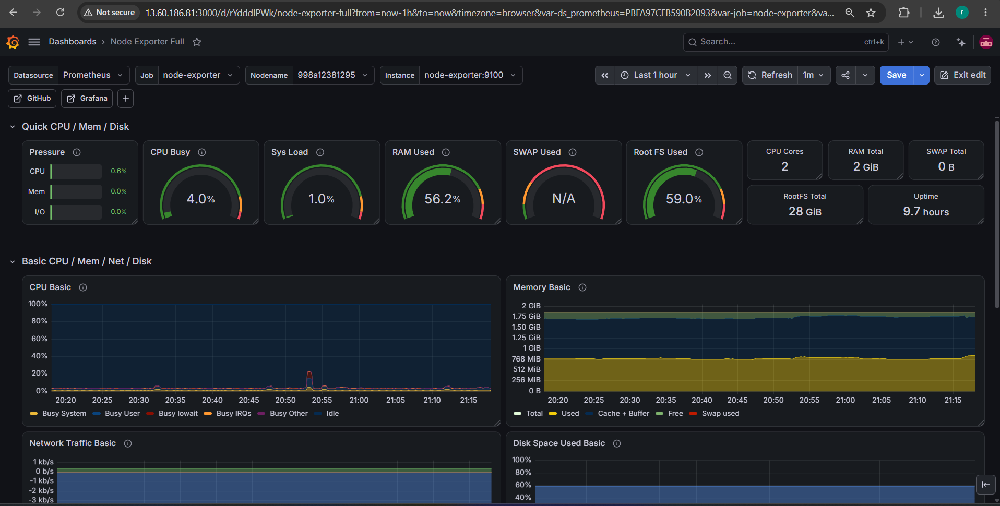

### Import dashboard 193 (Docker monitoring)

- Same steps with ID `193`.
- **Result:** all panels showed **No data / N/A**. This is an old dashboard written for older cAdvisor/Prometheus labels, so its queries do not match today's metrics.
- **Lesson:** a community dashboard may be outdated. Always check the last update date and the datasource it expects.

### Import dashboard 14282 (Cadvisor exporter)

- Same steps with ID `14282`.
- **Result:** works. You see CPU Usage, Memory Usage and Memory Cached for all five containers (`cadvisor`, `grafana`, `node-exporter`, `notes-app`, `prometheus`).

📸 **Output: Cadvisor exporter**

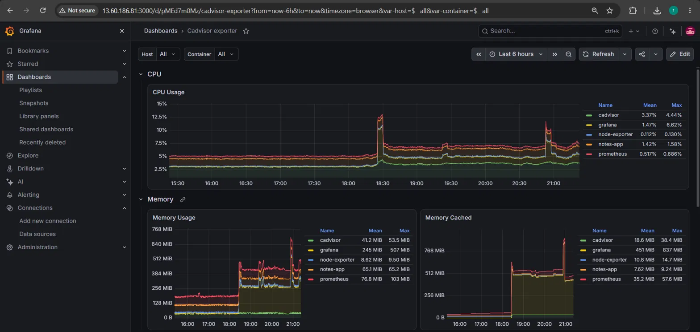

### Final check: all services are running

```bash
docker compose ps
```

- Shows the name, image, status and ports of every service.
- All five must be `Up`: `prometheus`, `node-exporter`, `cadvisor`, `grafana`, `notes-app`.
- Note: `grafana` shows a shorter uptime because it was recreated in Task 5. That is normal.

📸 **Output**

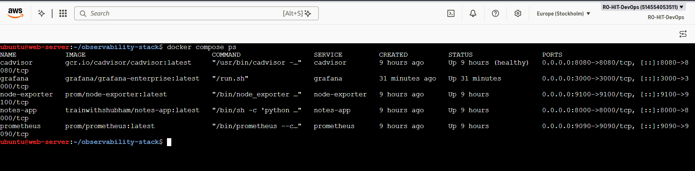

✅ **Task 6 done.**

---

## Troubleshooting

| Problem | Likely reason | What to do |
|---|---|---|
| Target shows **DOWN** in Prometheus | Wrong name/port or container not running | `docker compose ps`, check `targets:` in `prometheus.yml`, then `docker compose restart prometheus` |
| Prometheus does not see the new job | It did not reload the config | `docker compose restart prometheus` |
| `docker compose config` shows an error | Wrong spaces in YAML | Use spaces (no Tab), keep the indentation equal |
| Grafana "Save & test" fails | Used `localhost:9090` | Use `http://prometheus:9090` |
| Container query is empty | Label (like `name`) missing or wrong | Remove the filter, look at the raw labels, then filter using labels that really exist |
| Two datasources with similar names | One added manually, one by YAML | Keep both or delete the old one after moving panels to the new one |
| Datasource error after restart | Name conflict with the manual one | `docker compose logs grafana --tail 30`, delete the old one in UI, run `docker compose up -d grafana` again |
| Imported dashboard says No data | Old dashboard or wrong datasource | Pick the right datasource, or use a newer dashboard (for example 14282) |
| Cannot open a port in browser | AWS Security Group blocks it | Allow the port for your IP |

---

## Command cheat sheet

| Command | Meaning |
|---|---|
| `docker compose config` | Validate and print the final compose file |
| `docker compose up -d` | Start all services in the background |
| `docker compose up -d grafana` | Start or recreate only Grafana |
| `docker compose ps` | List services and status |
| `docker compose logs <service> --tail 30` | Show the last 30 log lines |
| `docker compose restart <service>` | Restart one service |
| `docker ps` | List running containers |
| `curl http://localhost:9100/metrics` | See raw Node Exporter metrics |
| `curl -s -o /dev/null -w "%{http_code}\n" <url>` | Print only the HTTP status code |
| `mkdir -p a/b/c` | Create nested folders |
| `nano <file>` | Edit a file (`Ctrl+O` save, `Ctrl+X` exit) |
| `grep -n -A 12 "text" <file>` | Find text and show lines after it |

**Useful PromQL**

| Goal | Query |
|---|---|
| Server CPU % | `100 - (avg(rate(node_cpu_seconds_total{mode="idle"}[5m])) * 100)` |
| Server memory % | `(1 - (node_memory_MemAvailable_bytes / node_memory_MemTotal_bytes)) * 100` |
| Disk % | `(1 - (node_filesystem_avail_bytes{mountpoint="/"} / node_filesystem_size_bytes{mountpoint="/"})) * 100` |
| Network in (bytes/s) | `rate(node_network_receive_bytes_total[5m])` |
| Container CPU % | `rate(container_cpu_usage_seconds_total{name!=""}[5m]) * 100` |
| Container memory (MB) | `container_memory_usage_bytes{name!=""} / 1024 / 1024` |
| Top 3 memory containers | `topk(3, container_memory_usage_bytes{name!=""})` |

---

## Key learnings

- **Prometheus pulls data.** It cannot read a server or Docker alone, so we use **exporters**.
- **Node Exporter = server metrics. cAdvisor = container metrics.**
- Inside Docker Compose, use the **service name** (`prometheus`, `node-exporter`) as the hostname, not `localhost`.
- **Counters** (total values that only go up) need `rate()` to become useful.
- **Grafana only draws.** It needs a datasource such as Prometheus.
- **Provisioning with YAML** makes Grafana setup repeatable, safe and version-controlled.
- **Community dashboards save time**, but check that they are not outdated.
- **Debug step by step** when a query is empty: exporter → target UP → labels → query.
- Never keep default or weak passwords and wide-open ports in real environments.

---

