# Day 75 - Log Management with Loki and Promtail

> **Goal of today:** Add the second pillar of observability, **logs**, to the monitoring stack built on Day 74.
> Metrics tell you **what** is broken. Logs tell you **why**.

This guide is written so that anyone, even a complete beginner, can follow it step by step and get the same result. Every command and every config line is explained.

---

## Table of Contents

1. [What we are building](#1-what-we-are-building)
2. [Task 1: Understand the logging pipeline](#2-task-1-understand-the-logging-pipeline)
3. [Task 2: Create the Loki config](#3-task-2-create-the-loki-config)
4. [Task 3: Create the Promtail config](#4-task-3-create-the-promtail-config)
5. [Task 4: Add Loki and Promtail to Docker Compose](#5-task-4-add-loki-and-promtail-to-docker-compose)
6. [Task 5: Start the containers](#6-task-5-start-the-containers)
7. [Task 6: Add Loki as a Grafana datasource](#7-task-6-add-loki-as-a-grafana-datasource)
8. [Task 7: Query logs with LogQL](#8-task-7-query-logs-with-logql)
9. [Task 8: Log metric queries](#9-task-8-log-metric-queries)
10. [Task 9: Exercise, errors from the notes-app](#10-task-9-exercise-errors-from-the-notes-app)
11. [Task 10: Correlate metrics and logs](#11-task-10-correlate-metrics-and-logs)
12. [Loki vs ELK](#12-loki-vs-elk)
13. [Troubleshooting (problems I actually hit)](#13-troubleshooting-problems-i-actually-hit)
14. [What I learned](#14-what-i-learned)
15. [Submission commands](#15-submission-commands)

---

## 1. What we are building

On Day 74 we built a **metrics** pipeline: Prometheus, Node Exporter, cAdvisor and Grafana.
Today we add a **logs** pipeline:

| Tool | Job | Simple example |
|---|---|---|
| **Loki** | Stores logs | The warehouse |
| **Promtail** | Collects logs and sends them to Loki | The postman |
| **Grafana** | Shows logs (and metrics) | The screen you look at |

**Prerequisite:** the Day 74 stack is already running with `docker-compose.yml`, `prometheus.yml` and a `grafana/` folder inside one project folder. In my case the folder is `~/observability-stack`.

Project folder after today:

```
observability-stack/
├── docker-compose.yml
├── prometheus.yml
├── loki-config.yml          <- new today
├── promtail-config.yml      <- new today
├── grafana/
│   └── provisioning/
└── screenshots/
```

Containers running at the end (7 total):
`notes-app`, `prometheus`, `node-exporter`, `cadvisor`, `grafana`, `loki`, `promtail`.

---

## 2. Task 1: Understand the logging pipeline

### Architecture diagram

```
[Docker Containers]
       |
       | (write JSON logs to /var/lib/docker/containers/)
       v
  [Promtail]
       |
       | (reads log files, adds labels, pushes to Loki)
       v
    [Loki]
       |
       | (stores logs, indexes by labels)
       v
   [Grafana]
       |
       | (queries Loki with LogQL, displays logs)
       v
   [You]
```

### How it works, in simple words

1. Every Docker container writes its output (requests, errors, warnings) to a JSON file on the host, under `/var/lib/docker/containers/`. These are **logs**.
2. **Promtail** reads those files, attaches **labels** (like a stamp: `job="docker"`), and pushes the lines to Loki.
3. **Loki** stores the log lines. It only builds an index on the labels.
4. **Grafana** asks Loki for logs using a query language called **LogQL**, and shows them to you.

### Document: Why does Loki only index labels instead of full text? What is the trade-off?

**Why:**

- Elasticsearch (the ELK stack) indexes every word of every log line. That is like a book with a giant index page listing every word. Search is very fast, but the index becomes huge. It needs a lot of disk, RAM and money.
- Loki indexes **only labels** (for example `job`, `filename`). The log text itself is compressed and stored as is. That is like a book with only a list of chapter names.
- Result: the index is tiny, storage is cheap, and the system is simple to run.
- It follows the same idea as Prometheus ("Prometheus, but for logs"), so the label approach feels familiar.

**Trade-off:**

| Benefit | Cost |
|---|---|
| Very cheap (small index, less RAM, less disk) | Searching for words inside logs (like `"error 500"`) is slower, because Loki must scan the log text |
| Simple to set up and operate | Less powerful than full-text search engines |
| Label queries are very fast | If you pick bad labels, queries get slow |

**One line summary:** Loki chooses *low cost and simplicity*. Elasticsearch chooses *search speed and power*.

---

## 3. Task 2: Create the Loki config

Loki needs a config file that tells it where to store data, which port to use, and how to index.

### Command

```bash
cd ~/observability-stack
nano loki-config.yml
```

- `cd ~/observability-stack` moves into the project folder (the same folder that has `docker-compose.yml`).
- `nano loki-config.yml` opens the nano editor and creates the file. Paste the content below, then save with `Ctrl + O`, `Enter`, and exit with `Ctrl + X`.

### `loki-config.yml`

```yaml
auth_enabled: false

server:
  http_listen_port: 3100

common:
  path_prefix: /loki
  storage:
    filesystem:
      chunks_directory: /loki/chunks
      rules_directory: /loki/rules
  replication_factor: 1
  ring:
    kvstore:
      store: inmemory

schema_config:
  configs:
    - from: 2020-10-24
      store: tsdb
      object_store: filesystem
      schema: v13
      index:
        prefix: index_
        period: 24h

limits_config:
  retention_period: 168h
```

### What each part means

| Config | Meaning |
|---|---|
| `auth_enabled: false` | Single-user mode. No login needed. Good for learning. |
| `http_listen_port: 3100` | Loki listens on port 3100. Promtail and Grafana talk to this port. |
| `path_prefix: /loki` | Base folder **inside the container** where Loki keeps its data. |
| `chunks_directory: /loki/chunks` | Where the compressed log data (chunks) is stored. |
| `rules_directory: /loki/rules` | Where alert rules would be stored. |
| `replication_factor: 1` | Keep only one copy of the data. Fine for a single instance. |
| `kvstore: store: inmemory` | Loki keeps its ring (cluster coordination) in RAM, because we run only one Loki. |
| `store: tsdb` | Use Loki's time-series database format for the index. |
| `object_store: filesystem` | Store chunks on local disk. |
| `schema: v13` | The current storage schema version. |
| `index: period: 24h` | Create a new index table every 24 hours. |
| `retention_period: 168h` | 168 hours = 7 days. Intended log lifetime. |

> **Note:** In Loki, `retention_period` only actually deletes old logs when the compactor's retention is also enabled. In this learning setup it documents our intent, but deletion is not enforced.

### Output

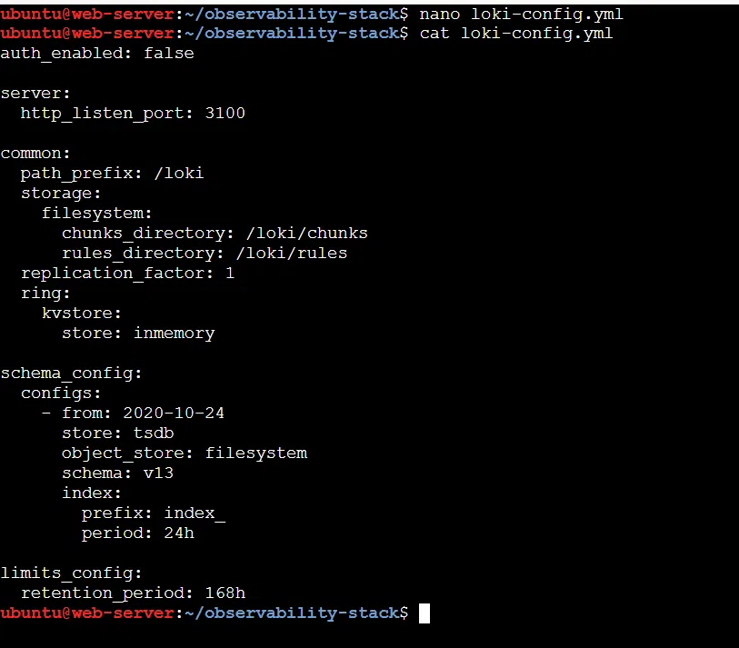

---

## 4. Task 3: Create the Promtail config

Promtail needs to know **which files to read**, **where to send them**, and **which labels to add**.

### Command

```bash
nano promtail-config.yml
```

### `promtail-config.yml`

```yaml
server:
  http_listen_port: 9080

positions:
  filename: /tmp/positions.yaml

clients:
  - url: http://loki:3100/loki/api/v1/push

scrape_configs:
  - job_name: docker
    static_configs:
      - targets:
          - localhost
        labels:
          job: docker
          __path__: /var/lib/docker/containers/*/*-json.log
    pipeline_stages:
      - docker: {}
```

### What each part means

| Config | Meaning |
|---|---|
| `http_listen_port: 9080` | Promtail's own status port. |
| `positions: filename: /tmp/positions.yaml` | A "bookmark" file. Promtail remembers how far it has read each log file, so after a restart it does not send duplicate logs. If you delete it, Promtail re-reads everything. |
| `clients: url: http://loki:3100/loki/api/v1/push` | Where to send logs. `loki` is the **container name**. Inside the Docker network, containers find each other by name. `3100` is the Loki port from Task 2. |
| `job_name: docker` | Name of this scrape job. |
| `targets: localhost` | Required by the format. Promtail reads local files, so this is just `localhost`. |
| `labels: job: docker` | Every log line gets the label `job="docker"`. We search with this label in Grafana. |
| `__path__: /var/lib/docker/containers/*/*-json.log` | Which files to read. `*` is a wildcard: all `*-json.log` files of all containers. |
| `pipeline_stages: - docker: {}` | Understands Docker's JSON format. It extracts the real log text, timestamp and stream (stdout/stderr). |

### Output

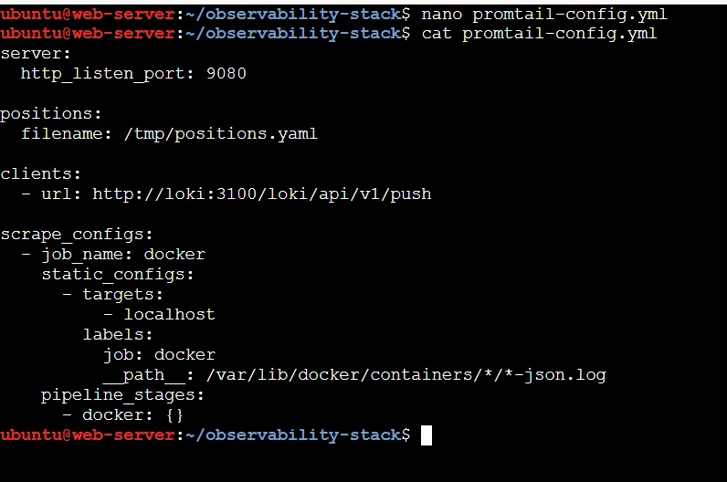

---

## 5. Task 4: Add Loki and Promtail to Docker Compose

Config files alone do nothing. We must tell Docker Compose to run Loki and Promtail containers and give them these config files.

### Command

```bash
nano docker-compose.yml
```

Under `services:` (same indentation as `grafana:`, which is 2 spaces), add:

```yaml
  loki:
    image: grafana/loki:3.2.0
    container_name: loki
    ports:
      - "3100:3100"
    command: -config.file=/etc/loki/loki-config.yml
    volumes:
      - ./loki-config.yml:/etc/loki/loki-config.yml
      - loki-data:/loki
    restart: always

  promtail:
    image: grafana/promtail:3.2.0
    container_name: promtail
    command: -config.file=/etc/promtail/promtail-config.yml
    volumes:
      - ./promtail-config.yml:/etc/promtail/promtail-config.yml
      - /var/lib/docker/containers:/var/lib/docker/containers:ro
    depends_on:
      - loki
    restart: always
```

At the bottom of the file, in the `volumes:` section, add one line:

```yaml
volumes:
  prometheus_data:
  grafana_data:
  loki-data:
```

### What each line means

| Line | Meaning |
|---|---|
| `image: grafana/loki:3.2.0` | Which program and which version to run. Pinning a version makes the setup repeatable. |
| `container_name: loki` | The name other containers use to reach it. |
| `ports: "3100:3100"` | Opens Loki's port 3100 on the server (host port : container port). |
| `command: -config.file=...` | Tells Loki which config file to use. |
| `./loki-config.yml:/etc/loki/loki-config.yml` | Copies (mounts) our config file from the server into the container. |
| `loki-data:/loki` | A Docker **volume**. Logs are stored here, so they survive container restarts. |
| `/var/lib/docker/containers:/var/lib/docker/containers:ro` | Gives Promtail access to the host's Docker log folder. `ro` means **read-only**: Promtail can read but not change anything. |
| `depends_on: - loki` | Start Loki first, then Promtail. |
| `restart: always` | Automatically restart the container if it stops or the server reboots. |

### Check the file for mistakes

```bash
docker compose config --quiet && echo "compose file OK"
```

This validates the YAML syntax. It must print `compose file OK`. YAML is strict about spaces, so a wrong indentation is the most common error.

### Show only the new part (to verify)

```bash
grep -n -A 14 -E "^  (loki|promtail):" docker-compose.yml
```

- `grep` searches inside the file.
- `-n` shows line numbers.
- `-A 14` also shows 14 lines after each match.
- `-E "^  (loki|promtail):"` finds lines that start with `  loki:` or `  promtail:`.

### Output

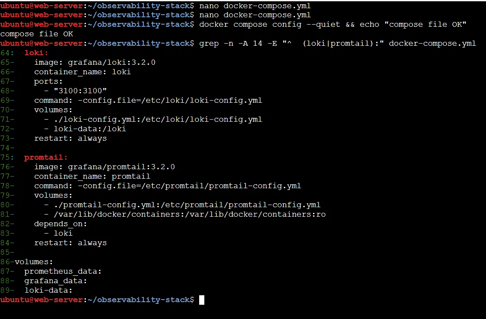

---

## 6. Task 5: Start the containers

### Commands

```bash
docker compose up -d
docker ps
```

- `docker compose up -d` creates and starts all containers defined in the file. `-d` means **detached** (run in the background). Docker downloads the Loki and Promtail images the first time. Containers that did not change keep running.
- `docker ps` lists running containers. All 7 must show `Up`.

Useful variation to see a clean table:

```bash
docker ps --format "table {{.Names}}\t{{.Status}}"
```

### Output

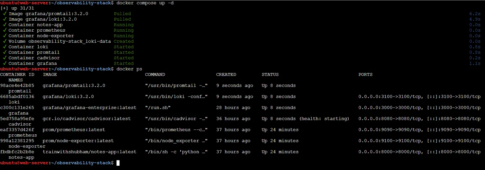

---

## 7. Task 6: Add Loki as a Grafana datasource

A **datasource** tells Grafana where to read data from. Prometheus (metrics) was added on Day 74. Now we add Loki (logs).

### Steps

1. Open Grafana in the browser: `http://<server-public-ip>:3000` and log in.
2. Left menu: **Connections -> Data sources -> Add data source**.
3. Choose **Loki**.
4. In the **URL** field enter:
   ```
   http://loki:3100
   ```
5. Leave everything else as default (No Authentication).
6. Scroll down and click **Save & test**.

### Why `http://loki:3100` and not `localhost`?

Grafana and Loki are **different containers**. Inside Grafana's container, `localhost` means Grafana itself, not Loki. Containers in the same Docker network find each other by **container name**, so we use `loki`.

> The server's public IP can change after a stop/start of an EC2 instance. This does not break the datasource, because it uses the container name, not the IP.

You should see the green message: **"Data source successfully connected."**

### Output

URL filled in:

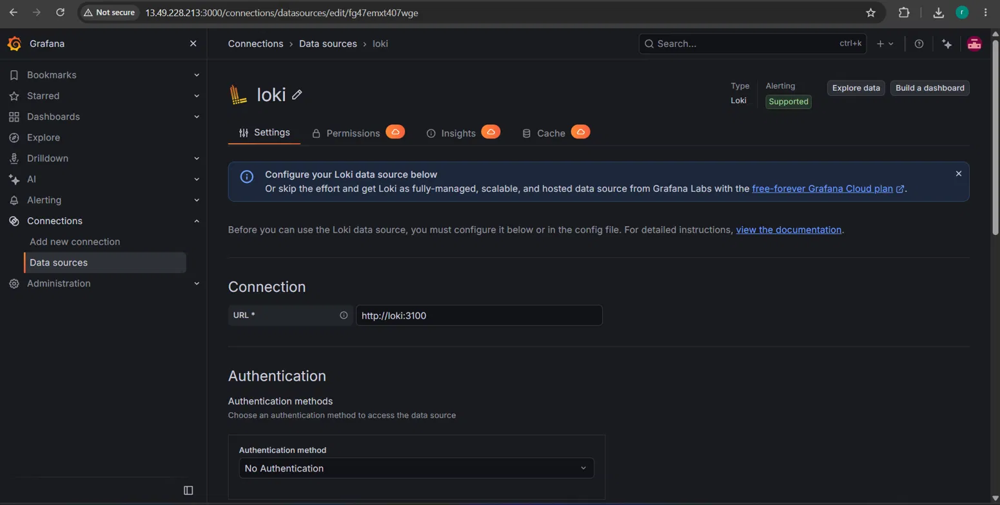

Connected successfully:

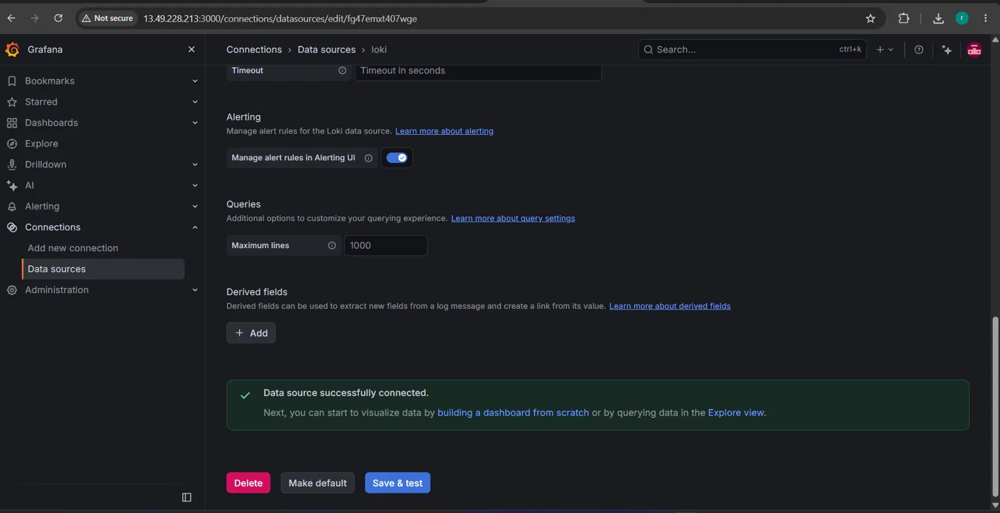

---

## 8. Task 7: Query logs with LogQL

**LogQL** is Loki's query language (similar to PromQL for Prometheus).

### How to run a query

1. Grafana left menu -> **Explore**.
2. Pick **Loki** in the datasource dropdown.
3. Set the time range (top right) to **Last 15 minutes** or **Last 1 hour**.
4. Type the query and press **Shift + Enter** (or click **Run query**).

> **Important:** If you see **Live** in the top-right, click the stop button first. In Live mode the query does not re-run and you only see old lines or no graph. After editing a query you must always press **Shift + Enter**.

### Generate some traffic first

Open the notes app in the browser and refresh it 5-6 times: `http://<server-public-ip>:8000`.
Each refresh creates a log line like `GET / HTTP/1.1 200`.

### Query 1: Stream selector (filter by label)

```logql
{job="docker"}
```

- `{ }` is the **label selector**. It picks all log streams that have the label `job="docker"`.
- This is the label we added in `promtail-config.yml`.
- Result: logs of **all** containers, mixed together.

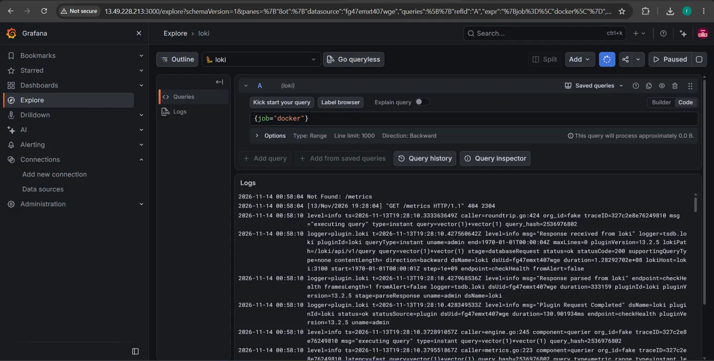

### Query 2: Keep only lines that contain a word (`|=`)

```logql
{job="docker"} |= "GET"
```

- `|=` means "line **contains**" (case-sensitive).
- Result: only lines with `GET` (HTTP GET requests).

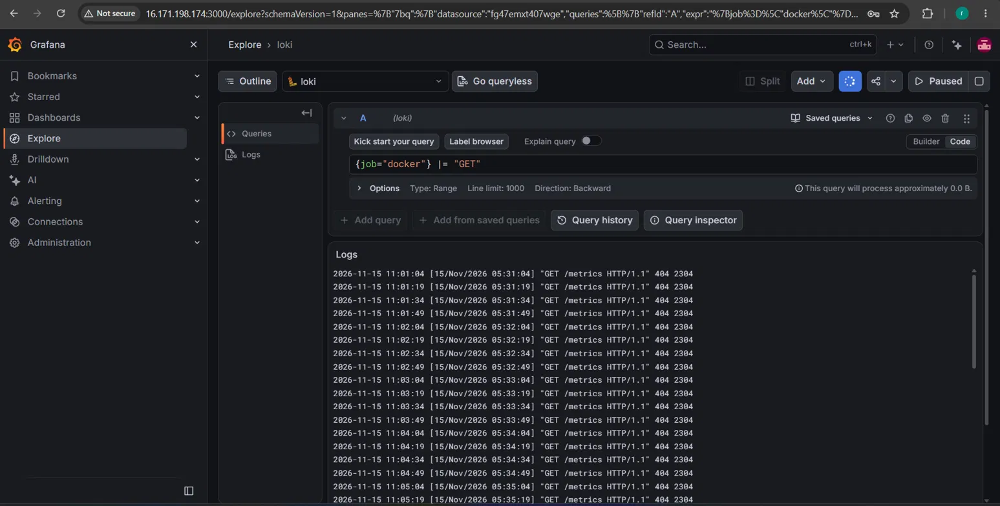

### Query 3: Remove lines that contain a word (`!=`)

```logql
{job="docker"} != "metrics"
```

- `!=` means "line does **not** contain".
- Prometheus calls `/metrics` of the notes-app every 15 seconds, which creates a lot of noise. This removes it.
- Result: real traffic like `GET / 200` and `GET /api/notes/ 200` becomes visible.

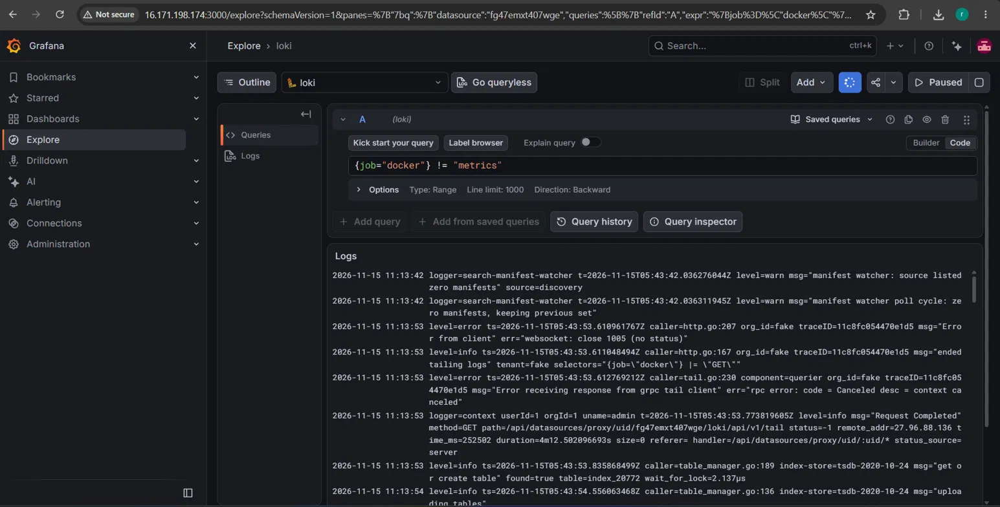

### Query 4: Combine filters

```logql
{job="docker"} |= "GET" != "metrics"
```

- Meaning: contains `GET` **and** does not contain `metrics`.
- Filters are applied from left to right.

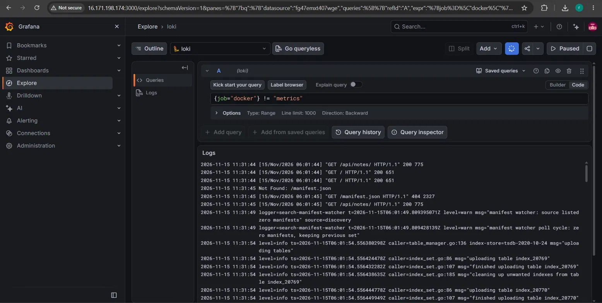

### Query 5: Logs of a single container

In the original task the query is `{container_name="notes-app"}`. In my setup Promtail only adds the labels `job` and `filename`, **not** `container_name`. So I select a container using its log file name, which contains the container ID.

Step 1: get the container ID:

```bash
docker ps --filter name=notes-app --format "{{.ID}}"
```

- `--filter name=notes-app` shows only the container named notes-app.
- `--format "{{.ID}}"` prints only its ID (mine was `fbdbfc2b2b8e`; yours will be different).

Step 2: use it in the query:

```logql
{job="docker", filename=~".*fbdbfc2b2b8e.*"}
```

- `filename` is a label that Promtail adds automatically from `__path__`.
- `=~` means "matches this **regex**". `.*` means "anything", so the query matches any file path that contains the container ID.
- Result: only notes-app logs. Loki and Grafana internal logs disappear.

This is the "labels are indexed" idea in practice: picking a label is fast, filtering text is slower.

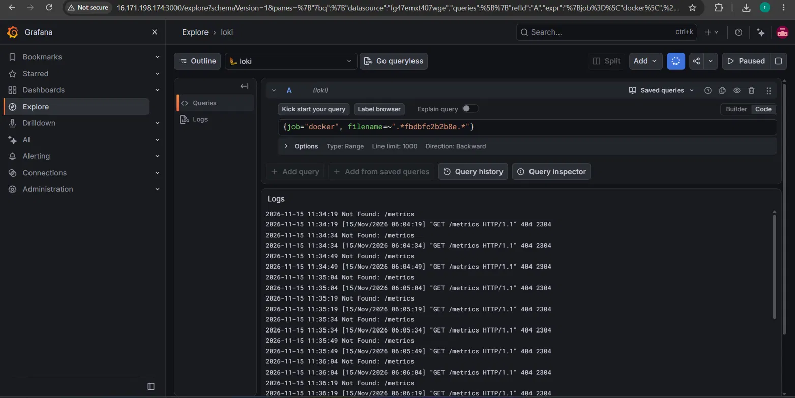

### Query 6: Regex filter (`|~`)

```logql
{job="docker"} |~ " (4|5)[0-9]{2} "
```

- `|~` means "line matches this regex".
- `(4|5)[0-9]{2}` means a number that starts with 4 or 5 and has 2 more digits: 404, 500, 503, and so on. These are HTTP error status codes.
- The spaces around it avoid matching random numbers inside other words.
- Result: only error responses. In my logs these were `404` for `/metrics` and `/manifest.json`.

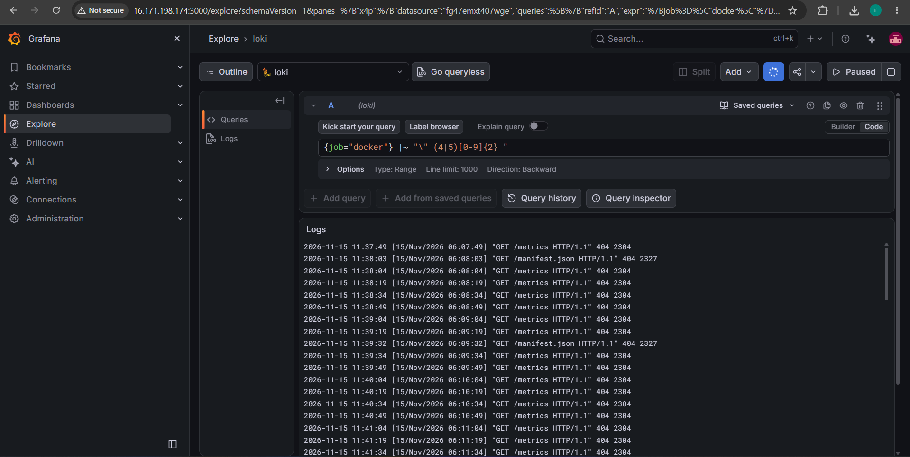

### Quick reference

| Operator | Meaning |
|---|---|
| `\|=` | line contains text |
| `!=` | line does not contain text |
| `\|~` | line matches regex |
| `!~` | line does not match regex |
| `=` / `=~` (inside `{ }`) | label equals / label matches regex |

> Tip: for case-insensitive search use `|~ "(?i)error"`.

---

## 9. Task 8: Log metric queries

Normal LogQL returns **log lines**. A **log metric query** turns logs into **numbers**, so you can draw graphs. This is the same idea as `rate()` in Prometheus.

> Make sure Live mode is off, otherwise you will see log lines instead of a graph.

### Query: `count_over_time`

```logql
count_over_time({job="docker"} |~ " (4|5)[0-9]{2} " [5m])
```

- Counts how many matching lines appeared in each 5-minute window.
- `[5m]` is the window size.
- In my graph the value moved from 20 to 25 when new 404 errors appeared.

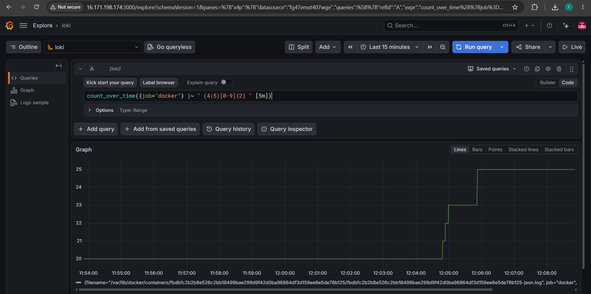

### Query: `rate`

```logql
rate({job="docker"} |~ " (4|5)[0-9]{2} " [5m])
```

- Same count, but **per second**.
- `rate = count / seconds`. Check: 25 lines / 300 seconds = 0.083 per second, which matches the graph.

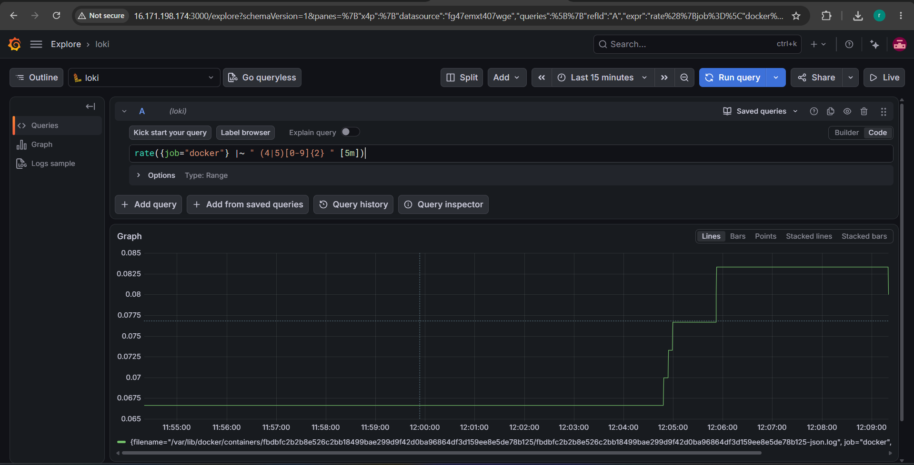

### Other useful queries (from the task)

```logql
topk(5, sum by (filename) (rate({job="docker"}[5m])))
```

- Top 5 log files (containers) by log volume.
- The original task uses `sum by (container_name)`. In my setup the label is `filename`.

```logql
sum(count_over_time({job="docker"} |~ " (4|5)[0-9]{2} " [5m]))
```

- `sum(...)` adds all streams into a single line.

---

## 10. Task 9: Exercise, errors from the notes-app

**Exercise:** Write a query that finds all error logs from the notes-app in the last 1 hour, and another that counts error lines per minute.

In this app, an "error" means an HTTP 4xx or 5xx response code.

### Query 1: Error logs of the notes-app (time range: Last 1 hour)

```logql
{job="docker", filename=~".*fbdbfc2b2b8e.*"} |~ " (4|5)[0-9]{2} "
```

- Label selector picks only the notes-app file.
- Regex filter keeps only 4xx/5xx lines.
- Result: `65 lines displayed`, all `404` (`/metrics` and `/manifest.json`). No 5xx errors.

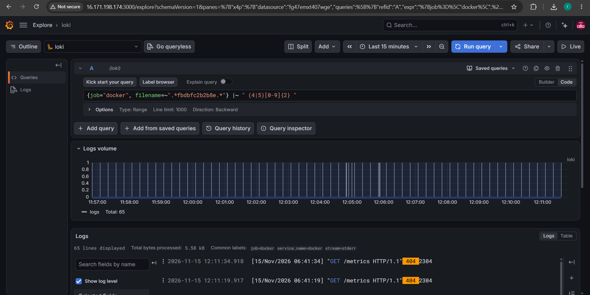

### Query 2: Errors per minute

```logql
sum(count_over_time({job="docker", filename=~".*fbdbfc2b2b8e.*"} |~ " (4|5)[0-9]{2} " [1m]))
```

- Same filter, but the window is `[1m]`, which gives errors **per minute**.
- Baseline was **4 per minute**: Prometheus scrapes `/metrics` every 15 seconds (60 / 15 = 4), and the app has no `/metrics`, so each one is a 404.
- The spike came when I refreshed the app in the browser, because the browser also asks for `/manifest.json` (404).

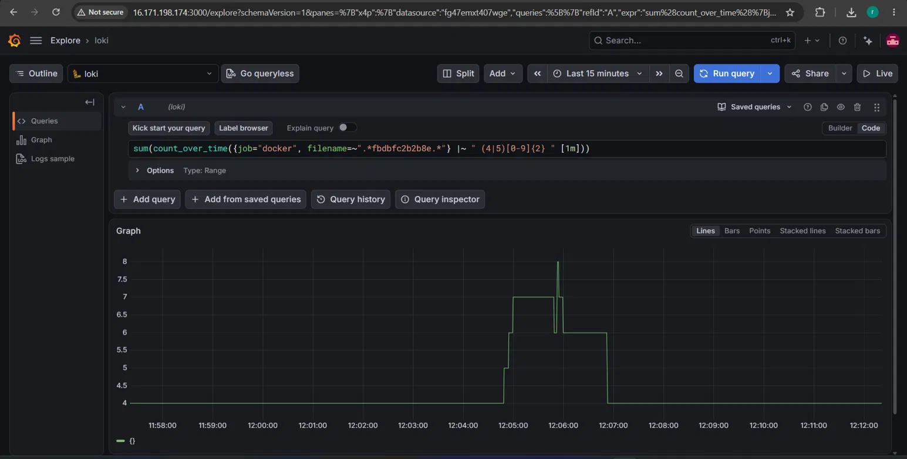

---

## 11. Task 10: Correlate metrics and logs

This is the real power of observability: see the metric **and** the logs from the same moment in one tool.

### Part A: Dashboard with a metrics panel and a logs panel

1. Grafana -> **Dashboards -> New -> New dashboard -> Add visualization**.
2. **Panel 1 (metrics):**
   - Datasource: **Prometheus**
   - Query:
     ```promql
     rate(node_cpu_seconds_total{mode!="idle"}[1m])
     ```
     (CPU time used per second, for every mode except idle.)
   - Title: `CPU Usage (Metrics)`
   - Click **Back to dashboard**.
3. **Add -> Visualization** for **Panel 2 (logs):**
   - Datasource: **Loki**
   - Query:
     ```logql
     {job="docker", filename=~".*fbdbfc2b2b8e.*"} != "metrics"
     ```
   - Visualization type: **Logs** (change it from the default Time series).
   - Title: `Notes-app Logs`
   - Click **Back to dashboard**.
4. Dashboard settings (gear icon): set the title to `Day 75 - Metrics and Logs`.
5. Set time range to **Last 1 hour**, click **Save dashboard**, then **Exit edit**.

A CPU spike on the left lines up with the burst of `GET /` and `GET /api/notes/` log lines on the right. These were caused by refreshing the app.

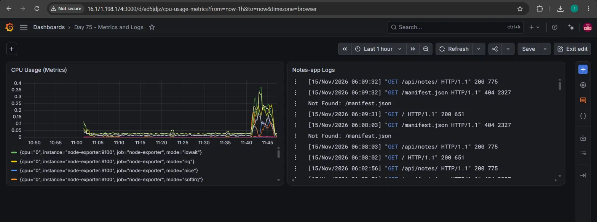

### Part B: Explore split view

1. Grafana -> **Explore** -> click **Split**.
2. Left panel: **Loki**
   ```logql
   {job="docker", filename=~".*fbdbfc2b2b8e.*"}
   ```
3. Right panel: **Prometheus**
   ```promql
   rate(container_cpu_usage_seconds_total{name="notes-app"}[5m])
   ```
4. Set both to **Last 1 hour** and click the link icon (time sync) so both panels use the same time range.
5. Move the mouse over a spike in the CPU graph and look at the logs from the same time.

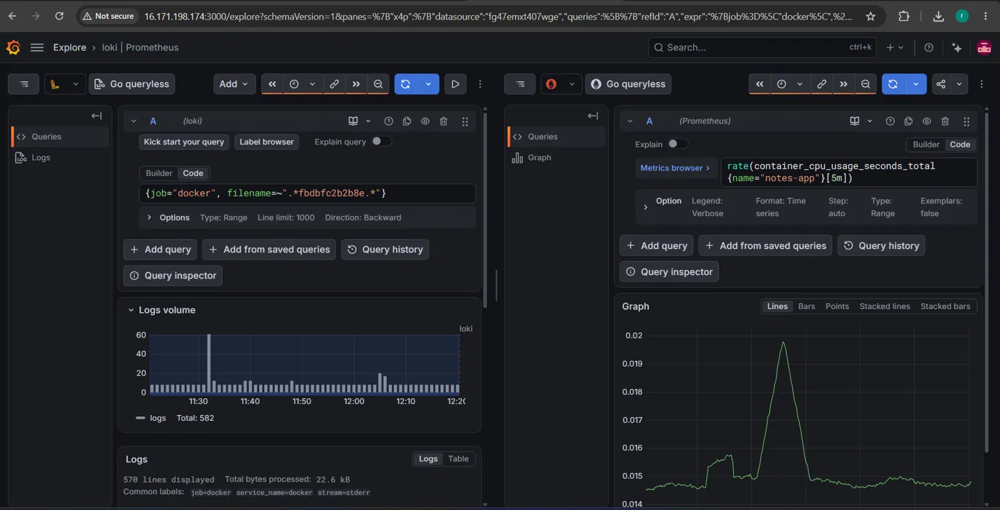

### Document: How does having metrics and logs in the same tool help during incident response?

- **Faster diagnosis.** The metric says *when* and *what* (CPU went up at 12:05). The logs say *why* (a burst of requests at 12:05). I stay on one screen and one time range.
- **No context switching.** With separate systems I must copy the timestamp, open another tool, set the same time range, and search again. That wastes minutes during an outage.
- **Same labels and same time axis.** Metrics and logs line up exactly, so I can trust that I am looking at the same event.
- **One place to learn and share.** One dashboard can be shared with the whole team, so everybody sees the same facts.

---

## 12. Loki vs ELK

| | **Loki (+ Promtail + Grafana)** | **ELK (Elasticsearch + Logstash + Kibana)** |
|---|---|---|
| What is indexed | Only labels | Full text of every log line |
| Storage and RAM cost | Low | High |
| Setup and operations | Simple | Complex |
| Full-text search speed | Slower (scans text) | Very fast |
| Query language | LogQL (like PromQL) | KQL / Lucene / Query DSL |
| Works best with | Prometheus and Grafana (same labels) | Large-scale search and analytics |
| Best for | Kubernetes/Docker logs, debugging with metrics, small to mid teams, tight budget | Security analytics, complex searches, compliance, free-text search over huge data |

**When to use Loki:** you already use Prometheus and Grafana, you mostly look at logs of a known service in a known time range, and you want low cost.

**When to use ELK:** you need powerful full-text search, aggregations and analytics over huge volumes, or advanced search for security and auditing.

---

## 13. Troubleshooting (problems I actually hit)

| Problem | Cause | Fix |
|---|---|---|
| Browser shows `ERR_CONNECTION_TIMED_OUT` the next day | The EC2 public IP changes after stop/start | Get the new IP (`curl -s ifconfig.me`, or the AWS console) and use it in the URL |
| I changed a query but the result is the same | The query was not run | Press **Shift + Enter** or click **Run query** |
| Log metric query shows log lines, no graph | **Live** mode is on | Click the stop button next to Live, then run the query again |
| Explore shows mixed logs from many containers | The label filter was not applied | Run the query again; check the filename ID |
| `No data` in the logs panel | Time range is too short, or no traffic | Set **Last 1 hour** and refresh the notes app a few times |
| `container_name` label not found | Our Promtail config only adds `job` and `filename` | Use `filename=~".*<container-id>.*"`, or add Docker service discovery to Promtail |
| `compose file` error | Wrong YAML indentation | Use 2 spaces; run `docker compose config --quiet` |
| Containers not running | Not started | `docker compose up -d`, then `docker ps` |
| Want to see Promtail/Loki errors | | `docker logs promtail --tail 20` and `docker logs loki --tail 20` |

---

## 14. What I learned

- Logs and metrics answer different questions: metrics show **what** is wrong, logs show **why**.
- The pipeline is Containers -> Promtail -> Loki -> Grafana.
- Loki indexes only labels, so it is cheap and simple. The trade-off is slower text search.
- Labels (inside `{ }`) are fast. Text filters (`|=`, `|~`) scan the log text and are slower.
- LogQL can return log lines, and with `count_over_time` and `rate` it can turn logs into graphs.
- Showing metrics and logs side by side in Grafana makes debugging much faster.
- Containers talk to each other by **container name** (`loki`, `prometheus`), not `localhost`.

---

## 15. Submission commands

The screenshots are in `2026/day-75/Screenshots/`. Put this file in `2026/day-75/` and run:

```bash
git add 2026/day-75/
git commit -m "Add Day 75: Loki and Promtail log management"
git push origin main
```

- `git add` stages the new files.
- `git commit -m` saves them in git history with a message.
- `git push origin main` uploads to your fork (use your branch name if it is not `main`).

Final folder:

```
2026/day-75/
├── day-75-loki-promtail.md
└── Screenshots/
    ├── 01-loki-config.png
    ├── 02-promtail-config.png
    ├── 03-docker-compose-loki-promtail.png
    ├── 04-containers-running.png
    ├── 05-grafana-loki-datasource-url.png
    ├── 06-grafana-loki-connected.png
    ├── 07-logql-query.png
    ├── 08-logql-filter-get.png
    ├── 09-logql-filter-exclude.png
    ├── 10-logql-filter-combined.png
    ├── 11-logql-single-container.png
    ├── 12-metrics-and-logs-dashboard.png
    ├── 13-logql-regex.png
    ├── 14-logql-count-over-time.png
    ├── 15-logql-rate.png
    ├── 16-exercise-errors.png
    ├── 17-exercise-errors-per-minute.png
    └── 18-split-view.png
```


