# Day 76: OpenTelemetry and Alerting

## Goal of the day

Before today we had two pillars of observability:

| Pillar | Tool | Question it answers |
|---|---|---|
| Metrics | Prometheus | "How much CPU is used? How many requests?" (numbers) |
| Logs | Loki + Promtail | "What did the app write?" (text) |

Today we add the **third pillar, Traces**, using **OpenTelemetry (OTEL)**. Then we add **alerting**, so the system tells us when something is wrong and we do not need to watch dashboards all day.

By the end of the day we have:

- An OpenTelemetry Collector running and exporting metrics to Prometheus
- OTLP traces sent to the Collector and visible in its debug output
- Prometheus alerting rules for critical conditions
- Grafana alert rules with contact points and notification policies
- A full view of the three-pillar architecture

> **How to use this guide:** You do not need any prior knowledge of OpenTelemetry. Read each task in order, run the commands on your server, and compare your result with the screenshot under each task.

**Prerequisite:** You already have a working stack from earlier days (Prometheus, Grafana, Loki, Promtail, Node Exporter, cAdvisor, and a sample `notes-app`) in a folder (here: `~/observability-stack`) with a `docker-compose.yml`.

---

## Task 1: Understand OpenTelemetry

This task is theory only. Nothing is run. These ideas are used in every later task.

### 1. What is OpenTelemetry (OTEL)?

- OpenTelemetry is an **open-source, vendor-neutral framework** for **generating, collecting and exporting** telemetry data (metrics, logs and traces).
- **It is not a backend.** It does not store data or show dashboards. It collects data and ships it to backends such as Prometheus, Jaeger, Loki or Datadog.
- **Why it exists:** Without OTEL, each tool needs its own agent and format. With OTEL, your app sends data to one place in one standard format, and OTEL forwards it wherever you want.
- **Vendor-neutral** means that if you move from Datadog to Grafana tomorrow, your application code does not change.

**Simple analogy:** Three different couriers (Prometheus, Loki, Jaeger) each want a different packing format. OTEL is one standard packing format plus one collection point.

### 2. What is the OTEL Collector?

The Collector is a **standalone service** (a separate program) that **receives, processes and exports** telemetry data.

Data flows through a pipeline of three parts:

```
Receivers  -->  Processors  -->  Exporters
```

| Component | Job | Examples |
|---|---|---|
| **Receivers** | Accept data coming in | OTLP, Prometheus, Jaeger formats |
| **Processors** | Change data on the way | batching, filtering, sampling |
| **Exporters** | Send data out to a backend | Prometheus, debug console, Jaeger |

**Analogy:** A post office. The receiver is the counter where letters arrive, the processor is the sorting room, and the exporter is the delivery person.

**Why use a Collector?** The app sends data only to the Collector. To change a backend, you only edit the Collector config, not the app code.

### 3. What is OTLP?

- **OTLP** = **O**pen**T**elemetry **P**rotocol.
- It is the standard "language" (wire format) used to send telemetry. Metrics, logs and traces all use it.
- It supports two transports:

| Transport | Port | Use |
|---|---|---|
| gRPC | **4317** | Fast and efficient. Default choice. |
| HTTP | **4318** | Simple. Easy to test with `curl`. |

### 4. What are distributed traces?

- A **trace** follows **one single request** as it travels through multiple services.
- Each step inside a trace is called a **span**.
- A span contains:

| Field | Meaning |
|---|---|
| Trace ID | Identifies the whole trace. Same for all spans in it. |
| Span ID | Unique ID of this one span. |
| Parent span ID | Which span started this one. Links spans into a tree. |
| Start time | When the step started. |
| Duration | How long the step took. |
| Attributes | Extra info, for example `http.method=GET`. |

**Example:**

```
User request
  -> API Gateway   (span 1)
       -> Auth Service (span 2)
            -> Database  (span 3)
```

**Why traces matter:** Metrics say "something is slow." Logs say "an error happened." Traces show **where** and **why**. If a request takes 5 seconds and the trace shows 4.5 seconds in the database, you know exactly where to fix.

---

## Task 2: Add the OpenTelemetry Collector

Here we add the Collector to the existing stack and connect it to Prometheus.

There are five steps:

1. Create the Collector config file
2. Add the Collector to `docker-compose.yml`
3. Add the Collector as a scrape target in `prometheus.yml`
4. Restart the stack
5. Verify

### Step 1: Create the Collector configuration

Run this in the folder that has your `docker-compose.yml`:

```bash
mkdir -p otel-collector
nano otel-collector/otel-collector-config.yml
```

Paste this content:

```yaml
receivers:
  otlp:
    protocols:
      grpc:
        endpoint: 0.0.0.0:4317
      http:
        endpoint: 0.0.0.0:4318

processors:
  batch:

exporters:
  prometheus:
    endpoint: "0.0.0.0:8889"
  debug:
    verbosity: detailed

service:
  pipelines:
    metrics:
      receivers: [otlp]
      processors: [batch]
      exporters: [prometheus]
    traces:
      receivers: [otlp]
      processors: [batch]
      exporters: [debug]
    logs:
      receivers: [otlp]
      processors: [batch]
      exporters: [debug]
```

Save in nano: `Ctrl + O`, `Enter`, `Ctrl + X`. Then check it: `cat otel-collector/otel-collector-config.yml`

> YAML uses **spaces for indentation, never tabs**. A wrong indent breaks the file.

**What this config means:**

| Section | Explanation |
|---|---|
| `receivers: otlp` | Listen for OTLP data on gRPC `4317` and HTTP `4318`. `0.0.0.0` means "accept from anywhere", including outside the container. |
| `processors: batch` | Group data into batches before exporting. This reduces overhead. |
| `exporters: prometheus` | Expose metrics on port `8889` in Prometheus format. Prometheus will scrape (pull) from here. |
| `exporters: debug` | Print data to the console. `verbosity: detailed` prints everything. In production you would send traces to Jaeger or Tempo instead. |
| `service: pipelines` | The most important part. It connects receivers, processors and exporters for each data type. |

**The pipelines:**

| Data type | Receiver | Processor | Exporter |
|---|---|---|---|
| metrics | otlp | batch | prometheus |
| traces | otlp | batch | debug |
| logs | otlp | batch | debug |

So metrics go to Prometheus, while traces and logs are printed in the Collector console.

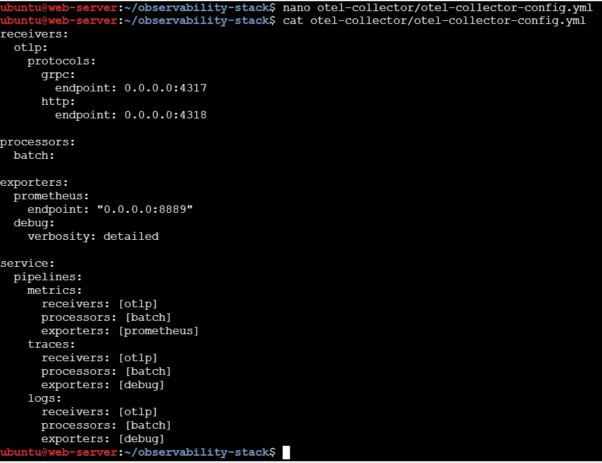

### Step 2: Add the Collector to `docker-compose.yml`

Open the file with `nano docker-compose.yml` and add this service block under `services:`. Put it after the last service (`promtail`) and **before** the top-level `volumes:` section. It must have **2 spaces** of indentation, the same as the other services.

```yaml
  otel-collector:
    image: otel/opentelemetry-collector-contrib:latest
    container_name: otel-collector
    ports:
      - "4317:4317"   # OTLP gRPC
      - "4318:4318"   # OTLP HTTP
      - "8889:8889"   # Prometheus exporter
    volumes:
      - ./otel-collector/otel-collector-config.yml:/etc/otelcol-contrib/config.yaml
    restart: unless-stopped
```

**What each line means:**

| Line | Meaning |
|---|---|
| `image: ...collector-contrib:latest` | Ready-made Collector image. The `contrib` version has more receivers and exporters. |
| `container_name: otel-collector` | Container name. Prometheus will reach it by this name. |
| `ports` | `host:container`. 4317 and 4318 receive data. 8889 is where Prometheus scrapes. |
| `volumes` | A **bind mount**. It connects your config file on the server to the path inside the container where the Collector reads its config. |
| `restart: unless-stopped` | Container restarts after a crash or a server reboot. |

**Do I need to add anything in the top-level `volumes:`?** No. That section is only for **named volumes** (for example `prometheus_data`) that store data. A bind mount of a file does not need an entry there.

Validate the file:

```bash
docker compose config > /dev/null && echo "OK"
```

`OK` means the YAML is valid.

### Step 3: Add the Collector as a Prometheus scrape target

Prometheus uses a **pull model**: it visits each target and collects metrics. We must tell it to visit the Collector on port `8889`. Add this job under `scrape_configs:` in `prometheus.yml`:

```yaml
  - job_name: "otel-collector"
    static_configs:
      - targets: ["otel-collector:8889"]
```

Use the container name `otel-collector`, **not** `localhost`. Prometheus runs in its own container, so `localhost` would mean itself. Containers in one Docker Compose network find each other by container name.

Check it:

```bash
grep -A 3 "otel-collector" prometheus.yml
```

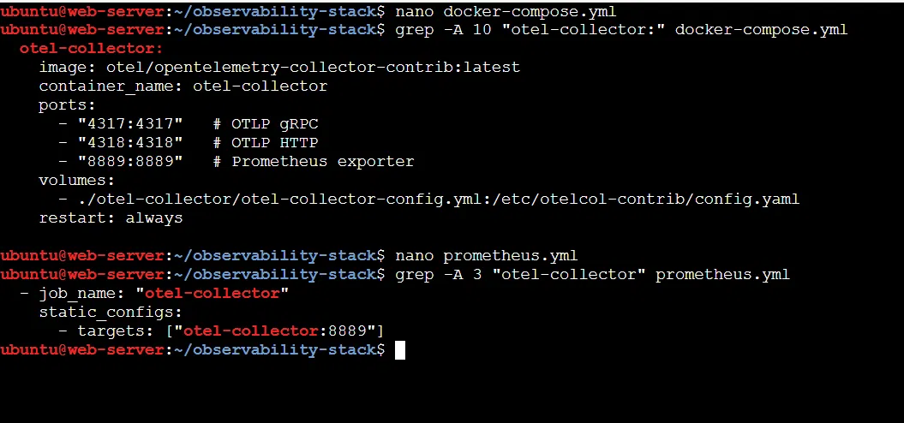

### Step 4: Restart the stack

```bash
docker compose up -d
docker compose restart prometheus
docker compose ps
```

- `docker compose up -d` creates and starts the new Collector container. `-d` means "detached" (runs in the background).
- `docker compose restart prometheus` is needed because Compose does not notice changes in `prometheus.yml`. Without a restart Prometheus would not know about the new job.
- `docker compose ps` shows the status. The `otel-collector` container must be `Up`.

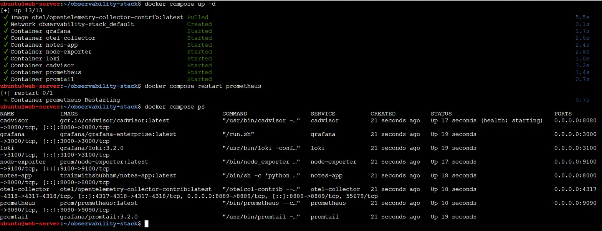

### Step 5: Verify

**Check the Collector logs:**

```bash
docker logs otel-collector 2>&1 | tail -5
```

`2>&1` shows errors together with normal output. `tail -5` shows the last 5 lines.

Look for these lines:

- `Starting GRPC server` on `4317`
- `Starting HTTP server` on `4318`
- `Everything is ready. Begin running and processing data.`  (the most important one)

> `[::]:4317` in the logs is the IPv6 form of "all addresses". It is the same as `0.0.0.0:4317` and is fine.

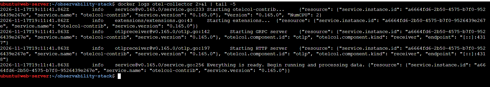

**Check Prometheus Targets:** open `http://<your-server-ip>:9090/targets`. The `otel-collector` job must show **UP**.

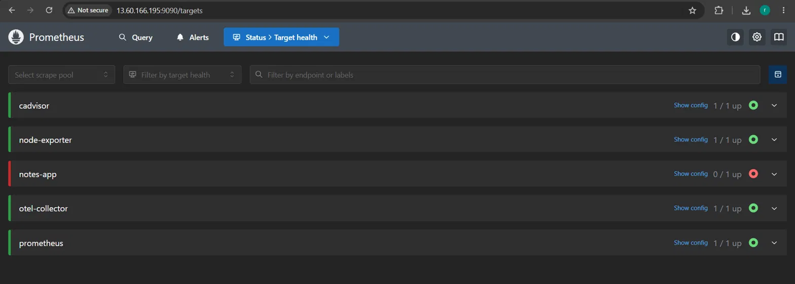

> **Note:** In our setup `notes-app` shows DOWN (red). That is because the sample app does not expose a `/metrics` endpoint. It is not related to OTEL, and it later gives us a real firing alert in Task 4.

---

## Task 3: Send test traces and metrics to the Collector

We have no real instrumented app yet, so we create fake telemetry with `curl` and send it to the Collector. This tests the full pipeline.

OTLP over HTTP uses these paths on port `4318`:

| Path | Data type |
|---|---|
| `/v1/traces` | traces |
| `/v1/metrics` | metrics |
| `/v1/logs` | logs |

### Step 1: Send a test trace

```bash
curl -X POST http://localhost:4318/v1/traces \
  -H "Content-Type: application/json" \
  -d '{
    "resourceSpans": [{
      "resource": {
        "attributes": [{
          "key": "service.name",
          "value": { "stringValue": "my-test-service" }
        }]
      },
      "scopeSpans": [{
        "spans": [{
          "traceId": "5b8efff798038103d269b633813fc60c",
          "spanId": "eee19b7ec3c1b174",
          "name": "test-span",
          "kind": 1,
          "startTimeUnixNano": "1544712660000000000",
          "endTimeUnixNano": "1544712661000000000",
          "attributes": [{
            "key": "http.method",
            "value": { "stringValue": "GET" }
          },
          {
            "key": "http.status_code",
            "value": { "intValue": "200" }
          }]
        }]
      }]
    }]
  }'
```

**Meaning of the JSON:**

| JSON field | Meaning |
|---|---|
| `service.name` | Which service sent the trace (`my-test-service`). |
| `traceId` | ID of the whole trace. |
| `spanId` | ID of this span. |
| `name` | Span name (`test-span`). We search the logs by this name. |
| `kind: 1` | Span type. `1` = INTERNAL. |
| `startTimeUnixNano` / `endTimeUnixNano` | Start and end time. The difference is the duration (1 second here). |
| `attributes` | Extra info: `http.method=GET`, `http.status_code=200`. |

There is no parent span ID, so this is a **root span** (it has no parent).

**Expected response:** `{"partialSuccess":{}}`. This means success: the Collector accepted everything.

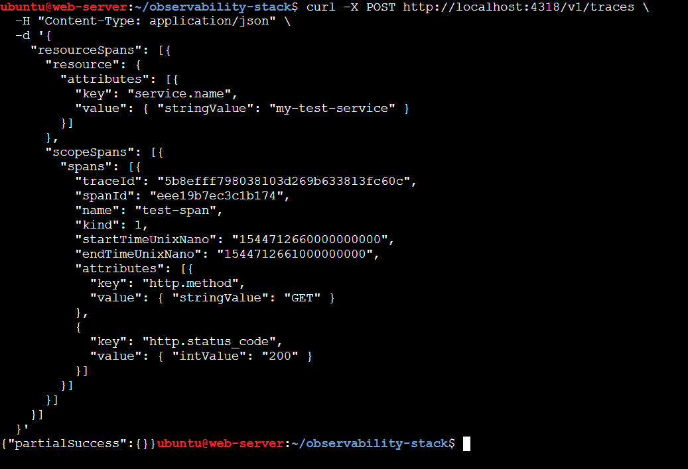

### Step 2: See the trace in the Collector logs

```bash
docker logs otel-collector 2>&1 | grep -A 14 "test-span"
```

`grep -A 14` shows the matching line and the 14 lines after it, so all span details are visible.

You should see: `Name: test-span`, `Kind: Internal`, start and end time (1 second apart), and the attributes `http.method: Str(GET)` and `http.status_code: Int(200)`.

> The date shows **2018** because we used the nanosecond timestamp `1544712660000000000` in the payload. A real app sends the current time.

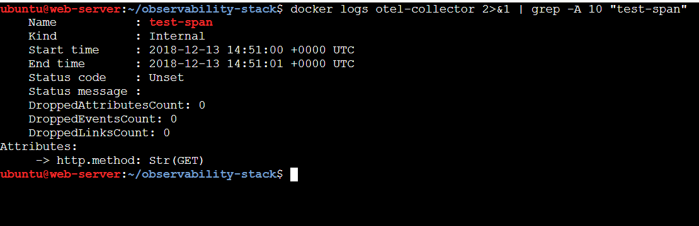

In production, traces would go to a backend like **Jaeger** or **Grafana Tempo** for storage and visualization. Here the debug exporter prints them to the console.

### Step 3: Send a test metric

```bash
curl -X POST http://localhost:4318/v1/metrics \
  -H "Content-Type: application/json" \
  -d '{
    "resourceMetrics": [{
      "resource": {
        "attributes": [{
          "key": "service.name",
          "value": { "stringValue": "my-test-service" }
        }]
      },
      "scopeMetrics": [{
        "metrics": [{
          "name": "test_requests_total",
          "sum": {
            "dataPoints": [{
              "asInt": "42",
              "startTimeUnixNano": "1544712660000000000",
              "timeUnixNano": "1544712661000000000"
            }],
            "aggregationTemporality": 2,
            "isMonotonic": true
          }
        }]
      }]
    }]
  }'
```

**Meaning of the JSON:**

| JSON field | Meaning |
|---|---|
| `name: test_requests_total` | Metric name. We will search for it in Prometheus. |
| `sum` | The metric type is a sum (a count that adds up). |
| `asInt: "42"` | The value is 42. |
| `aggregationTemporality: 2` | `2` = cumulative (total since the start). |
| `isMonotonic: true` | It only goes up, like a counter. |

Expected response: `{"partialSuccess":{}}`

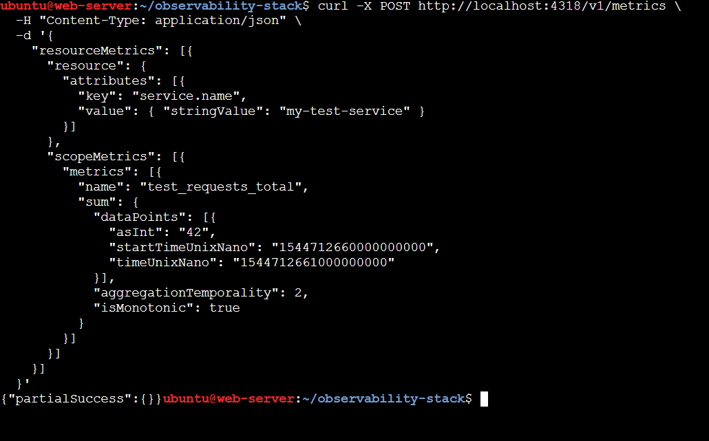

### Step 4: Query the metric in Prometheus

Open `http://<your-server-ip>:9090/query` and run:

```
test_requests_total
```

If the result is empty, wait 15 to 30 seconds (the scrape interval) and run it again.

You should see value **42** with labels like:

```
test_requests_total{exported_job="my-test-service", instance="otel-collector:8889", job="otel-collector"}   42
```

- `job="otel-collector"` and `instance="otel-collector:8889"` show that Prometheus scraped the Collector.
- `exported_job="my-test-service"` is our OTLP `service.name`. OTEL converted the resource attribute into a Prometheus label.

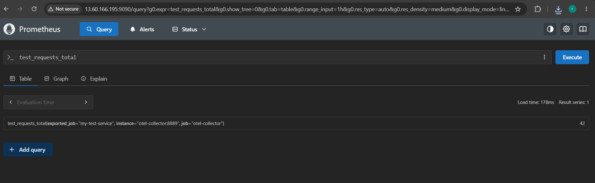

**The full path of the metric:**

```
curl (OTLP) -> OTEL Collector (OTLP receiver) -> batch -> Prometheus exporter (:8889) -> Prometheus scrapes -> query shows 42
```

This is how OTEL bridges formats: we sent OTLP, and Prometheus received data in its own format.

---

## Task 4: Set up Prometheus alerting rules

Prometheus can evaluate conditions by itself and fire alerts when a condition is true. We create five alert rules.

### How an alert rule works

| Field | Meaning |
|---|---|
| `expr` | The PromQL condition. When it is true, the alert starts. |
| `for` | How long the condition must stay true before firing. This avoids false alarms from short spikes. |
| `labels` | Tags used for routing, for example `severity: warning` or `critical`. |
| `annotations` | Human-readable text. `{{ $value }}` is the current number. `{{ $labels.job }}` is a label value. |

**Alert states:**

```
inactive (all OK) -> pending (condition true, waiting for "for" time) -> firing (alert is active)
```

### Step 1: Create `alert-rules.yml`

In the same folder as `docker-compose.yml`:

```bash
nano alert-rules.yml
```

```yaml
groups:
  - name: system-alerts
    rules:
      - alert: HighCPUUsage
        expr: 100 - (avg(rate(node_cpu_seconds_total{mode="idle"}[5m])) * 100) > 80
        for: 2m
        labels:
          severity: warning
        annotations:
          summary: "High CPU usage detected"
          description: "CPU usage has been above 80% for more than 2 minutes. Current value: {{ $value }}%"

      - alert: HighMemoryUsage
        expr: (1 - node_memory_MemAvailable_bytes / node_memory_MemTotal_bytes) * 100 > 85
        for: 2m
        labels:
          severity: warning
        annotations:
          summary: "High memory usage detected"
          description: "Memory usage is above 85%. Current value: {{ $value }}%"

      - alert: ContainerDown
        expr: absent(container_last_seen{name="notes-app"})
        for: 1m
        labels:
          severity: critical
        annotations:
          summary: "Container is down"
          description: "The notes-app container has not been seen for over 1 minute"

      - alert: TargetDown
        expr: up == 0
        for: 1m
        labels:
          severity: critical
        annotations:
          summary: "Scrape target is down"
          description: "{{ $labels.job }} target {{ $labels.instance }} is unreachable"

      - alert: HighDiskUsage
        expr: (1 - node_filesystem_avail_bytes{mountpoint="/"} / node_filesystem_size_bytes{mountpoint="/"}) * 100 > 90
        for: 5m
        labels:
          severity: critical
        annotations:
          summary: "Disk space running low"
          description: "Root filesystem usage is above 90%. Current value: {{ $value }}%"
```

**What each alert does:**

| Alert | Fires when | Severity |
|---|---|---|
| `HighCPUUsage` | CPU is above 80% for 2 minutes | warning |
| `HighMemoryUsage` | Memory is above 85% for 2 minutes | warning |
| `ContainerDown` | The `notes-app` container is not seen for 1 minute | critical |
| `TargetDown` | Any scrape target has `up == 0` for 1 minute | critical |
| `HighDiskUsage` | Root disk is above 90% for 5 minutes | critical |

Quick explanations of the PromQL:

- `up == 0`: `up` is `1` when Prometheus can scrape a target and `0` when it cannot.
- `absent(...)`: true when the metric does not exist at all.
- `node_cpu_seconds_total{mode="idle"}`: time the CPU spends idle. `100 - idle%` gives the used CPU.

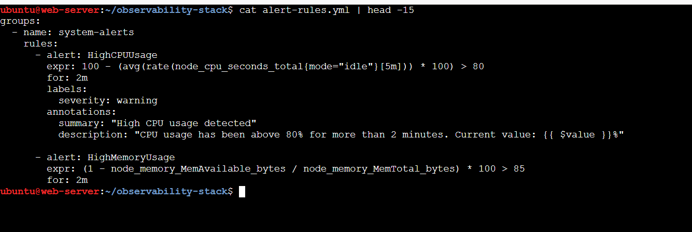

### Step 2: Load the rules in `prometheus.yml`

Add `rule_files` as a top-level section, **after** `global:` and **before** `scrape_configs:`. Do not delete your existing jobs.

```yaml
global:
  scrape_interval: 15s
  evaluation_interval: 15s

rule_files:
  - /etc/prometheus/alert-rules.yml

scrape_configs:
  - job_name: "prometheus"
  ...
```

`/etc/prometheus/alert-rules.yml` is the path **inside the container**. We mount the file there in the next step. `evaluation_interval: 15s` means Prometheus checks the rules every 15 seconds.

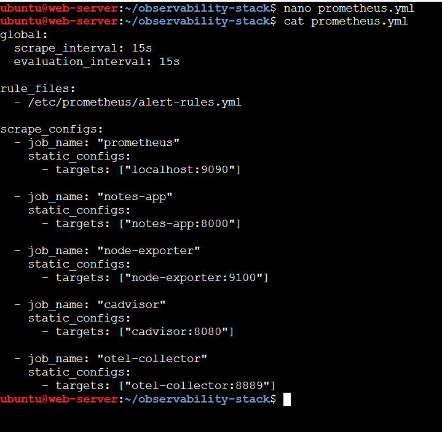

### Step 3: Mount the rules file into the Prometheus container

In `docker-compose.yml`, under the `prometheus` service `volumes:`, add one line:

```yaml
    volumes:
      - ./prometheus.yml:/etc/prometheus/prometheus.yml
      - ./alert-rules.yml:/etc/prometheus/alert-rules.yml
      - prometheus_data:/prometheus
```

This is a bind mount. It makes the server file `./alert-rules.yml` visible inside the container at `/etc/prometheus/alert-rules.yml`, which is the path used in `prometheus.yml`.

Validate and check:

```bash
docker compose config > /dev/null && echo "OK"
grep -A 8 "prometheus:" docker-compose.yml | head -12
```

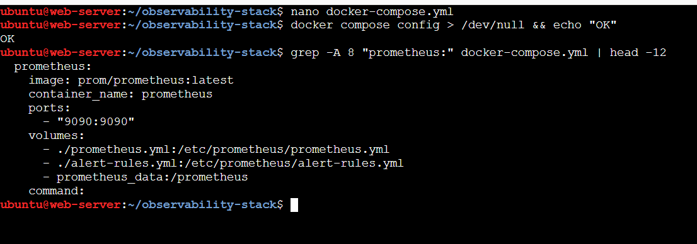

### Step 4: Restart Prometheus and check the rules

```bash
docker compose up -d prometheus
docker compose ps prometheus
```

`up -d prometheus` recreates the container, because the volumes changed (a plain `restart` is not enough).

Open `http://<your-server-ip>:9090/rules`. You should see the group `system-alerts` with all five rules and health `OK`.

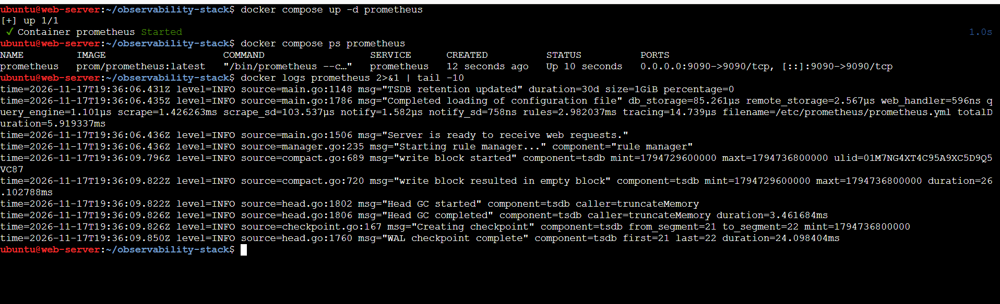

### Step 5: Check the Alerts page

Open `http://<your-server-ip>:9090/alerts`.

- Four alerts are `inactive` (green), so everything is fine.
- `TargetDown` is **FIRING**, because `notes-app` has been down since Task 2 (`up == 0`). This proves that alerting works.

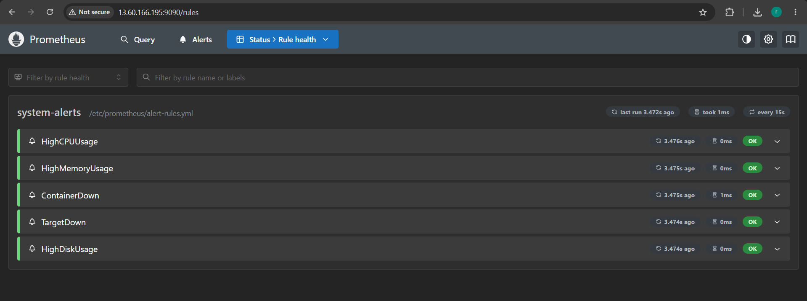

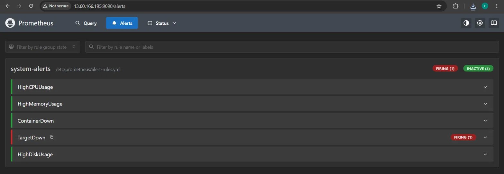

### Step 6: Test the alert lifecycle

`notes-app` was already down, so we stopped `node-exporter` to see a new alert appear:

```bash
docker compose stop node-exporter
```

Wait about 15 to 30 seconds and refresh the Alerts page. `TargetDown` shows **PENDING (1)** for `node-exporter`. It is pending because the condition is true but the `for: 1m` time has not finished yet. After one minute it would become `FIRING`.

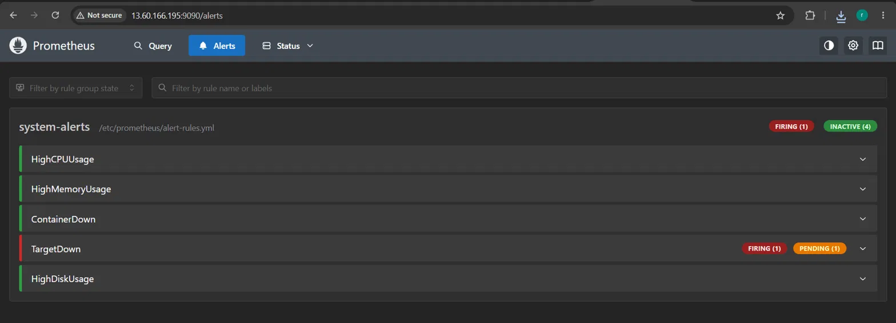

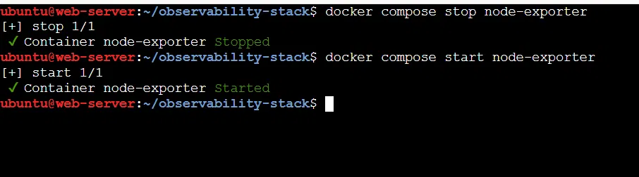

Always start it again:

```bash
docker compose start node-exporter
```

After about 30 seconds the pending alert disappears and only the `notes-app` alert remains.

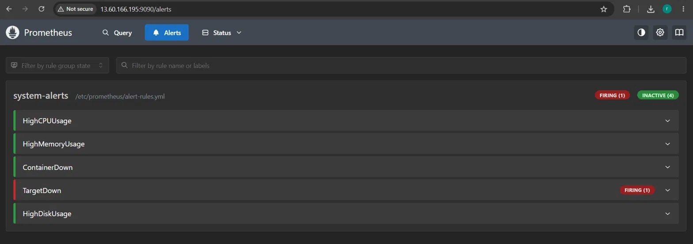

This shows why `for:` is useful: if a target comes back before the time is over, no alert fires. Short blips do not wake you up.

---

## Task 5: Set up Grafana alerts

Grafana can also evaluate alerts, and it has **built-in notifications** (email, Slack, PagerDuty and more).

Grafana alerting has three parts:

| Part | What it decides |
|---|---|
| **Contact point** | **Where** the notification goes (email, Slack...). |
| **Alert rule** | **When** an alert fires. |
| **Notification policy** | **Which** alert goes to **which** contact point. |

Open Grafana at `http://<your-server-ip>:3000` (login `admin` / the password from your compose file).

> In newer Grafana versions, Contact points and Notification policies are under **Alerting > Notification configuration**.

### Step 1: Create a contact point

1. Go to **Alerting > Notification configuration > Contact points > New contact point**.
2. Fill in:

| Field | Value |
|---|---|
| Name | `DevOps Team` |
| Integration | `Email` |
| Addresses | your email (here `you@example.com`) |

3. Click **Save contact point**.

> **Important:** Grafana needs an **SMTP server** configured to send real emails. In this lab SMTP is not set up, so the contact point saves fine but the email is **not actually delivered**. The goal here is to learn the setup. For real delivery, use a Slack or Webhook integration (they need no SMTP).

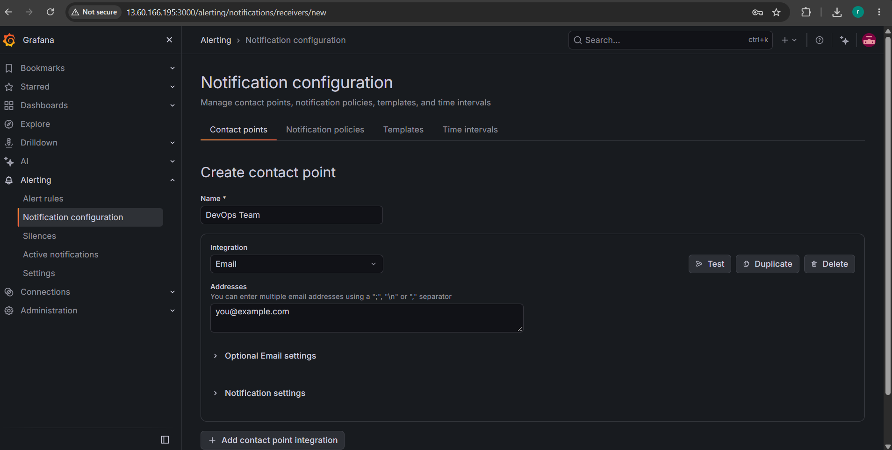

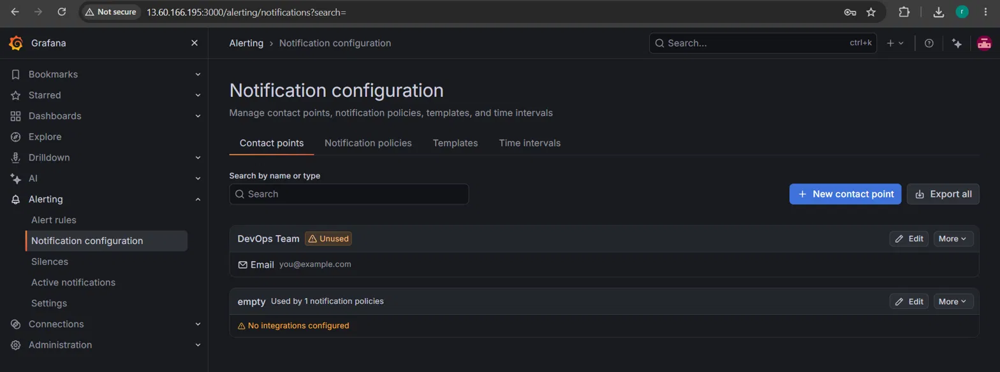

`Unused` next to the contact point means no rule or policy uses it yet. We fix that next.

### Step 2: Create an alert rule

Go to **Alerting > Alert rules > New alert rule** and fill in the form section by section.

**Section 1: Name**

```
High Container Memory
```

**Section 2: Query and condition**

- Data source: `Prometheus`
- Switch the query editor to **Code** mode and enter:

```
container_memory_usage_bytes{name="notes-app"} / 1024 / 1024
```

This gives the memory used by the `notes-app` container in **MB** (bytes / 1024 / 1024).

- Click **Run queries**. You should see a value (about 74 MB in our case).
- Alert condition: `WHEN QUERY  IS ABOVE  100`. The alert fires if the container uses more than 100 MB.

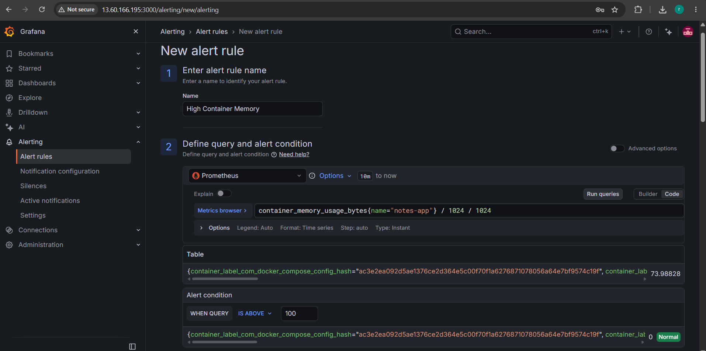

**Section 3: Folder and labels**

- Folder: create a new folder named `Observability`.
- Label: `severity` = `warning`. Labels are tags used by notification policies for routing.

**Section 4: Evaluation behavior**

- Evaluation group: new group `container-alerts`, interval `1m` (Grafana checks the rule every minute).
- Pending period: `2m` (the condition must be true for 2 minutes before firing, the same idea as `for:` in Prometheus).

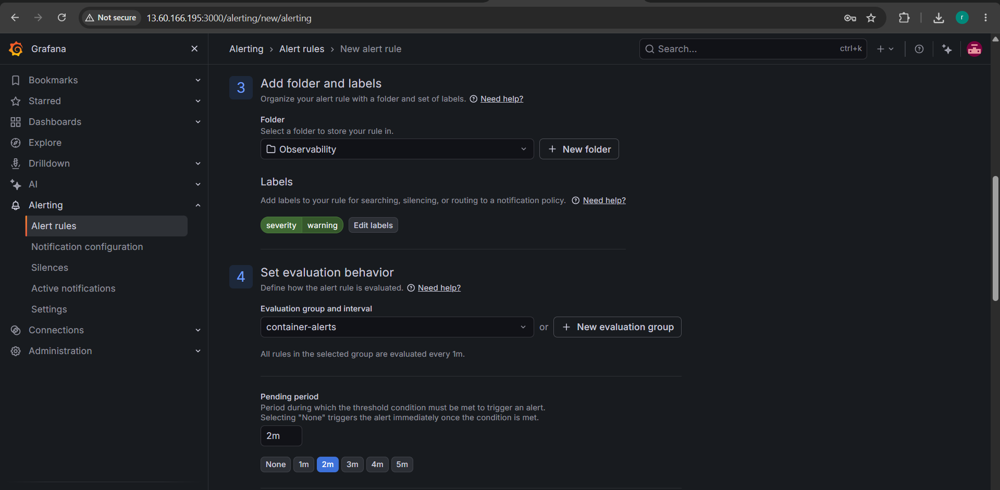

**Section 5: Configure notifications**

- Contact point: `DevOps Team`.

**Section 6: Message (optional)**

- Summary: `Container memory above 100MB`

Click **Save rule and exit**.

The rule page now shows state **Normal**, "Notifications are delivered to DevOps Team", evaluation every 1m, pending period 2m, and the label `severity=warning`.

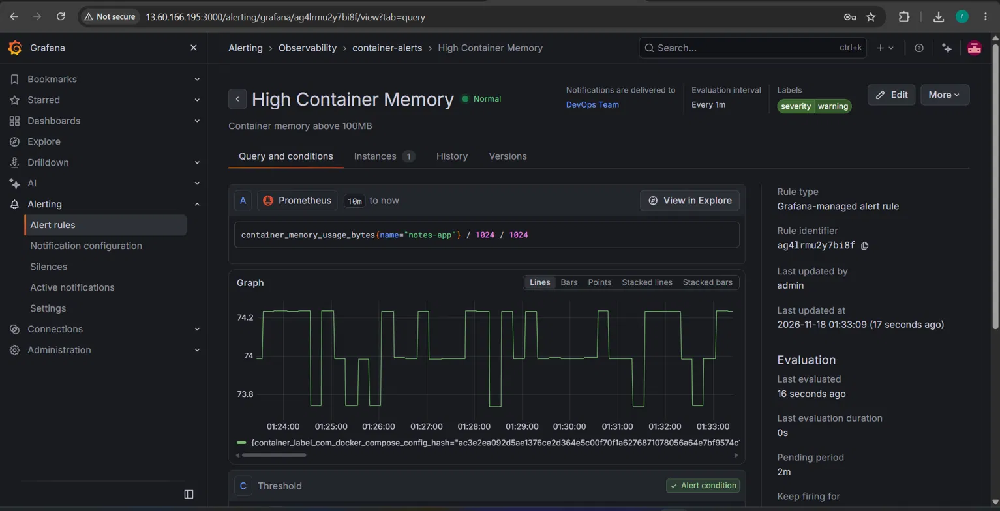

### Step 3: Create notification policies

Go to **Alerting > Notification configuration > Notification policies**.

**Part A: Set the default contact point**

The default policy was sending to an empty contact point (no integrations), so alerts went nowhere. Click **More > Edit** on the **Default policy**, set **Default contact point** to `DevOps Team`, and click **Update policy**.

**Part B: Add a nested policy for critical alerts**

First create a second contact point named `Critical Alerts` (email, any address). Then, on the default policy, click **+ Add route** and set:

| Field | Value |
|---|---|
| Label | `severity` |
| Operator | `=` |
| Value | `critical` |
| Contact point | `Critical Alerts` |

Click **Save policy**.

**How the routing works now:**

- Alert with `severity=critical` goes to **Critical Alerts**.
- Every other alert (for example our `High Container Memory` with `severity=warning`) goes to the default, **DevOps Team**.

> **Common mistake:** **More > Edit** on the default policy changes the default route for **all** alerts. **+ Add route** creates a **nested** policy that applies only to alerts matching the label. Do not mix them up.

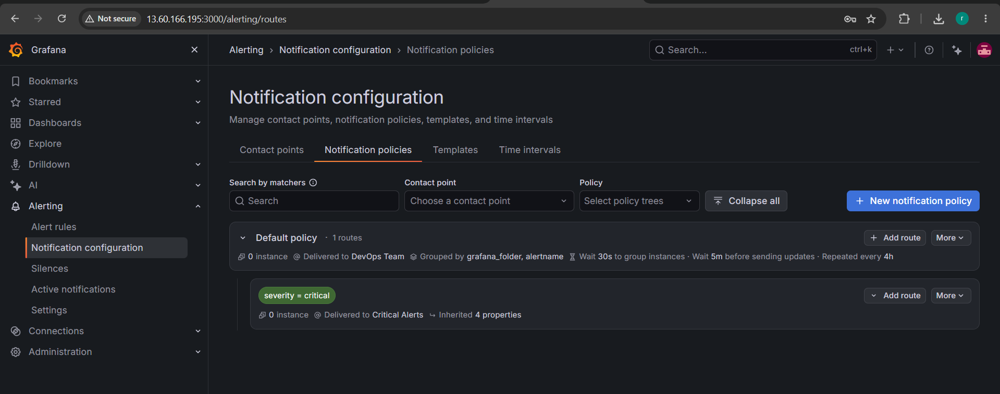

### Step 4: View the alert state

Go to **Alerting > Alert rules**. Open `Observability > container-alerts > High Container Memory`.

Grafana states match the Prometheus states:

| Prometheus | Grafana |
|---|---|
| inactive | Normal |
| pending | Pending |
| firing | Firing |

The memory is about 74 MB and the threshold is 100 MB, so the rule is **Normal**.

> The same page also lists the five Prometheus rules from Task 4 (`system-alerts`). Grafana reads them from the Prometheus data source and shows them next to its own Grafana-managed rules.

### Optional: Force the alert to fire

To see Pending and Firing:

1. Edit the rule and change the threshold from `100` to `50`.
2. Wait 2 to 3 minutes. The state goes Normal, then Pending, then **Firing** (74 MB is above 50 MB and the pending period is 2 minutes).
3. **Change the threshold back to 100** and save, so the alert does not stay firing.

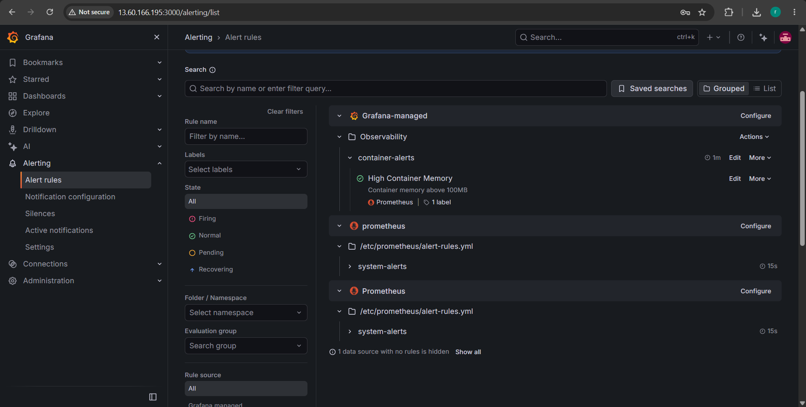

### Prometheus alerts vs Grafana alerts

| Topic | Prometheus alerts | Grafana alerts |
|---|---|---|
| Where defined | YAML rule files (easy to keep in Git) | Grafana UI, API or provisioning |
| Who evaluates | Prometheus server | Grafana server |
| Data sources | Prometheus only (PromQL) | Many: Prometheus, Loki, CloudWatch, SQL and more |
| Notifications | Needs a separate component, **Alertmanager** | Built in (contact points and policies) |
| Setup | Code based, a bit more work | Visual, quick |
| Version control | Easy (it is a file) | Harder (needs provisioning) |

**When to use which:**

- **Prometheus alerts:** core infrastructure alerts (CPU, disk, target down), when you want rules in Git (GitOps), or when alerts must keep working even if Grafana is down.
- **Grafana alerts:** when you need alerts on many data sources in one place (metrics plus logs), want quick UI setup, or want easy routing to Slack, email and so on.

---

## Task 6: Review the full stack architecture

The stack now covers all three pillars.

```
                 METRICS PIPELINE
[Node Exporter] ------> [Prometheus] ------> [Grafana Dashboards]
[cAdvisor] ----------> [Prometheus] ------> [Grafana Dashboards]
[OTEL Collector:8889]-> [Prometheus] ------> [Grafana Dashboards]
                                      ------> [Alert Rules -> Notifications]

                 LOGS PIPELINE
[Docker Containers] -> [Promtail] -> [Loki] -> [Grafana Explore/Dashboards]

                 TRACES PIPELINE
[curl/App OTLP] -----> [OTEL Collector] -> [Debug Output / Future: Jaeger/Tempo]
```

**Pull vs push (important to remember):**

- **Prometheus pulls.** It goes to Node Exporter, cAdvisor and the Collector and collects metrics.
- **Promtail and OTEL push.** Promtail pushes logs to Loki. Apps push OTLP data to the Collector.

**Services running:**

| Service | Port | Purpose |
|---|---|---|
| Prometheus | 9090 | Metrics storage and querying |
| Node Exporter | 9100 | Host system metrics |
| cAdvisor | 8080 | Container metrics |
| Grafana | 3000 | Visualization and alerting |
| Loki | 3100 | Log storage |
| Promtail | 9080 | Log collection agent (internal, not published) |
| OTEL Collector | 4317 / 4318 / 8889 | Telemetry collection |
| Notes App | 8000 | Sample application |

Verify that all 8 containers are running:

```bash
docker compose ps
```

All containers must be `Up`. cAdvisor may show `(health: starting)` for a short time, which is normal.

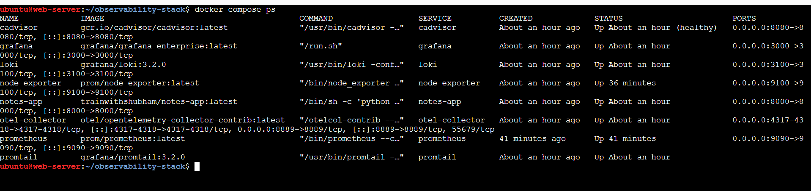

---

## Troubleshooting

| Problem | Likely cause and fix |
|---|---|
| `docker compose config` shows an error | YAML indentation is wrong. Use spaces, not tabs. |
| `otel-collector` is `Restarting` or `Exited` | Config error. Run `docker logs otel-collector`. |
| `curl: (7) Failed to connect` | Collector is not running, or the port is wrong. |
| `test_requests_total` is empty | Wait 15 to 30 seconds for the next scrape. |
| Prometheus does not start after the rules change | The rules file is not mounted, or the path in `rule_files` is wrong. |
| Grafana page does not open | Open the port (3000, 9090) in the AWS Security Group. Prefer **My IP**, not `0.0.0.0/0`. |
| Rules page in Grafana looks empty with a filter | Clear the filter on the Notification policies page. |
| Grafana email is not delivered | SMTP is not configured. Use Slack or Webhook, or configure SMTP. |
| `notes-app` target is DOWN | The sample app has no `/metrics` endpoint. Expected in this lab. |

## What I learned

- OpenTelemetry is a vendor-neutral standard for metrics, logs and traces. It is not a backend.
- The OTEL Collector works as Receivers, then Processors, then Exporters, and OTLP uses ports 4317 (gRPC) and 4318 (HTTP).
- A trace is made of spans linked by a trace ID and parent span IDs.
- Prometheus alert rules use `expr`, `for`, `labels` and `annotations`, and move from inactive to pending to firing.
- Grafana alerting uses contact points, alert rules and notification policies, and labels route alerts to the right place.
- Metrics, logs and traces together give a full picture: what is wrong, what happened, and where.
