# Day 77 - Observability Project: Full Stack with Docker Compose

> **One command. Eight-plus services. Metrics, logs and traces in one Grafana.**

In Days 73 to 76 we built the pieces one by one (Prometheus, Node Exporter, cAdvisor, Grafana, Loki, Promtail, OpenTelemetry Collector, alerting). On Day 77 we put everything together using a **ready-made reference repository**, check that every data flow works end to end, build one unified dashboard, and compare it with what we built ourselves.

This guide is written so that **anyone who has never seen Day 77 can follow it step by step and practice it**. Every command is explained: what it is, why we run it, and what output to expect.

---

## Table of Contents

1. [What You Will Learn](#1-what-you-will-learn)
2. [Basic Concepts (Read This First)](#2-basic-concepts-read-this-first)
3. [Architecture: How Data Flows](#3-architecture-how-data-flows)
4. [Prerequisites](#4-prerequisites)
5. [Task 1: Clone and Launch the Reference Stack](#task-1-clone-and-launch-the-reference-stack)
6. [Task 2: Validate the Metrics Pipeline](#task-2-validate-the-metrics-pipeline)
7. [Task 3: Validate the Logs Pipeline](#task-3-validate-the-logs-pipeline)
8. [Task 4: Validate the Traces Pipeline](#task-4-validate-the-traces-pipeline)
9. [Task 5: Build the "Production Overview" Dashboard](#task-5-build-the-production-overview-dashboard)
10. [Task 6: Compare With the Reference and Document](#task-6-compare-with-the-reference-and-document)
11. [Cleanup](#cleanup)
12. [Troubleshooting Cheat Sheet](#troubleshooting-cheat-sheet)
13. [Key Takeaways](#key-takeaways)

---

## 1. What You Will Learn

- How to run a complete observability stack with a single `docker compose up -d`.
- How to confirm that **metrics**, **logs** and **traces** each reach their storage.
- How to write basic **PromQL** (for metrics) and **LogQL** (for logs).
- How to send a **manual trace** to the OpenTelemetry Collector and find it in Tempo.
- How to build a **single dashboard** that shows the whole system.
- How to read a config file and compare two setups like a DevOps engineer.

---

## 2. Basic Concepts (Read This First)

### What is observability?

Observability means: **"Can I understand what is happening inside my application just by looking at the data it produces?"**

It stands on three pillars:

| Pillar | What it is | Simple example | Tool in this project |
|---|---|---|---|
| **Metrics** | Numbers over time | CPU is 4%, memory is 60% | Prometheus |
| **Logs** | Text messages written by apps | `Not Found: /favicon.ico` | Loki |
| **Traces** | The journey of one request through the system | A web request that called a database | Tempo |

Grafana is the **single window** where we look at all three.

### The services in the stack

| Service | Port | Job in simple words |
|---|---|---|
| **Prometheus** | 9090 | Collects (scrapes) metrics from other services and stores them |
| **Node Exporter** | 9100 | Reports the **host machine** metrics (CPU, RAM, disk) |
| **cAdvisor** | 8080 | Reports **container** metrics (CPU, memory per container) |
| **Grafana** | 3000 | Dashboards. Shows metrics, logs and traces |
| **Loki** | 3100 | Stores logs |
| **Tempo** | 3200 | Stores traces |
| **OpenTelemetry (OTEL) Collector** | 4317 / 4318 | Receives telemetry from apps and forwards each type to the right place |
| **Alertmanager** | 9093 | Decides where alerts go (email, Slack, etc.) |
| **Notes App** | 8000 | A sample Django + React app that we monitor |

> The task text says "8 services". The reference repo we used actually runs **9 containers** (it adds Alertmanager and Tempo, and has no Promtail). This is normal.

### Developer files vs DevOps files

- **Developers** write the application: `notes-app/` (Django backend in `api/`, React frontend in `mynotes/`).
- **DevOps** writes how to run and watch the app: `docker-compose.yml`, `prometheus.yml`, `loki/`, `otel-collector/`, `tempo/`, `grafana/provisioning/`, `alertmanager/`, `Jenkinsfile`, `Dockerfile`.

In this project, **your job is the DevOps part**. The notes app is just a sample to monitor.

---

## 3. Architecture: How Data Flows

```
                        +-------------------+
                        |     Notes App     |
                        |  (Django, :8000)  |
                        +---------+---------+
                                  | OTLP (metrics, logs, traces)
                                  v
                        +-------------------+
                        |  OTEL Collector   |
                        |  :4317 gRPC       |
                        |  :4318 HTTP       |
                        +----+----+----+----+
                 metrics     |    |    |     logs
              (port 8889)    |    |    |  (/otlp)
                   +---------+    |    +---------+
                   v              | traces       v
           +--------------+       v       +--------------+
           |  Prometheus  |  +---------+  |     Loki     |
           |    :9090     |  |  Tempo  |  |    :3100     |
           +------+-------+  |  :3200  |  +------+-------+
                  ^          +----+----+         |
   scrapes        |               |              |
 Node Exporter    |               |              |
 cAdvisor, etc.   +-------+-------+--------------+
                          v
                  +---------------+
                  |    Grafana    |   <- you look here
                  |     :3000     |
                  +---------------+
```

Key idea: **Prometheus pulls** metrics (it goes and scrapes). The **app pushes** logs and traces to the Collector, and the Collector forwards them.

---

## 4. Prerequisites

- A Linux server (this guide used an **AWS EC2 Ubuntu** instance named `web-server`).
- **Docker** and **Docker Compose v2** installed (`docker compose version` should work).
- `git` installed.
- If your server is on AWS: open these ports in the **Security Group** (Inbound rules) so your browser can reach them. Set Source to **My IP**, not `0.0.0.0/0`:

| Port | For |
|---|---|
| 3000 | Grafana |
| 9090 | Prometheus |
| 8080 | cAdvisor |
| 8000 | Notes App |

> **Important:** On a cloud server, `localhost` in your laptop's browser will not work. Use the server's **Public IP**: `http://<PUBLIC-IP>:3000`. Commands typed inside the server terminal can still use `localhost`.
>
> To get the public IP from the server: `curl -s ifconfig.me`. Note that a stopped and restarted EC2 instance **gets a new public IP**.

Throughout this document, replace `<PUBLIC-IP>` with your own IP.

---

# Task 1: Clone and Launch the Reference Stack

## What
Download the reference project and start all services with one command.

## Why
Installing eight tools one by one would take a long time. Docker Compose reads one file (`docker-compose.yml`) and starts everything together. This is exactly how DevOps engineers run multi-service systems.

## Step 1.1: Clone the repository

```bash
git clone https://github.com/LondheShubham153/observability-for-devops.git
cd observability-for-devops
```

| Part | Meaning |
|---|---|
| `git clone <url>` | Downloads a copy of the project from GitHub to your machine |
| `cd observability-for-devops` | Moves into the downloaded folder |

## Step 1.2: Look at the project structure

```bash
tree -I 'node_modules|build|staticfiles|__pycache__'
```

| Part | Meaning |
|---|---|
| `tree` | Shows folders and files in a tree shape |
| `-I '...'` | **I**gnore these folders (they are huge and not useful here) |

If you get `tree: command not found`, install it: `sudo apt install tree` (Ubuntu) or `brew install tree` (Mac).

**Output (screenshots):**

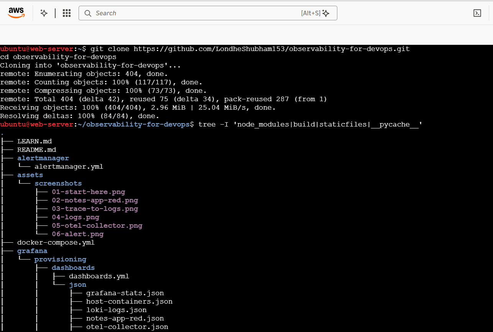
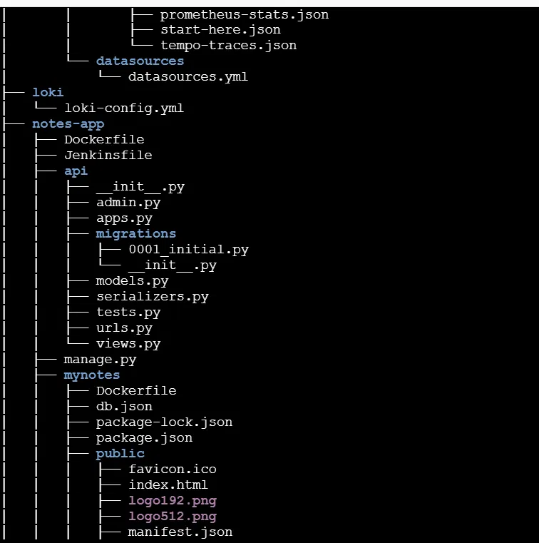
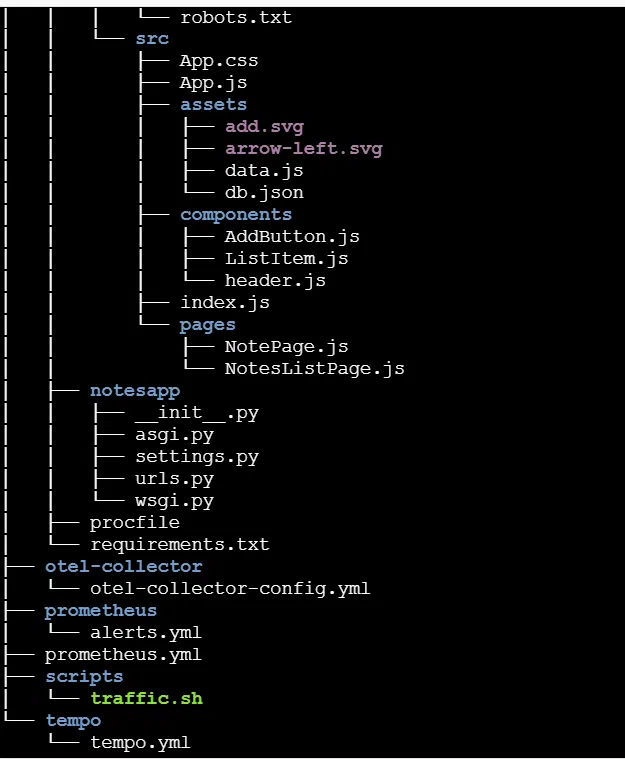

### What each folder/file does

| Path | Purpose |
|---|---|
| `docker-compose.yml` | Defines all services and how they connect |
| `prometheus.yml` | Tells Prometheus **what to scrape** and how often |
| `prometheus/alerts.yml` | Alert rules (for example "CPU too high") |
| `alertmanager/alertmanager.yml` | Where alerts get sent |
| `loki/loki-config.yml` | How Loki stores logs |
| `tempo/tempo.yml` | How Tempo stores traces |
| `otel-collector/otel-collector-config.yml` | Receivers, processors and exporters of the Collector |
| `grafana/provisioning/datasources/datasources.yml` | Connects Grafana to Prometheus, Loki, Tempo automatically |
| `grafana/provisioning/dashboards/` | Ready-made dashboards loaded automatically |
| `scripts/traffic.sh` | Script to generate test traffic |
| `notes-app/` | The sample application (written by developers) |

> Note: this repo has **no `promtail/` folder**. Logs reach Loki through the OTEL Collector instead. We will see this again in Task 3.

## Step 1.3: Start the whole stack

```bash
docker compose up -d
```

| Part | Meaning |
|---|---|
| `docker compose up` | Read `docker-compose.yml`, create networks/volumes, and start every service |
| `-d` | **Detached**: run in the background so the terminal stays free |

What happens: Docker **pulls** ready images from the internet and **builds** the `notes-app` image locally from its `Dockerfile`. The first run takes a few minutes.

### A warning that looks scary but is harmless

```
! Image notes-app:latest  pull access denied for notes-app, repository does not exist or may require 'docker login'
```

**Meaning:** Docker first tried to download `notes-app:latest` from Docker Hub. That image does not exist online because we build it ourselves. Docker then **built it locally** (you will see `Built` at the end). So this is **only a warning, not an error**.

**Output (screenshots):**

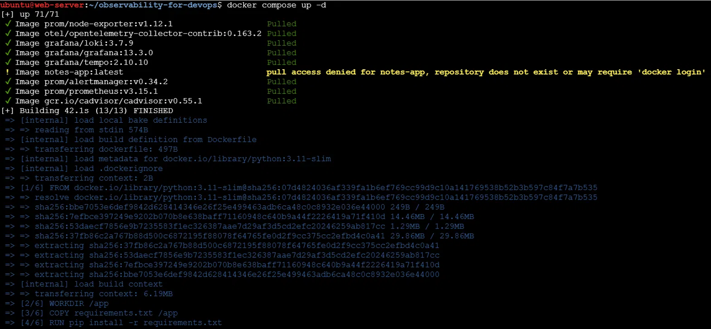
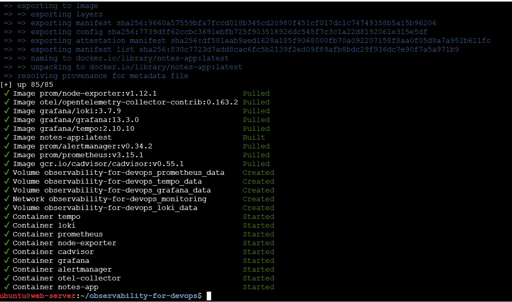

## Step 1.4: Check that containers are running

```bash
docker compose ps
```

`ps` lists the containers of this compose project. Look at the **STATUS** column: every container should say `Up ...`. If one says `Exited` or `Restarting`, it crashed.

Expected containers: `alertmanager`, `cadvisor`, `grafana`, `loki`, `node-exporter`, `notes-app`, `otel-collector`, `prometheus`, `tempo` (9 total).

**Output:**

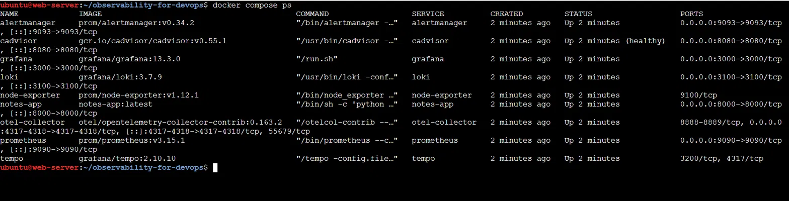

## Step 1.5: Health-check each service from the terminal

"Up" only means the container started. These commands prove the service actually **responds**.

```bash
curl -s http://localhost:3100/ready
curl -s http://localhost:9090/-/healthy
docker compose exec prometheus wget -qO- http://node-exporter:9100/metrics | head -5
```

| Command | Meaning |
|---|---|
| `curl -s <url>` | Send an HTTP request. `-s` = silent (no progress bar) |
| `.../ready` (Loki) | Loki's readiness endpoint |
| `.../-/healthy` (Prometheus) | Prometheus health endpoint |
| `docker compose exec prometheus ...` | Run a command **inside** the prometheus container |
| `wget -qO- <url>` | Download a URL and print it to the screen (like curl) |
| `\| head -5` | Show only the first 5 lines |

### What you should see and two gotchas

| Check | Expected | Note |
|---|---|---|
| Loki | `ready` | Right after start it says `Ingester not ready: waiting for 15s after being ready`. **Wait about 20 seconds and run it again.** |
| Prometheus | `Prometheus Server is Healthy.` | |
| Node Exporter | `# HELP go_gc_duration_seconds ...` lines | `curl localhost:9100` on the host prints **nothing**, because in this repo Node Exporter's port is **not published** to the host (`expose` only). Other containers (like Prometheus) can still reach it over the Docker network as `node-exporter:9100`. That is why we test from inside the prometheus container. |

**Output:**

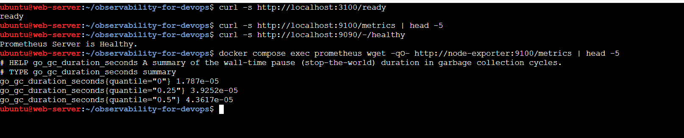

## Step 1.6: Open the UIs in the browser

URLs (use your public IP):

| Service | URL |
|---|---|
| Prometheus | `http://<PUBLIC-IP>:9090` |
| Grafana | `http://<PUBLIC-IP>:3000` (login `admin` / `admin`, you can skip the password change) |
| cAdvisor | `http://<PUBLIC-IP>:8080` |
| Notes App | `http://<PUBLIC-IP>:8000` |

Use `http://`, not `https://` (there is no TLS in this setup).

If a page does not open: a **timeout** usually means a missing Security Group rule or a changed IP; **connection refused** means the container is not running.

**Output:**

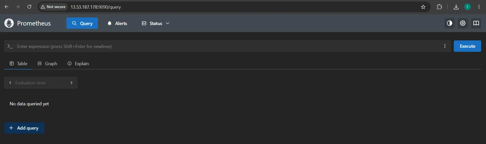
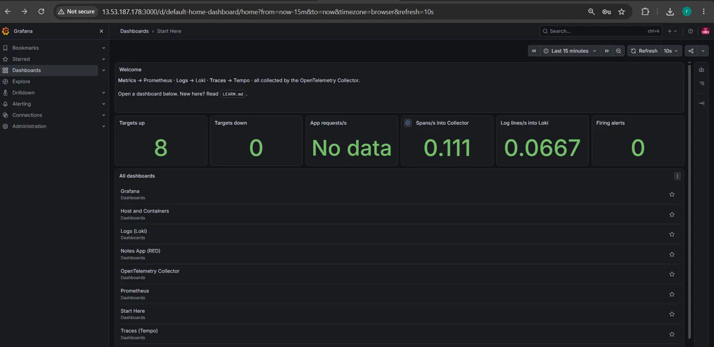
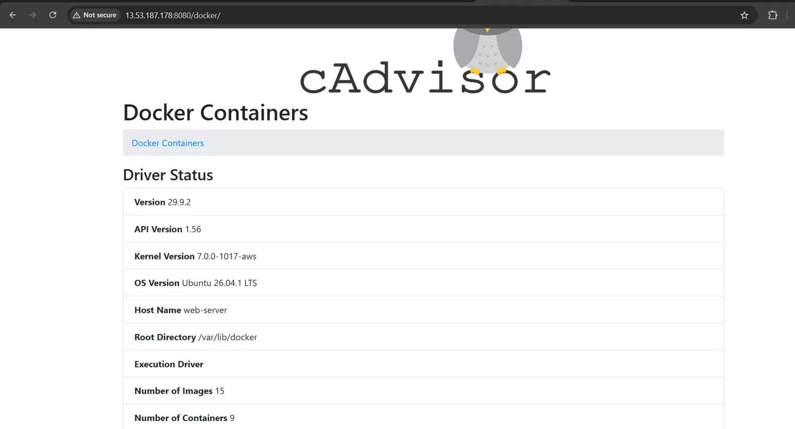
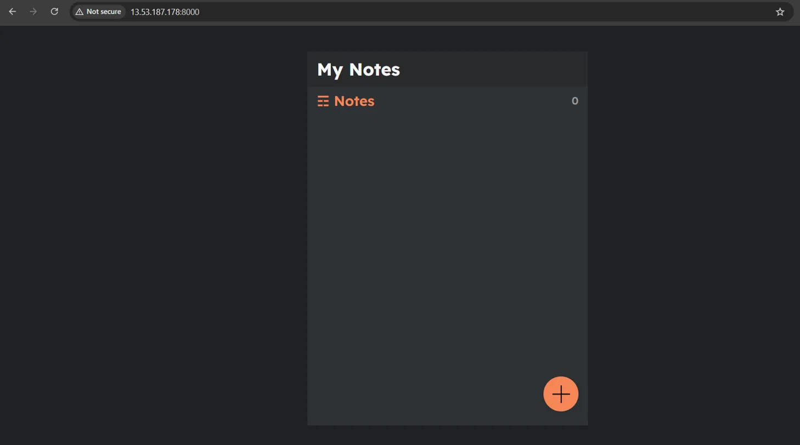

## Step 1.7: Check the OTEL Collector logs

```bash
docker logs otel-collector 2>&1 | tail -20
```

| Part | Meaning |
|---|---|
| `docker logs <name>` | Print everything the container wrote to its log |
| `2>&1` | Merge error output and normal output together |
| `\| tail -20` | Show only the last 20 lines |

Look for these lines: `Starting GRPC server` (port 4317), `Starting HTTP server` (port 4318) and `Everything is ready. Begin running and processing data.` No `error` or `failed` lines means the Collector is healthy.

**Output:**

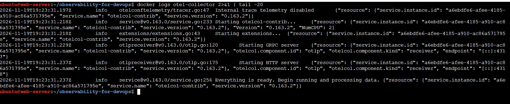

**Task 1 result:** all 9 containers are running, all UIs open, and Grafana's home dashboard shows `Targets up = 8`.

---

# Task 2: Validate the Metrics Pipeline

## What
Confirm that Prometheus is really scraping every target, then run PromQL queries to see host and container metrics.

## Why
"Target UP" proves scraping works. Queries prove that the **data is stored and can be read**, which is what dashboards rely on.

## Step 2.1: Check scrape targets

Open `http://<PUBLIC-IP>:9090/targets`.

A **target** is one thing Prometheus scrapes. A **job** is a group of targets. The task asks for four jobs to be UP: `prometheus`, `node-exporter`, `cadvisor` and `otel-collector`. This reference setup shows **8 jobs** (it also scrapes `otel-collector-internal`, `grafana`, `loki` and `tempo`). All were `1 / 1 up`.

**Output:**

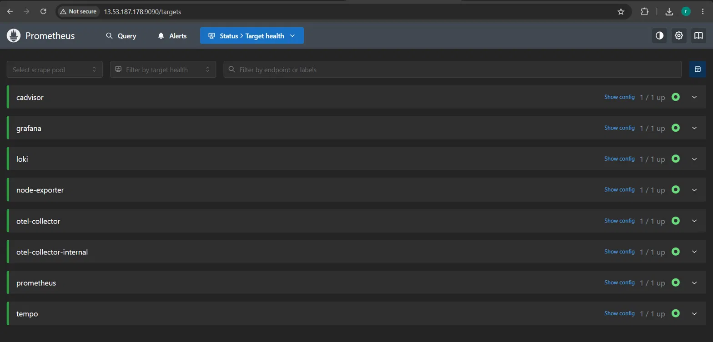

## Step 2.2: Run the validation queries

Open `http://<PUBLIC-IP>:9090/query`, paste a query, click **Execute**, and look at the **Table** tab.

### Query 1: Are all targets healthy?

```
up
```

`up` is a built-in metric: `1` means the target is UP, `0` means DOWN. Result: **8 series, each with value 1**.

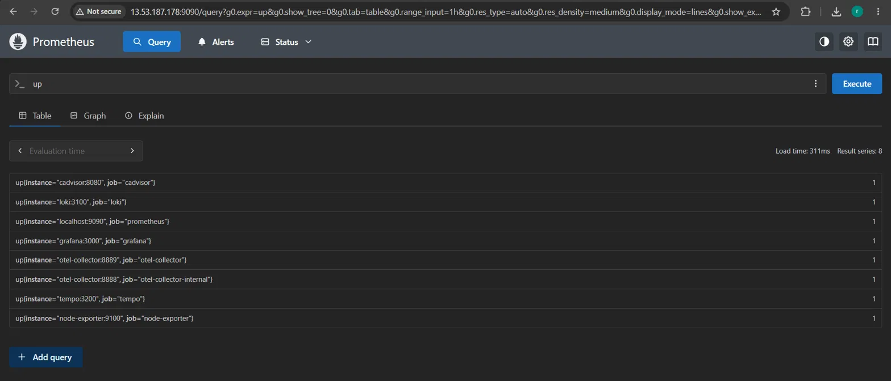

### Query 2: Host CPU usage (%)

```
100 - (avg(rate(node_cpu_seconds_total{mode="idle"}[5m])) * 100)
```

| Part | Meaning |
|---|---|
| `node_cpu_seconds_total{mode="idle"}` | Total seconds the CPU spent idle (doing nothing) |
| `rate(...[5m])` | How fast it grew per second over the last 5 minutes |
| `avg(...)` | Average across all CPU cores |
| `100 - (... * 100)` | Idle percent flipped to **used** percent |

Result: about **4.23** (about 4% CPU used, the server is quiet).

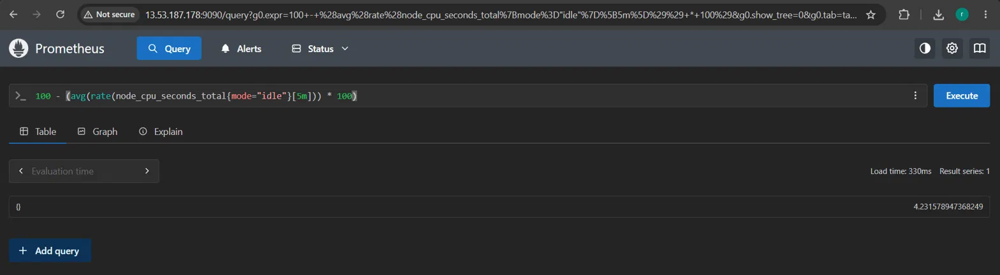

### Query 3: Memory usage (%)

```
(1 - node_memory_MemAvailable_bytes / node_memory_MemTotal_bytes) * 100
```

`MemAvailable / MemTotal` is the free fraction. `1 - that` is the used fraction. Times 100 makes a percent. Result: about **59.5%** (normal with 9 containers running).

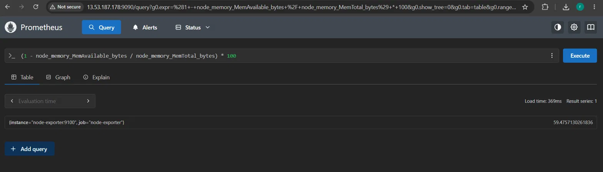

### Query 4: Container CPU per container (task version)

```
rate(container_cpu_usage_seconds_total{name!=""}[5m]) * 100
```

### Query 5: Top 3 memory-hungry containers (task version)

```
topk(3, container_memory_usage_bytes{name!=""})
```

### Problem: Queries 4 and 5 returned "Empty query result"

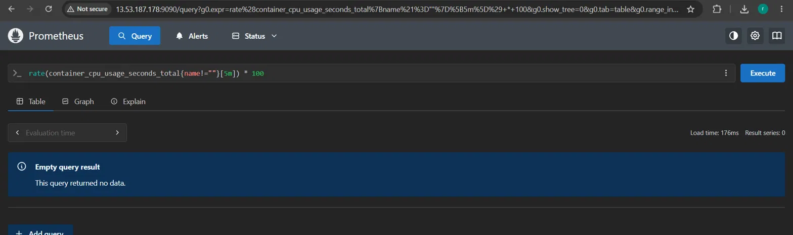
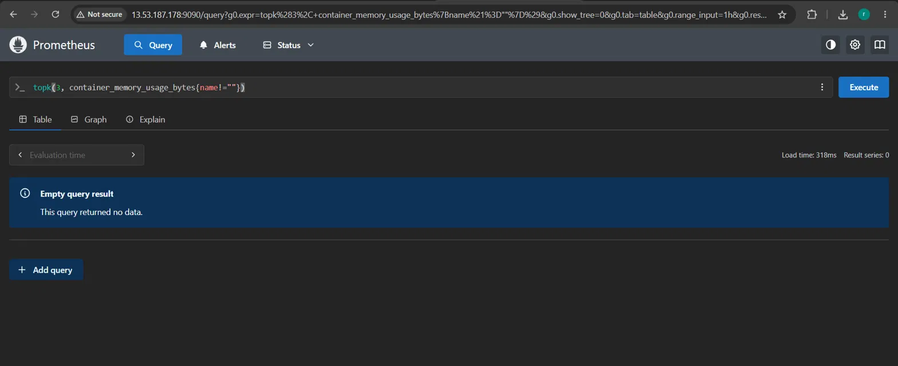

**Why?** `{name!=""}` means "only series that have a `name` label". On this server (newer Docker + cAdvisor), cAdvisor does **not** attach a `name` label. We confirmed this by running the metric with no filter:

```
container_memory_usage_bytes
```

It returned 58 series, each with only the labels `id`, `instance` and `job`. The container appears inside `id`, like `/system.slice/docker-<long-id>.scope`.

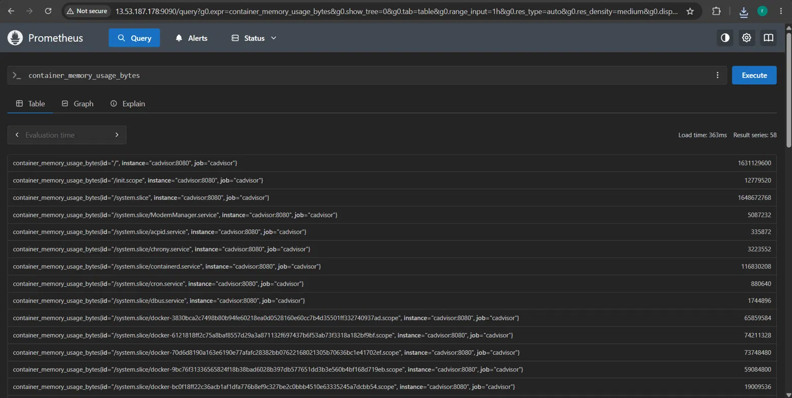

### The fix: filter by `id` with a regex

`=~` means "matches this regular expression". `.*docker.*scope` matches only real Docker containers (system services like `cron.service` are skipped).

```
rate(container_cpu_usage_seconds_total{id=~".*docker.*scope"}[5m]) * 100
```

```
topk(3, container_memory_usage_bytes{id=~".*docker.*scope"})
```

Result: **9 rows** for CPU (all 9 containers, each under about 2%), and the top 3 memory users were about 407 MB, 119 MB and 103 MB.

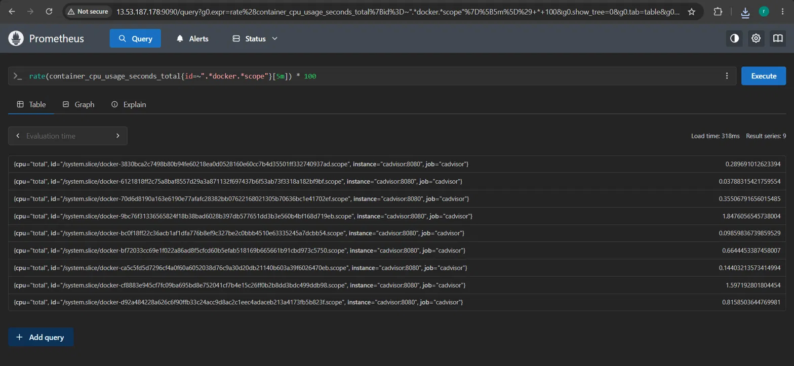
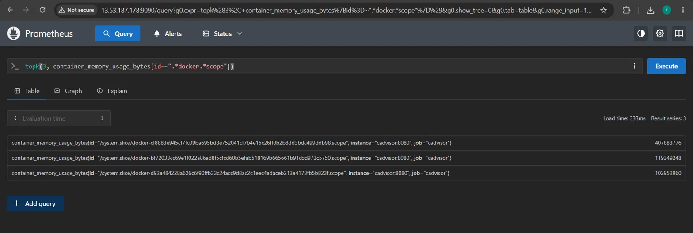

> Lesson: when a query returns nothing, **remove the filter and look at the real labels**. Then adjust the query.

## Step 2.3: Compare `prometheus.yml` (reference vs Day 73-76)

Show the reference file: `cat prometheus.yml`.

| Item | Day 73-76 (mine) | Reference repo |
|---|---|---|
| `scrape_interval` | 15s | 15s |
| `evaluation_interval` | 15s | 15s |
| Jobs | prometheus, notes-app, node-exporter, cadvisor, otel-collector (5) | prometheus, cadvisor, node-exporter, otel-collector, otel-collector-internal, grafana, tempo, loki (8) |
| `notes-app:8000` job | Yes | No (app data comes through the Collector) |
| Self-monitoring of the stack (grafana, loki, tempo, collector health) | No | Yes |
| Rule file | `/etc/prometheus/alert-rules.yml` | `/etc/prometheus/alerts.yml` |
| `alerting:` block to Alertmanager | No | Yes (`alertmanager:9093`) |

**Takeaways:** intervals are the same. The reference also **monitors the monitoring tools themselves**, and it sends firing alerts to Alertmanager. Without an `alerting:` block, alerts would appear in Prometheus but never be delivered.

---

# Task 3: Validate the Logs Pipeline

## What
Generate some logs, then read them from Grafana using Loki and LogQL.

## Why
This proves the whole chain: app, collector, Loki, Grafana.

## Step 3.1: Generate traffic

```bash
for i in $(seq 1 50); do
  curl -s http://localhost:8000 > /dev/null
  curl -s http://localhost:8000/api/ > /dev/null
done
```

| Part | Meaning |
|---|---|
| `for i in $(seq 1 50)` | Loop 50 times |
| `curl -s http://localhost:8000` | Request the app home page |
| `curl -s .../api/` | Request the API |
| `> /dev/null` | Throw away the response, we only need the app to write logs |

No output is expected.

## Step 3.2: Open Grafana Explore with Loki

1. Open Grafana, click **Explore** in the left menu.
2. Choose the **Loki** datasource.
3. Switch the editor to **Code** mode, set the time range (for example Last 1 hour).

### Problem: the task labels do not exist here

The task queries use `{job="docker"}` and `{container_name="notes-app"}`. In the Grafana **Label browser** we got **"No labels found"** (a Grafana UI quirk), so we asked Loki directly:

```bash
curl -s http://localhost:3100/loki/api/v1/labels
curl -s http://localhost:3100/loki/api/v1/label/service_name/values
```

Output:

```
{"status":"success","data":["service_instance_id","service_name"]}
{"status":"success","data":["notes-app"]}
```

| Command | Meaning |
|---|---|
| `/loki/api/v1/labels` | Ask Loki for all label names it has |
| `/label/service_name/values` | Ask for all values of the `service_name` label |

**Why different labels?** In this repo logs come from the **OTEL Collector** (OpenTelemetry labels such as `service_name`), not from Promtail (which would add `job` and `container_name`). So we translate the queries:

| Task query | Query used here |
|---|---|
| `{job="docker"}` | `{service_name=~".+"}` |
| `{container_name="notes-app"}` | `{service_name="notes-app"}` |
| `{job="docker"} \|= "error"` | `{service_name=~".+"} \|= "error"` |
| `{container_name="notes-app"} \|= "GET"` | `{service_name="notes-app"} \|= "GET"` |
| `sum by (container_name) (rate({job="docker"}[5m]))` | `sum by (service_name) (rate({service_name=~".+"}[5m]))` |

(`=~".+"` is a regex meaning "any non-empty value". Loki needs at least one label matcher, so `{}` alone is not allowed.)

## Step 3.3: Run the LogQL queries

LogQL basics: `{labels}` selects log streams. `|= "text"` keeps only lines containing that text. `rate(...[5m])` turns log lines into "lines per second".

**Query 1: all logs**
```
{service_name=~".+"}
```
**Query 2: only notes-app logs**
```
{service_name="notes-app"}
```

Both returned logs such as `Not Found: /manifest.json`, `listed 0 notes` and `Not Found: /favicon.ico` (level WARN).

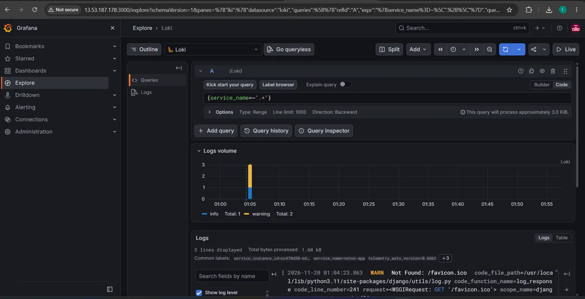
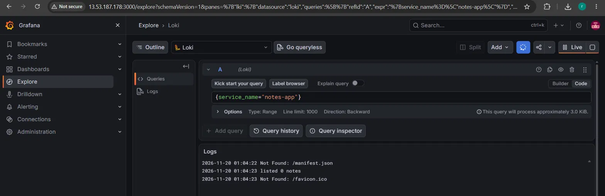

**Query 3: errors**
```
{service_name=~".+"} |= "error"
```
Result: **empty**. This is **expected**: the app never wrote the word "error" (only WARN and INFO).

**Query 4: GET requests**
```
{service_name="notes-app"} |= "GET"
```
Result: **empty**. Django does not write normal successful requests to its log (it logs only warnings and errors such as 404). The word `GET` appeared only inside metadata, not in the message text, and `|=` searches the message.

**Query 5: log rate per service**
```
sum by (service_name) (rate({service_name=~".+"}[5m]))
```
It was empty at first because the last logs were old. After creating fresh logs (requesting a page that does not exist produces a `Not Found` WARN log):

```bash
for i in $(seq 1 20); do curl -s http://localhost:8000/does-not-exist > /dev/null; done
```

the graph showed a line for `notes-app` (about 0.07 lines per second).

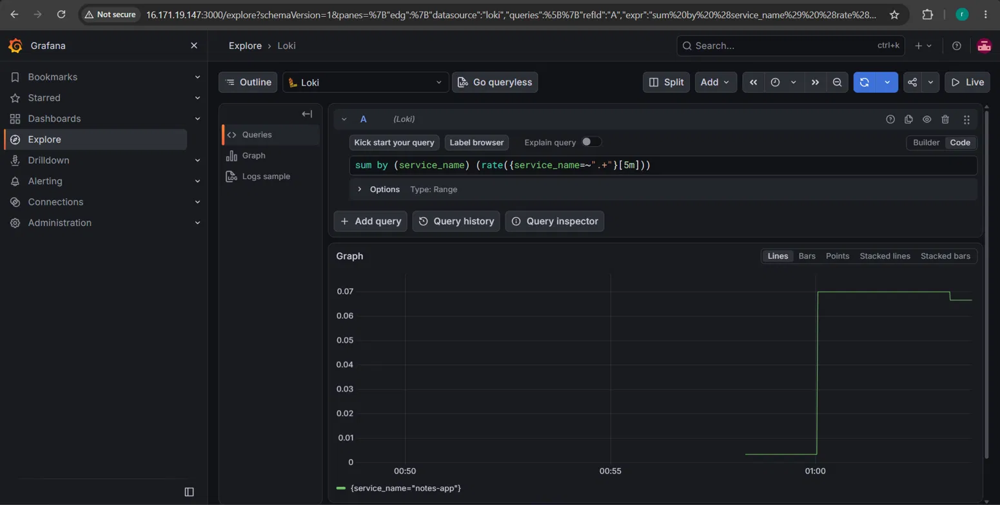

## Step 3.4: Promtail check

The task asks:

```bash
curl -s http://localhost:9080/targets | head -30
ls promtail
```

Result: **no output** and `ls: cannot access 'promtail': No such file or directory`. This **proves Promtail is not part of the reference stack**; the OTEL Collector ships the logs.

## Step 3.5: Compare Promtail (Day 75) vs the reference approach

My Day 75 `promtail-config.yml`:

```yaml
server:
  http_listen_port: 9080
positions:
  filename: /tmp/positions.yaml
clients:
  - url: http://loki:3100/loki/api/v1/push
scrape_configs:
  - job_name: docker
    static_configs:
      - targets: [localhost]
        labels:
          job: docker
          __path__: /var/lib/docker/containers/*/*-json.log
    pipeline_stages:
      - docker: {}
```

| Part | Meaning |
|---|---|
| `positions` | Remembers how far each file was read, so nothing is re-sent after a restart |
| `clients.url` | Where to push logs (Loki's push API) |
| `__path__` | Which files to read: the JSON log files of every Docker container |
| `labels.job: docker` | Why `{job="docker"}` worked on Day 75 |
| `pipeline_stages: docker` | Parses Docker's JSON log format |

| Topic | Day 75 (Promtail) | Reference (OTEL Collector) |
|---|---|---|
| Where logs come from | Reads Docker log files on the host | The app **pushes** logs via OTLP |
| Loki endpoint | `/loki/api/v1/push` | `/otlp` |
| Labels | `job="docker"` | `service_name`, `service_instance_id` |
| Covers | Every container | Only apps with OpenTelemetry (here notes-app) |
| Signals | Logs only | Logs, metrics and traces through one agent |
| Extra container | Yes (Promtail) | No |

Note: my Day 75 config never set a `container_name` label, so even then `{container_name="notes-app"}` would not have worked without extra config.

---

# Task 4: Validate the Traces Pipeline

## What
Send a handmade trace to the OTEL Collector and confirm it arrives in Tempo.

## Why
A **trace** shows one request's journey, made of **spans**. A **span** is one step with a start and an end time. A child span points to its parent with `parentSpanId`. This test proves: curl, Collector, Tempo.

## Step 4.1: Send the trace

```bash
curl -X POST http://localhost:4318/v1/traces \
  -H "Content-Type: application/json" \
  -d '{
    "resourceSpans": [{
      "resource": { "attributes": [{ "key": "service.name", "value": { "stringValue": "notes-app" } }] },
      "scopeSpans": [{
        "spans": [
          {
            "traceId": "aaaabbbbccccdddd1111222233334444",
            "spanId": "1111222233334444",
            "name": "GET /api/notes",
            "kind": 2,
            "startTimeUnixNano": "1700000000000000000",
            "endTimeUnixNano": "1700000000150000000",
            "attributes": [
              { "key": "http.method", "value": { "stringValue": "GET" } },
              { "key": "http.route", "value": { "stringValue": "/api/notes" } },
              { "key": "http.status_code", "value": { "intValue": "200" } }
            ],
            "status": { "code": 1 }
          },
          {
            "traceId": "aaaabbbbccccdddd1111222233334444",
            "spanId": "5555666677778888",
            "parentSpanId": "1111222233334444",
            "name": "SELECT notes FROM database",
            "kind": 3,
            "startTimeUnixNano": "1700000000020000000",
            "endTimeUnixNano": "1700000000120000000",
            "attributes": [
              { "key": "db.system", "value": { "stringValue": "sqlite" } },
              { "key": "db.statement", "value": { "stringValue": "SELECT * FROM notes" } }
            ]
          }
        ]
      }]
    }]
  }'
```

| Part | Meaning |
|---|---|
| `-X POST` | Send data (not just read) |
| `http://localhost:4318/v1/traces` | The Collector's OTLP **HTTP** endpoint for traces |
| `-H "Content-Type: application/json"` | Tell the server the body is JSON |
| `traceId` | Same for both spans, so they belong to one trace |
| `spanId` / `parentSpanId` | The second span's parent is the first span |
| `kind: 2` / `3` | 2 = SERVER (handles a request), 3 = CLIENT (calls something else, here the database) |
| `startTimeUnixNano` / `endTimeUnixNano` | Start and end times; first span = 150 ms, second = 100 ms inside it |

Expected response: `{"partialSuccess":{}}`. It means the Collector **accepted** the trace and rejected nothing.

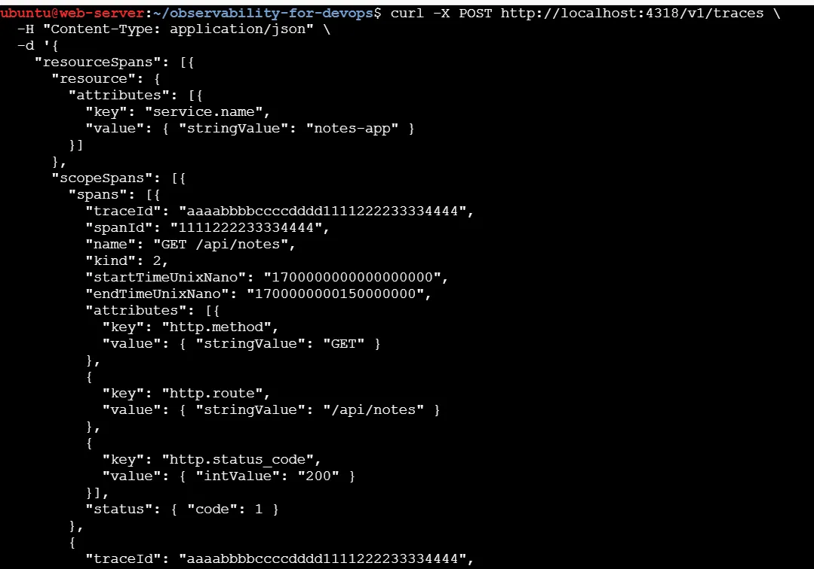
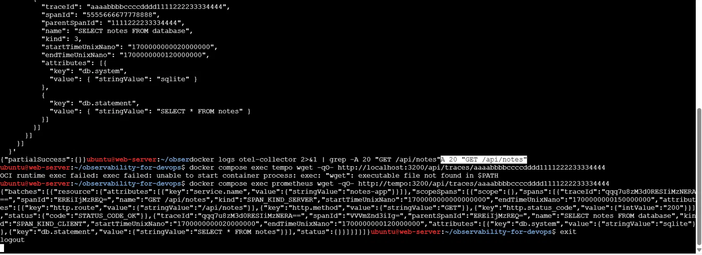

## Step 4.2: Debug output check (task version)

```bash
docker logs otel-collector 2>&1 | grep -A 20 "GET /api/notes"
```

`grep -A 20` prints the matching line plus the 20 lines after it. Result: **empty**. The reference Collector has **no `debug` exporter**, so spans are not printed into its log. (My Day 76 config does have `debug` exporters, so this command works there.)

## Step 4.3: Prove the trace reached Tempo

Tempo's image has no `wget` (`docker compose exec tempo wget ...` gives `executable file not found`), and its port 3200 is not published. So we ask Tempo **through the Prometheus container**, which has `wget` and is on the same Docker network:

```bash
docker compose exec prometheus wget -qO- http://tempo:3200/api/traces/aaaabbbbccccdddd1111222233334444
```

Result (shortened): JSON with `service.name = notes-app`, span `GET /api/notes` (SERVER), span `SELECT notes FROM database` (CLIENT) with a `parentSpanId`, correct timings and all attributes.

The IDs look different (for example `qqq7u8zM3d0RESIiMzNERA==`) because Tempo prints them in **base64**. It is the same ID in another form.

If you get 404, wait 30 seconds and retry (Tempo needs a moment).

## Step 4.4: Compare `otel-collector-config.yml`

My Day 76 file:

```yaml
receivers:
  otlp:
    protocols:
      grpc: { endpoint: 0.0.0.0:4317 }
      http: { endpoint: 0.0.0.0:4318 }
processors:
  batch:
exporters:
  prometheus: { endpoint: "0.0.0.0:8889" }
  debug: { verbosity: detailed }
service:
  pipelines:
    metrics: { receivers: [otlp], processors: [batch], exporters: [prometheus] }
    traces:  { receivers: [otlp], processors: [batch], exporters: [debug] }
    logs:    { receivers: [otlp], processors: [batch], exporters: [debug] }
```

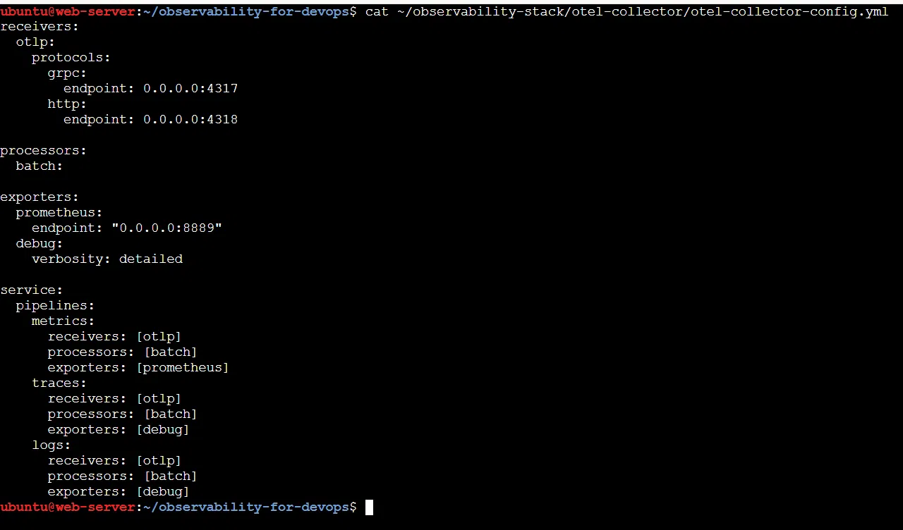

Reference file, in short: the same receiver and `batch`, but exporters are `prometheus` (metrics), `otlp_grpc/tempo` (`tempo:4317`, traces) and `otlp_http/loki` (`http://loki:3100/otlp`, logs), plus `service.telemetry` exposing the Collector's own metrics on port 8888.

| Pipeline | Day 76 | Reference |
|---|---|---|
| Metrics | otlp, batch, prometheus | Same |
| Traces | otlp, batch, **debug** (print only) | otlp, batch, **Tempo** (stored) |
| Logs | otlp, batch, **debug** (print only) | otlp, batch, **Loki** (stored) |
| Collector self-metrics (:8888) | No | Yes |

**Concept:** a Collector is **receivers** (how data comes in), **processors** (what is done to it, like batching) and **exporters** (where it goes), wired together by **pipelines**. Day 76 only printed traces and logs to the console; the reference stores them in real backends.

---

# Task 5: Build the "Production Overview" Dashboard

## What
One Grafana dashboard that shows system health, containers, logs and services.

## Why
In real life nobody opens five tools during an incident. One dashboard gives a "single pane of glass".

## How to create it
1. Grafana, **Dashboards**, **New**, **New dashboard**, **Add visualization**.
2. Pick a datasource, switch the query editor to **Code**, paste the query, click **Run queries**.
3. Choose the visualization type (on the right, **All visualizations**), set **Title** and **Unit**.
4. Go **Back to dashboard**, **Add**, **Visualization** for the next panel.

> **Important gotcha:** every **new panel starts with Prometheus**. For Loki panels you must change the **Data source** dropdown to **Loki** yourself. If you paste a LogQL query while Prometheus is selected you get `bad_data: ... parse error: unexpected character: '|'`. Also, switching a panel to Loki can switch its visualization to **Logs**, so re-select **Time series** where needed.

## Panels (with the queries that worked here)

### Row 1: System health (Prometheus)

| Panel | Type | Query | Settings |
|---|---|---|---|
| CPU Usage | Gauge | `100 - (avg(rate(node_cpu_seconds_total{mode="idle"}[5m])) * 100)` | Unit Percent (0-100), min 0, max 100 |
| Memory Usage | Gauge | `(1 - node_memory_MemAvailable_bytes / node_memory_MemTotal_bytes) * 100` | Same |
| Disk Usage | Gauge | `(1 - node_filesystem_avail_bytes{mountpoint="/"} / node_filesystem_size_bytes{mountpoint="/"}) * 100` | Same |
| Targets Up | Stat | `sum(up) / count(up)` | Unit Percent (0.0-1.0) so `1` shows as 100% |

### Row 2: Containers (Prometheus, cAdvisor)

| Panel | Type | Query (adjusted) |
|---|---|---|
| Container CPU | Time series | `rate(container_cpu_usage_seconds_total{id=~".*docker.*scope"}[5m]) * 100` |
| Container Memory (MB) | Bar chart | `container_memory_usage_bytes{id=~".*docker.*scope"} / 1024 / 1024` (if the bar chart complains, set the query type to **Instant**) |
| Container Count | Stat | `count(container_last_seen{id=~".*docker.*scope"})` |

(The task used `{name!=""}`; we use `id` because of the missing `name` label from Task 2.)

### Row 3: Application logs (Loki)

| Panel | Type | Query (adjusted) |
|---|---|---|
| App Logs | Logs | `{service_name="notes-app"}` |
| Error Rate | Time series | `sum(rate({service_name=~".+"} \|= "error" [5m]))` |
| Log Volume | Time series | `sum by (service_name) (rate({service_name=~".+"}[5m]))` |

Error Rate shows **No data**. That is correct: the app has no "error" lines. A panel with "No data" here means "no errors", which is good news.

### Row 4: Service overview (Prometheus)

| Panel | Type | Query |
|---|---|---|
| Prometheus Scrape Duration | Time series | `prometheus_target_interval_length_seconds{quantile="0.99"}` (unit seconds) |
| OTEL Metrics Received | Stat | `otelcol_receiver_accepted_metric_points_total` |

The task query `otelcol_receiver_accepted_metric_points` showed **No data**. Searching with `{job="otel-collector-internal", __name__=~"otelcol_receiver.*"}` revealed the real names end with **`_total`** (counters), so the `_total` name is used. Values seen: about 400 accepted metric points, with all `failed` and `refused` counters at 0.

If App Logs or Log Volume show "No data", the logs are simply older than the time range. Generate fresh logs (`curl localhost:8000/does-not-exist` in a loop) and refresh.

## Save and settings
- Title: **Production Overview -- Observability Stack**
- Time range: **Last 30 minutes**
- Auto refresh: **10s**
- Click **Save**, then **Exit edit** (the dashboard stays in edit mode until you do).

**Final output:**

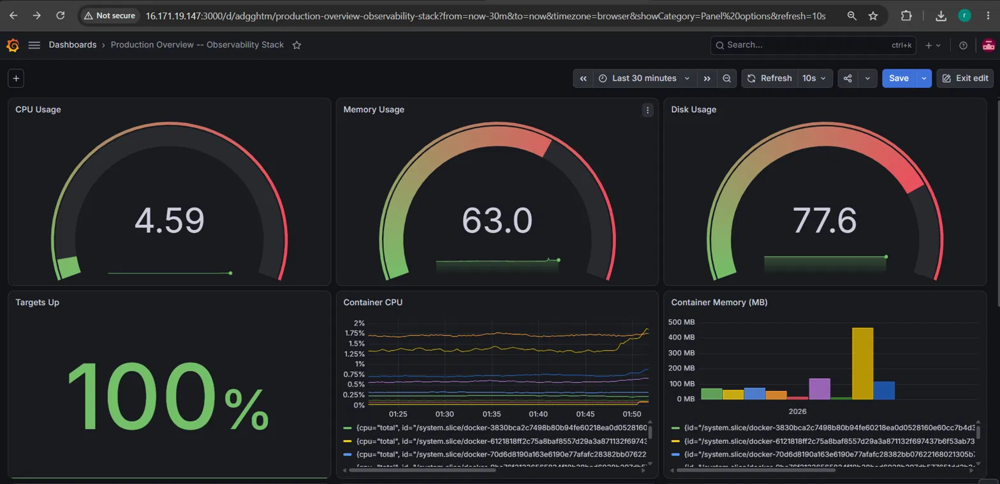
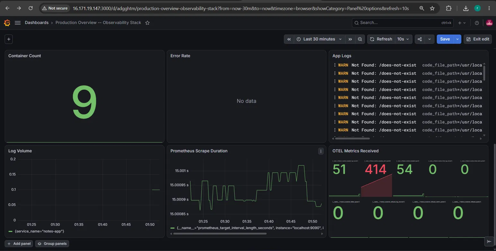

Seen values: CPU about 4.6%, Memory 63%, Disk 77.6%, Targets Up 100%, Container Count 9, Prometheus scrape interval about 15.0009 s (matches `scrape_interval: 15s`).

---

# Task 6: Compare With the Reference and Document

Files: `cat <file>` shows each one. Reference files are in the cloned repo; mine are from my Days 73-76 folder (`observability-stack`).

## 6.1 `prometheus.yml`
See the table in [Task 2, Step 2.3](#step-23-compare-prometheusyml-reference-vs-day-73-76).

## 6.2 `loki-config.yml`

| Setting | Day 75 | Reference |
|---|---|---|
| `auth_enabled` | false | false |
| Port | 3100 | 3100 |
| `path_prefix` | `/loki` | `/loki` |
| Replication factor | 1 | 1 (no high availability) |
| Ring kvstore | inmemory | inmemory |
| `instance_addr` | Not set | `127.0.0.1` |
| Where storage is set | `common.storage.filesystem` (chunks and rules dirs) | `storage_config.filesystem.directory: /loki/chunks` |
| Schema | tsdb, filesystem, v13, 24h index | Same |
| `limits_config.retention_period` | **168h (7 days)** | Not set |

Both store data on the **local disk**. Production normally uses object storage (S3 or GCS). One thing to know: in Loki, deleting old logs by retention usually also needs the **compactor** enabled. Neither file shows a compactor section, so verify retention really works before relying on it.

## 6.3 `promtail-config.yml`
See [Task 3, Step 3.5](#step-35-compare-promtail-day-75-vs-the-reference-approach). The reference has no Promtail at all.

## 6.4 `otel-collector-config.yml`
See [Task 4, Step 4.4](#step-44-compare-otel-collector-configyml).

## 6.5 `datasources.yml`

| Item | Day 74 | Reference |
|---|---|---|
| Number of datasources | 1 | 4 |
| Prometheus | Yes (default) | Yes (default) |
| Loki | No | Yes |
| Tempo | No | Yes |
| Alertmanager | No | Yes |
| Fixed `uid` | No (Grafana generates) | Yes (`prometheus`, `loki`, `tempo`, `alertmanager`) |
| `editable: false` | Yes | No |
| Trace to logs link (`tracesToLogsV2`) | No | Yes |

**Why `uid` matters:** provisioned dashboards refer to a datasource by uid; a fixed uid means dashboards never break. **Trace to logs:** from a span in Tempo you click a button and jump to the matching logs in Loki.

## 6.6 `docker-compose.yml`

| Service | Mine (Day 73-76) | Reference |
|---|---|---|
| prometheus, node-exporter, cadvisor, grafana, loki, otel-collector, notes-app | Yes | Yes |
| promtail | Yes | No |
| alertmanager | No | Yes |
| tempo | No | Yes |
| Total | 9 | 9 |

| Topic | Mine | Reference |
|---|---|---|
| Image tags | `:latest` | **Pinned** (for example `grafana:13.3.0`) |
| Grafana image / password | `grafana-enterprise:latest`, password in plain text in the file | `grafana:13.3.0`, default login |
| Notes app | Ready-made image, no telemetry | Built locally, sends OTLP to the Collector |
| Network | Default | Named `monitoring` network |
| Volumes | 3 | 4 (adds Tempo) |
| Config mounts | Mostly writable | Read-only (`:ro`) |
| Restart policy | Mixed | `unless-stopped` everywhere |
| Ports | Node Exporter and Collector's 8889 published | Internal services use `expose` only |
| Prometheus retention flags | `30d` and `1GB` | Default |
| Dashboards provisioning | No | Yes, with a home dashboard |

**Lessons:** `:latest` can break a working setup on the day an image updates; pin versions. Keep configs read-only. Expose only the ports you really need.

## 6.7 Reflection: what I built on each day

| Day | What I built |
|---|---|
| 73 | Prometheus, PromQL, metrics fundamentals |
| 74 | Node Exporter, cAdvisor, Grafana dashboards |
| 75 | Loki, Promtail, LogQL, log-metric correlation |
| 76 | OTEL Collector, traces, alerting rules |
| 77 | Full stack integration, unified dashboard |

## 6.8 What I would add for production

| Addition | Why |
|---|---|
| **Alertmanager routing to Slack or PagerDuty** | Alerts must reach a human, not just sit in Prometheus |
| **Tempo for traces (replacing the debug exporter)** | The `debug` exporter only prints; Tempo stores and searches traces |
| **HTTPS/TLS on every endpoint** | Everything here is plain HTTP |
| **Authentication** on Grafana and Prometheus | Prometheus has no login by default; Grafana needs strong passwords or SSO |
| **Log retention and storage limits** | Disks fill up; set retention and size caps |
| **High availability** (multiple Prometheus/Loki replicas) | One copy means one failure takes monitoring down |
| Also: pinned versions, secrets from a secret manager, remote storage (S3), backups of dashboards as code | Reproducible and safe |

## 6.9 Compared with Datadog, New Relic and AWS CloudWatch

| Topic | This open-source stack | Managed (Datadog, New Relic, CloudWatch) |
|---|---|---|
| Cost | Software is free; you pay for servers and for the time of the team | Pay per host, metric or GB; can become expensive at scale |
| Setup effort | High (we configured everything) | Low (install an agent) |
| Maintenance | You upgrade, scale and back up | The vendor does it |
| Control and flexibility | Full control, open standards (OpenTelemetry, PromQL) | Less control, some vendor lock-in |
| Data ownership | Data stays with you | Data goes to the vendor |
| Features such as AI alerts, APM UI, support | Build or add yourself | Included |
| Scale and HA | Your responsibility | Built in |

Rule of thumb: small team or tight budget or need full control, choose the open-source stack. Small team that wants speed and has a budget, choose a managed service. Using **OpenTelemetry** keeps both options open.

---

## Cleanup

Only run this when you are finished exploring and have saved your screenshots and, if you want, exported the dashboard JSON (Grafana, dashboard, Export, Export as JSON).

```bash
docker compose down -v
```

| Part | Meaning |
|---|---|
| `docker compose down` | Stop and remove the containers and the network |
| `-v` | Also delete the **named volumes** (Prometheus, Grafana, Loki, Tempo data). **This cannot be undone, and your saved dashboard goes too.** |

Verify that everything is gone:

```bash
docker compose ps -a
docker ps -a
docker volume ls
```

All three should show empty lists. Run `down -v` in **each** compose project folder you started (for example the old `observability-stack` and the reference repo).

---

## Troubleshooting Cheat Sheet

| Problem | Reason | Fix |
|---|---|---|
| `pull access denied for notes-app` | The image is built locally, not on Docker Hub | Ignore; wait for `Built` |
| Page does not open in the browser | Security Group rule missing, or the public IP changed after a restart | Add inbound rules (My IP); check the new IP |
| `curl localhost:9100` prints nothing | Node Exporter port is not published | Test from inside: `docker compose exec prometheus wget -qO- http://node-exporter:9100/metrics` |
| Loki says `Ingester not ready` | It waits about 15 s after start | Wait and retry |
| Container queries are empty with `name!=""` | cAdvisor adds no `name` label here | Use `id=~".*docker.*scope"` |
| Loki label browser says "No labels found" | Grafana UI quirk | Check with `curl localhost:3100/loki/api/v1/labels` |
| `{job="docker"}` returns nothing | No Promtail; logs use `service_name` | Use `{service_name=~".+"}` |
| `grep "GET /api/notes"` is empty | No `debug` exporter in the reference Collector | Verify the trace in Tempo instead |
| `wget: executable file not found` in Tempo | Image has no wget | Run wget from the prometheus container |
| `bad_data ... unexpected character '\|'` in a panel | A LogQL query was sent to Prometheus | Set the panel's Data source to Loki |
| Panel shows "No data" for logs | Logs are older than the time range | Generate fresh logs and refresh |
| `otelcol_receiver_accepted_metric_points` has no data | Counter names end with `_total` | Use `..._total` |

---

## Key Takeaways

1. **Up does not mean working.** Always test the real response (health endpoints, queries).
2. **When a query is empty, remove filters and look at the real labels.** Then adapt.
3. **Reference solutions can differ from the task text.** Read the actual config (`cat`) instead of assuming.
4. The OTEL Collector is a single door for **metrics, logs and traces**, with receivers, processors, exporters and pipelines.
5. **Pin image versions, mount configs read-only, and expose only needed ports.**
6. A good dashboard answers "is everything OK?" in one glance. "No data" on an error panel can mean good news.

---

